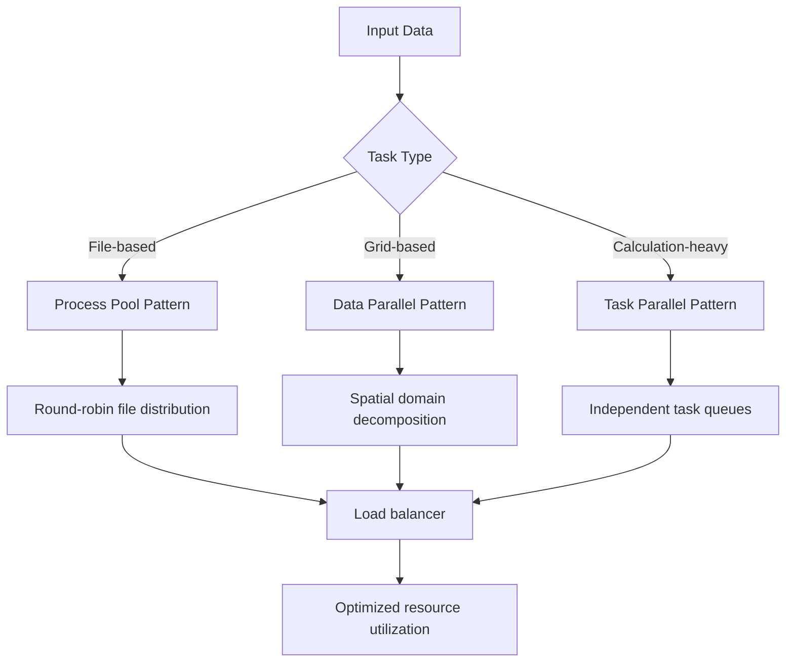

Gemmi provides several parallel processing approaches to handle computationally intensive crystallographic tasks efficiently. This documentation outlines the available strategies and their appropriate use cases for intermediate developers looking to optimize their workflows.

## Multiprocessing for Batch File Processing

The most straightforward parallel processing approach uses Python's multiprocessing module for batch processing of coordinate files. The library includes a dedicated example demonstrating asynchronous processing of multiple structure files:

```python
import multiprocessing
import sys
import gemmi

def f(path):
    st = gemmi.read_structure(path)
    weight = st[0].calculate_mass()
    return (st.name, weight)

def main(top_dir):
    with multiprocessing.Pool(processes=4) as pool:
        it = pool.imap_unordered(f, gemmi.CoorFileWalk(top_dir))
        for (name, weight) in it:
            print(f'{name} {weight / 1000:.1f} kDa')
```

This pattern is ideal for embarrassingly parallel tasks where multiple files can be processed independently, such as calculating structure properties, validating files, or extracting statistics across datasets [examples/multiproc.py#L1-L21].

## Grid-Based Parallel Operations

Gemmi's grid operations form the foundation for many computationally intensive calculations, particularly in electron density map processing and reciprocal space transformations. The grid infrastructure supports several parallelizable operations:

### Grid Interpolation and Transformation

Grid interpolation operations can be parallelized at the voxel level, particularly useful for large 3D density maps:

```python
m.def("interpolate_grid", &interpolate_grid<float>,
      nb::arg("dest"), nb::arg("src"), nb::arg("tr"), nb::arg("order")=1);
m.def("interpolate_grid_around_model", &interpolate_grid_around_model<float>,
      nb::arg("dest"), nb::arg("src"), nb::arg("tr"),
      nb::arg("dest_model"), nb::arg("radius"), nb::arg("order")=1);
```

These functions support parallel processing of grid points when working with large electron density maps or performing model-based interpolation [python/grid.cpp#L350-L357].

### Blob Detection and Flood Fill

Blob detection algorithms using flood fill can benefit from parallel processing, especially when processing large grids with multiple seed points:

```python
m.def("find_blobs_by_flood_fill",
      [](const Grid<float>& grid, double cutoff, double min_volume,
         double min_score, double min_peak, bool negate) {
     BlobCriteria crit;
     crit.cutoff = cutoff;
     crit.min_volume = min_volume;
     crit.min_score = min_score;
     crit.min_peak = min_peak;
     return find_blobs_by_flood_fill(grid, crit, negate);
  }, nb::arg("grid"), nb::arg("cutoff"), nb::arg("min_volume")=10.,
     nb::arg("min_score")=15., nb::arg("min_peak")=0., nb::arg("negate")=false);
```

The flood fill algorithm can be parallelized by processing different regions or seed points concurrently [python/grid.cpp#L360-L369].

## Reciprocal Space Calculations

Asymmetric unit data processing in reciprocal space provides opportunities for parallel computation, particularly in Fourier transformations and structure factor calculations:

### ASU Data Processing

The AsuData classes support parallel operations for large reflection datasets:

```python
template<typename T, typename Func>
auto make_new_column(const AsuData<T>& asu_data, Func f) {
  if (!asu_data.unit_cell().is_crystal())
    throw std::runtime_error("AsuData: unknown unit cell parameters");
  auto numpy_arr = make_numpy_array<float>({asu_data.size()});
  float* arr = numpy_arr.data();
  for (size_t i = 0; i < asu_data.size(); ++i)
    arr[i] = static_cast<float>(f(asu_data.unit_cell(), asu_data.get_hkl(i)));
  return numpy_arr;
}
```

This pattern enables parallel processing of reflection data for calculations like structure factor generation or correlation analysis [python/recgrid.cpp#L8-L20].

## Memory-Efficient Parallel Processing

### Neighbor Search Parallelization

Neighbor search operations can be parallelized by dividing space into regions and processing them independently:

```cpp
static void neighbor_search_find(benchmark::State& state) {
  using namespace gemmi;
  Structure st = read_pdb_file(path);
  const Model& model = st[0];
  // Parallel neighbor search implementation
  for (auto _ : state) {
    NeighborSearch ns(model, st.cell, 5.0);
    benchmark::DoNotOptimize(ns);
  }
}
```

The benchmark framework demonstrates how neighbor search operations can be optimized for parallel execution [benchmarks/pdb.cpp#L35-L48].

## Performance Considerations

### Thread Safety

When implementing parallel processing with Gemmi, consider the following thread safety aspects:

1. **Read-only operations**: Most read-only operations like structure reading, coordinate calculations, and grid access are thread-safe
2. **Memory management**: Avoid sharing mutable data structures between threads without proper synchronization
3. **Global state**: Some operations may use global caches or state that requires careful handling in multi-threaded environments

### Load Balancing

For optimal performance, implement proper load balancing strategies:



> [!TIP]
> When processing large numbers of files, use `pool.imap_unordered()` instead of `pool.map()` for better load balancing, as it allows faster workers to process more items while waiting for slower ones to complete.

### Memory Management

Parallel processing can significantly increase memory usage. Implement these strategies:

1. **Streaming processing**: Process data in chunks rather than loading entire datasets into memory
2. **Shared memory**: Use shared memory arrays when multiple processes need access to the same large datasets
3. **Lazy evaluation**: Defer expensive calculations until needed and cache results appropriately

> [!TIP]
> For grid-based operations, consider using memory-mapped files when working with datasets larger than available RAM, as this allows multiple processes to access the same data without duplicating it in memory.

## Integration with High-Performance Computing

Gemmi's parallel processing strategies integrate well with HPC environments:

### Cluster Computing

The multiprocessing approach extends naturally to cluster computing using libraries like Dask or MPI for distributed processing of large crystallographic datasets.

### GPU Acceleration

While Gemmi primarily focuses on CPU optimization, the grid-based operations provide natural boundaries for GPU acceleration, particularly for Fourier transforms and convolution operations.

## Next Steps

To implement effective parallel processing strategies in your Gemmi workflows:

1. Start with the multiprocessing pattern for batch file operations [examples/multiproc.py]
2. Explore grid-based parallelization for density map processing [python/grid.cpp]
3. Consider reciprocal space parallelization for structure factor calculations [python/recgrid.cpp]
4. Review performance benchmarks to understand optimization opportunities [benchmarks/pdb.cpp]

For more advanced optimization techniques, see [High-Performance Computing Considerations](24-high-performance-computing-considerations) and [Memory-Efficient Data Structures](25-memory-efficient-data-structures).