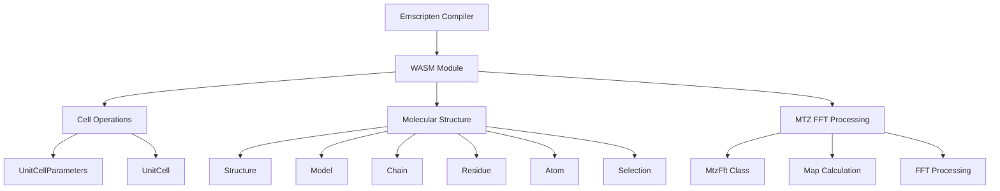
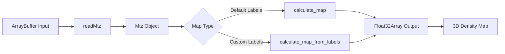

Gemmi provides comprehensive WebAssembly (WASM) compilation support, enabling crystallographic computations directly in web browsers. This implementation leverages Emscripten to compile the C++ library into JavaScript and WebAssembly modules, making powerful crystallographic algorithms accessible for web-based molecular viewers and scientific applications.

## Architecture Overview

The WASM implementation is organized into modular components that expose specific crystallographic functionality to JavaScript environments:



The build system uses Emscripten 3.1.56 with specific optimization flags for web deployment [wasm/Makefile#L1-L3](wasm/Makefile#L1-L3):

```makefile
CXX = em++
FLAGS = -O3 -flto $(COMMON_FLAGS)
LINK_FLAGS = \
  --pre-js pre.js \
  --post-js post.js \
  --no-entry \
  -lembind \
  -s EXPORTED_RUNTIME_METHODS=writeArrayToMemory,HEAPU8 \
  -s INCOMING_MODULE_JS_API=print,printErr,setStatus,onRuntimeInitialized \
  -s ALLOW_MEMORY_GROWTH=1 \
  -s MODULARIZE=1 \
  -s EXPORT_NAME=Gemmi
```

## Core Components

### Unit Cell Operations

The cell module provides fundamental crystallographic calculations through two main classes [wasm/cell.cpp#L8-L19](wasm/cell.cpp#L8-L19):

- **UnitCellParameters**: Exposes basic cell parameters (a, b, c, alpha, beta, gamma)
- **UnitCell**: Extends parameters with volume calculations and crystal validation

### Molecular Structure Handling

The molecular module enables comprehensive structure manipulation with hierarchical access to macromolecular data [wasm/mol.cpp#L67-L119](wasm/mol.cpp#L67-L119):

| Class | Purpose | Key Properties |
|-------|---------|----------------|
| Structure | Top-level container | name, cell |
| Model | Atomic model representation | num, count_occupancies |
| Chain | Polymer chain data | name |
| Residue | Amino acid/nucleotide | seqid_string, entity_type_string |
| Atom | Individual atom data | name, pos, occ, b_iso, element_uname |

The module includes a `read_structure` function that supports multiple coordinate formats (PDB, mmCIF) with automatic format detection [wasm/mol.cpp#L30](wasm/mol.cpp#L30).

### MTZ Processing and FFT

The MTZ FFT module provides specialized functionality for reflection data processing and map calculation [wasm/mtz_fft.cpp#L99-L107](wasm/mtz_fft.cpp#L99-L107):

```cpp
em::class_<MtzFft>("Mtz")
  .constructor<std::string>()
  .function("read", &MtzFft::read)
  .function("calculate_map", &MtzFft::calculate_map)
  .function("calculate_map_from_labels", &MtzFft::calculate_map_from_labels)
  .property("nx", &MtzFft::get_nx)
  .property("ny", &MtzFft::get_ny)
  .property("nz", &MtzFft::get_nz)
  .property("rmsd", &MtzFft::get_rmsd)
  .property("last_error", &MtzFft::get_last_error)
  .property("cell", &MtzFft::get_cell)
```

This implementation uses PocketFFT for efficient Fourier transforms with web-specific optimizations:
- Disabled multithreading for browser compatibility [wasm/mtz_fft.cpp#L6](wasm/mtz_fft.cpp#L6)
- Disabled vectorization for broader device support [wasm/mtz_fft.cpp#L7](wasm/mtz_fft.cpp#L7)
- Configurable cache size for memory management [wasm/mtz_fft.cpp#L5](wasm/mtz_fft.cpp#L5)

## Browser Integration

### Module Loading Pattern

The WASM module uses Emscripten's MODULARIZE option, providing a promise-based initialization pattern [wasm/README.md#L31-L38](wasm/README.md#L31-L38):

```javascript
var module = Gemmi();

Gemmi().then(function(module) {
  mtz = module.readMtz(array_buffer);
  // ... operations
  mtz.delete(); // Memory cleanup
});
```

### Memory Management

> [!TIP]
> The module implements explicit memory management through `delete()` methods. WASM memory views are invalidated when new maps are calculated, requiring data copying for persistent storage.

### Map Calculation Workflow



The MTZ reader supports both automatic and manual map coefficient selection:
- **Normal maps**: FWT/PHWT or 2FOFCWT/PH2FOFCWT
- **Difference maps**: DELFWT/PHDELWT or FOFCWT/PHFOFCWT [wasm/README.md#L46-L50](wasm/README.md#L46-L50)

## Build Configuration

### Compilation Targets

The Makefile defines two main build targets [wasm/Makefile#L25-L37](wasm/Makefile#L25-L37):

1. **gemmi.js**: Full-featured module with all components
2. **mtz.js**: Standalone MTZ reader (legacy, not built by default)

### Object Organization

The build system separates core library objects from binding-specific code:

| Object Type | Source | Purpose |
|-------------|--------|---------|
| GEMMI_OBJS | ../src/*.cpp | Core crystallographic algorithms |
| BINDING_OBJS | wasm/*.cpp | JavaScript interface bindings |

### Debug Configuration

Debug builds include additional safety features:
- Safe heap validation [wasm/Makefile#L17](wasm/Makefile#L17)
- TypeScript definition generation [wasm/Makefile#L17](wasm/Makefile#L17)
- Optimized debugging symbols

## Performance Considerations

> [!TIP]
> The WASM implementation uses LTO (Link Time Optimization) and aggressive optimization (-O3) for production builds, balancing code size with execution speed in browser environments.

Memory growth is enabled to handle variable-sized crystallographic data, with the ALLOW_MEMORY_GROWTH flag ensuring compatibility with large structure files [wasm/Makefile#L13](wasm/Makefile#L13).

## Integration Examples

The WASM module is designed for web-based molecular viewers and scientific visualization tools. A working demonstration is available at https://uglymol.github.io/view/, showcasing real-time MTZ processing and map calculation in the browser [wasm/README.md#L18](wasm/README.md#L18).

For developers, the package is distributed via npm as `mtz` for easy integration into JavaScript projects [wasm/README.md#L24](wasm/README.md#L24).

## Next Steps

For comprehensive understanding of the underlying crystallographic algorithms, explore:
- [Fast Fourier Transform and Reciprocal Space](14-fast-fourier-transform-and-reciprocal-space) for mathematical foundations
- [MTZ Reflection Data Processing](10-mtz-reflection-data-processing) for data format details
- [Unit Cell Mathematics and Transformations](13-unit-cell-mathematics-and-transformations) for geometric calculations

For deployment and optimization strategies, see [High-Performance Computing Considerations](24-high-performance-computing-considerations).