Gemmi provides a comprehensive command-line interface that serves as both a practical toolkit for structural biology workflows and an accessible entry point to the library's capabilities. The `gemmi` command-line utility is actually a collection of specialized tools, each designed for specific tasks in macromolecular crystallography and structural analysis.

## Command Architecture and Organization

The gemmi command-line tool follows a unified subcommand architecture where all functionality is accessed through the main `gemmi` executable followed by specific subcommands. This design pattern provides consistency while maintaining modularity across different functional areas.


The complete command ecosystem consists of 32 specialized tools organized into logical functional groups:

```mermaid
graph TD
    A[gemmi CLI] --> B[File Format Tools]
    A --> C[Structure Analysis]
    A --> D[Crystallographic Computing]
    A --> D[Data Processing]
    A --> E[Utility Tools]
    
    B --> B1[convert]
    B --> B2[cif2json]
    B --> B3[json2cif]
    B --> B4[cif2mtz]
    B --> B5[mtz2cif]
    B --> B6[xds2mtz]
    
    C --> C1[align]
    C --> C2[contact]
    C --> C3[contents]
    C --> C4[residues]
    C --> C5[rmsz]
    C --> C6[ss]
    C --> C7[validate]
    
    D --> D1[sfcalc]
    D --> D2[sf2map]
    D --> D3[map2sf]
    D --> D4[ecalc]
    D --> D5[fprime]
    D --> D6[mask]
    D --> D7[blobs]
    
    E --> E1[grep]
    E --> E2[tags]
    E --> E3[sg]
    E --> E4[h]
    E --> E5[set]
    E --> E6[wcn]
```



## Core File Format Conversion Tools

### convert: Universal Format Transformer

The `convert` subcommand is the workhorse for file format conversions and basic structure modifications. It supports bidirectional conversion between PDB, mmCIF, and mmJSON formats, with extensive customization options [convert.cpp](prog/convert.cpp#L22-L23).

**Key capabilities:**
- Format conversion: PDB ↔ mmCIF ↔ mmJSON
- Chain renaming and shortening
- Sequence assignment from external files
- B-factor manipulation and scaling
- Selection-based filtering
- Symmetry operations and assembly generation

**Common usage patterns:**
```bash
# Basic format conversion
gemmi convert input.pdb output.cif

# With chain renaming and B-factor scaling
gemmi convert --rename-chain=A:B --scale-biso=1.2 input.cif output.pdb

# Selection-based filtering
gemmi convert --select="chain A and resname HOH" input.pdb filtered.pdb
```

### Specialized Format Tools

- **cif2json/json2cif**: Bidirectional conversion between CIF and JSON representations
- **cif2mtz/mtz2cif**: Structure factor data conversion between mmCIF and MTZ formats
- **xds2mtz**: XDS integration output to MTZ format conversion

## Structure Analysis and Validation

### align: Sequence Alignment Tool

The `align` tool performs sophisticated sequence alignments with affine gap penalties, supporting both model-to-SEQRES alignments and cross-file comparisons [align.cpp](prog/align.cpp#L14-L15).

**Features:**
- Global pairwise sequence alignment
- Support for both model sequences and SEQRES data
- Affine gap penalty scoring
- Cross-file alignment capabilities

### contents: Structure Content Analyzer

Provides comprehensive information about coordinate file contents including chain composition, residue statistics, and optional B-factor analysis [contents-help.txt](docs/contents-help.txt#L1-L12).

### contact: Interatomic Contact Analysis

Sophisticated contact detection with customizable distance criteria and symmetry considerations [contact-help.txt](docs/contact-help.txt#L1-L24).

**Key options:**
- Distance-based and covalent-radius-based criteria
- Symmetry-aware contact detection
- Assembly-specific analysis
- Selective atom type filtering

## Crystallographic Computing Tools

### Structure Factor Calculations

- **sfcalc**: Calculate structure factors from atomic models
- **sf2map**: Transform structure factors to electron density maps
- **map2sf**: Convert maps back to structure factor coefficients
- **ecalc**: Calculate normalized amplitudes (E-values)

### Map Processing

- **map**: CCP4 map file manipulation and information display
- **mask**: Generate bulk-solvent masks for density modification
- **blobs**: Identify and analyze unmodelled density features

## Data Processing and Validation

### grep: CIF Data Mining

Powerful CIF file search tool with syntax-aware parsing and globbing support [program.rst](docs/program.rst#L75-L140). Unlike traditional text-based grep, gemmi-grep understands CIF structure and handles both name-value pairs and tabular data correctly.

**Advanced features:**
- Wildcard pattern matching
- Block-specific searching
- Integration with Unix pipeline tools
- Optimized batch processing

### validate: Comprehensive Validation

Multi-level validation supporting CIF syntax checking, dictionary validation, and specialized monomer library validation [program.rst](docs/program.rst#L30-L74).

## Utility and Miscellaneous Tools

### Specialized Analysis Tools

- **rmsz**: Geometry validation using monomer libraries
- **wcn**: Local density and contact number calculations
- **ss**: Secondary structure assignment for polypeptide chains
- **residues**: Residue listing and analysis
- **sg**: Space group information and operations

### Structure Modification Tools

- **h**: Hydrogen atom addition and removal
- **set**: Coordinate file modifications (similar to pdbset)
- **crd**: Refmac topology file preparation

## Usage Patterns and Best Practices

### Command Discovery

All tools support `-h/--help` for detailed usage information:
```bash
gemmi --help          # List all available commands
gemmi convert --help  # Detailed convert tool documentation
```

### Batch Processing Integration

Gemmi tools are designed for pipeline integration and can be combined with Unix utilities:
```bash
# Parallel processing with GNU parallel
find /data/ -name "*.cif" | parallel gemmi grep _refine.ls_R_factor_R_free {}

# Complex filtering pipelines
gemmi grep _cell.volume *.cif | awk '$2 > 100000 {print $1}' | xargs gemmi contents
```

### Performance Considerations

The `-O` option in grep optimizes for single-occurrence searches, significantly improving performance for large-scale PDB archive analysis [program.rst](docs/program.rst#L140-L160).

## Next Steps

After mastering the command-line interface, explore the underlying library architecture in [Library Structure and Design Philosophy](5-library-structure-and-design-philosophy) to understand how these tools leverage the core Gemmi APIs. For specific file format handling details, see [CIF/STAR File Parsing](8-cif-star-file-parsing-and-dom-sax-interfaces) and [PDB and mmCIF Coordinate File Handling](9-pdb-and-mmcif-coordinate-file-handling).

The command-line tools serve as both practical utilities and learning examples for the library's capabilities, making Gemmi accessible to both casual users and developers seeking to integrate structural biology functionality into their own applications.