Gemmi is a comprehensive C++ library for macromolecular crystallography and structural biology, designed with performance, modularity, and ease of use as core principles. The library follows a header-based architecture with optional Python bindings, providing both high-performance computational capabilities and convenient scripting interfaces.

## Architectural Overview

Gemmi's architecture is organized around clear functional domains that mirror the workflows in structural biology and crystallography:

```mermaid
graph TB
    A[Gemmi Library Core] --> B[File Format Support]
    A --> C[Crystallographic Computing]
    A --> D[Molecular Structure Analysis]
    A --> E[Data Processing Algorithms]
    
    B --> B1[CIF/STAR Parser]
    B --> B2[PDB/mmCIF Handler]
    B --> B3[MTZ Reflection Data]
    B --> B4[MRC/CCP4 Maps]
    
    C --> C1[Symmetry Operations]
    C --> C2[Unit Cell Mathematics]
    C --> C3[FFT & Reciprocal Space]
    C --> C4[Electron Density]
    
    D --> D1[Macromolecular Models]
    D --> D2[Structure Alignment]
    D --> D3[Neighbor Search]
    D --> D4[Topology & Restraints]
    
    E --> E1[Scattering Factors]
    E --> E2[Scaling & Bulk Solvent]
    E --> E3[Sequence Analysis]
    E --> E4[Structure Validation]
```

## Core Design Principles

### Header-Based Architecture

Gemmi employs a **header-first design** where the primary library interface consists entirely of header files in `include/gemmi/` [include/gemmi/](include/gemmi/). This approach provides several advantages:

- **Zero compilation overhead** for users - just include the headers you need
- **Template-friendly** architecture enabling compile-time optimizations
- **Clear dependency management** through explicit include relationships
- **Easy integration** into existing C++ projects

The current version `0.7.4-dev` [include/gemmi/version.hpp#L9](include/gemmi/version.hpp#L9) maintains this philosophy throughout the codebase.

### Modular Organization

The library is organized into **functional modules** that can be used independently:

| Module | Primary Headers | Core Functionality |
|--------|----------------|-------------------|
| File I/O | `cif.hpp`, `pdb.hpp`, `mtz.hpp`, `ccp4.hpp` | Format parsing and writing |
| Crystallography | `symmetry.hpp`, `unitcell.hpp`, `reciproc.hpp` | Symmetry and crystal mathematics |
| Molecular Models | `model.hpp`, `chemcomp.hpp`, `topo.hpp` | Structure representation |
| Computing | `fourier.hpp`, `grid.hpp`, `calculate.hpp` | Numerical algorithms |
| Utilities | `util.hpp`, `elem.hpp`, `fail.hpp` | Core utilities and error handling |

### Memory Management Strategy

Gemmi follows a **RAII-based memory management** approach with careful attention to performance:

- **Efficient data structures** using contiguous memory where possible
- **Minimal dynamic allocation** in hot paths
- **Smart pointer usage** for ownership management
- **Move semantics** throughout for optimal performance

The `util.hpp` [include/gemmi/util.hpp](include/gemmi/util.hpp) header provides fundamental string and vector utilities that support this efficient memory strategy.

## Language Integration Philosophy

### C++ Core Foundation

The library is built on **modern C++ principles** with careful attention to:

- **Template metaprogramming** for compile-time optimizations
- **Exception safety** with custom error handling through `fail.hpp`
- **STL compatibility** for seamless integration
- **Header-only implementation** for most components

### Python Bindings Architecture

Gemmi provides **comprehensive Python bindings** that mirror the C++ API while providing Pythonic interfaces:

- **Direct C++ to Python mapping** maintaining performance
- **NumPy integration** for numerical computing
- **Automatic memory management** in Python context
- **Complete API coverage** for all major functionality

The Python bindings are built using the same modular approach, with separate modules for different functional areas [python/](python/).

### WebAssembly Support

Gemmi includes **WebAssembly compilation** support [wasm/](wasm/) enabling:

- **Browser-based crystallography applications**
- **JavaScript/TypeScript interfaces** for web development
- **Cross-platform deployment** without native dependencies

## Performance-Driven Design

### Zero-Copy Operations

Wherever possible, Gemmi employs **zero-copy strategies**:

- **String views** instead of string copies
- **Reference semantics** for large data structures
- **Lazy evaluation** for expensive computations
- **Memory mapping** for large file operations

### Specialized Algorithms

The library includes **domain-specific optimizations**:

- **FFT implementations** using PocketFFT for performance [include/gemmi/third_party/tao/pegtl.hpp](include/gemmi/third_party/tao/pegtl.hpp)
- **Custom parsers** for CIF/STAR format using PEGTL parsing framework
- **Optimized neighbor search** algorithms for large structures
- **Vectorized mathematical operations** for crystallographic calculations

## Build System Philosophy

### Flexible Configuration

The CMake build system [CMakeLists.txt](CMakeLists.txt) provides **extensive configuration options**:

- **Modular component selection** (shared/static libraries, Python bindings, Fortran support)
- **Cross-compilation support** including WebAssembly
- **Package manager integration** (conda, pip, vcpkg)
- **Development tooling** (testing, benchmarking, documentation)

### Dependency Management

Gemmi follows a **minimal dependency philosophy**:

- **Essential third-party libraries** bundled for reliability
- **Optional external dependencies** for enhanced functionality
- **Header-only alternatives** where possible
- **Clear version requirements** and compatibility testing

## Extensibility Framework

### Plugin Architecture

The library supports **extension through multiple mechanisms**:

- **Template-based customization** for new data types
- **Parser plug-ins** for custom file formats
- **Algorithm extensions** through inheritance and templates
- **Binding generation** for additional languages

### Community Integration

Gemmi is designed for **seamless integration** with the scientific computing ecosystem:

- **Standard format support** (CIF, PDB, MTZ, MRC/CCP4)
- **Compatibility with existing tools** (CCP4, Phenix, Coot)
- **Open development model** with comprehensive testing
- **Documentation-driven design** for maintainability

This architectural approach makes Gemmi both **powerful for experts** and **accessible to newcomers**, serving as a foundation for next-generation structural biology software development.

For deeper understanding of specific architectural components, continue to [C++ Core Classes and Memory Management](6-c-core-classes-and-memory-management) or explore the [Python Bindings Architecture](7-python-bindings-architecture).