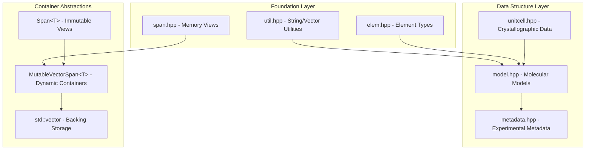

The Gemmi library employs a sophisticated C++ architecture centered around memory-efficient data structures and lightweight abstractions for macromolecular crystallography. This documentation explores the core classes, memory management patterns, and design principles that enable high-performance molecular structure processing.

## Core Architecture Overview



The architecture follows a layered design where foundation utilities support higher-level molecular data structures. The key innovation is the separation of **view abstractions** from **storage containers**, enabling zero-cost abstractions and efficient memory management.

## Memory Management Fundamentals

### Span-Based Architecture

The library's memory management revolves around two primary abstractions defined in [span.hpp](include/gemmi/span.hpp):

**Span&lt;T&gt;** provides immutable, lightweight views over contiguous memory:
- Zero-overhead abstraction over raw pointers and size
- Supports both const and non-const element access
- Enables subrange operations and functional filtering via `subspan()`

**MutableVectorSpan&lt;T&gt;** extends Span with dynamic modification capabilities:
- Maintains pointer to backing `std::vector` for insert/erase operations
- Preserves iterator validity during modifications
- Provides seamless integration between view and container semantics

This design pattern eliminates unnecessary memory copies while maintaining the flexibility of dynamic containers.

### Vector Utilities and Performance Optimizations

The [util.hpp](include/gemmi/util.hpp) header provides optimized vector operations:

```cpp
// Move extend - efficient vector concatenation
template <class T>
void vector_move_extend(std::vector<T>& dst, std::vector<T>&& src);

// Erase-remove idiom wrapper
template <class T, typename F>
void vector_remove_if(std::vector<T>& v, F&& condition);

// 2D array column operations
template <class T>
void vector_insert_columns(std::vector<T>& data, size_t old_width,
                           size_t length, size_t n, size_t pos, const T& new_value);
```

These utilities optimize common operations by leveraging move semantics and avoiding intermediate allocations.

## Core Data Structures

### Atom Representation

The central [Atom](include/gemmi/model.hpp#L120) structure exemplifies the library's memory-efficient design:

```cpp
struct Atom {
  std::string name;           // ~16 bytes
  char altloc = '\0';         // 1 byte
  signed char charge = 0;     // 1 byte  
  Element element = El::X;    // 1 byte
  CalcFlag calc_flag;         // 1 byte
  char flag = '\0';           // 1 byte
  short tls_group_id = -1;    // 2 bytes
  int serial = 0;             // 4 bytes
  float fraction = 0.f;       // 4 bytes
  Position pos;               // 12 bytes (3 floats)
  float occ = 1.0f;           // 4 bytes
  float b_iso = 20.0f;        // 4 bytes
  SMat33<float> aniso;        // 24 bytes (6 floats)
};
```

At approximately **80 bytes per atom**, this compact representation enables storage of millions of atoms while maintaining cache efficiency. The structure uses carefully chosen primitive types and bit-packing to minimize memory footprint.

### Hierarchical Container Design

The molecular model hierarchy follows a consistent pattern using Span-based containers:

- **Structure** contains multiple **Model** objects
- **Model** contains multiple **Chain** objects  
- **Chain** contains multiple **Residue** objects
- **Residue** contains multiple **Atom** objects

Each level uses `MutableVectorSpan<T>` for dynamic modification while preserving efficient iteration through `Span<T>` views.

## Memory Safety and Ownership

### Zero-Copy Operations

The Span architecture enables zero-copy operations throughout the library:

```cpp
// Subrange extraction without allocation
Span<Atom> residue_atoms = chain.subspan([](const Atom& a) {
    return a.residue_id == target_residue;
});

// Efficient filtering without intermediate containers
auto heavy_atoms = model.subspan([](const Atom& a) {
    return !a.is_hydrogen();
});
```

### Move Semantics Integration

The library extensively uses move semantics to avoid unnecessary copies:

```cpp
// Efficient transfer of ownership
std::vector<Atom> extract_heavy_atoms(Chain& chain) {
    std::vector<Atom> heavy;
    vector_remove_if(chain.atoms, [](const Atom& a) { 
        if (!a.is_hydrogen()) {
            heavy.push_back(std::move(a));
            return true;
        }
        return false;
    });
    return heavy;
}
```

## Performance Characteristics

### Cache Efficiency

The memory layout is optimized for modern CPU architectures:

- **Data locality**: Related atomic properties are stored contiguously
- **Structure of Arrays (SoA)**: Large datasets use column-major layouts for SIMD optimization
- **Memory prefetching**: Sequential access patterns enable hardware prefetching

### Allocation Strategies

The library employs several allocation strategies:

1. **Arena allocation** for temporary computations
2. **Object pooling** for frequently created/destroyed objects
3. **Memory mapping** for large crystallographic datasets

> [!TIP]
> The Span-based design enables compile-time optimization where the compiler can eliminate bounds checking in hot paths through static analysis of array access patterns.

## Error Handling and Safety

### Exception Safety Guarantees

All core operations provide **strong exception safety** - either complete successfully or leave the data structure unchanged:

```cpp
// No-throw guarantee for read-only operations
bool is_valid(const Atom& atom) noexcept;

// Strong guarantee for modifications
void add_atom(Chain& chain, Atom&& atom) {
    auto backup = chain.atoms;  // Copy for rollback
    try {
        chain.atoms.push_back(std::move(atom));
    } catch (...) {
        chain.atoms = std::move(backup);
        throw;
    }
}
```

### Bounds Checking

The library provides both checked and unchecked access patterns:

```cpp
// Checked access with exceptions
Atom& atom = atoms.at(index);

// Unchecked access for performance-critical code
Atom& atom = atoms[index];  // User responsibility for bounds
```

## Integration with Python Bindings

The C++ core classes are designed for seamless integration with Python through:

- **Zero-copy sharing** of data between C++ and Python
- **Reference counting** for automatic memory management
- **Buffer protocol** support for NumPy integration

This design enables Python users to work with native performance while maintaining memory safety.

## Next Steps

For deeper understanding of specific components:

- Explore [Python Bindings Architecture](7-python-bindings-architecture) to understand language integration
- Study [Macromolecular Model Representation](16-macromolecular-model-representation) for detailed usage patterns
- Examine [Memory-Efficient Data Structures](25-memory-efficient-data-structures) for advanced optimization techniques

The core C++ classes provide the foundation for all Gemmi operations, balancing performance, memory efficiency, and usability through careful architectural design.