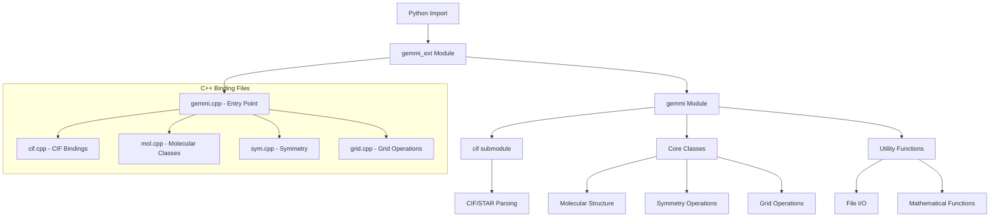

The Python bindings architecture for GEMMI provides a comprehensive bridge between the high-performance C++ crystallographic library and Python's scientific computing ecosystem. This architecture enables seamless access to GEMMI's functionality while maintaining performance and Pythonic interfaces.

## Core Architecture Overview

The Python bindings are built using **nanobind**, a modern C++/Python binding library that replaces the older pybind11 approach. The architecture follows a modular design where each major GEMMI subsystem has its own binding module, all orchestrated through a central entry point.



## Module Organization and Entry Point

The Python bindings use an unusual but effective module organization strategy. The `gemmi_ext` module serves as the extension entry point, but immediately imports and populates the main `gemmi` module [gemmi.cpp#L159-L168](python/gemmi.cpp#L159-L168):

```cpp
NB_MODULE(gemmi_ext, m_) {
  // unusual setup: importing gemmi_ext adds classes and functions to gemmi
  (void) m_;
  nb::module_ m = nb::module_::import_("gemmi");
  m.doc() = "Python bindings to GEMMI - a library used in macromolecular\n"
             "crystallography and related fields";
  m.attr("__version__") = GEMMI_VERSION;
```

This approach allows users to simply `import gemmi` while the compiled extension handles the heavy lifting. The module initialization systematically adds subsystems through dedicated `add_*` functions [gemmi.cpp#L182-L206](python/gemmi.cpp#L182-L206):

- `add_cif()` for CIF file format support
- `add_symmetry()` for crystallographic symmetry
- `add_mol()` for molecular structure classes
- `add_grid()` for electron density grids
- `add_mtz()` for reflection data
- And 10+ other specialized subsystems

## Nanobind Integration and Memory Management

The bindings leverage nanobind 2.2+ as specified in [common.h#L20-L22](python/common.h#L20-L22), providing modern C++/Python interoperability. Key architectural features include:

**Reference Internal Policy**: Most bindings use `rv_policy::reference_internal` [common.h#L25](python/common.h#L25) to ensure proper lifetime management between C++ objects and Python references.

**Custom Type Casting**: Specialized type casters handle complex conversions, such as the Logger class that accepts Python callables, file-like objects, or tuples [common.h#L118-L143](python/common.h#L118-L143).

**Exception Translation**: Comprehensive exception handling translates C++ exceptions to appropriate Python exceptions [gemmi.cpp#L170-L180](python/gemmi.cpp#L170-L180):

```cpp
nb::register_exception_translator([](const std::exception_ptr& p, void*) {
  try {
    if (p)
      std::rethrow_exception(p);
  } catch (const std::system_error &e) {
    const int errornum = e.code().value();
    PyErr_SetObject(PyExc_IOError, nb::make_tuple(errornum, e.what()).ptr());
  } catch (const tao::pegtl::parse_error &e) {
    PyErr_SetString(PyExc_ValueError, e.what());
  }
});
```

## NumPy Integration and Array Handling

A critical architectural component is the seamless NumPy integration through custom array types [array.h#L7-L8](python/array.h#L7-L8):

```cpp
template<typename T>
using cpu_array = nb::ndarray<T, nb::shape<-1>, nb::device::cpu>;

template<typename T>
using cpu_c_array = nb::ndarray<T, nb::shape<-1>, nb::device::cpu, nb::c_contig>;
```

The architecture provides sophisticated array manipulation utilities:

- **Vector to NumPy Conversion**: Zero-copy conversion from C++ vectors to NumPy arrays [array.h#L14-L20](python/array.h#L14-L20)
- **Member Array Views**: Direct access to vector member data without copying [array.h#L31-L41](python/array.h#L31-L41)
- **Miller Index Operations**: Specialized functions for crystallographic array operations [array.h#L54-L63](python/array.h#L54-L63)

## Class Binding Architecture

The architecture uses forward declarations to create clean Python class hierarchies [mol.cpp#L76-L80](python/mol.cpp#L76-L80):

```cpp
// "Forward declaration" of python classes to avoid
// C++ signatures in docstrings
nb::class_<Atom> pyAtom(m, "Atom");
nb::class_<Residue, ResidueId> pyResidue(m, "Residue");
nb::class_<Chain> pyChain(m, "Chain");
```

This approach ensures that Python docstrings contain clean, readable signatures without C++ implementation details.

## Pythonic Interface Design

The architecture provides Pythonic interfaces through several key patterns:

**Slice Support**: Template functions provide Python slicing semantics for C++ containers [common.h#L85-L103](python/common.h#L85-L103):

```cpp
template<typename Items>
nb::list getitem_slice(Items& items, const nb::slice& slice) {
  auto [start, stop, step, length] = slice.compute(items.size());
  nb::list l;
  for (size_t i = 0; i < length; i++)
    l.append(nb::cast(&items[start + i * step]));
  return l;
}
```

**Index Normalization**: Proper handling of Python's negative indexing [common.h#L60-L71](python/common.h#L60-L71):

```cpp
inline int c_index(int index, size_t size) {
  if (index < 0)
    index += (int) size;
  if ((size_t) index >= size)
    throw nb::index_error();
  return index;
}
```

## Performance Considerations

The architecture prioritizes performance through several design choices:

- **Zero-Copy Operations**: Where possible, data is shared between C++ and Python without copying
- **Template Specialization**: Optimized paths for common operations like vectorized functions [gemmi.cpp#L33-L45](python/gemmi.cpp#L33-L45)
- **Efficient Iterators**: Custom iterator implementations for large data structures [gemmi.cpp#L50-L57](python/gemmi.cpp#L50-L57)

> [!TIP]
> The modular binding architecture allows selective loading of subsystems, reducing memory footprint for applications that only need specific GEMMI functionality.

> [!TIP]
> The nanobind-based design provides better performance and smaller binary sizes compared to traditional pybind11 approaches, while maintaining full compatibility with the scientific Python ecosystem.

## Integration with Scientific Python Ecosystem

The Python bindings architecture is designed to work seamlessly with the broader scientific Python ecosystem:

- **NumPy Compatibility**: Full support for NumPy arrays as input and output
- **File Format Integration**: Support for common scientific file formats through Python's file handling
- **Error Handling**: Python-idiomatic error messages and exception types
- **Documentation**: Clean docstrings suitable for automatic documentation generation

This architecture makes GEMMI a natural fit for crystallographic workflows in Python, bridging high-performance C++ computations with Python's flexibility and extensive scientific libraries.

For understanding how these bindings connect to the underlying C++ architecture, see [C++ Core Classes and Memory Management](6-c-core-classes-and-memory-management). To explore specific file format handling through these bindings, refer to [CIF/STAR File Parsing and DOM/SAX Interfaces](8-cif-star-file-parsing-and-dom-sax-interfaces).