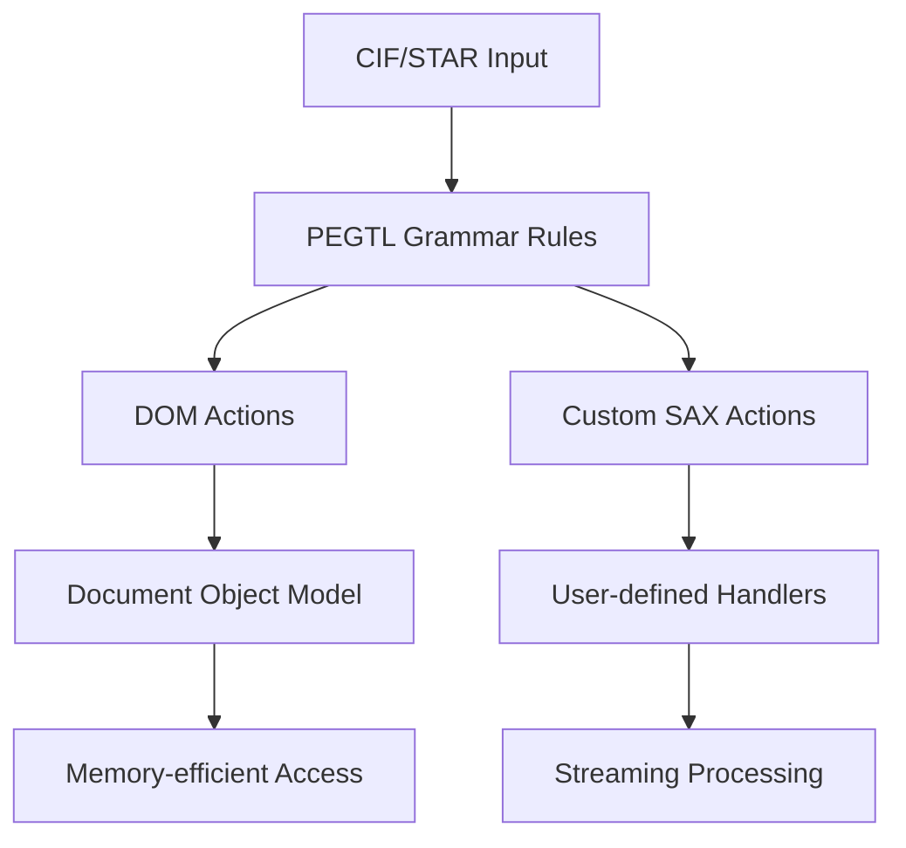

Gemmi provides comprehensive support for parsing CIF (Crystallographic Information File) and STAR files through both DOM and SAX-style interfaces. The implementation leverages the PEGTL parsing expression grammar library for robust and efficient parsing while maintaining flexibility for different use cases.

## Architecture Overview

The CIF parsing architecture is built around a clear separation between grammar definition, parsing actions, and document representation:



The core components include:

- **Grammar Definition**: Complete CIF 1.1 grammar rules defined in [`cif.hpp`](include/gemmi/cif.hpp#L1-L100) using PEGTL's parsing expression grammar
- **DOM Implementation**: Document structure classes in [`cifdoc.hpp`](include/gemmi/cifdoc.hpp#L1-L100) for in-memory representation
- **Parsing Actions**: Template-based actions that populate the DOM during parsing
- **SAX Interface**: Pluggable action system for event-driven processing

## DOM Interface

The Document Object Model provides a complete in-memory representation of CIF files with the following hierarchy:

- **Document**: Contains multiple blocks
- **Block**: Contains name-value pairs, loops, and frames  
- **Frame**: Can contain name-value pairs and loops
- **Loop**: Represents tabular data with column names and values

### Core Classes

The DOM is built around these fundamental classes from [`cifdoc.hpp`](include/gemmi/cifdoc.hpp#L1-L100):

```cpp
enum class ItemType : unsigned char {
  Pair,    // Tag-value pair
  Loop,    // Tabular data
  Frame,   // Save frame
  Comment, // Comment
  Erased,  // Deleted item
};
```

The `Document` class serves as the root container, managing blocks and providing parsing capabilities. Each `Block` represents a CIF data block (starting with `data_`) and contains various items.

### Value Types and Conversions

CIF 1.1 defines four base types, but the DOM stores raw strings to preserve exact input formatting. Helper functions provide type conversion:

- `as_string()` - Extracts unquoted string content
- `as_number()` - Converts to floating-point number
- `as_int()` - Converts to integer
- `as_char()` - Extracts single character  
- `is_null()` - Checks for null values (`?` or `.`)
- `quote()` - Adds appropriate quotes for string output

> [!TIP]
> The DOM preserves raw string values including quotes, enabling lossless round-trip parsing. Type conversion is performed on-demand using helper functions that handle CIF's ambiguous number/string syntax.

## Reading CIF Files

Gemmi provides multiple reading functions for different scenarios:

### C++ Interface

```cpp
#include <gemmi/read_cif.hpp>

// Read with automatic gzip decompression
cif::Document doc = gemmi::read_cif_gz("file.cif", check_level=1);

// Read from memory buffer
cif::Document doc = gemmi::read_cif_from_memory(data, size, "filename", check_level=1);
```

### Python Interface

```python
from gemmi import cif

# Read file (handles .gz automatically)
doc = cif.read_file('components.cif')

# Read from string
doc = cif.read_string('data_block _tag value')
```

### Check Levels

The `check_level` parameter controls syntax validation strictness:

- **Level 0**: Most permissive, tolerates syntax errors
- **Level 1**: Default, handles common variations
- **Level 2**: Strictest, throws errors for most issues

## SAX Interface

For high-performance or memory-constrained applications, Gemmi supports a SAX-style interface through PEGTL actions. Instead of building a complete DOM, you can define custom actions triggered during parsing:

```cpp
template<typename Rule> struct MyAction : pegtl::nothing<Rule> {};

template<> struct MyAction<rules::datablockname> {
  template<typename Input> static void apply(const Input& in, MyState& state) {
    // Handle block name
  }
};
```

This approach enables streaming processing of large files without loading everything into memory.

## Grammar and Parsing Rules

The CIF grammar is comprehensively defined using PEGTL rules in [`cif.hpp`](include/gemmi/cif.hpp#L1-L100):

- **Character Classes**: Precise definitions for ordinary characters, whitespace, and printable characters
- **Keywords**: Recognition of reserved words (`data_`, `loop_`, `global_`, `save_`, `stop_`)
- **Values**: Support for quoted strings, text fields, and unquoted values
- **Structure**: Complete grammar for blocks, frames, loops, and data items

> [!TIP]
> The grammar includes relaxed parsing rules to handle real-world CIF files that may not strictly conform to the specification, such as files from RELION and Buccaneer that use empty block names.

## Performance Considerations

The implementation is optimized for performance:

- **PEGTL**: Compile-time parsing expression grammar eliminates runtime parsing overhead
- **Character Tables**: Fast character classification using lookup tables
- **Memory Efficiency**: Minimal allocations during parsing
- **Streaming Support**: SAX interface enables processing files larger than available memory

## Error Handling

Comprehensive error messages are provided for parsing failures, with specific error handling for common issues:

- Unterminated strings and text fields
- Invalid block structure
- Missing required elements
- Syntax violations

## Integration Examples

### Basic CIF Reading

```cpp
#include <gemmi/cif.hpp>

int main() {
  cif::Document doc = cif::read_file("structure.cif");
  for (cif::Block& block : doc.blocks) {
    for (auto item : block.find("_chem_comp.", {"id", "formula_weight"})) {
      std::cout << item[0] << " weight: " << item[1] << std::endl;
    }
  }
}
```

### Table Processing

```cpp
void process_atoms(cif::Document doc) {
  cif::Table atoms = doc.sole_block().find("atom_site_.",
                          {"type_symbol", "Cartn_x", "Cartn_y", "Cartn_z"});
  for (auto row : atoms) {
    // Process atom coordinates
  }
}
```

## Next Steps

For understanding how CIF parsing integrates with higher-level crystallographic operations, see [PDB and mmCIF Coordinate File Handling](9-pdb-and-mmcif-coordinate-file-handling). To learn about processing reflection data stored in CIF format, refer to [MTZ Reflection Data Processing](10-mtz-reflection-data-processing).

The CIF parsing infrastructure serves as the foundation for all file format support in Gemmi, making it essential for understanding the library's overall architecture as described in [Library Structure and Design Philosophy](5-library-structure-and-design-philosophy).