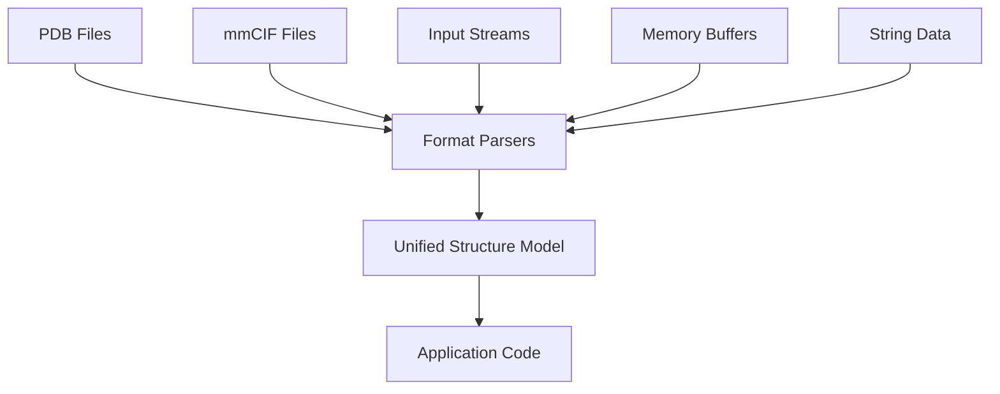

Gemmi provides comprehensive support for reading and writing coordinate files in both the traditional PDB format and the modern mmCIF (PDBx/mmCIF) format. The library implements a unified interface that abstracts away the differences between these formats while maintaining format-specific optimizations and features.

## Core Architecture

The coordinate file handling is built around a three-layer architecture that separates format-specific parsing from the unified data model:



The foundation rests on the `Structure` class from `model.hpp` which serves as the common data representation, while format-specific parsers in `pdb.hpp` and `mmcif.hpp` handle the intricacies of each file format.

## PDB Format Support

### Reading PDB Files

Gemmi provides multiple interfaces for PDB file reading, all built around the core `populate_structure_from_pdb_stream` function [src/pdb.cpp](src/pdb.cpp#1-L100):

```cpp
// From file path
Structure read_pdb_file(const std::string& path, PdbReadOptions options={});

// From memory buffer
Structure read_pdb_from_memory(const char* data, size_t size, 
                               const std::string& name, PdbReadOptions options={});

// From string
Structure read_pdb_string(const std::string& str, const std::string& name,
                          PdbReadOptions options={});
```

The PDB parser supports several advanced features beyond the basic specification:

- **Hybrid-36 encoding** for serial numbers and sequence IDs, enabling support for structures with more than 99,999 atoms or 9,999 residues per chain
- **Two-character chain IDs** using columns 21 and 22
- **Extended REMARK lines** up to 120 characters
- **Segment identifiers** in columns 73-76 for non-standard but widely used segment tracking

### PDB Record Processing

The parser processes records sequentially, with special handling for key record types:

- **ATOM/HETATM**: Core coordinate records with full atomic information including positions, occupancy, B-factors, and element types [src/pdb.cpp](src/pdb.cpp#900-L1000)
- **ANISOU**: Anisotropic displacement parameters directly linked to preceding ATOM/HETATM records
- **SEQRES**: Polymer sequence information for entity construction
- **HELIX/SHEET**: Secondary structure annotations
- **REMARK 290**: Symmetry operations for biological assemblies

The parser uses optimized string parsing functions like `read_int()`, `read_double()`, and `read_string()` to efficiently extract fixed-width field data while handling edge cases and malformed input gracefully.

## mmCIF Format Support

### Reading mmCIF Files

The mmCIF interface leverages Gemmi's CIF parsing infrastructure to build structures from CIF blocks:

```cpp
// From CIF block
Structure make_structure_from_block(const cif::Block& block_);

// From complete CIF document
Structure make_structure(cif::Document&& doc, cif::Document* save_doc=nullptr);
```

The mmCIF parser handles the hierarchical nature of CIF data, mapping relational tables to the object-oriented Structure model [src/mmcif.cpp](src/mmcif.cpp#1-L100):

```cpp
void populate_structure_from_block(const cif::Block& block_, Structure& st);
```

### Chemical Component Dictionary Support

Gemmi includes specialized support for reading Chemical Component Dictionary (CCD) and monomer library files:

```cpp
enum class ChemCompModel {
  Xyz      = 1, // _chem_comp_atom.x, etc
  Example  = 2, // _chem_comp_atom.model_Cartn_x
  Ideal    = 4  // _chem_comp_atom.pdbx_model_Cartn_x_ideal
};

Structure make_structure_from_chemcomp_block(const cif::Block& block, int which=7);
```

This enables reading chemical components as coordinate structures with multiple models representing different conformational states (ideal, example, XYZ coordinates) [include/gemmi/mmcif.hpp](include/gemmi/mmcif.hpp#40-L80).

## Data Model Integration

Both PDB and mmCIF parsers populate the same unified `Structure` data model, ensuring consistent behavior regardless of input format. The model includes:

- **Models**: Multiple conformational states
- **Chains**: Polymer and non-polymer chains with segment support
- **Residues**: Amino acids, nucleotides, ligands, and water
- **Atoms**: Full atomic information including anisotropic parameters
- **Entities**: Chemical entity definitions and sequences
- **Metadata**: Experimental conditions, symmetry information, and biological assembly data

## Input Stream Architecture

Gemmi uses a flexible stream-based input system that supports multiple data sources [include/gemmi/input.hpp](include/gemmi/input.hpp#1-L169):

```cpp
class AnyStream {
    // Unified interface for file streams, memory streams, and string streams
};
```

This enables seamless reading from:
- Physical files on disk
- Memory-mapped data
- Network streams
- Compressed data (gzip support built-in)

## Format Conversion and Writing

While the primary focus is on reading, Gemmi also provides capabilities for format conversion through the unified data model. Structures read from either format can be written back in the preferred format, enabling lossless conversion where possible and intelligent handling of format-specific limitations.

> [!TIP]
> The parsers use optimized residue lookup tables (`resmap`) to handle pseudo-PDB files with millions of residues efficiently, avoiding O(n²) searches that would occur with naive chain->find_residue() calls.

> [!TIP]
> mmCIF parsing benefits from Gemmi's efficient CIF table lookup system, which uses hash maps for O(1) access to categorical data and minimizes string copying during processing.

## Integration with Other Components

The coordinate file handling integrates seamlessly with other Gemmi components:

- **[CIF/STAR File Parsing](8-cif-star-file-parsing-and-dom-sax-interfaces)**: Provides the underlying CIF parsing infrastructure for mmCIF
- **[Macromolecular Model Representation](16-macromolecular-model-representation)**: Defines the unified data model that both formats populate
- **[Symmetry Operations](12-symmetry-operations-and-space-groups)**: Handles symmetry information from both PDB REMARK 290 and mmCIF symmetry tables

The coordinate file handling serves as the foundation for most structural bioinformatics workflows in Gemmi, providing reliable, efficient access to protein structure data regardless of the source format.