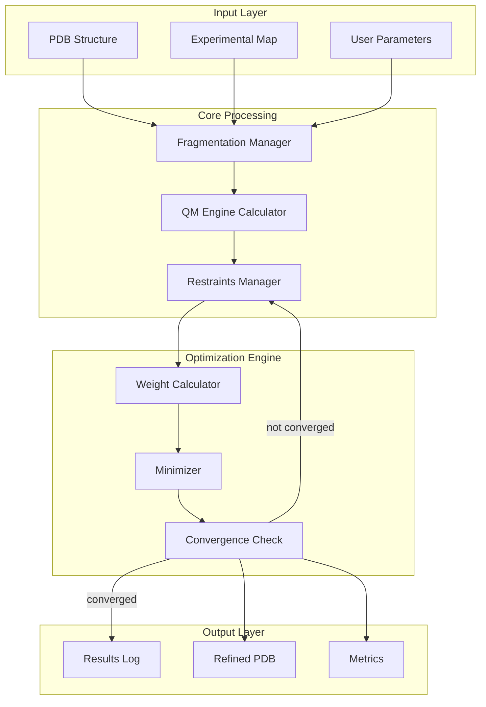

Quantum-based refinement represents a significant advancement in structural biology, combining quantum chemical methods with crystallographic and cryo-EM data to improve biomolecular structure accuracy. Q|R (Quantum-based Refinement) is an open-source module that replaces traditional parameterized library-based restraints with chemically accurate restraints derived from quantum chemical calculations, offering superior accuracy especially for novel molecules like drugs or cofactors that lack comprehensive experimental parameterization.

Sources: [README.md](README.md#L1-L11)

## The Core Challenge

Biomacromolecular refinement using quantum chemistry faces a fundamental scaling challenge—quantum mechanical methods have computational complexity that scales poorly with system size. Traditional quantum chemistry approaches cannot handle the thousands of atoms typically found in proteins, nucleic acids, and other biological macromolecules within practical timeframes. This limitation has prevented widespread adoption of quantum-based restraints in structural refinement workflows, despite their theoretical advantages in accuracy and transferability to novel molecules.

Sources: [README.md](README.md#L12-L18)

## The Fragmentation Solution

Q|R solves this scaling problem through an innovative divide-and-conquer fragmentation approach that breaks large biological systems into manageable pieces. Each fragment can be treated with quantum mechanical methods individually, then combined to provide complete system restraints. The system employs sophisticated clustering algorithms based on interaction densities to optimally partition molecules, ensuring that chemically relevant regions remain intact while maintaining computational tractability.

Sources: [README.md](README.md#L19-L23), [fragmentation.py](fragmentation.py#L20-L28)

## System Architecture

The Q|R architecture follows a modular design with clear separation of concerns across computational, structural, and optimization components. The system orchestrates quantum mechanical calculations through a flexible calculator system that supports multiple quantum chemistry engines and machine learning potentials. Key architectural components include fragmentation managers that partition the system, restraints managers that compute energies and gradients, and an optimization engine that drives coordinate updates using conjugate gradient or ASE-based minimization algorithms.



Sources: [refine.py](refine.py#L1-L20), [driver.py](driver.py#L301-L310)


## Core Components

The fragment manager handles system partitioning using interaction-based clustering algorithms, ensuring chemically meaningful fragment boundaries while maximizing computational efficiency. The calculator system provides a unified interface to multiple quantum chemistry backends, from traditional ab initio methods (Gaussian, ORCA, PySCF) to semi-empirical approaches (MOPAC, xTB) and modern machine learning potentials (AIMNet2, ANI, FairChem). The restraints manager coordinates energy and gradient calculations, seamlessly switching between quantum mechanical and standard CCTBX restraints based on user configuration and system requirements.

Sources: [refine.py](refine.py#L77-L81), [restraints.py](restraints.py#L48-L51), [restraints.py](restraints.py#L434-L452)

## Supported QM Engines

Q|R offers extensive compatibility with quantum chemical methods through a modular plugin architecture supporting over a dozen different calculation engines. Traditional quantum chemistry packages include Gaussian, ORCA, PySCF, Turbomole, and Terachem for high-accuracy calculations, while semi-empirical options like MOPAC and xTB provide faster approximations suitable for larger systems. The system also integrates cutting-edge machine learning potentials including AIMNet2, ANI, TensorMol, and FairChem, which offer near quantum-chemical accuracy at computational speeds approaching classical force fields.

Sources: [README.md](README.md#L72-L77), [calculator.py](calculator.py#L1-L5)

> [!TIP]
> The AQuaRef implementation using AIMNet2 provides particularly efficient refinement, combining neural network potentials with quantum-based restraints for significantly accelerated calculations while maintaining chemical accuracy.

## Optimization and Weighting

The refinement engine implements adaptive weight factor calculation that automatically balances experimental data against restraints during optimization. The system monitors bond RMSD throughout refinement, dynamically adjusting restraint weights—doubling when bond RMSD is high to prioritize geometry, and halving when bond RMSD is low to better fit experimental data. This adaptive approach, combined with robust convergence criteria and multiple minimization algorithms (conjugate gradient and ASE-based optimizers), ensures stable convergence to chemically and physically meaningful structures.

Sources: [calculator.py](calculator.py#L1-L5), [calculator.py](calculator.py#L26-L27), [driver.py](driver.py#L22-L34)

## Project Structure

The Q|R codebase follows a clear modular organization with separation between user interfaces, core algorithms, quantum chemistry integrations, and testing infrastructure. The command-line interface provides accessible entry points for refinement, fragmentation, charge calculation, and testing workflows. Core modules handle fragmentation strategies, restraint computation, optimization driving, and result management. The plugin architecture encapsulates quantum chemistry engine specifics, while comprehensive test suites include unit tests for component validation and regression tests for system integrity.

```
qrefine/
├── command_line/    # CLI entry points (qr.refine, qr.fragment, qr.test)
├── Core modules     # refine.py, driver.py, restraints.py, calculator.py
├── plugin/ase/      # QM engine integrations (mopac_qr.py, gaussian_qr.py, aimnet2_qr.py)
├── tests/           # Unit tests, regression tests, acceptance tests
├── config/          # Environment specifications (conda, cuda, phenix)
└── examples/        # Example datasets and workflows
```

Sources: [README.md](README.md#L42-L58)

## Applications and Use Cases

Quantum refinement provides particular advantages for challenging structural biology scenarios. Low-resolution crystallographic data (beyond 3Å) benefits significantly from chemically accurate restraints when traditional library parameters may not capture true molecular geometry. Novel molecules including drug candidates, cofactors, ligands, and modified residues can be refined more accurately since quantum-based restraints don't rely on pre-existing parameterization. Cryo-EM structures also benefit from Q|R's real-space refinement capabilities, which directly optimize model fit to density maps using quantum mechanical restraints.

Sources: [README.md](README.md#L1-L10)

## Installation Options

Q|R provides multiple installation pathways tailored to different user needs and computational environments. CCTBX-only installation offers a fully open-source route suitable for developers and users comfortable managing conda environments. Phenix integration provides a fully automated, user-friendly experience recommended for most structural biologists, leveraging Phenix's extensive ecosystem and graphical interfaces. Docker containers offer reproducible environments for both development and production use, with images available for CUDA 11 and CUDA 12 configurations to support GPU-accelerated quantum chemistry calculations.

Sources: [README.md](README.md#L24-L29), [README.md](README.md#L60-L61)

## Getting Started

The recommended learning path begins with understanding installation requirements and options. Users should review the [Quick Start](2-quick-start) guide for basic workflow familiarity, then proceed to installation instructions matching their environment: [Phenix Installation](3-phenix-installation) for most users, [CCTBX Installation](4-cctbx-installation) for developers, or [Docker Setup](5-docker-setup) for containerized deployments. After successful installation, the command-line option `qr.refine --show-defaults` displays all available parameters and default values for exploration.

Sources: [README.md](README.md#L62-L67), [README.md](README.md#L69-L77)

## Next Steps

For users ready to begin working with Q|R, the recommended progression continues with practical workflow guidance. The [Quick Start](2-quick-start) page provides hands-on examples to run your first refinement, followed by [Understanding Fragmentation](7-understanding-fragmentation) to learn how the system partitions biomolecules. Those interested in specific quantum chemistry backends should explore the [Supported QM Engines Overview](11-supported-qm-engines-overview) to select appropriate methods for their research needs. Advanced users may proceed directly to [Quantum Refinement Concepts](6-quantum-refinement-concepts) for deeper theoretical understanding of the methodology.
