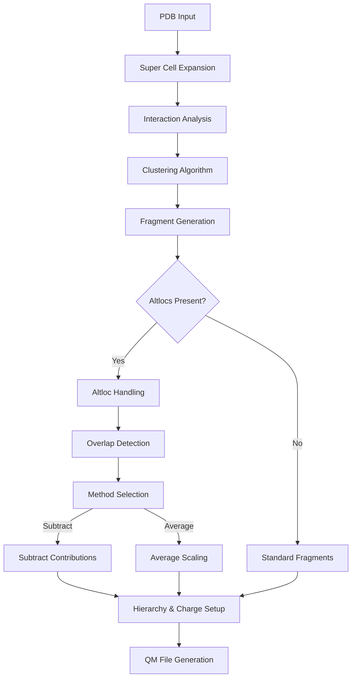
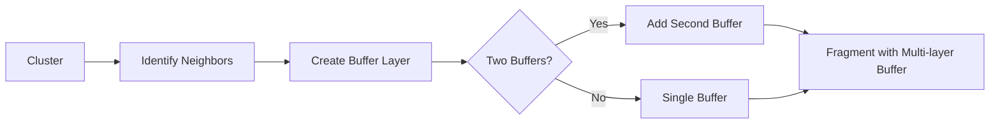

Fragment management in qrefine orchestrates the division of large molecular systems into computationally tractable pieces for quantum mechanical calculations. This process balances computational efficiency with chemical accuracy by creating fragments that include both a quantum region and a classical buffer environment. The system handles complex scenarios including crystal symmetry, alternative conformations, and charge embedding.

Sources: [fragment.py](fragment.py#L43-L96), [fragmentation.py](command_line/fragmentation.py#L21-L31)

## Core Architecture

The `fragments` class serves as the central orchestrator for all fragment management operations, coordinating between clustering algorithms, geometry expansion, and QM engine preparation. This class initializes with comprehensive parameters that control how molecules are grouped, buffered, and prepared for quantum calculations.

Key initialization parameters include:
- **`clustering_method`**: Algorithm for grouping molecules (betweenness centrality by default)
- **`maxnum_residues_in_cluster`**: Controls cluster size (default: 20 residues)
- **`bcc_threshold`**: Betweenness centrality clustering threshold (default: 9)
- **`altloc_method`**: Strategy for alternative conformations ("subtract" or "average")
- **`charge_embedding`**: Enables electrostatic embedding with point charges
- **`two_buffers`**: Creates a second buffer layer around clusters
- **`select_within_radius`**: Radius for environment selection in Å (default: 10.0)
- **`save_clusters`**: Controls whether cluster PDB files are written for debugging

Sources: [fragment.py](fragment.py#L45-L96)

## Fragment Lifecycle

The fragment management process follows a systematic pipeline from initial model to QM-ready fragments:



Sources: [fragment.py](fragment.py#L98-L117), [super_cell.py](super_cell.py#L20-L46)

## Super Cell Expansion

Before fragmentation, the system expands the crystal environment to capture boundary effects. The `expand` class creates a super-sphere that includes symmetry-related molecules within a specified radius:

```python
self.expansion = expand(
  pdb_hierarchy        = self.pdb_hierarchy,
  crystal_symmetry     = self.crystal_symmetry,
  select_within_radius = self.select_within_radius)
```

This expansion ensures that fragments include realistic crystal packing interactions and provides atoms for charge embedding. The expansion includes:
- **P1 symmetry conversion**: Expands to primitive triclinic setting
- **Super-sphere selection**: Selects atoms within radius of original model
- **Geometry restraints**: Creates restraint manager for the expanded system
- **Update capability**: Allows coordinate updates during refinement

Sources: [super_cell.py](super_cell.py#L20-L46), [fragment.py](fragment.py#L98-L106)

## Clustering Strategy

The clustering phase groups interacting molecules into clusters based on pairwise interactions and backbone connectivity:

1. **Interaction Analysis**: The `pair_interaction.run()` method identifies all non-covalent interactions between molecules in the system
2. **Backbone Connection**: Backbone peptide bonds are explicitly added to prevent breaking polypeptide chains
3. **Graph Clustering**: Betweenness centrality clustering partitions the interaction graph into clusters of manageable size

```python
self.interaction_list = pair_interaction.run(
  copy.deepcopy(self.pdb_hierarchy))
self.interaction_list += self.backbone_connections
clusters = clustering.betweenness_centrality_clustering(
  self.interaction_list,
  size = n_residues,
  maxnum_residues_in_cluster = self.maxnum_residues_in_cluster,
  bcc_threshold = self.bcc_threshold).get_clusters()
```

Clusters are sorted by size in descending order, ensuring larger quantum regions are processed first.

Sources: [fragment.py](fragment.py#L119-L131), [clustering.py](clustering.py#L83-L100), [utils/fragment_utils.py](utils/fragment_utils.py#L2-L18)

## Fragment Generation

Each cluster becomes the core of a QM fragment, surrounded by a buffer region of neighboring molecules. The `get_fragments()` method orchestrates this process:



The buffer region includes molecules within interaction distance of the cluster, providing:
- **Electrostatic embedding**: Classical charges surround the QM region
- **Capping atoms**: Hydrogen atoms cap broken bonds at fragment boundaries
- **Size control**: The `maxnum_residues_in_cluster` parameter prevents QM calculations from becoming too expensive

For fragments with two buffer layers, the process repeats to capture second-shell neighbors, providing a more complete electrostatic environment at the cost of larger classical regions.

Sources: [fragment.py](fragment.py#L133-L196)

## Alternative Conformation Handling

Alternative locations (altlocs) pose unique challenges for fragmentation, as different conformations may interact with overlapping sets of neighboring molecules. The system provides two strategies:

### Subtract Method

The subtract method subtracts overlapping contributions to avoid double-counting:
- Calculates overlap between altloc-specific fragments
- Creates separate cluster/fragment pairs for overlapping regions
- Applies negative scaling factors (-1.0) to subtract duplicate interactions
- Ensures each atom's contribution is counted exactly once

### Average Method

The average method distributes overlapping contributions proportionally:
- Detects atoms that appear in multiple overlapping fragments
- Calculates frequency of each overlapping atom
- Applies scaling factors of `1.0/frequency` to each occurrence
- Ensures the total contribution equals the original weight

Both methods check for bonds to altloc atoms to preserve covalent connectivity:

```python
if(not self.bond_with_altloc(atom, self.bond_with_altloc_flag)):
  self.fragment_scales[i_cluster][index] = 1.0/frequency_overlap_atoms[atom]
```

Sources: [fragment.py](fragment.py#L204-L288), [fragment.py](fragment.py#L289-L302)

## Hierarchy and Charge Management

After fragment definition, the system creates PDB hierarchies and calculates charges for each fragment:

1. **Selection Arrays**: Boolean arrays identify atoms belonging to each component:
   - `cluster_selections`: Atoms in the QM cluster core
   - `fragment_selections`: Atoms in the full fragment (cluster + buffer)
   - `buffer_selections`: Buffer-only atoms (fragment minus cluster)

2. **Charge Calculation**: Total system charge is calculated for each fragment:
   ```python
   self.charge_service = charges_class(
     pdb_hierarchy=charge_hierarchy,
     crystal_symmetry=self.expansion.cs_box).get_total_charge()
   ```

3. **Capping**: Terminal atoms are capped with hydrogens using the completion system to saturate valences at fragment boundaries

4. **Validation**: Multiple checks ensure fragment integrity:
   - `check_atoms_integrity()`: Validates amino acid residue completeness
   - `check_selection_integrity()`: Verifies atom selections
   - `check_hierarchy()`: Confirms hierarchy validity

Sources: [fragment.py](fragment.py#L316-L364), [completion.py](completion.py#L327-L342), [fragment.py](fragment.py#L20-L38)

## Data Structures

The `fragments` class maintains several key data structures throughout the fragment lifecycle:

| Data Structure | Type | Purpose |
|----------------|------|---------|
| `clusters` | List of lists | Residue indices for each cluster |
| `cluster_atoms` | List of lists | Atom indices for each cluster |
| `fragment_super_atoms` | List of lists | Atom indices for each fragment (cluster + buffer) |
| `fragment_scales` | List of lists | Scaling factors for each atom in each fragment |
| `fragment_selections` | List of flex.bool | Boolean selections for fragments in original hierarchy |
| `fragment_super_selections` | List of flex.bool | Boolean selections for fragments in expanded hierarchy |
| `cluster_selections` | List of flex.bool | Boolean selections for clusters |
| `buffer_selections` | List of flex.bool | Boolean selections for buffer regions |
| `fragment_charges` | List of int | Total charge for each fragment |

These structures are encapsulated in a `group_args` object returned by `get_fragment_extracts()`, which serves as the interface between fragment management and the rest of the qrefine system.

Sources: [fragment.py](fragment.py#L365-L390)

## QM File Generation

When QM calculations are needed, the `get_qm_file_name_and_pdb_hierarchy()` function generates QM-ready PDB files:

```python
def get_qm_file_name_and_pdb_hierarchy(fragment_extracts, index):
  fragment_selection = fragment_extracts.fragment_super_selections[index]
  fragment_hierarchy = fragment_extracts.pdb_hierarchy_super.select(
    fragment_selection)
  sub_working_folder = fragment_extracts.working_folder + "/"+ str(index) + "/"
```

This process:
1. **Creates working directory**: Each fragment gets its own subdirectory
2. **Writes initial PDB**: Fragment hierarchy written with expansion symmetry
3. **Re-applies capping**: Hydrogen capping is refreshed to match current geometry
4. **Writes final PDB**: Capped fragment written for QM engine input

The capping step is critical because fragment geometries may change during refinement, requiring fresh capping to maintain chemical accuracy.

Sources: [fragment.py](fragment.py#L391-L413)

## Debugging and Visualization

The system provides extensive debugging capabilities for fragment inspection:

```python
def write_cluster_and_fragments_pdbs(fragments, directory):
  # Writes cluster and fragment PDB files to ./<directory>
  # Creates fresh directory, removes old one if exists
```

When `save_clusters=True`, the system generates:
- **`{index}_cluster.pdb`**: QM cluster atoms only
- **`{index}_frag.pdb`**: Full fragment (cluster + buffer)
- **`{index}_capped0.pdb`**: Fragment with hydrogen capping applied
- **`fragment_info.txt`**: Summary statistics including atom counts per cluster/fragment

These files enable inspection of fragmentation quality, verification of capping, and debugging of QM engine inputs.

Sources: [fragment.py](fragment.py#L492-L535)

## Coordinate Updates

During refinement cycles, fragment coordinates must stay synchronized with the refined model:

```python
def update_xyz(self, sites_cart):
  self.pdb_hierarchy.atoms().set_xyz(sites_cart)
  self.expansion = self.expansion.update_xyz(sites_cart=sites_cart)
  self.pdb_hierarchy_super = self.expansion.ph_super_sphere
```

This method ensures:
- Original hierarchy coordinates are updated
- Super cell expansion recalculates with new positions
- Fragment selections remain valid in updated geometry
- Charge embedding positions stay current

The update capability enables iterative refinement without regenerating fragments from scratch.

Sources: [fragment.py](fragment.py#L108-L111)

## Integration with QM Engines

The fragment management system provides clean interfaces for QM engine integration:

- **`get_qm_file_name_and_pdb_hierarchy()`**: Returns PDB file path and hierarchy for QM input
- **`charge()`**: Returns total charge for charge embedding
- **`write_mm_charge_file()`**: Generates MM point charge files for electrostatic embedding

These functions abstract the complexity of fragment management, allowing QM engine plugins to focus on calculations rather than fragmentation details.

Sources: [fragment.py](fragment.py#L391-L420), [command_line/fragmentation.py](command_line/fragmentation.py#L36-L42)

## Parameter Selection Guidelines

Effective fragment management requires careful parameter selection based on system characteristics:

| Parameter | Small Systems | Medium Systems | Large Systems |
|-----------|--------------|----------------|---------------|
| `maxnum_residues_in_cluster` | 15-20 | 10-15 | 5-10 |
| `bcc_threshold` | 7-9 | 9-11 | 11-13 |
| `two_buffers` | False | False | True |
| `charge_embedding` | Always | Always | Optional (for speed) |
| `select_within_radius` | 8-10 Å | 10-12 Å | 12-15 Å |

**Critical insight**: Larger systems benefit from smaller clusters and larger buffer radii to maintain QM accuracy while keeping individual calculations tractable. The `two_buffers` option becomes important for systems where second-shell electrostatic effects are significant.

Sources: [fragment.py](fragment.py#L45-L96), [clustering.py](clustering.py#L83-L100)

## Common Patterns and Pitfalls

### Pattern: Backbone Preservation
Backbone connections are explicitly added to the interaction list to prevent polypeptide chains from being broken into multiple clusters. This ensures that continuous secondary structure elements remain together in the same quantum region.

```python
self.interaction_list += self.backbone_connections
```

Sources: [fragment.py](fragment.py#L121-L122), [utils/fragment_utils.py](utils/fragment_utils.py#L2-L18)

### Pitfall: Altloc Overlap Complexity
When using altloc methods, overlapping fragments can create complex scaling factor distributions. The `bond_with_altloc` check prevents atoms bonded to altloc atoms from being scaled, preserving covalent interactions across alternative conformations.

Sources: [fragment.py](fragment.py#L289-L302)

### Pattern: Expansion Radius Balance
The `select_within_radius` parameter controls how much crystal environment is included. Too small and boundary effects become significant; too large and computational costs increase. For typical protein refinement, 10-12 Å provides a good balance.

Sources: [super_cell.py](super_cell.py#L21-L46), [fragment.py](fragment.py#L61-L62)

## Next Steps

Understanding fragment management is essential for effective quantum refinement. For deeper exploration, consider:

- [Understanding Fragmentation](7-understanding-fragmentation): Learn the theoretical foundations of why we fragment
- [Fragmentation Parameters](8-fragmentation-parameters): Detailed parameter tuning strategies
- [Clustering Algorithms](9-clustering-algorithms): Deep dive into available clustering methods
- [QM Interfaces](11-supported-qm-engines-overview): How fragments interface with QM engines
- [Alternative Conformation Handling](23-alternative-conformation-handling): Advanced altloc strategies