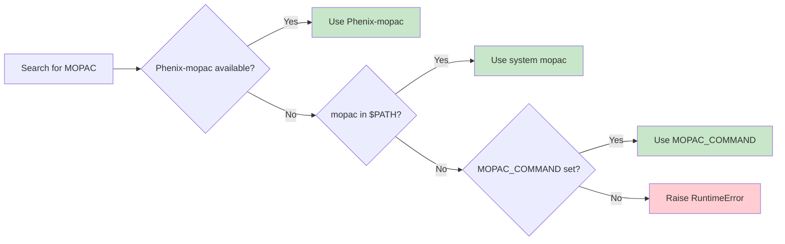

MOPAC (Molecular Orbital PACkage) provides semi-empirical quantum mechanics calculations within Q|R's quantum refinement framework. This integration enables fast QM restraints through PM7 and related methods, offering a computationally efficient alternative to higher-level QM codes.

Sources: [mopac_qr.py](plugin/ase/mopac_qr.py#L1-L50), [qm_interfaces.txt](rst_files/qr/qm_interfaces.txt#L90-L103)

## Architecture Overview

The MOPAC integration follows Q|R's plugin architecture, where the calculator extends ASE's base Calculator class and adapts its interface for quantum refinement workflows. The calculator handles input generation, job execution, and results parsing specifically optimized for crystallographic refinement scenarios.

```mermaid
graph TB
    A[Q|R Refinement] --> B[Engine Selection]
    B -->|engine_name='mopac'| C[MOPAC Calculator]
    C --> D[Input Generation]
    D --> E[MOPAC Execution]
    E --> F[Output Parsing]
    F --> G[Energy & Forces]
    G --> H[Restraint Generation]
    
    style C fill:#e1f5ff
    style E fill:#fff4e1
    style G fill:#e8f5e9
```

Sources: [mopac_qr.py](plugin/ase/mopac_qr.py#L26-L392), [restraints.py](restraints.py#L14-L15)

## Calculator Implementation

### Core Class Structure

The `Mopac` class in [`plugin/ase/mopac_qr.py`](plugin/ase/mopac_qr.py#L26) implements the following key attributes:

| Attribute Type | Parameters | Description |
|----------------|------------|-------------|
| **String** | `functional`, `job_type` | QM method and job specifications |
| **Integer** | `restart`, `spin`, `charge`, `nproc` | Calculation control parameters |
| **Boolean** | `OPT` | Optimization flag |
| **Float** | `RELSCF` | SCF convergence criteria |

The calculator initializes with PM7 as the default functional, which can be overridden via the `MOPAC_FUNCTIONAL` environment variable.

Sources: [mopac_qr.py](plugin/ase/mopac_qr.py#L20-L65)

### Input Generation

The `write_input()` method constructs MOPAC input files with the following structure:

- **Control Line**: Contains functional, job type, charge, spin state, and solvent parameters
- **Title Line**: "Title: ASE job"
- **Coordinates**: Atomic positions in Ångströms with force field flags
- **Periodic Boundary**: Cell vectors when PBC is enabled

Key configuration details include:
- Solvent model: `EPS=78.4` (water approximation)
- Thread specification: `THREADS=<nproc>` for parallel execution
- Charge handling: Explicit `CHARGE=` parameter
- Spin states: `DOUBLET` or `TRIPLET` for open-shell systems

Sources: [mopac_qr.py](plugin/ase/mopac_qr.py#L101-L159)

## Command Resolution

MOPAC executable location is determined through a priority system:



The `get_command()` method implements this search order, while `set_command()` allows manual override. This flexible approach accommodates various installation scenarios including conda environments and system-wide installations.

Sources: [mopac_qr.py](plugin/ase/mopac_qr.py#L161-L178)

## Results Parsing

### Energy Extraction

The `read_energy()` method locates the heat of formation from MOPAC output using multiple search patterns:
- `HEAT OF FORMATION` for standard calculations
- `H.o.F. per unit cell` for periodic systems
- Error detection for `UNABLE TO ACHIEVE SELF-CONSISTENCE`

Energy values are automatically converted from kcal/mol to ASE's internal units via the `kcal/mol` conversion factor.

Sources: [mopac_qr.py](plugin/ase/mopac_qr.py#L271-L295)

### Force Extraction

Force calculations handle two distinct output formats:

| Mode | Identifier | Force Location |
|------|-----------|----------------|
| **Standard** | `GRADIENT\n` | Column 49-62 of lines following marker |
| **Mozyme** | `FINAL POINT AND DERIVATIVES` | Columns 8-35 starting 5 lines after marker |

Infinite force values (marked as `*****`) are converted to large finite numbers (999999999.9999) to prevent numerical issues. Forces are negated to convert from gradient to force convention and unit-converted appropriately.

Sources: [mopac_qr.py](plugin/ase/mopac_qr.py#L296-L336)

## Q|R-Specific Extensions

The calculator implements specialized methods required for quantum refinement:

### Q|R Interface Methods

- **`set_charge(charge)`**: Sets molecular charge via integer parameter
- **`set_method(method)`**: Updates the semi-empirical functional (e.g., PM6, PM7)
- **`set_label(label)`**: Defines file naming convention for input/output
- **`set_nproc(nproc)`**: Configures thread count for parallel execution
- **`run_qr(atoms_new, **kwargs)`**: Main execution entry point that processes keyword arguments, copies atom objects, and initiates calculation

These methods bridge the ASE interface with Q|R's parameter system, allowing seamless integration with the refinement pipeline.

Sources: [mopac_qr.py](plugin/ase/mopac_qr.py#L367-L392)

### Default Configuration

When MOPAC is selected as the QM engine, Q|R automatically applies these defaults:

| Parameter | Value | Source |
|-----------|-------|--------|
| Method | `PM7` | [`refine.py`](refine.py#L231-L234) |
| Basis | Empty string (not used) | [`refine.py`](refine.py#L235-L236) |
| Job Type | `1SCF GRADIENTS AUX(0,PRECISION=9)` | [`mopac_qr.py`](plugin/ase/mopac_qr.py#L52) |
| Solvent | `EPS=78.4` | [`mopac_qr.py`](plugin/ase/mopac_qr.py#L143) |

Sources: [refine.py](refine.py#L230-L236), [mopac_qr.py](plugin/ase/mopac_qr.py#L51-L61)

## Installation and Configuration

### Requirements

| Platform | Environment Variables | Purpose |
|----------|----------------------|---------|
| **Linux** | `MOPAC_DIR` | Installation directory path |
| **All** | `MOPAC_COMMAND` | Full execution command |
| **All** | `MOPAC_FUNCTIONAL` | Override default functional |

### Installation Verification

Run the Q|R interface checker:
```bash
qr.build_interfaces
```

This command scans for available QM engines and reports installation status.

### Usage Example

```bash
qr.refine model.pdb model.mtz mode=refine engine_name=mopac
```

Custom method selection:
```bash
qr.refine model.pdb model.mtz mode=refine engine_name=mopac quantum.method=PM6
```

Sources: [qm_interfaces.txt](rst_files/qr/qm_interfaces.txt#L90-L103)

> [!TIP]
> The MOPAC interface automatically includes a water solvent model (EPS=78.4) in calculations. This approximation is suitable for protein crystallography but may need adjustment for non-aqueous environments via the job_type parameter.

## Fragmentation Integration

MOPAC calculations are performed on fragmented systems in parallel workflows. The [`command_line/fqm_mopac.py`](command_line/fqm_mopac.py) script demonstrates the integration pattern:

1. **Fragment Extraction**: Individual clusters are extracted from the full structure
2. **Charge Assignment**: Each fragment receives appropriate charge from the charge embedding system
3. **Parallel Execution**: Multiple fragments can be processed concurrently using multiprocessing
4. **Energy Aggregation**: Results are collected for restraint generation

The `get_qm_energy()` function shows the typical workflow:
```python
qm_engine.run_qr(atoms,
                 charge=qm_charge,
                 pointcharges=None,
                 coordinates=qm_pdb_file[:-4]+".xyz",
                 define_str=None)
energy = qm_engine.energy_free
```

Sources: [fqm_mopac.py](command_line/fqm_mopac.py#L38-L76)

## Advanced Features

### Atomic Comparison

The `atoms_are_equal()` method implements position and cell parameter comparison with tolerance (1.0e-6 Å). This prevents redundant calculations when atomic positions haven't changed significantly between refinement cycles.

### Threading Support

MOPAC parallelization is controlled via the `THREADS` parameter, which is automatically set from the `nproc` integer parameter. This enables efficient multi-core utilization for larger fragment calculations.

### Infinite Force Handling

When MOPAC reports forces as `*****` (indicating numerical overflow or convergence issues), the calculator substitutes a large finite value. This prevents crashes while flagging problematic regions for potential investigation.

Sources: [mopac_qr.py](plugin/ase/mopac_qr.py#L332-L361), [mopac_qr.py](plugin/ase/mopac_qr.py#L319-L332)

## Error Handling

The implementation includes several error detection mechanisms:

1. **Command Verification**: Raises RuntimeError if no executable is found
2. **Exit Code Checking**: Validates MOPAC return codes and reports errors with full stdout/stderr
3. **Energy Parsing**: Fails if heat of formation cannot be located
4. **Self-Consistency**: Detects and reports SCF convergence failures

> [!TIP]
> For large systems, consider reducing fragment size or adjusting the `RELSCF` parameter to improve convergence reliability. The default precision setting (AUX(0,PRECISION=9)) provides high accuracy but may be relaxed for faster iterations.

Sources: [mopac_qr.py](plugin/ase/mopac_qr.py#L179-L198), [mopac_qr.py](plugin/ase/mopac_qr.py#L289-L291)

## Comparison with Other QM Engines

| Feature | MOPAC | Gaussian | ORCA | xTB |
|---------|-------|---------|------|-----|
| **Method Type** | Semi-empirical | Ab initio/DFT | Ab initio/DFT | Semi-empirical |
| **Default Method** | PM7 | HF/STO-3G | User-specified | GFN2-xTB |
| **Speed** | Very Fast | Slow | Medium | Fast |
| **Accuracy** | Moderate | High | High | Moderate-High |
| **Parallel** | Threads | MPI | MPI | MPI |
| **Solvent Model** | EPS parameter | Continuum | Continuum | GBSA |

MOPAC's primary advantage is computational speed, making it suitable for initial refinement cycles and large systems where higher accuracy methods are prohibitive.

Sources: [qm_interfaces.txt](rst_files/qr/qm_interfaces.txt#L90-L120)

## Next Steps

- For general information on available QM engines, see [Supported QM Engines Overview](11-supported-qm-engines-overview)
- To learn about fragmentation strategies used with MOPAC, see [Understanding Fragmentation](7-understanding-fragmentation)
- For parameter tuning guidance, consult [Fragmentation Parameters](8-fragmentation-parameters)
- To explore other semi-empirical options, refer to [xTB Integration](16-xtb-integration)