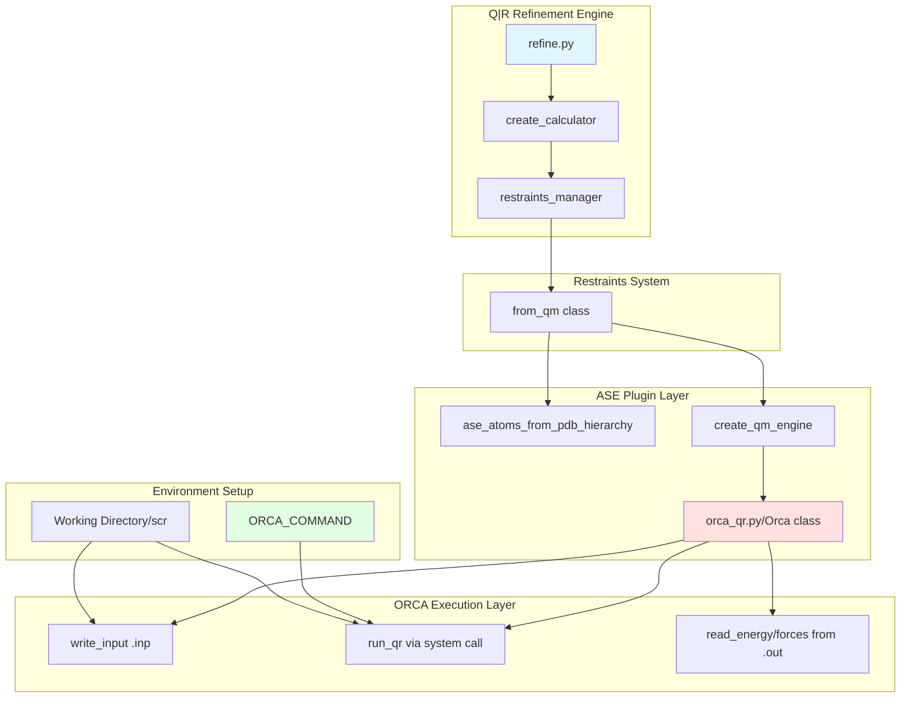
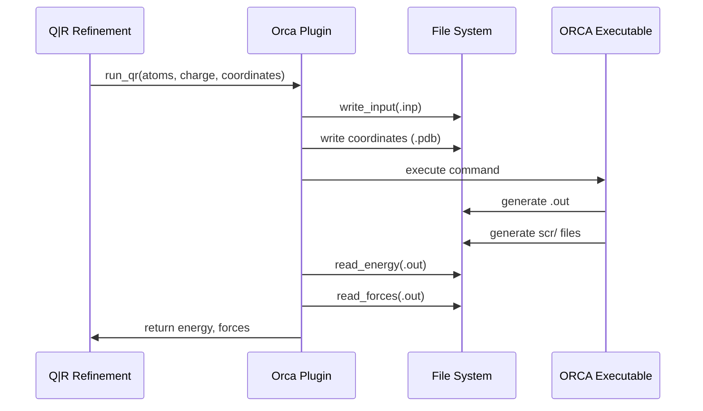

ORCA (An Ab Initio, Density Functional Theory and Semiempirical Package) integration enables quantum mechanical calculations through Q|R's fragment-based refinement workflow. The implementation provides a robust interface for energy and gradient computations using density functional theory (DFT) and Hartree-Fock methods with various basis sets and dispersion corrections.

## Architecture Overview

The ORCA integration follows Q|R's plugin architecture, leveraging the Atomic Simulation Environment (ASE) framework to create a standardized interface wrapper around ORCA's native capabilities. The architecture enables seamless integration with Q|R's refinement engine while maintaining flexibility for different quantum mechanical methods.



The integration flow demonstrates how ORCA's capabilities are accessed through a three-layer architecture: the Q|R refinement orchestrator, the ASE plugin abstraction layer, and the ORCA execution interface. Each layer handles specific responsibilities, from high-level refinement coordination to low-level input/output parsing.

Sources: [plugin/ase/orca_qr.py](plugin/ase/orca_qr.py#L36-L265), [restraints.py](restraints.py#L434-L646)

## Installation and Setup

ORCA must be installed independently from Q|R, with the execution path configured through environment variables. The plugin detects ORCA availability through the `ORCA_COMMAND` environment variable, which should contain the full path to the ORCA executable binary.

### Environment Configuration

The ORCA plugin searches for the execution command using a specific priority order. The `get_command()` method first checks for `ORCA_COMMAND`, then falls back to `Orca_COMMAND` (case-insensitive variant). This flexibility accommodates different system configurations while maintaining a primary standard.

Sources: [plugin/ase/orca_qr.py](plugin/ase/orca_qr.py#L111-L118)

### Default Parameter Settings

When ORCA is selected as the quantum engine without explicit method or basis specifications, Q|R applies sensible defaults through the `set_qm_defaults()` function. For ORCA, the default configuration uses Hartree-Fock theory with the 6-31G basis set, providing a balance between computational efficiency and accuracy for refinement tasks.

Sources: [refine.py](refine.py#L240-L290)

## Configuration Parameters

The ORCA plugin exposes a comprehensive set of configurable parameters that control the quantum mechanical calculation. These parameters are managed through the `key_parameters` dictionary and can be modified using setter methods that conform to the Q|R interface specification.

### Core Calculation Parameters

| Parameter | Type | Default | Description |
|-----------|------|---------|-------------|
| `basis` | string | '6-31g' | Atomic orbital basis set specification |
| `method` | string | 'rhf' | Quantum mechanical method (HF, DFT functional, etc.) |
| `charge` | string | '0' | Total molecular charge |
| `dftd` | string | 'yes' | Dispersion correction (D3, D3BJ, etc.) |
| `run` | string | 'gradient' | Calculation type (gradient for forces) |
| `memory` | integer | None | Memory allocation in MB via MaxCore |

### Advanced Options

| Parameter | Type | Default | Description |
|-----------|------|---------|-------------|
| `maxit` | integer | 200 | Maximum SCF iterations |
| `threall` | float | 1.0e-12 | SCF convergence threshold |
| `scf` | string | 'diis' | SCF convergence acceleration method |
| `gpumem` | integer | 512 | GPU memory allocation (if applicable) |
| `gpus` | string | '1    1' | GPU specification for parallel execution |

### Interface Methods

The plugin implements Q|R's standardized interface for quantum engine configuration:

```python
# Standard configuration methods
set_charge(charge)        # Set molecular charge
set_basis(basis)          # Set basis set
set_method(method)        # Set quantum method/DFT functional
set_label(label)          # Set calculation label/directory
set_memory(memory)        # Set memory allocation
```

These methods enable dynamic reconfiguration during refinement cycles, allowing adaptive adjustment of computational parameters based on convergence behavior.

Sources: [plugin/ase/orca_qr.py](plugin/ase/orca_qr.py#L249-L263), [plugin/ase/orca_qr.py](plugin/ase/orca_qr.py#L16-L19)

## Input File Generation

The `write_input()` method generates ORCA input files in the standard `.inp` format. The method constructs the input file with three key sections: the method line, coordinate specification, and charge/spin multiplicity settings.

### Input File Structure

The generated ORCA input follows a structured format:

```
! <method> <basis> EnGrad
%MaxCore <memory>

* xyz <charge> 1
<element_symbol> <x> <y> <z>
...
*
```

The method line combines the quantum mechanical method and basis set, with `EnGrad` specifying that energy gradients (forces) should be computed. The coordinate section uses ORCA's XYZ format specification with charge and multiplicity (defaulting to singlet, multiplicity=1).

Sources: [plugin/ase/orca_qr.py](plugin/ase/orca_qr.py#L75-L110)

### Coordinate File Generation

The plugin writes atomic coordinates to a temporary PDB file (`tmp_ase.pdb`) when the `orca_file` flag is not set to use existing input files. This enables the ASE atoms object to be serialized and passed to ORCA for calculation. The coordinates are extracted from the ASE atoms object using standard PDB format.

> [!TIP]
> The working directory includes a `scr` subdirectory that ORCA uses for scratch files. If a previous calculation has generated molecular orbital guess files (`c0`), the plugin automatically configures ORCA to use these files as initial guesses, significantly accelerating convergence for sequential refinement cycles.

Sources: [plugin/ase/orca_qr.py](plugin/ase/orca_qr.py#L75-L110), [plugin/ase/orca_qr.py](plugin/ase/orca_qr.py#L103-L108)

## Execution and Job Management

The `run_qr()` method orchestrates the complete ORCA calculation workflow, from input file generation through execution and result parsing. This method serves as the primary interface between Q|R's refinement engine and ORCA's computational capabilities.

### Calculation Workflow



The workflow demonstrates the complete execution cycle, including file generation, subprocess execution, and result parsing. The plugin uses `os.system()` for subprocess management, capturing both stdout and stderr to the output file for debugging purposes.

Sources: [plugin/ase/orca_qr.py](plugin/ase/orca_qr.py#L120-L160)

### Error Handling

The plugin implements robust error handling through exit code checking. If ORCA exits with a non-zero status code, a `RuntimeError` is raised with the exit information, allowing Q|R's refinement engine to handle calculation failures gracefully. This prevents silent failures and ensures users are notified of computational problems.

Sources: [plugin/ase/orca_qr.py](plugin/ase/orca_qr.py#L145-L148)

## Result Parsing

The plugin implements specialized methods for extracting energies and forces from ORCA's output files. These methods parse the textual output format and convert units to match Q|R's internal conventions.

### Energy Extraction

The `read_energy()` method searches for the line containing "FINAL SINGLE POINT ENERGY" in ORCA's output file. The energy value is extracted from the fourth word of this line, which ORCA reports in atomic units (Hartree). The plugin then converts the energy to kcal/mol for consistency with Q|R's energy scale.

Sources: [plugin/ase/orca_qr.py](plugin/ase/orca_qr.py#L161-L179)

### Force Extraction

The `read_forces()` method parses the cartesian gradient section identified by the "CARTESIAN GRADIENT" marker. ORCA reports gradients in Hartree/Bohr units, which the plugin converts to kcal/mol/Å through unit conversion factors. The method handles potential numerical issues, including infinite force values that ORCA reports as asterisks (`*****`), substituting a large finite value to prevent downstream failures.

Sources: [plugin/ase/orca_qr.py](plugin/ase/orca_qr.py#L180-L207)

### Unit Conversions

The plugin uses ASE's unit conversion system to transform ORCA's native units (Hartree for energy, Hartree/Bohr for gradients) into the kcal/mol and kcal/mol/Å units used throughout Q|R. This conversion ensures consistency with other quantum engines and the refinement engine's internal calculations.

Sources: [plugin/ase/orca_qr.py](plugin/ase/orca_qr.py#L10-L13), [plugin/ase/orca_qr.py](plugin/ase/orca_qr.py#L206-L207)

## State Management and Updates

The plugin implements sophisticated state management to optimize computational efficiency during refinement cycles. The `atoms_are_equal()` method compares atomic positions with a tolerance of 1.0e-6 Å, enabling detection of geometric changes that require recalculation.

### Update Logic

The `update()` method checks if new atomic coordinates differ significantly from the current state using the `atoms_are_equal()` comparison. If the atoms have changed beyond the tolerance threshold, the plugin updates the internal atoms object and triggers a new QM calculation via `run_qr()`. This optimization prevents redundant calculations when atomic positions are unchanged between refinement steps.

Sources: [plugin/ase/orca_qr.py](plugin/ase/orca_qr.py#L208-L237)

> [!TIP]
> The tolerance-based comparison accounts for floating-point arithmetic differences, ensuring that numerically identical positions are recognized as equal. This prevents unnecessary recalculations due to rounding errors that inevitably accumulate during iterative refinement.

## Integration with Q|R Workflow

The ORCA plugin integrates with Q|R's refinement architecture through the `from_qm` class in `restraints.py`. This class manages the creation and configuration of quantum mechanical restraints, handling fragment-level calculations and gradient accumulation.

### Engine Creation

The `create_qm_engine()` method instantiates the appropriate ASE calculator based on the `qm_engine_name` parameter. For ORCA, this creates an `Orca` class instance with all configured parameters, including method, basis set, charge, and memory allocation. The engine is then used for energy and force calculations on individual fragments.

Sources: [restraints.py](restraints.py#L480-L540)

### Fragment-Based Calculations

Q|R's fragment-based refinement strategy decomposes large macromolecular systems into smaller, computationally tractable fragments. Each fragment is treated as an independent quantum mechanical calculation, with the ORCA plugin computing energies and gradients for the fragment's atoms within the context of surrounding electrostatic embedding (point charges).

Sources: [fragment.py](fragment.py#L43-L365), [restraints.py](restraints.py#L434-L646)

### Gradient Assembly

The `target_and_gradients()` method in the `from_qm` class coordinates the calculation of total energy and gradients across all fragments. For each fragment, the method invokes the ORCA engine's calculation, then assembles the individual fragment gradients into a complete gradient array that represents the total quantum mechanical contribution to the refinement objective function.

Sources: [restraints.py](restraints.py#L552-L620)

## Usage Examples

### Basic Refinement with ORCA

The simplest invocation uses ORCA with default parameters:

```bash
qr.refine model.pdb model.mtz mode=refine engine_name=orca
```

This command initiates refinement using HF/6-31G calculations, with Q|R automatically handling fragment generation, point charge embedding, and gradient assembly.

Sources: [rst_files/qr/qm_interfaces.txt](rst_files/qr/qm_interfaces.txt#L27-L35)

### Custom DFT Functional

To use a specific DFT functional with a different basis set:

```bash
qr.refine model.pdb model.mtz mode=refine engine_name=orca \
    quantum.method=B3LYP quantum.basis=def2-SVP
```

This configuration uses B3LYP DFT with the def2-SVP basis set, providing higher accuracy for systems requiring more sophisticated electronic structure treatment.

Sources: [rst_files/qr/qm_interfaces.txt](rst_files/qr/qm_interfaces.txt#L27-L35)

### Parallel Execution

For parallel ORCA calculations, ensure the `ORCA_COMMAND` environment variable includes the full path with parallel execution flags:

```bash
export ORCA_COMMAND="/path/to/orca"  # Full path required
qr.refine model.pdb model.mtz mode=refine engine_name=orca \
    quantum.nproc=4
```

This enables ORCA's parallel capabilities across multiple CPU cores, accelerating calculations for larger fragments.

Sources: [rst_files/qr/qm_interfaces.txt](rst_files/qr/qm_interfaces.txt#L27-L35)

### Memory Configuration

To allocate more memory for large calculations:

```bash
qr.refine model.pdb model.mtz mode=refine engine_name=orca \
    quantum.memory=8000  # 8GB per core
```

This configuration increases the memory available to ORCA's SCF procedure, enabling treatment of larger basis sets and more complex systems.

Sources: [plugin/ase/orca_qr.py](plugin/ase/orca_qr.py#L262-L263)

## Comparison with Other QM Engines

ORCA offers distinct advantages and trade-offs compared to other quantum engines available in Q|R. Understanding these characteristics helps select the appropriate engine for specific refinement tasks.

| Engine | Default Method | Strengths | Limitations |
|--------|----------------|------------|-------------|
| **ORCA** | HF/6-31G | Robust DFT methods, extensive basis set library, good dispersion support | Requires external installation, commercial license |
| **MOPAC** | PM7 | Fast, semiempirical, no installation required | Limited accuracy for transition metals, parameter-dependent |
| **Gaussian** | HF/sto-3g | Widely benchmarked, extensive functionality | Commercial license, g16 requirement |
| **Turbomole** | BP86/def2-SV(P) | Efficient RI-J methods, good for medium systems | RI-J only, commercial license |
| **xTB** | GFN2-xTB | Very fast, good for large systems, includes GBSA | Semiempirical accuracy, fewer method options |
| **PySCF** | HF | Open source, Python-based, flexible | Slower than compiled engines |

> [!TIP]
> ORCA's combination of robust DFT implementations, efficient integral algorithms, and comprehensive dispersion corrections makes it particularly well-suited for refinement tasks requiring balanced accuracy and computational efficiency. The extensive basis set library enables systematic convergence studies, while the parallel execution capabilities scale well across multiple cores.

Sources: [rst_files/qr/qm_interfaces.txt](rst_files/qr/qm_interfaces.txt#L1-L200), [plugin/ase/README.md](plugin/ase/README.md#L1-L13)

## Performance Considerations

Several factors influence ORCA's performance within Q|R's refinement workflow. Understanding these factors enables optimization of computational resources and refinement efficiency.

### Fragment Size and Complexity

ORCA's computational cost scales approximately as O(N³) with system size for Hartree-Fock and O(N⁴) for hybrid DFT methods, where N represents the number of basis functions. Q|R's fragmentation strategy keeps individual fragments relatively small (typically 20-50 atoms), ensuring that ORCA calculations complete within reasonable timeframes even for large macromolecular systems.

Sources: [fragment.py](fragment.py#L45-L63)

### Convergence Acceleration

The plugin's automatic detection of molecular orbital guess files in the `scr/` directory provides significant convergence acceleration for sequential refinement cycles. Reusing converged wavefunctions from previous cycles reduces the number of SCF iterations by 50-80% compared to starting from core orbitals, dramatically improving overall refinement speed.

Sources: [plugin/ase/orca_qr.py](plugin/ase/orca_qr.py#L103-L108)

### Basis Set Selection

Larger basis sets increase computational cost quadratically to cubatically with the number of basis functions. For routine refinement, the default 6-31G basis provides a good balance. For final high-accuracy refinements, consider def2-SVP or larger basis sets, but be prepared for increased computational time and memory requirements.

Sources: [plugin/ase/orca_qr.py](plugin/ase/orca_qr.py#L16-L19)

## Troubleshooting

### Command Not Found

If Q|R reports "Orca command not specified", ensure the `ORCA_COMMAND` environment variable is properly set:

```bash
export ORCA_COMMAND="/full/path/to/orca"
```

Verify the path by running the command directly in a terminal. The full path is required for parallel execution configurations.

Sources: [plugin/ase/orca_qr.py](plugin/ase/orca_qr.py#L111-L118)

### SCF Convergence Failures

For fragments experiencing SCF convergence problems, consider these adjustments:

1. Increase `maxit` to allow more iterations
2. Tighten `threall` to improve convergence precision
3. Enable `dftd='D3BJ'` for better dispersion treatment
4. Use a simpler basis set for initial cycles, then refine with larger sets

These parameters can be set through the `set()` method or command-line arguments.

Sources: [plugin/ase/orca_qr.py](plugin/ase/orca_qr.py#L16-L19)

### Memory Allocation Errors

If ORCA reports insufficient memory, increase the `memory` parameter:

```bash
qr.refine ... engine_name=orca quantum.memory=16000  # 16GB
```

ORCA's memory allocation is per-core in the `MaxCore` specification. Ensure sufficient physical RAM is available, especially for parallel calculations with many cores.

Sources: [plugin/ase/orca_qr.py](plugin/ase/orca_qr.py#L262-L263)

### Force Parsing Errors

If the plugin fails to extract forces, check the ORCA output file for:

1. Proper convergence (no error messages)
2. Complete gradient section with "CARTESIAN GRADIENT" marker
3. Correct atomic count matching the input structure

Infinite force values marked with asterisks are handled automatically by the plugin, which substitutes large finite values to prevent downstream failures.

Sources: [plugin/ase/orca_qr.py](plugin/ase/orca_qr.py#L180-L207)

## Advanced Configuration

### Custom ORCA Input Files

For specialized calculations requiring custom ORCA keywords not exposed through the standard interface, set the `orca_file` parameter to `True` and provide a pre-formatted `.inp` file. The plugin will use this file directly instead of generating one from ASE atoms, enabling complete control over ORCA's input specification.

Sources: [plugin/ase/orca_qr.py](plugin/ase/orca_qr.py#L75-L78)

### Point Charge Embedding

The plugin supports electrostatic embedding through point charges specified via the `pointcharges` parameter in `run_qr()`. This enables QM/MM-style calculations where the QM region (fragment) experiences the electrostatic field of surrounding MM atoms represented as point charges, improving accuracy for polar environments.

Sources: [plugin/ase/orca_qr.py](plugin/ase/orca_qr.py#L120-L160)

### Alternative Conformation Handling

For structures with alternative conformations, Q|R's `from_altlocs` class manages multiple restraint calculations, with the ORCA plugin computing energies and gradients for each conformational variant. The results are combined according to the specified altloc handling method (subtraction or separate treatment).

Sources: [restraints.py](restraints.py#L257-L388)

## Next Steps

After mastering ORCA integration, consider exploring these related topics to enhance your quantum refinement capabilities:

- **Understanding Fragmentation**: Learn about Q|R's fragment generation strategies and how they balance accuracy with computational efficiency. [Understanding Fragmentation](7-understanding-fragmentation)

- **Fragmentation Parameters**: Customize fragment size, clustering methods, and charge embedding for your specific system. [Fragmentation Parameters](8-fragmentation-parameters)

- **QM vs CCTBX Restraints**: Compare quantum mechanical restraints with classical geometric restraints to understand when each approach is appropriate. [QM vs CCTBX Restraints](20-qm-vs-cctbx-restraints)

- **Gaussian Integration**: Explore ORCA's competitor Gaussian interface for comparison or when ORCA is unavailable. [Gaussian Integration](13-gaussian-integration)

- **Weight Factor Calculation**: Understand how Q|R balances experimental data against quantum mechanical restraints. [Weight Factor Calculation](24-weight-factor-calculation)