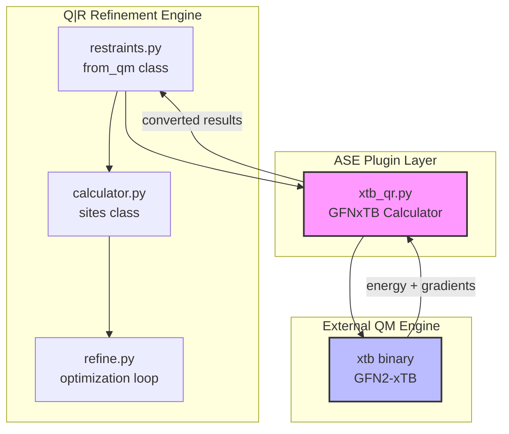
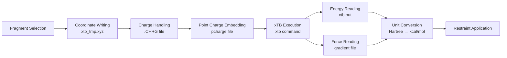

xTB (Extended Tight Binding) provides a computationally efficient semi-empirical quantum mechanical method ideally suited for macromolecular refinement in Q|R. This integration leverages the GFN (Geometry, Frequency, Noncovalent) force field family, particularly GFN2-xTB, to deliver accurate electronic structure calculations at a fraction of the computational cost of traditional DFT methods.

## Architecture Overview

The xTB integration follows Q|R's modular plugin architecture, implementing ASE's Calculator interface to provide seamless integration with the refinement workflow. The system consists of three primary layers: the ASE-compliant calculator wrapper, the QM restraint manager, and the refinement engine coordination.



The integration follows the [Restraint Manager Architecture](21-restraint-manager-architecture), where xTB functions as the QM engine providing electronic energies and atomic forces for fragment-based quantum restraints. The calculator maintains state across refinement cycles, managing temporary files, coordinate conversions, and energy unit transformations.

Sources: [xtb_qr.py](plugin/ase/xtb_qr.py#L22-L35), [restraints.py](restraints.py#L434-L452)

## Core Calculator Implementation

### GFNxTB Class Structure

The `GFNxTB` class extends ASE's base `Calculator` class, implementing Q|R-specific requirements while maintaining ASE compatibility. The calculator handles coordinate management, charge specification, and parallel execution configuration through its key parameter system.

```python
class GFNxTB(Calculator):
    name = 'gfn-xtb'
    
    def __init__(self,
                 label='ase_plugin',
                 coordinates='xtb_tmp.xyz',
                 charge='0',
                 version=2,
                 method='-gfn2',
                 nproc=1,
                 atoms=None,
                 pointcharges=None,
                 **kwargs):
```

Key parameters control calculator behavior: `method` specifies the GFN version (default `-gfn2`), `nproc` sets parallel execution threads, and `charge` defines the total molecular charge. The calculator maintains internal state for energies, forces, and stress calculations across refinement iterations.

Sources: [xtb_qr.py](plugin/ase/xtb_qr.py#L22-L44)

### Input/Output Management

The calculator manages molecular coordinates through XYZ files, writing ASE Atoms objects to temporary files for xTB consumption. Coordinate conversion follows ASE's internal unit conventions, with proper handling of Cartesian coordinates and periodic boundary conditions.

Energy extraction parses xTB's standard output format, identifying the "TOTAL ENERGY" line and converting from Hartree atomic units to kcal/mol for internal Q|R consistency. Force reading leverages xTB's Turbomole-format gradient output, handling the sign convention difference (forces = -gradients) and applying appropriate unit conversions.

Sources: [xtb_qr.py](plugin/ase/xtb_qr.py#L204-L249)

### Point Charge Embedding

For fragment-based calculations, xTB supports environmental embedding through point charges. The `set_pointcharges` method transforms external charge distributions into xTB's "pcharge" format, enabling QM/MM-style electrostatic embedding where the QM fragment feels the electrostatic field of the surrounding crystal environment.

```python
def set_pointcharges(self):
    f = open(self.pointcharges, "r")
    pchrg = f.readlines()
    f.close()
    f = open("pcharge","w")
    f.writelines(pchrg[0])
    f.writelines(pchrg[2:])
    f.close()
```

This functionality enables the [Partial Point Charges](29-partial-point-charges) workflow, where classical electrostatic environments influence QM fragment calculations. The point charge file format follows Turbomole conventions, parsing header and charge coordinate sections appropriately.

Sources: [xtb_qr.py](plugin/ase/xtb_qr.py#L250-L257)

## Installation and Configuration

### System Requirements

xTB requires proper binary installation and environment configuration. The calculator searches for the xtb binary using two strategies:

1. **XTBHOME environment variable**: Points to the xTB installation directory, with the binary expected at `$XTBHOME/bin/xtb`
2. **PATH search**: Falls back to system PATH using `shutil.which('xtb')`

Installation follows the standard xTB distribution procedures, with version 6.x recommended for Q|R compatibility. The binary must be executable and accessible from the refinement environment.

Sources: [xtb_qr.py](plugin/ase/xtb_qr.py#L92-L101)

### Verification

Q|R provides a command-line interface for verifying xTB installation and testing all available QM engines:

```bash
qr.build_interfaces
```

This utility checks binary availability, validates environment variables, and reports integration status for all supported QM calculators including xTB.

Sources: [qm_interfaces.txt](rst_files/qr/qm_interfaces.txt#L1-L10)

## Usage Configuration

### Basic Refinement Command

The standard refinement workflow specifies xTB as the quantum engine through the `engine_name` parameter:

```bash
qr.refine model.pdb model.mtz mode=refine engine_name=xtb
```

This configuration uses default GFN2-xTB with GBSA (Generalized Born Surface Area) implicit solvation, appropriate for most macromolecular refinement scenarios. The method provides balanced accuracy and computational efficiency for biological systems.

Sources: [qm_interfaces.txt](rst_files/qr/qm_interfaces.txt#L95-L110)

### Method Selection

Alternative GFN versions and method variants are specified through the `quantum.method` parameter:

```bash
# GFN1-xTB with explicit water GBSA
qr.refine model.pdb model.mtz engine_name=xtb \
    quantum.method='--gfn 1 --gbsa h2o'
```

Available options include:
- `--gfn 2`: GFN2-xTB (default, improved noncovalent interactions)
- `--gfn 1`: GFN1-xTB (faster, slightly less accurate)
- `--gbsa water/h2o`: Implicit solvation models
- `--gbsa methanol`: Alternative solvent parameters

Method selection should consider system size, required accuracy, and available computational resources. GFN2-xTB is recommended for most refinement tasks due to its improved treatment of dispersion and electrostatic interactions.

Sources: [qm_interfaces.txt](rst_files/qr/qm_interfaces.txt#L103-L108)

### Parallel Execution

The `nproc` parameter controls parallel execution, distributing computational load across multiple CPU cores:

```bash
qr.refine model.pdb model.mtz engine_name=xtb quantum.nproc=8
```

xTB's parallel implementation scales well for medium-sized fragments, with diminishing returns beyond 8-12 cores typical for semi-empirical methods. Parallel execution is particularly beneficial during gradient calculations, which dominate Q|R refinement cycles.

Sources: [xtb_qr.py](plugin/ase/xtb_qr.py#L140-L148)

### Charge Specification

System charge is specified through the `quantum.charge` parameter, with automatic charge detection available for non-clustered systems:

```bash
# Explicit charge specification
qr.refine model.pdb model.mtz engine_name=xtb quantum.charge=-2
```

For clustered fragment calculations, charge must be explicitly specified for each cluster. Automatic charge calculation uses the [Charge Calculations](28-charge-calculations) infrastructure, determining total molecular charge from atom types and formal charges.

Sources: [restraints.py](restraints.py#L461-L471)

## Integration with Q|R Workflow

### Fragment Processing Pipeline

The xTB calculator integrates with Q|R's fragmentation system through the `from_qm` restraint class. The workflow follows these steps:

1. **Fragment extraction**: Molecular system is decomposed into manageable QM fragments
2. **Coordinate conversion**: Cartesian coordinates are formatted as XYZ input files
3. **QM calculation**: xTB computes energies and forces for each fragment
4. **Result conversion**: Outputs are converted to internal Q|R units and formats
5. **Restraint application**: Gradients are applied to the full system through the restraint manager



This pipeline enables efficient parallel fragment processing, with each fragment handled independently through temporary calculation directories.

Sources: [xtb_qr.py](plugin/ase/xtb_qr.py#L108-L176)

### Engine Instantiation

The `from_qm` class instantiates the xTB calculator during refinement initialization:

```python
elif(self.qm_engine_name == "xtb"):
    calculator = GFNxTB()
```

Engine parameters are dynamically set through the calculator's interface methods, with Q|R parameter mapping handled automatically. This design allows consistent parameter handling across all supported QM engines.

Sources: [restraints.py](restraints.py#L506-L508)

### Parameter Mapping

Q|R's PHIL (Parameter Hierarchical Interface Language) parameters map to calculator-specific settings:

| Q|R Parameter | xTB Calculator Setting | Description |
|--------------|----------------------|-------------|
| `quantum.charge` | `set_charge()` | Total molecular charge |
| `quantum.nproc` | `set_nproc()` | Parallel execution threads |
| `quantum.method` | `set_method()` | GFN version and options |
| `quantum.basis` | (not used) | Semi-empirical methods don't use basis sets |

The `quantum.basis` parameter is ignored for xTB since semi-empirical methods use parameterized atomic orbitals rather than explicit basis sets. This contrasts with DFT engines like [Gaussian Integration](13-gaussian-integration) where basis set selection critically affects accuracy.

Sources: [restraints.py](restraints.py#L510-L533)

## Performance Characteristics

### Computational Efficiency

xTB's semi-empirical nature provides 2-3 orders of magnitude speed improvement compared to conventional DFT methods. Typical performance characteristics:

- **Small fragments** (< 50 atoms): < 1 second per energy/force evaluation
- **Medium fragments** (50-200 atoms): 1-10 seconds per evaluation
- **Large fragments** (200-500 atoms): 10-60 seconds per evaluation

Performance scales approximately as O(N²) with system size, where N is the number of atoms. This scaling compares favorably to DFT's O(N³) scaling, making xTB suitable for routine refinement of macromolecular systems.

Sources: [plugin/ase/README.md](plugin/ase/README.md#L1-L13)

### Memory Requirements

Memory usage scales linearly with system size, typically requiring:
- **Small fragments**: < 500 MB RAM
- **Medium fragments**: 500 MB - 2 GB RAM
- **Large fragments**: 2 - 8 GB RAM

Memory efficiency makes xTB suitable for high-throughput refinement scenarios and parallel execution on multi-core systems.

> [!TIP]
> For optimal performance in refinement workflows, balance fragment size against available computational resources. Larger fragments improve electrostatic embedding accuracy but increase per-evaluation time. The [Fragmentation Parameters](8-fragmentation-parameters) page provides guidance on fragment size selection strategies.

## Comparison with Other QM Engines

### Accuracy vs. Efficiency Trade-offs

| Engine | Method Type | Accuracy (relative) | Speed | Memory Use |
|--------|-------------|---------------------|-------|------------|
| xTB (GFN2) | Semi-empirical | ★★★☆☆ | Very Fast | Low |
| MOPAC (PM7) | Semi-empirical | ★★☆☆☆ | Very Fast | Low |
| ORCA (DFT) | First-principles | ★★★★☆ | Slow | High |
| Gaussian (DFT) | First-principles | ★★★★★ | Very Slow | Very High |
| PySCF (DFT) | First-principles | ★★★★☆ | Medium | Medium |

xTB provides the best balance of accuracy and efficiency for routine refinement tasks, particularly for systems where accurate noncovalent interactions are critical. The GFN2-xTB method includes parameterization for dispersion and electrostatics typically lacking in older semi-empirical methods like MOPAC's PM7.

Sources: [qm_interfaces.txt](rst_files/qr/qm_interfaces.txt#L10-L120)

### Appropriate Use Cases

**Use xTB when:**
- Refining large macromolecules with many QM atoms
- Running high-throughput refinement campaigns
- Balancing computational budget with accuracy requirements
- Studying systems where noncovalent interactions dominate
- Performing initial refinement before higher-level validation

**Consider DFT engines when:**
- Studying metal centers with complex electronic structure
- Investigating reaction mechanisms with transition states
- Validating critical structural features
- Publishing high-impact structural biology results

The choice between xTB and DFT engines should consider the scientific question, available computational resources, and required publication quality. Many workflows benefit from xTB-driven refinement followed by targeted DFT validation of critical regions.

## Troubleshooting

### Common Installation Issues

**Binary not found error:**
```
RuntimeError: $XTBHOME not set
```

Solution: Set the `XTBHOME` environment variable pointing to the xTB installation directory:
```bash
export XTBHOME=/path/to/xtb/installation
export PATH=$PATH:$XTBHOME/bin
```

**Permission denied errors:** Ensure the xtb binary is executable:
```bash
chmod +x $XTBHOME/bin/xtb
```

Sources: [xtb_qr.py](plugin/ase/xtb_qr.py#L92-L101)

### Calculation Failures

**SCF convergence issues:** If calculations fail to converge, try:
1. Reducing fragment size to avoid problematic electronic configurations
2. Checking for unusual oxidation states or charge distributions
3. Using `qr.status` to examine fragment charge assignments

**Gradient reading errors:** Verify xTB output format compatibility:
```python
# Check for 'cycle' marker in gradient file
# Ensure proper Turbomole format
```

Force reading errors typically indicate xTB version incompatibility or incomplete calculation termination.

Sources: [xtb_qr.py](plugin/ase/xtb_qr.py#L177-L189)

### Performance Optimization

For slow calculations:
1. Reduce `quantum.nproc` if core oversubscription is suspected
2. Check I/O performance for temporary file operations
3. Verify that only necessary fragments are calculated each cycle
4. Consider using [Clustering Algorithms](9-clustering-algorithms) to minimize redundant calculations

## Advanced Features

### Custom Method Specifications

Advanced users can pass arbitrary xTB command-line options through the method parameter:

```bash
qr.refine model.pdb model.mtz engine_name=xtb \
    quantum.method='--gfn 2 --gbsa water --etemp 300'
```

The `--etemp` parameter controls electronic temperature for finite-temperature electronic structure, useful for systems with near-degenerate electronic states.

Sources: [xtb_qr.py](plugin/ase/xtb_qr.py#L140-L148)

### Cluster Calculations

For clustered fragment workflows, charge specification becomes critical. Use the [Clustering Algorithms](9-clustering-algorithms) infrastructure to manage fragment charge distribution:

```bash
qr.refine model.pdb model.mtz engine_name=xtb \
    quantum.clustering=true \
    quantum.charge=-1
```

Cluster mode disables automatic charge detection, requiring explicit specification of total system charge and proper fragment charge partitioning.

Sources: [restraints.py](restraints.py#L461-L471)

## Next Steps

- **Understanding Fragmentation**: Learn about Q|R's fragment-based approach at [Understanding Fragmentation](7-understanding-fragmentation)
- **Restraint Architecture**: Explore how QM restraints integrate with refinement at [Restraint Manager Architecture](21-restraint-manager-architecture)
- **Alternative Engines**: Compare xTB with other QM options at [Supported QM Engines Overview](11-supported-qm-engines-overview)
- **Charge Handling**: Understand automatic charge calculation at [Charge Calculations](28-charge-calculations)
- **Clustering Strategies**: Optimize fragment organization with [Clustering Algorithms](9-clustering-algorithms)

The xTB integration provides an optimal balance of computational efficiency and chemical accuracy for routine quantum refinement workflows. Its seamless integration with Q|R's architecture enables straightforward adoption for both novice and expert users seeking improved structural models through quantum mechanical refinement.