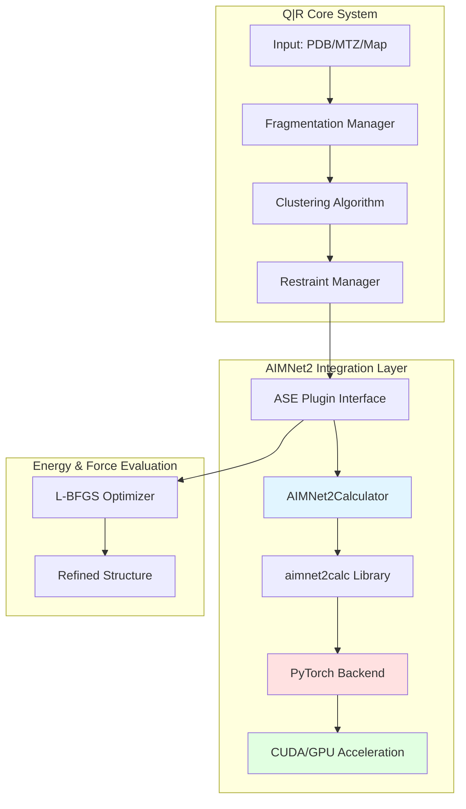
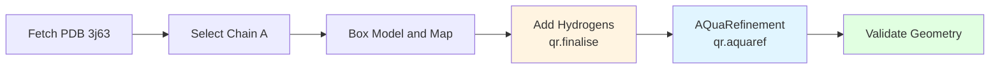

AQuaRef (AI-based Quantum Refinement) represents a paradigm shift in quantum-based refinement by leveraging the AIMNet2 neural network potential to achieve quantum-chemical accuracy with computational efficiency approaching classical force fields. This approach combines the scalability required for biomolecular structure refinement with the chemical accuracy traditionally associated with expensive quantum mechanical calculations.

## Architecture Overview

The AQuaRef integration follows a modular architecture where Q|R's fragmentation and restraint system interfaces with AIMNet2 through an ASE (Atomic Simulation Environment) calculator plugin. This design maintains the existing Q|R workflow while replacing traditional QM engines with the neural network potential.



The architecture demonstrates how AIMNet2 plugs into the existing Q|R ecosystem through the ASE interface, maintaining compatibility with the fragmentation, clustering, and restraint management systems while leveraging GPU acceleration through PyTorch.

## AIMNet2 Neural Network Potential

AIMNet2 is an AI-enhanced interatomic potential that combines the accuracy of quantum chemical methods with the speed of classical force fields. The model uses a machine learning approach trained on extensive quantum mechanical datasets to predict energies and forces directly from atomic structures without solving the Schrödinger equation during refinement.

The implementation in Q|R modifies the standard AIMNet2 ASE calculator to work seamlessly within the quantum refinement framework. The `AIMNet2Calculator` class extends `AIMNet2ASE` and implements the `run_qr` method that Q|R calls at each optimization step to obtain energies and forces.

Sources: [plugin/ase/aimnet2_qr.py](plugin/ase/aimnet2_qr.py#L1-L41), [plugin/ase/README.md](plugin/ase/README.md#L1-L13)

### Calculator Interface

The AIMNet2 calculator receives atomic coordinates, system charge, and optional point charges, then returns energies and forces in units compatible with Q|R's optimization engine. The key implementation handles unit conversion from Hartree to kcal/mol:

```python
def run_qr(self, atoms, coordinates, charge, pointcharges, define_str=None):
    atoms.calc = self
    self.atoms = atoms
    self.set_charge(charge)
    unit_convert = ase_units.kcal / ase_units.mol
    self.calculate(atoms, properties=['energy', 'forces'])
    self.energy_free = self.results['energy'][0] * unit_convert
    self.forces = self.results['forces'].astype(np.float64) * unit_convert
```

This method is called by the L-BFGS optimizer at each refinement step, providing the gradient information necessary for atomic coordinate updates.

Sources: [plugin/ase/aimnet2_qr.py](plugin/ase/aimnet2_qr.py#L17-L35)

## Installation Requirements

Installing AQuaRef and AIMNet2 requires attention to CUDA compatibility and PyTorch versions. The installation process differs slightly between CCTBX and Phenix environments.

### CCTBX Installation

For CCTBX-based installations, update your conda environment and install the AIMNet2 calculator package:

```bash
conda env update -f config/aimnet2.yaml
qrefine.python -m pip install git+https://github.com/zubatyuk/aimnet2calc.git
```

The environment configuration file specifies the required dependencies including PyTorch, CUDA toolkits, and supporting libraries like numba and pytorch-cluster.

Sources: [aimnet2.md](aimnet2.md#L1-L8), [config/aimnet2.yaml](config/aimnet2.yaml#L1-L14)

### Phenix Installation

For Phenix users, either use the provided update script or install directly into the Phenix conda environment:

```bash
conda env update -f -p /path/to/phenix/conda_base config/aimnet2.yaml
qrefine.python -m pip install git+https://github.com/zubatyuk/aimnet2calc.git
```

Alternatively, the `config/update_phenix.sh` script automates this process for convenience.

Sources: [aimnet2.md](aimnet2.md#L9-L13), [phenix.md](phenix.md)

### CUDA Version Specifics

Q|R provides configuration files for different CUDA versions to ensure compatibility with your GPU hardware and drivers:

| CUDA Version | Configuration File | PyTorch Variant |
|--------------|-------------------|-----------------|
| CUDA 11.8    | config/aimnet2_cuda11.txt | pytorch=*=cuda11* |
| CUDA 12.1    | config/aimnet2_cuda12.txt | pytorch=*=cuda12* |

Select the appropriate configuration based on your system's CUDA installation. Both versions require PyTorch, CUDA-Python, numba, and supporting libraries for neural network operations.

Sources: [config/aimnet2_cuda11.txt](config/aimnet2_cuda11.txt#L1-L9), [config/aimnet2_cuda12.txt](config/aimnet2_cuda12.txt#L1-L10)

### Apple Silicon Considerations

While Q|R can run on Apple Silicon, the AQuaRef functionality with clustering is not recommended due to unreliable pair interactions on this platform. If using CCTBX on Apple Silicon, create the environment with:

```bash
conda env create -n qrefine -f config/arm64-osx.yaml
```

For Phenix installations, switch the BLAS implementation to Apple's Accelerate framework for better performance.

Sources: [README.md](README.md#L32-L42), [config/arm64-osx.yaml](config/arm64-osx.yaml)

## Performance Optimization

AQuaRef achieves its speed advantage through GPU acceleration enabled by PyTorch and CUDA. Proper configuration ensures optimal performance.

### Environment Configuration

Set the following environment variable in your `.bashrc` or equivalent shell configuration file:

```bash
export NUMBA_CUDA_USE_NVIDIA_BINDING=1
```

This setting enables NVIDIA CUDA bindings for numba, which is essential for optimal CUDA performance in the AIMNet2 calculations.

Sources: [aimnet2.md](aimnet2.md#L19-L23)

### CUDA Verification

Verify that your CUDA components are correctly installed and accessible by running:

```bash
qrefine.python -c "import numba.cuda; print(numba.cuda.is_available())"
qrefine.python -c "import torch; print(torch.cuda.is_available())"
```

Both commands should return `True` to confirm that GPU acceleration is available. If either returns `False`, check your CUDA installation, PyTorch version compatibility, and GPU driver updates.

Sources: [aimnet2.md](aimnet2.md#L24-L26)

### TorchANI Integration (Optional)

While AIMNet2 is the primary neural network engine, TorchANI provides an alternative neural network potential interface. To install TorchANI:

```bash
conda install -p <phenix_conda> torchani -c conda-forge
```

To verify if the CUDA-optimized version is installed:

```bash
mamba list | grep torchani
ls $(qrefine.python -c 'import site; print(site.getsitepackages()[0])')/torchani/cuaev
```

The output should show `torchani=*=cuda...` and the `cuaev` directory should exist. If not, you may need to remove torchani and install via pip:

```bash
mamba remove torchani
pip install torchani
```

Sources: [aimnet2.md](aimnet2.md#L27-L55), [command_line/calculators.py](command_line/calculators.py#L120-L130)

## Usage Patterns

AQuaRef provides multiple interfaces for refinement depending on your workflow preferences and experimental data type.

### Command-Line Interface

For crystallographic refinement with AIMNet2:

```bash
qr.refine your_pdb.pdb your_map.map mode=refine engine=aimnet2
```

For cryo-EM real-space refinement, use the specialized AQuaRef command:

```bash
qr.aquaref your_model.pdb your_map.ccp4
```

The `qr.aquaref` command automatically sets `engine=aimnet2` and configures appropriate parameters for real-space refinement.

Sources: [command_line/aquaref.py](command_line/aquaref.py#L8-L9), [README.md](README.md#L86-L90)

### Workflow Integration

AQuaRef integrates seamlessly with Q|R's fragmentation strategy, allowing you to:

1. **Fragment large systems** using the established fragmentation algorithms
2. **Apply clustering** to group interacting fragments efficiently
3. **Compute QM restraints** via AIMNet2 instead of traditional QM engines
4. **Refine structures** with quantum-chemically accurate restraints

The neural network approach is particularly advantageous when working with large systems where traditional QM methods would be prohibitively expensive.

Sources: [fragmentation.py](fragmentation.py#L20-L43), [clustering.py](clustering.py)

## Example: Cryo-EM Refinement

A practical example demonstrates AQuaRef's effectiveness on cryo-EM data using chain A of PDB entry 3j63.

### Preparation Workflow

The example illustrates the complete AQuaRef workflow:



The preparation steps include:
1. **Data acquisition**: `phenix.fetch_pdb 3j63 action=model+data`
2. **Boxing**: `phenix.map_box` to limit the system to chain A
3. **Hydrogen completion**: `qr.finalise reduce=false` for atom-complete model
4. **Refinement**: `qr.aquaref 3j63_chainA_box_complete.pdb 3j63_chainA_box_masked.ccp4`

Sources: [examples/AQuaRef/README](examples/AQuaRef/README#L1-L38)

### Results Comparison

The AQuaRef refinement demonstrates dramatic improvements in model geometry while maintaining good model-to-data fit:

| Metric | Before Refinement | After Refinement | Improvement |
|--------|-------------------|------------------|-------------|
| **All-atom Clashscore** | 45.96 | 0.00 | 100% |
| **Ramachandran Outliers** | 4.49% | 0.00% | 100% |
| **Ramachandran Favored** | 85.39% | 100.00% | +14.61% |
| **Rotamer Outliers** | 5.48% | 0.00% | 100% |
| **CCmask** | 0.5418 | 0.5133 | -5.26% |
| **Rama-Z Score** | -4.46 (bad) | -2.14 (good) | Significant |

The slight decrease in CCmask (0.0285) accompanied by dramatically improved geometry indicates that the original model was overfitting the experimental data. The refined model achieves better chemical realism while maintaining reasonable agreement with the density.

> [!TIP]
> The perfect clashscore and Ramachandran statistics achieved in this example demonstrate AIMNet2's ability to find energetically favorable conformations that respect steric constraints—a key advantage of using quantum-based restraints over classical geometric restraints.

Sources: [examples/AQuaRef/README](examples/AQuaRef/README#L51-L143)

### Runtime Characteristics

The example system (89 residues) completes in less than 5 minutes depending on hardware, representing a significant speedup over traditional QM-based refinement methods while achieving quantum-level accuracy.

Sources: [examples/AQuaRef/README](examples/AQuaRef/README#L28-L30)

## Charge Handling

AQuaRef inherits Q|R's comprehensive charge handling system, which is critical for accurate quantum calculations. The charges module provides:

- **Residue-level charge calculation** for standard amino acids and nucleotides
- **Ligand charge derivation** from chemical component definitions
- **Total system charge validation** for electroneutrality
- **Partial point charge generation** for electrostatic embedding

The `charges_class` manages charge calculations across the entire molecular hierarchy, ensuring that AIMNet2 receives correctly charged fragments for energy evaluation.

Sources: [charges.py](charges.py#L74-L185), [charges.py](charges.py#L636-L660)

## Integration with Restraint System

AQuaRef's AIMNet2 calculator integrates with Q|R's restraint architecture through the ASE interface, generating quantum-derived restraints that supplement or replace classical geometric restraints.

### Restraint Generation Flow

```mermaid
sequenceDiagram
    participant F as Fragmentation Manager
    participant R as Restraint Manager
    participant A as AIMNet2 Calculator
    participant O as Optimizer
    
    F->>R: Provide fragment coordinates
    R->>A: Request energy & forces
    A->>A: Calculate via neural network
    A-->>R: Return E, F in kcal/mol
    R->>O: Apply QM restraints
    O->>O: L-BFGS optimization
    O->>R: Update coordinates
    R->>A: Request new energy & forces
```



The restraint manager coordinates the interaction between AIMNet2 and the optimization engine, ensuring that quantum restraints are properly weighted and combined with experimental data restraints.

Sources: [restraints.py](restraints.py), [calculator.py](calculator.py#L141-L172)

### Weight Factor Adaptation

Q|R's adaptive weight factor system automatically balances QM restraints against experimental data during refinement. The system increases restraint weight when bond RMSD exceeds thresholds and decreases it when geometry is already good, ensuring optimal convergence.

Sources: [calculator.py](calculator.py#L1-L6), [calculator.py](calculator.py#L241-L256)

## Comparison with Traditional QM Engines

AQuaRef's neural network approach offers distinct advantages and trade-offs compared to traditional quantum mechanical engines:

| Aspect | AIMNet2 (AQuaRef) | Traditional QM Engines |
|--------|-------------------|------------------------|
| **Speed** | Very fast (neural network) | Slower (electron structure) |
| **Accuracy** | QM-accurate (trained on QM data) | QM-accurate (direct calculation) |
| **System Size** | Excellent scaling | Limited by computational cost |
| **Charge Handling** | Supports arbitrary charges | Varies by engine |
| **Installation** | PyTorch/CUDA dependencies | External software required |
| **GPU Required** | Recommended for optimal performance | CPU-based (mostly) |
| **Method Flexibility** | Fixed neural network model | Multiple QM methods available |

The choice between AIMNet2 and traditional QM engines depends on your specific use case, available hardware, and need for methodological flexibility versus computational efficiency.

> [!TIP]
> For routine refinement of large biomolecular systems where speed is critical and QM-accuracy is desired, AIMNet2 provides an optimal balance. Traditional QM engines remain valuable for methodological development, benchmarking, or systems requiring specialized quantum chemical methods.

Sources: [plugin/ase/README.md](plugin/ase/README.md#L1-L13), [command_line/calculators.py](command_line/calculators.py#L95-L101)

## Troubleshooting

### CUDA Availability Issues

If `torch.cuda.is_available()` returns `False`:

1. Verify your GPU drivers are compatible with the installed CUDA version
2. Ensure PyTorch was installed with CUDA support (check `torch.version.cuda`)
3. Verify that the `NUMBA_CUDA_USE_NVIDIA_BINDING` environment variable is set
4. Check that GPU is visible: `nvidia-smi` should list your GPU

### Installation Failures

If `pip install git+https://github.com/zubatyuk/aimnet2calc.git` fails:

1. Ensure you're using the correct Python interpreter (`qrefine.python`)
2. Verify all dependencies in `config/aimnet2.yaml` are installed
3. Check that you have sufficient disk space and network connectivity
4. Consider updating conda and pip before installation

### Performance Issues

If refinement is slower than expected:

1. Verify GPU acceleration is active (check CUDA verification commands)
2. Ensure your system has adequate GPU memory
3. Consider reducing clustering size for very large systems
4. Check that you're using the latest version of aimnet2calc

## Next Steps

With AQuaRef and AIMNet2 configured, you can explore:

- **Advanced Fragmentation**: Learn about the fragmentation strategies that enable quantum refinement of large systems in [Understanding Fragmentation](7-understanding-fragmentation)
- **Clustering Algorithms**: Explore density-based clustering algorithms for efficient QM/MM partitioning in [Clustering Algorithms](9-clustering-algorithms)
- **Restraint Manager**: Understand how QM restraints are weighted and combined with experimental data in [Restraint Manager Architecture](21-restraint-manager-architecture)
- **Weight Factor Calculation**: Learn about adaptive weight factor optimization for balancing QM and experimental restraints in [Weight Factor Calculation](24-weight-factor-calculation)

AQuaRef represents the intersection of artificial intelligence and quantum chemistry, enabling quantum-level refinement of biomolecular structures at unprecedented scales. By leveraging neural network potentials, it bridges the gap between computational efficiency and chemical accuracy, making quantum refinement accessible for routine structural biology applications.