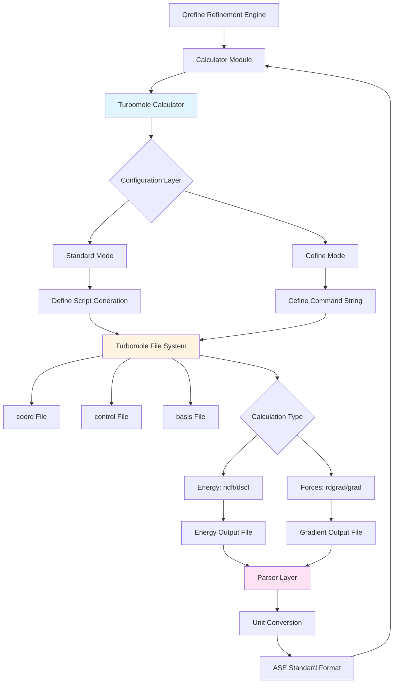
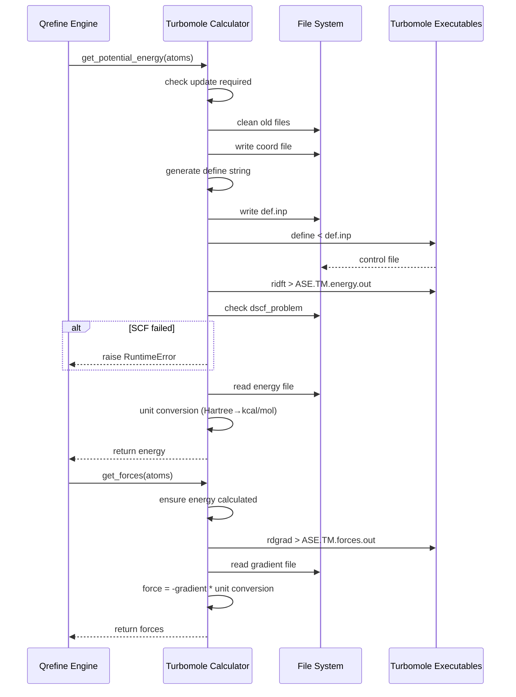

The Turbomole integration in Qrefine provides a high-performance quantum chemistry backend for quantum refinement workflows. This interface bridges the comprehensive Turbomole quantum chemistry package—renowned for its efficient density functional theory (DFT) and post-Hartree-Fock implementations—with the Q|R refinement architecture. The integration leverages the ASE (Atomic Simulation Environment) Calculator framework to deliver seamless energy and force calculations for molecular systems, enabling high-accuracy quantum mechanics refinements for crystallographic structures.

Sources: [turbomole_qr.py](plugin/ase/turbomole_qr.py#L1-L10), [qm_interfaces.txt](rst_files/qr/qm_interfaces.txt#L48-L59)

## Architecture Overview

The Turbomole interface follows Qrefine's modular QM engine architecture, implementing the ASE Calculator pattern to integrate Turbomole's executables with the refinement framework. This design enables direct execution of Turbomole's energy and gradient modules while managing file-based I/O operations transparently.



The interface operates through a sophisticated file-based communication protocol with Turbomole's native file system, managing the complete lifecycle from coordinate input to energy/force output parsing. The calculator automatically handles Turbomole's complex directory structure and control file generation, enabling both standard `define`-based configurations and the modern `cefine` interface for flexible method specification.

Sources: [turbomole_qr.py](plugin/ase/turbomole_qr.py#L30-L78), [turbomole_qr.py](plugin/ase/turbomole_qr.py#L140-L178)

## Core Components

### Turbomole Calculator Class

The `Turbomole` class extends ASE's Calculator base class and implements Qrefine-specific requirements for quantum refinement. The calculator maintains internal state for energy, forces, and convergence status while providing methods for calculation execution and result parsing.

**Key Parameters:**

| Parameter | Default | Description | Acceptable Values |
|-----------|---------|-------------|-------------------|
| `calculate_energy` | 'ridft' | Energy calculation executable | 'ridft', 'dscf' |
| `calculate_forces` | 'rdgrad' | Force calculation executable | 'rdgrad', 'grad' |
| `charge` | '0' | Molecular charge | String integer |
| `method` | 'b-p' | DFT functional | Any Turbomole-supported functional |
| `basis` | 'def2-SV(P)' | Basis set | Turbomole basis set names |
| `pointcharges` | None | Point charges file path | File path or None |
| `post_HF` | False | Post-Hartree-Fock correction flag | Boolean |
| `maxit` | 200 | Maximum SCF iterations | Integer |

Sources: [turbomole_qr.py](plugin/ase/turbomole_qr.py#L30-L60), [turbomole_qr.py](plugin/ase/turbomole_qr.py#L22)

> [!TIP]
> The calculator automatically switches between RI-J (ridft/rdgrad) and conventional (dscf/grad) methods based on the presence of `$rij` in the control file. This optimization enables efficient calculations for large systems by leveraging Turbomole's resolution-of-identity approximation.

### Configuration Modes

The interface supports two distinct configuration modes, offering flexibility for different use cases:

**Standard Mode (define-based):** Uses Turbomole's traditional `define` script for interactive configuration. This mode generates a comprehensive define string covering coordinates, basis set assignment, SCF parameters, and DFT settings. The default configuration sets up RI-DFT with 4000 MB memory allocation, 300 maximum SCF iterations, and automatic integral screening.

**Cefine Mode:** Provides advanced configuration through Turbomole's modern cefine command-line interface. This mode supports complex method specifications including dispersion corrections, frozen core options, and minimally contracted basis sets. Cefine is activated by setting `quantum.basis='cefine'` in the refinement command.

Sources: [turbomole_qr.py](plugin/ase/turbomole_qr.py#L4-L7), [turbomole_qr.py](plugin/ase/turbomole_qr.py#L157-L171)

## Calculation Workflow

The Turbomole integration implements a robust workflow that handles energy and force calculations with automatic convergence checking and error recovery.



The workflow demonstrates the calculator's attention to critical reliability features: automatic cleanup of previous calculation files prevents state contamination, convergence checking via the `dscf_problem` file identifies failed SCF cycles before result processing, and proper unit conversion ensures compatibility with the ASE standard energy (kcal/mol) and force units.

Sources: [turbomole_qr.py](plugin/ase/turbomole_qr.py#L100-L146), [turbomole_qr.py](plugin/ase/turbomole_qr.py#L179-L231), [turbomole_qr.py](plugin/ase/turbomole_qr.py#L242-L252)

## Data Processing and Unit Conversions

Turbomole outputs energies in atomic units (Hartree) and gradients in Hartree/Bohr, requiring conversion to ASE's standard units for compatibility with the refinement engine. The interface applies precise conversion factors:

- **Energy conversion:** `energy_ase = energy_au × (Hartree / (kcal/mol))`
- **Force conversion:** `forces_ase = -gradients_au × (Hartree/Bohr) / (kcal/mol)`

The negative sign in force conversion reflects Turbomole's convention of outputting gradients rather than forces. The parser handles both scientific notation (e.g., "1.23E-45") and Fortran D notation (e.g., "1.23D-45") for robust numeric parsing.

Sources: [turbomole_qr.py](plugin/ase/turbomole_qr.py#L10-L14), [turbomole_qr.py](plugin/ase/turbomole_qr.py#L203-L230)

## QM/MM Point Charge Support

The Turbomole interface explicitly supports QM/MM calculations through point charge embedding, essential for large molecular systems where treating the entire system quantum mechanically would be computationally prohibitive. The implementation injects external point charges into Turbomole's control file before calculation execution.

**Point Charge Integration Process:**
1. Read external point charges from the specified file
2. Parse existing control file contents
3. Insert `$point_charges` directive followed by charge values
4. Rewrite control file with embedded charges
5. Execute calculation with point charge potential included

This enables realistic modeling of protein environments where quantum regions (e.g., active sites, ligands) experience electrostatic effects from the surrounding molecular framework treated as point charges.

Sources: [turbomole_qr.py](plugin/ase/turbomole_qr.py#L75-L99), [turbomole_qr.py](plugin/ase/turbomole_qr.py#L311-L328)

## Configuration and Usage

### Basic Refinement Command

The standard Turbomole refinement uses default BP86/def2-SV(P) methodology with RI-J acceleration:

```bash
qr.refine model.pdb model.mtz mode=refine engine_name=turbomole
```

**Default Calculation Parameters:**
- DFT Functional: BP86 (Becke-Perdew 86)
- Basis Set: def2-SV(P) (Ahrens' triple-zeta valence polarization)
- SCF Acceleration: RI-J (Resolution of Identity for Coulomb)
- Memory: 3000 MB
- Max SCF Iterations: 200

Sources: [qm_interfaces.txt](rst_files/qr/qm_interfaces.txt#L50-L59), [turbomole_qr.py](plugin/ase/turbomole_qr.py#L32-L38)

### Advanced Configuration Examples

**High-accuracy hybrid functional calculation:**

```bash
qr.refine model.pdb model.mtz mode=refine \
  engine_name=turbomole \
  quantum.method='pbe0' \
  quantum.basis='def2-TZVP'
```

> [!TIP]
> When switching to larger basis sets (def2-TZVP, def2-QZVP), increase the Turbomole memory allocation via the `maxit` parameter or modify the define string to ensure sufficient computational resources for integral storage and exchange calculations.

**Dispersion-corrected DFT with frozen core:**

```bash
qr.refine model.pdb model.mtz mode=refine \
  engine_name=turbomole \
  quantum.basis='cefine' \
  quantum.method='cefine -func pbe0 -d3 -fon -bas def2-TZVP -ri -noopt'
```

This configuration invokes the cefine interface with:
- PBE0 hybrid functional
- Grimme's D3 dispersion correction
- Frozen core orbitals
- RI-J acceleration
- No pre-optimization

Sources: [turbomole_qr.py](plugin/ase/turbomole_qr.py#L4-L7), [turbomole_qr.py](plugin/ase/turbomole_qr.py#L168-L171)

### Charged System Refinement

For systems with net charge or multiple charge states:

```bash
qr.refine model.pdb model.mtz mode=refine \
  engine_name=turbomole \
  quantum.charge='-1' \
  quantum.method='b3-lyp' \
  quantum.basis='def2-SVP'
```

The charge parameter modifies the Turbomole define string, ensuring proper electron count and SCF convergence behavior for ionic species.

Sources: [turbomole_qr.py](plugin/ase/turbomole_qr.py#L269-L277)

## Installation and Requirements

The Turbomole interface requires a valid Turbomole installation accessible through the system PATH or explicitly configured environment variables. Unlike some other QM interfaces, Turbomole does not have a dedicated environment variable in the current implementation—executables are called directly through shell subprocess execution.

**Installation Prerequisites:**
- Valid Turbomole license (academic/commercial)
- Turbomole binaries in system PATH
- Compatible ASE installation (≥3.22.1)
- Python environment with NumPy support

**System Integration:**
The Qrefine conda environment includes ASE and dependencies but excludes Turbomole itself due to licensing restrictions. Users must obtain and install Turbomole separately following the official installation guide from [www.turbomole.com](http://www.turbomole.com/).

Sources: [environment.yaml](environment.yaml#L1-L22), [qm_interfaces.txt](rst_files/qr/qm_interfaces.txt#L47-L49), [turbomole_qr.py](plugin/ase/turbomole_qr.py#L259-L266)

## Error Handling and Troubleshooting

The Turbomole interface implements comprehensive error detection and reporting mechanisms:

| Error Condition | Detection Method | Action Taken |
|----------------|------------------|--------------|
| SCF Convergence Failure | `dscf_problem` file presence | Raise RuntimeError with define suggestion |
| Abnormal Process Termination | stderr contains 'abnormally' | Raise OSError with error output |
| Non-zero Exit Code | subprocess returncode ≠ 0 | Raise RuntimeError with exit code |
| Gradient File Corruption | 'cycle' marker not found | Raise RuntimeError for gradient check |
| Invalid Force Values | '***' pattern in gradient file | Raise RuntimeError for invalid data |

**Common Troubleshooting Scenarios:**

1. **SCF Non-convergence:** Increase maximum iterations via `quantum.maxit=500` or use level shifting in the define string. Consider tightening convergence criteria for problematic systems.

2. **Memory Exhaustion:** Increase the memory allocation in the define string from the default 3000 MB. Turbomole memory scales with basis set size and system dimensionality.

3. **Missing Executables:** Verify Turbomole binaries are in the PATH. Test directly via `ridft` and `rdgrad` commands in the terminal.

4. **Gradient Parsing Failures:** Check the `gradient` file for non-standard output formats. Some post-HF methods produce gradient files requiring manual inspection.

Sources: [turbomole_qr.py](plugin/ase/turbomole_qr.py#L107-L118), [turbomole_qr.py](plugin/ase/turbomole_qr.py#L75-L99), [turbomole_qr.py](plugin/ase/turbomole_qr.py#L216-L230)

## Integration with Qrefine Ecosystem

The Turbomole calculator integrates seamlessly with Qrefine's broader quantum refinement infrastructure, supporting all major refinement modes and advanced features:

**Supported Refinement Modes:**
- **Full refinement:** Complete structure optimization with QM-derived restraints
- **Hybrid refinement:** Mixed QM/CCTBX restraints for selective quantum treatment
- **Cluster refinement:** Fragmented QM calculations for large systems

**Feature Compatibility:**
- **Fragmentation:** Turbomole calculations can be applied to individual fragments via the clustering system
- **Restraint generation:** QM forces translate directly into Qrefine restraint dictionaries
- **Weight adaptation:** The adaptive weight factor mechanism handles QM/CCTBX restraint balance
- **Alternative conformations:** Multiple conformers are processed through parallel Turbomole jobs

The interface respects Qrefine's calculator abstraction layer, enabling straightforward substitution with other QM engines (Gaussian, ORCA, xTB) without modification of higher-level refinement logic.

Sources: [calculator.py](calculator.py#L85-L189), [qm_interfaces.txt](rst_files/qr/qm_interfaces.txt#L1-L13)

## Performance Considerations

Turbomole's computational efficiency makes it particularly suitable for medium-sized quantum regions in macromolecular refinement. Key performance characteristics:

**Computational Scaling:**
- RI-DFT methods scale as O(N²) vs O(N³) for conventional DFT
- Memory requirements scale linearly with basis set quality
- Parallel execution available for most Turbomole modules

**Recommended Usage Patterns:**
- **Small fragments (<50 atoms):** def2-TZVP with hybrid functionals
- **Medium fragments (50-150 atoms):** def2-SV(P) with GGA functionals and RI-J
- **Large fragments (>150 atoms):** Consider semi-empirical methods (xTB) or fragmentation with smaller basis sets

**Resource Optimization:**
- Use frozen core approximations for transition metals and heavy elements
- Enable RI-J for all systems where available basis sets support it
- Consider dispersion corrections only for non-covalent interaction regions

Sources: [turbomole_qr.py](plugin/ase/turbomole_qr.py#L242-L252), [qm_interfaces.txt](rst_files/qr/qm_interfaces.txt#L50-L59)

## Next Steps

For comprehensive understanding of quantum refinement with Turbomole, explore the following topics:

- **Supported QM Engines Overview**: Compare Turbomole capabilities with other QM interfaces like [Gaussian Integration](13-gaussian-integration), [ORCA Integration](14-orca-integration), and [xTB Integration](16-xtb-integration)

- **Fragmentation Strategy**: Learn how to partition large macromolecules for efficient Turbomole calculations via [Understanding Fragmentation](7-understanding-fragmentation) and [Clustering Algorithms](9-clustering-algorithms)

- **Restraints System**: Understand how Turbomole-derived forces integrate with the refinement framework through [QM vs CCTBX Restraints](20-qm-vs-cctbx-restraints) and [Restraint Manager Architecture](21-restraint-manager-architecture)

- **Optimization Engine**: Examine the weight factor calculation and minimization procedures that incorporate Turbomole energy gradients in [Weight Factor Calculation](24-weight-factor-calculation) and [Real Space Refinement](26-real-space-refinement)