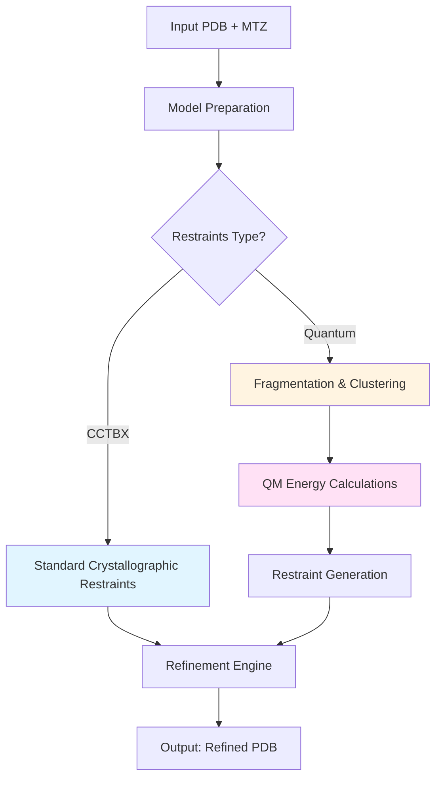

Welcome to Q|R (Quantum Refinement), a tool that combines quantum chemistry with crystallographic refinement to improve biomacromolecular structures, especially when working with low-resolution data from X-ray crystallography or cryo-EM experiments. This guide will get you running your first refinement in minutes.


## What You'll Learn

This Quick Start guide covers the essential steps to:
- Install Q|R using conda
- Verify your installation with built-in tests
- Prepare your structural model for refinement
- Run your first quantum refinement using MOPAC
- Understand the basic workflow and command-line options

After completing this guide, you'll be ready to explore more advanced features like [Understanding Fragmentation](7-understanding-fragmentation), different QM engines in [Supported QM Engines Overview](11-supported-qm-engines-overview), and the clustering algorithms in [Clustering Algorithms](9-clustering-algorithms).

## Installation

Q|R supports two installation paths. For beginners and researchers wanting the fastest path to productive refinement, the **CCTBX conda installation** is recommended.

### Prerequisites

Before installing Q|R, ensure you have:
- Python ≥ 3.9
- Conda binary (miniconda or mamba recommended)
- 2-5 GB of free disk space

### CCTBX Installation (Recommended for Open Source Users)

The CCTBX installation provides a complete open-source environment with MOPAC and xTB quantum engines pre-configured:

```bash
# Clone the repository
git clone https://github.com/qrefine/qrefine.git qrefine && cd qrefine

# Create conda environment with all dependencies
conda env create -n qrefine -f environment.yaml

# Activate the environment
conda activate qrefine

# Configure Q|R within CCTBX
bash ./build_into_conda.sh

# Source the paths (run this for every new shell)
source <path_shown_in_previous_step>/setpaths.sh
```

Sources: [environment.yaml](environment.yaml#L1-L22), [cctbx.md](cctbx.md#L1-L44)

### Alternative: Phenix Installation

If you're already a PHENIX user, Q|R integrates seamlessly with the PHENIX suite:

```bash
# Activate your PHENIX environment
source path_to_phenix/phenix_env.sh

# Navigate to qrefine and install
cd qrefine
sh build_into_phenix.sh
```

Sources: [phenix.md](phenix.md#L1-L33)

> [!TIP]
> For Apple Silicon users, clustering on macOS may be unreliable due to pair interaction issues. Use the alternative environment configuration: `conda env create -n qrefine -f config/arm64-osx.yaml`

## Verification: Run Built-in Tests

After installation, verify everything works correctly by running the test suite. This step is crucial—it confirms your environment is properly configured before you start working with your own data.

```bash
# Create a temporary directory for tests
mkdir test_qrefine && cd test_qrefine

# Run the test suite
qr.test
```

The test suite exercises core functionality including refinement, restraint calculations, and quantum engine integration. If all tests pass, your installation is ready for production use.

Sources: [README.md](README.md#L39-L44), [command_line/test.py](command_line/test.py)

## Understanding the Q|R Workflow

Before diving into refinement commands, it's helpful to understand the Q|R architecture. The system divides large biomacromolecules into smaller, quantum-chemically tractable fragments using a **divide and conquer** approach:



The workflow consists of three main phases:

1. **Model Preparation**: Completing missing atoms, adding hydrogens, and validating structure
2. **Restraint Calculation**: Either using standard CCTBX restraints or generating quantum-derived restraints via fragmentation
3. **Refinement**: Optimizing atomic positions against experimental data using calculated restraints

Sources: [refine.py](refine.py#L1-L20), [README.md](README.md#L10-L20)

## Your First Refinement: CCTBX Mode

The fastest way to get started is using **CCTBX restraints**, which employs standard parameterized library-based restraints. This mode is ideal for initial refinement runs and for systems where quantum refinement isn't necessary.

### Basic Command Structure

The primary command for refinement is `qr.refine`, which requires:
1. An MTZ file containing experimental data (structure factors)
2. A PDB file containing the atomic model
3. Optional parameters to control refinement behavior

Sources: [command_line/qr.py](command_line/qr.py#L1-L9), [tests/unit/run_tests.py](tests/unit/run_tests.py#L49-L62)

### Running a CCTBX Refinement

Here's the simplest possible refinement command:

```bash
qr.refine your_structure.pdb your_data.mtz restraints=cctbx
```

This command will:
- Load the experimental data and structural model
- Use standard CCTBX restraints for geometric constraints
- Run optimization cycles to minimize the discrepancy between model and data
- Output a refined PDB file (typically named `your_structure_refined.pdb`)

**Example output**:
```
Rw: 0.3230 Rf: 0.3113 Rf-Rw: -0.0117 rmsd(b):  0.0151 rws:  1.000 n_fev: 0
...
Best r_work: 0.2526 r_free: 0.2966
```

Sources: [examples/3dtj/README.md](examples/3dtj/README.md#L43-L63)

### Available Command-Line Options

To see all available options and their default values:

```bash
qr.refine --show-defaults
```

Key parameters you might want to adjust:

| Parameter | Default | Description |
|-----------|---------|-------------|
| `restraints` | `cctbx` | Type of restraints: `cctbx` (fast) or `qm` (quantum) |
| `max_iterations_refine` | 100 | Maximum refinement cycles |
| `data_weight` | auto | Weight of experimental data vs. restraints |
| `clustering` | True | Enable/disable fragmentation (for large systems) |
| `output_folder_name` | None | Directory for output files |

Sources: [qr.py](qr.py#L12-L78), [README.md](README.md#L68-L72)

## Model Preparation: Adding Missing Atoms

Quantum refinement requires a **complete atomic model** with all hydrogen atoms and missing side-chain residues present. The `qr.finalise` tool automates this preparation step.

### Running Model Completion

```bash
qr.finalise your_structure.pdb
```

This command:
- Adds missing hydrogen atoms using Reduce/ReadySet
- Completes missing side-chain atoms and termini
- Validates the overall charge of the molecule
- Outputs `your_structure_complete.pdb`

**Example validation**:
```bash
# Check charge before finalisation (may show nonsensical results)
qr.charges your_structure.pdb verbose=true
# Output: Charge: -1292 (invalid)

# Check charge after finalisation
qr.charges your_structure_complete.pdb verbose=true
# Output: Charge: 0 (valid)
```

Sources: [command_line/finalise.py](command_line/finalise.py#L1-L116), [examples/3dtj/README.md](examples/3dtj/README.md#L99-L136)

> [!TIP]
> Always run `qr.finalise` before quantum refinement. Incomplete models can cause QM calculations to fail or produce meaningless results. The tool also checks that the total charge is physically reasonable.

## Quantum Refinement with MOPAC

Once you have a complete model, you can perform **quantum refinement** using the MOPAC semi-empirical QM engine. This provides more accurate chemical restraints than standard library-based methods.

### Basic Quantum Refinement Command

```bash
qr.refine your_complete.pdb your_data.mtz restraints=qm engine=mopac
```

This command triggers the full Q|R pipeline:
1. Fragments the structure into manageable pieces (default: ≤15 residues per cluster)
2. Computes QM energies and gradients for each fragment using MOPAC
3. Generates quantum-derived geometric restraints
4. Refines the structure using these restraints against experimental data

### Example from Test Data

Q|R includes test data you can use to practice:

```bash
# Navigate to test data directory
cd qrefine/tests/unit

# Run quantum refinement with MOPAC
qr.refine data_files/m00_poor.pdb data_files/2olx.mtz \
  restraints=qm engine=mopac clustering=False mode=opt
```

The `mode=opt` parameter performs geometry optimization without experimental data weighting, useful for testing QM calculations.

Sources: [tests/unit/tst_01.py](tests/unit/tst_01.py#L36-L45), [README.md](README.md#L74-L79)

## Clustering for Large Systems

For systems larger than ~500 atoms, Q|R automatically applies **clustering** to divide the structure into smaller fragments. You can inspect and control this process.

### Inspecting Cluster Configuration

```bash
qr.cluster your_structure.pdb
```

This displays:
- Maximum residues per cluster (default: 15)
- Residue indices assigned to each cluster
- Clustering time and statistics

**Example output**:
```
max number of residues in each cluster: 15

Residue indices for each cluster:
[[120, 121, 122, 123, 124, 125, 126, 127, 128, 129, 130, 131, 146],
 [189, 190, 192, 193, 194, 195, 196, 197, 198, 199, 200, 201, 202],
 ...]

Time: 53.6436
```

Sources: [examples/3dtj/README.md](examples/3dtj/README.md#L75-L94), [command_line/cluster.py](command_line/cluster.py#L1-L9)

### Visualizing Fragments

To understand how your structure is being fragmented for QM calculations:

```bash
qr.fragmentation your_complete.pdb
```

This generates PDB files for each fragment with buffer regions, allowing you to visually inspect the fragmentation strategy in molecular visualization tools like PyMOL or VMD.

**Output files created**:
- `0.pdb`, `1.pdb`, `2.pdb`, ... - Individual fragments
- `0_cluster.pdb`, `1_cluster.pdb`, ... - Fragments with buffer regions
- Point charge files for electrostatic embedding

Sources: [examples/3dtj/README.md](examples/3dtj/README.md#L148-L184), [command_line/fragmentation.py](command_line/fragmentation.py#L1-L52)

## Troubleshooting Common Issues

### Installation Fails

**Problem**: Conda environment creation fails
- **Solution**: Ensure you have conda ≥23.10 or use mamba for faster dependency resolution

**Problem**: Module not found errors after installation
- **Solution**: Make sure you've sourced the `setpaths.sh` script as shown in the installation section

### Refinement Errors

**Problem**: "No model file found"
- **Solution**: Check that you're providing both PDB and MTZ files in the correct order: `qr.refine model.pdb data.mtz`

**Problem**: QM calculations fail to converge
- **Solution**: Try `gradient_only=1` to use only QM gradients without full energy minimization: `qr.refine model.pdb data.mtz engine=mopac gradient_only=1`

**Problem**: Clustering takes too long
- **Solution**: Reduce `maxnum_residues_in_cluster` parameter: `qr.refine model.pdb data.mtz cluster.maxnum_residues_in_cluster=10`

### Test Failures

**Problem**: Unit tests fail during verification
- **Solution**: Always run tests in an empty directory. The tests create files and can conflict with existing data: `mkdir test_dir && cd test_dir && qr.test`

Sources: [README.md](README.md#L39-L44), [examples/3dtj/README.md](examples/3dtj/README.md#L30-L38)

## Project Structure Overview

Understanding the Q|R codebase organization helps when exploring advanced features:

```
qrefine/
├── command_line/       # Main entry points (qr.refine, qr.finalise, qr.cluster)
├── config/             # Configuration files for different QM engines
├── doc/                # Documentation and HTML files
├── examples/           # Tutorial examples (1us0, 3dtj, AQuaRef)
├── plugin/ase/         # QM engine interfaces (mopac, gaussian, orca, xtb, aimnet2)
├── tests/              # Unit tests and regression tests
├── qr.py              # Main refinement program with parameter definitions
├── refine.py          # Core refinement logic
├── fragmentation.py   # Fragmentation and clustering algorithms
└── restraints.py      # Restraint generation from QM calculations
```

Sources: [Repository structure](.), [qr.py](qr.py#L1-L100)

## Next Steps

Now that you've completed the Quick Start, you're ready to explore more advanced features:

1. **Learn about fragmentation strategies**: Understanding how Q|R divides structures is crucial for large systems. Read [Understanding Fragmentation](7-understanding-fragmentation) to learn about buffer regions, charge embedding, and different clustering algorithms.

2. **Explore quantum engines**: MOPAC is just one of many QM engines available. Discover faster alternatives like [AQuaRef and AIMNet2](17-aquaref-and-aimnet2) for GPU-accelerated refinement, or high-accuracy options in [Gaussian Integration](13-gaussian-integration) and [ORCA Integration](14-orca-integration).

3. **Master restraint systems**: Deepen your understanding of the differences between [QM vs CCTBX Restraints](20-qm-vs-cctbx-restraints) and how to manage complex restraint scenarios.

4. **Advanced optimization**: Learn about [Weight Factor Calculation](24-weight-factor-calculation) to balance experimental data against chemical restraints, and explore different [Minimization Algorithms](25-minimization-algorithms) for challenging refinement problems.

5. **Production workflows**: See how the examples directory applies these concepts to real structures. The 3dtj example demonstrates a complete workflow from model preparation through quantum refinement.

Remember to consult the [Overview](1-overview) for context on when quantum refinement is most beneficial—particularly for low-resolution data, novel ligands, or systems where standard restraints may be insufficient.