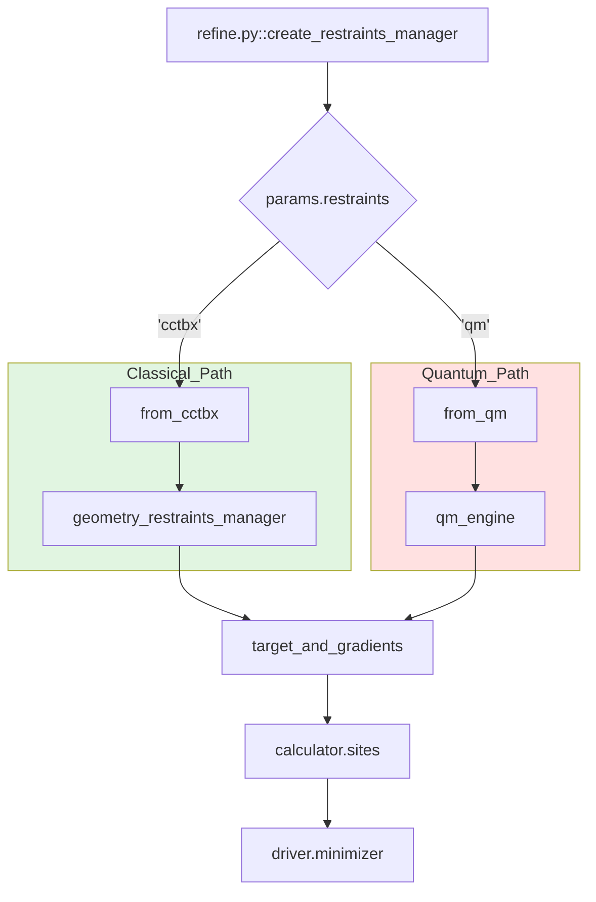

Understanding the fundamental distinction between quantum mechanical and classical geometry restraints is essential for effective quantum refinement. qrefine's architecture provides a unified interface to both restraint systems, allowing seamless switching between classical and quantum approaches while maintaining compatibility with the optimization engine.

## Restraint Architecture Overview

qrefine implements a **dual restraint system** that serves as the foundation for quantum refinement. At the architectural level, both restraint types share a common interface but differ fundamentally in their underlying physics, computational characteristics, and application domains. The system is designed around polymorphic restraint managers that present identical APIs to the optimization engine despite their divergent internal implementations.

The restraint system integrates directly into the refinement pipeline through the `calculator.sites` and `calculator.sites_opt` classes, which aggregate crystallographic data with restraint contributions. This unified interface allows the LBFGS minimizer in `driver.py` to treat both restraint types identically, calling `target_and_gradients()` without knowledge of the underlying physics source.

Sources: [refine.py](refine.py#L159-L216), [restraints.py](restraints.py#L48-L106), [driver.py](driver.py#L87-L93)

## CCTBX Restraints

CCTBX restraints represent the **classical approach** to molecular refinement, relying on parameterized geometric constraints derived from crystallographic libraries and chemical knowledge bases. This system operates through the geometry restraints manager from the cctbx framework, which evaluates bonds, angles, dihedrals, chirality, and other stereochemical terms based on empirical force field parameters.

### Implementation Details

The `from_cctbx` class serves as a wrapper around the standard cctbx geometry restraints manager, inheriting its complete restraint evaluation machinery. During initialization, it receives a pre-configured `geometry_restraints_manager` from the model's restraint objects, which already contains bond lengths, angle parameters, planarity restraints, and other stereochemical constraints derived from CIF files and monomer libraries [restraints.py](restraints.py#L389-L396).

When computing energies and gradients, the CCTBX system directly calls the geometry restraints manager's `energies_sites()` method, which iterates through all defined restraints, calculates deviations from ideal values, and computes both the target energy and analytical gradients with respect to atomic positions. This process is highly optimized within cctbx and executes rapidly for systems of typical macromolecular size [restraints.py](restraints.py#L430-L431).

### Clustering Support

When clustering is enabled with CCTBX restraints, the system employs **super-selection geometry** rather than full-system restraints. The `fragment_extracts` object provides both fragment-specific selections and a corresponding super-selection that defines the boundary of each cluster. For each cluster evaluation, the geometry restraints manager is first filtered to include only restraints within the super-selection region, then energies are computed only for atoms within the fragment selection [restraints.py](restraints.py#L416-L428).

**Important**: The gradients from cluster-level CCTBX evaluations are scaled by `fragment_scales` to prevent double-counting when clusters overlap. This scaling is essential for maintaining consistency with the global energy landscape when using clustering approaches for computational efficiency.

### Performance Characteristics

CCTBX restraints offer **deterministic, reproducible** results with negligible computational overhead. The evaluation time scales approximately linearly with the number of restraints, which itself scales roughly linearly with molecular size. For a typical protein of 200-300 residues, CCTBX gradient evaluation completes in milliseconds, making it suitable for real-time refinement loops.

> [!TIP]
> When troubleshooting convergence issues, first verify that CCTBX restraints produce reasonable gradients using `qr.restraint` on your finalized model. This isolates potential problems before introducing the complexity of quantum calculations.

## QM Restraints

Quantum mechanical restraints represent the **physics-based approach**, deriving geometric constraints from first-principles quantum chemical calculations rather than empirical parameterizations. This system interfaces with a wide variety of quantum chemistry packages through ASE (Atomic Simulation Environment) calculators, enabling choice of appropriate methods for different chemical systems and computational resource constraints.

### Implementation Architecture

The `from_qm` class orchestrates quantum chemical calculations by managing the interface between the molecular structure and the quantum engine. During initialization, it performs several critical setup steps: creates a working directory for temporary files, initializes the appropriate quantum calculator based on `qm_engine_name`, calculates or receives the system charge, and establishes the fragmentation context if clustering is enabled [restraints.py](restraints.py#L452-L478).

The **quantum engine factory** in `create_qm_engine()` supports an extensive ecosystem of quantum chemistry packages including MOPAC, Gaussian, ORCA, PySCF, TeraChem, Turbomole, xTB, AIMNet2, TorchANI, FAIRChem, and custom REST API servers. Each engine is instantiated with default parameters optimized for quantum refinement, then configured with user-specified method, basis set, memory, and processor settings [restraints.py](restraints.py#L480-L538).

### Calculation Workflow

For each target and gradients evaluation, the QM system follows a structured workflow:

1. **Structure preparation**: The current atomic coordinates are written to a PDB file, which serves as the input for the quantum calculation. When clustering is enabled, only the fragment-specific atoms (including capping hydrogens and neighbor buffers) are extracted via `get_qm_file_name_and_pdb_hierarchy()` [restraints.py](restraints.py#L558-L560).

2. **Charge handling**: Fragment-level charges are computed from the fragment extracts, and optional MM point charge files are generated for electrostatic embedding via `write_mm_charge_file()` [restraints.py](restraints.py#L562-L565).

3. **ASE conversion**: The PDB hierarchy is converted to ASE atoms format with appropriate handling of crystal symmetry, which the quantum engine uses for coordinate input [restraints.py](restraints.py#L577).

4. **Quantum calculation**: The engine's `run_qr()` method executes the quantum chemical calculation, typically an energy optimization or single-point evaluation, returning electronic energy and atomic forces [restraints.py](restraints.py#L595-L600).

5. **Unit conversion**: Energies are converted from Hartree to kcal/mol (factor ~23.06), and forces are converted to gradients by negation [restraints.py](restraints.py#L578-L612).

6. **Post-processing**: Capping hydrogens and neighbor buffer atoms are removed from the gradients, and fragment-specific scaling is applied for clustering consistency [restraints.py](restraints.py#L614-L619).

### Fragmentation and Clustering

The quantum system implements sophisticated **fragmentation strategies** to address the scaling challenge of quantum chemistry. When `clustering=True`, the system processes the molecular structure through the fragment manager, which divides the system into overlapping clusters based on interaction criteria, residue boundaries, and charge considerations.

Each cluster calculation includes the fragment atoms of interest plus a neighbor buffer region and appropriate capping groups to maintain chemical realism. The fragment extracts provide: `fragment_super_selections` (defining the spatial boundary), `fragment_scales` (preventing double-counting), and charge information for each fragment [restraints.py](restraints.py#L553-L566).

### Performance Characteristics

QM restraints are **orders of magnitude slower** than CCTBX restraints, with evaluation times ranging from seconds for small fragments with semi-empirical methods to hours for large fragments with DFT calculations. The computational complexity depends primarily on the quantum method (semi-empirical << DFT << CCSD(T)) and the fragment size.

> [!TIP]
> For production refinement, start with semi-empirical methods (MOPAC/PM7 or xTB/GFN2) to establish geometry, then optionally re-refine critical regions with higher-level methods. This staged approach balances accuracy with computational feasibility.

## Key Differences Summary

| Aspect | CCTBX Restraints | QM Restraints |
|--------|------------------|---------------|
| **Basis** | Empirical parameters from libraries | First-principles quantum mechanics |
| **Speed** | Milliseconds per evaluation | Seconds to hours per evaluation |
| **Accuracy** | Good for standard biomolecules | Better for novel chemistry, transition states |
| **Setup** | Automatic from CIF libraries | Requires method/basis selection, charge determination |
| **Fragmentation** | Not applicable | Essential for macromolecules |
| **Memory** | Minimal | Significant, scales with Q^3 to Q^4 |
| **Determinism** | Fully deterministic | May have convergence variability |
| **External Dependencies** | None (cctbx internal) | Quantum chemistry packages required |

Sources: [restraints.py](restraints.py#L389-L619), [refine.py](refine.py#L159-L216), [README.md](README.md#L7-L22)

## Selection Logic and Integration

The choice between CCTBX and QM restraints is controlled by the `params.restraints` parameter, which determines the source through the `source_of_restraints_qm()` method. This binary switch occurs in the `restraints.update()` method, which instantiates either `from_cctbx` or `from_qm` based on the parameter value [restraints.py](restraints.py#L64-L106).

In `refine.py`, the `create_restraints_manager()` function implements the restraint selection logic with additional consideration for alternative conformations and expansion modes. For systems with alternative conformations, specialized `from_altlocs2` managers handle the complexity of averaging gradients across conformer states. For expansion scenarios, `from_expansion` wraps either CCTBX or QM restraints with super-cell augmentation [refine.py](refine.py#L159-L216).

**Critical**: Once the restraint manager is created, the optimization engine treats it as a black box with the standard interface. This abstraction allows seamless switching between restraint sources without requiring changes to the minimization algorithms or crystallographic data handling.

## Advanced Scenarios

### Expansion Mode

When using super-cell expansion (via the `expand` function), both CCTBX and QM restraints must handle an augmented atom set that includes symmetry-related molecules. For CCTBX, this requires constructing geometry restraints for the expanded super-sphere region. For QM, the expansion requires careful completion of the super-sphere with missing atoms while preserving the original master copy untouched [restraints.py](restraints.py#L125-L199).

The `from_expansion` class manages this complexity by: expanding the hierarchy using crystallographic symmetry, completing missing atoms in the expansion region (while preserving the master copy), creating appropriate selections mapping between original and expanded systems, and delegating gradient computation to either CCTBX or QM based on the underlying source [restraints.py](restraints.py#L196-L228).

### Alternative Conformations

For systems with alternative conformations, qrefine implements specialized restraint managers that handle gradient averaging across conformer states. The `from_altlocs` and `from_altlocs2` classes provide experimental implementations for this scenario, though they are noted as development code not yet in production [restraints.py](restraints.py#L257-L387).

These approaches either compute independent restraints for each conformer and average the gradients, or create unified restraint managers that account for partial occupancy. The appropriate method depends on whether the alternative conformations represent genuine chemical alternatives (different ligands) or conformational variability (different rotamers).

## Practical Considerations

### Choosing Between Systems

Select CCTBX restraints when:
- Refining standard biomolecules with well-characterized chemistry
- Working with limited computational resources
- Performing rapid prototyping or exploratory refinement
- Crystallographic data quality is sufficient for classical restraints

Select QM restraints when:
- Refining novel ligands, cofactors, or modified residues lacking library parameters
- Studying reaction intermediates, transition states, or unusual coordination chemistry
- Crystallographic data is low-resolution (<2.5Å) where geometric information is limited
- Investigating protonation states, hydrogen bonding networks, or electronic effects

### Hybrid Approaches

qrefine supports **hybrid refinement** where different regions of the molecule use different restraint types. This is achieved through clustering combined with appropriate selection of QM vs. CCTBX methods. For example, active sites can be refined with QM restraints while the rest of the protein uses CCTBX restraints.

The cluster restraint manager in `cluster_restraints.py` orchestrates this hybrid approach, distributing gradient computations across potentially heterogeneous restraint sources while maintaining consistency at the global optimization level [cluster_restraints.py](cluster_restraints.py#L29-L40).

### Debugging and Validation

The `qr.restraint` command-line tool provides direct access to restraint calculations for debugging and validation. This tool allows you to compute energies and gradients for a finalized model without running full refinement, making it ideal for:
- Verifying that QM engines are properly configured
- Comparing gradient magnitudes between CCTBX and QM approaches
- Estimating refinement times by benchmarking QM calculations
- Validating that fragmentation produces chemically reasonable fragments

Sources: [command_line/restraint.py](command_line/restraint.py#L22-L53), [rst_files/qr/restraint.txt](rst_files/qr/restraint.txt#L1-L27)

## Next Steps

To deepen your understanding of the restraint system:

- **[Restraint Manager Architecture](21-restraint-manager-architecture)**: Detailed examination of how restraint managers are instantiated, updated, and integrated with the optimization engine
- **[Cluster Restraints](22-cluster-restraints)**: Comprehensive coverage of fragmentation strategies, clustering algorithms, and hybrid restraint approaches
- **[Alternative Conformation Handling](23-alternative-conformation-handling)**: Specialized techniques for refining systems with multiple conformer states
- **[Weight Factor Calculation](24-weight-factor-calculation)**: Understanding how crystallographic and restraint contributions are balanced during refinement
