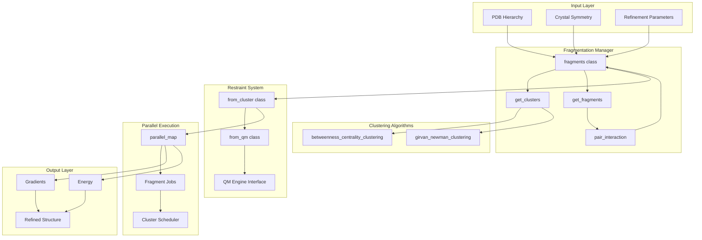
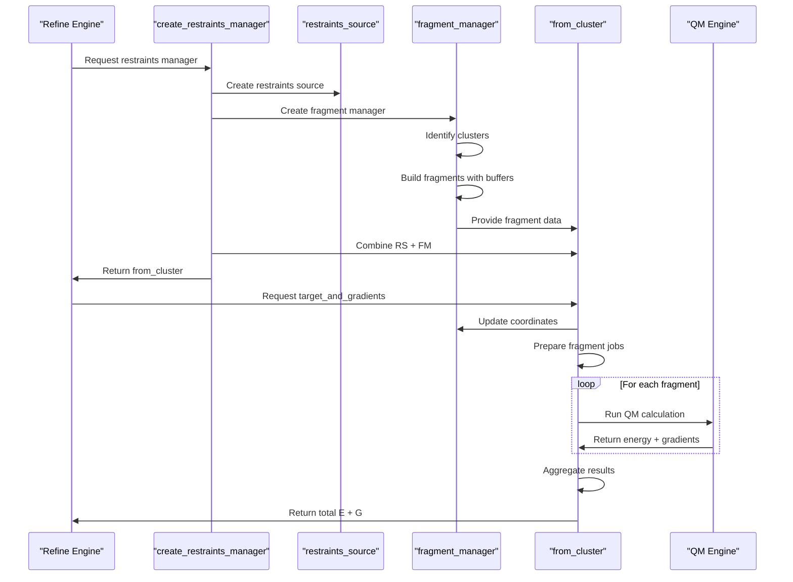

Cluster restraints represent a sophisticated approach to quantum mechanical refinement in qrefine, enabling QM-level accuracy for large macromolecular systems through fragment-based computation. This system decomposes complex structures into manageable clusters, performs parallel QM calculations on each fragment with appropriate buffer regions, and aggregates results to produce accurate energy and gradient contributions for refinement.

## Architectural Overview

The cluster restraints system operates on the principle of **divide-and-conquer**, breaking down large protein structures into smaller, computationally tractable fragments while preserving the chemical environment through carefully designed buffer regions. This architecture enables quantum-level refinement of systems that would otherwise be prohibitively expensive to compute using traditional QM methods.

The core components work in concert: a fragmentation manager identifies optimal cluster boundaries, a restraints manager coordinates QM calculations across fragments, and a parallel execution system distributes computational load efficiently. The system scales from small molecules to large macromolecular complexes while maintaining QM accuracy.

Sources: [cluster_restraints.py](cluster_restraints.py#L29-L40), [restraints.py](restraints.py#L434-L622), [fragment.py](fragment.py#L43-L136)

## Core Architecture Components

### Fragment Manager

The `fragments` class serves as the central orchestrator for fragment creation and management. It handles the complex task of identifying chemically meaningful cluster boundaries through graph-based clustering algorithms, then constructs appropriate buffer regions around each fragment to preserve the local chemical environment.

The fragmentation process begins with **cluster identification**, where the system analyzes inter-residue interactions to build a connectivity graph. Two primary clustering algorithms are available: betweenness centrality clustering (the default) and Girvan-Newman clustering. The betweenness centrality method evaluates edge importance in the interaction graph and iteratively removes edges with highest centrality until optimal cluster sizes are achieved, controlled by parameters such as `maxnum_residues_in_cluster` and `bcc_threshold`.

Once clusters are identified, the system constructs **fragment super-regions** by adding buffer atoms around each cluster. These buffer atoms typically include residues within a specified radius (default 10Å) of the cluster atoms, ensuring that atoms near the boundary experience a complete chemical environment during QM calculations. The buffer selection is crucial for accurate gradient computation at cluster boundaries.

> [!TIP]
> The buffer size parameter (`select_within_radius`) directly balances computational efficiency against accuracy. Smaller buffers reduce QM calculation cost but may introduce boundary artifacts, while larger buffers improve accuracy at increased computational expense. For most systems, the default 10Å radius provides an optimal balance.

Sources: [fragment.py](fragment.py#L113-L136), [fragment.py](fragment.py#L316-L390)

### Restraint Manager Interface

The `from_cluster` class implements the primary interface between the refinement engine and the fragment-based QM system. This class inherits the standard restraint manager interface, providing `target_and_gradients()` and `energies_sites()` methods that integrate seamlessly with the existing refinement framework.

When the refinement engine requests energy and gradients for a given atomic configuration, `from_cluster` performs several coordinated operations. First, it updates all atomic positions throughout the fragment hierarchy, propagating coordinate changes from the main model to the expanded super-cell representation. It then extracts fragment-specific coordinate sets for each QM region, prepares the appropriate input files for each fragment, and distributes the QM calculations across available computational resources.

The parallel execution strategy is implemented using `libtbx.easy_mp.parallel_map`, which supports both multi-threaded execution on local machines and distributed execution through cluster job schedulers (PBS, SLURM). This flexibility enables efficient scaling from workstation computations to large-scale cluster deployments.

Sources: [cluster_restraints.py](cluster_restraints.py#L29-L75)

### QM Engine Integration

The `from_qm` class provides the abstraction layer for interfacing with various quantum chemistry packages. This design enables seamless integration of multiple QM engines, including conventional ab initio packages (Gaussian, ORCA, PySCF, Turbomole), semi-empirical methods (MOPAC, xTB), and machine learning potentials (AIMNet2, TorchANI, FAIRChem).

Each QM calculation operates on a **fragment super-region** containing the cluster atoms plus buffer atoms. The system automatically handles capping atoms for broken bonds at fragment boundaries, computes partial charges for charge embedding when enabled, and manages coordinate transformations between qrefine's internal representation and the format required by each QM engine.

A critical design feature is the handling of alternative conformations. When multiple conformations exist (e.g., side-chain rotamers), the system creates separate fragment calculations for each alternative conformation, applying either "subtract" or "average" methods to handle overlapping regions between conformations. The subtract method removes contributions from overlapping atoms, while the average method scales contributions by the frequency of overlap.

Sources: [restraints.py](restraints.py#L434-L622), [restraints.py](restraints.py#L552-L622)

## Gradient Aggregation Strategy

The cluster restraints system employs a sophisticated gradient aggregation mechanism that combines contributions from multiple fragment calculations into a unified gradient vector for the entire system. This process requires careful handling to ensure consistency and avoid double-counting of atoms.

For each fragment calculation, the system receives a gradient vector corresponding to the QM atoms in that fragment. These gradients are first **masked to exclude buffer atoms**, since buffer atoms exist only to provide boundary conditions and should not contribute to the overall gradient. The remaining gradients are then mapped back to their positions in the full atomic coordinate system.

The final gradient is assembled by summing contributions from all fragments. When multiple alternative conformations exist, the system applies scaling factors to account for overlap between fragments. Atoms that appear in multiple fragments (typically at conformation boundaries) have their contributions scaled according to the frequency of appearance, preventing over-contribution to the gradient.

> [!TIP]
> The gradient scaling mechanism (stored in `fragment_scales`) is automatically computed during fragment creation and applies scaling factors ranging from -1.0 to 1.0. Values of -1.0 indicate subtraction operations for overlapping regions in alternative conformations, while fractional values (e.g., 0.5) indicate averaging for atoms appearing in multiple conformations.

Sources: [cluster_restraints.py](cluster_restraints.py#L113-L161), [fragment.py](fragment.py#L316-L390)

## Configuration Parameters

The cluster restraints system provides extensive configuration options through the refinement parameter hierarchy. Understanding these parameters is essential for optimizing performance and accuracy for specific applications.

### Clustering Parameters

| Parameter | Default | Description | Impact |
|-----------|---------|-------------|--------|
| `clustering` | False | Enable cluster-based QM restraints | Required for fragment-based QM |
| `clustering_method` | None | Select clustering algorithm | Choice between BCC and Girvan-Newman |
| `maxnum_residues_in_cluster` | 20 | Maximum residues per cluster | Smaller values = more fragments, more parallelizable |
| `bcc_threshold` | 9 | Betweenness centrality threshold | Controls cluster fragmentation granularity |
| `select_within_radius` | 10.0 | Buffer radius around clusters (Å) | Larger buffers = better accuracy, higher cost |

### Charge Embedding Parameters

| Parameter | Default | Description | Impact |
|-----------|---------|-------------|--------|
| `charge_embedding` | False | Enable point charge embedding | Improves electrostatic boundary treatment |
| `charge_cutoff` | 8.0 | Distance cutoff for embedding (Å) | Determines range of electrostatic coupling |

### Alternative Conformation Parameters

| Parameter | Default | Description | Impact |
|-----------|---------|-------------|--------|
| `altloc_method` | "subtract" | Method for handling overlapping altlocs | "subtract" removes overlap, "average" scales contributions |
| `two_buffers` | False | Add second buffer layer | Improves boundary treatment at increased cost |
| `bond_with_altloc_flag` | True | Include altloc bonds in clustering | Affects how alternative conformations are grouped |

Sources: [fragment.py](fragment.py#L45-L98), [refine.py](refine.py#L75-L98)

## Parallel Execution Model

The cluster restraints system implements a robust parallel execution framework that distributes QM calculations across multiple computational resources. This model is essential for achieving reasonable turnaround times for large systems, where hundreds or thousands of fragment calculations may be required.

### Execution Flow

The parallel execution follows a producer-consumer pattern:

1. **Job Preparation**: The `from_cluster` class creates a list of jobs, where each job contains the fragment selection, atomic coordinates, and fragment index. This list represents the complete set of QM calculations required for the current refinement cycle.

2. **Resource Allocation**: Based on the `parallel_params` configuration, the system determines the appropriate execution strategy. For local execution, it uses multi-threading with Python multiprocessing. For cluster environments, it generates job scripts compatible with PBS or SLURM schedulers.

3. **Fault Tolerance**: The system implements a retry mechanism (up to 5 attempts) for failed jobs, with diagnostic information captured and reported. In case of persistent failures, the system preserves the working directory as `ase_error` for debugging.

4. **Result Aggregation**: As fragment calculations complete, results are collected and assembled into the final energy and gradient vectors. The parallel_map function ensures thread-safe result aggregation.

### Configuration Options

Parallel execution is controlled through the following parameters in the refinement configuration:

- `parallel_params.nproc`: Number of parallel processes (or Auto for automatic detection)
- `parallel_params.method`: Execution method ("multiprocessing" or "qsub")
- `parallel_params.qsub_command`: Cluster job submission command (for distributed execution)

Sources: [cluster_restraints.py](cluster_restraints.py#L75-L113), [refine.py](refine.py#L175-L186)

## Integration with Refinement Workflow

The cluster restraints system integrates seamlessly into the broader qrefine refinement workflow through a well-defined interface that matches standard CCTBX restraint managers. This compatibility ensures that cluster-based QM restraints can be used as drop-in replacements for classical restraints without requiring changes to the refinement engine.

The integration point in the refinement pipeline is the `create_restraints_manager()` function in [refine.py](refine.py#L147-L186). When clustering is enabled and no alternative conformations requiring special handling are present, this function creates a `from_cluster` instance that wraps both the underlying restraints source and the fragment manager.

During refinement cycles, the engine repeatedly calls `target_and_gradients()` with updated atomic coordinates. The cluster restraints system efficiently handles these requests by updating only the coordinate information and reusing the fragment definitions established during initialization, minimizing overhead between refinement cycles.

Sources: [refine.py](refine.py#L147-L186), [cluster_restraints.py](cluster_restraints.py#L33-L75)

## Advanced Features

### Charge Embedding

The charge embedding feature significantly improves the accuracy of boundary region treatment by including partial point charges from surrounding atoms. This approach captures long-range electrostatic effects that would otherwise be missing from isolated fragment calculations.

When enabled, the system computes partial charges for the expanded super-cell region using the charge calculation service. These charges are written to an external charge file that the QM engine reads during each fragment calculation. The `charge_cutoff` parameter determines the distance cutoff for including point charges around each fragment.

This feature is particularly important for systems with strong electrostatic interactions, such as metal centers, charged residues, or regions with high polarity. However, it increases computational cost per fragment calculation due to the additional electrostatic terms.

Sources: [restraints.py](restraints.py#L552-L622), [fragment.py](fragment.py#L365-L390)

### Alternative Conformation Handling

The cluster restraints system provides sophisticated handling of alternative conformations (altlocs) through two primary methods: subtract and average.

**Subtract Method** (default): This approach creates separate fragment calculations for each alternative conformation. For atoms that appear in multiple conformations (overlapping regions), the system subtracts contributions from non-matching conformations, effectively isolating the unique contribution of each alternative. This method is conceptually simpler and works well for most cases.

**Average Method**: This approach scales contributions from overlapping atoms by the inverse of their frequency across conformations. For an atom appearing in N conformations, each contribution is scaled by 1/N. This method provides a smoother energy surface but may introduce artifacts when conformational populations are unequal.

The system automatically detects alternative conformations and applies the selected handling method throughout the fragmentation and gradient aggregation process. The `bond_with_altloc_flag` parameter controls whether bonds involving alternative conformations are considered during clustering, affecting how conformations are grouped into fragments.

Sources: [fragment.py](fragment.py#L133-L290), [fragment.py](fragment.py#L365-L390)

### Double Buffering

The `two_buffers` parameter enables a more sophisticated boundary treatment by adding two concentric buffer layers around each cluster. The inner buffer (standard layer) includes atoms within the primary radius, while the outer buffer extends this region further.

The double buffering approach improves the accuracy of gradient calculations at cluster boundaries by providing a more complete representation of the local chemical environment. The inner buffer atoms participate directly in QM calculations, while the outer buffer provides additional context for charge embedding and capping decisions.

This feature increases the computational cost per fragment (larger QM regions) but can significantly reduce boundary artifacts in sensitive applications. It is particularly useful for systems with subtle conformational changes or high-resolution refinement targets.

Sources: [fragment.py](fragment.py#L133-L290)

## Performance Considerations

The cluster restraints system involves complex trade-offs between accuracy, computational cost, and memory usage. Understanding these considerations is essential for optimizing performance for specific applications.

### Computational Cost Factors

The primary computational cost drivers are:

1. **Number of fragments**: Determined by cluster size parameters. More fragments = higher parallelizability but increased aggregation overhead.

2. **Fragment size**: Controlled by `maxnum_residues_in_cluster` and buffer radius. Larger fragments = higher QM cost per calculation but fewer total calculations.

3. **QM method**: Choice of QM engine and theoretical level significantly impacts cost. Machine learning potentials (AIMNet2) are typically 10-100× faster than ab initio methods (Gaussian, ORCA).

4. **Charge embedding**: Enables more accurate boundary treatment at the cost of additional electrostatic calculations per fragment.

5. **Parallel efficiency**: Network and I/O overhead can limit parallel scaling, especially for distributed execution on clusters.

### Memory Management

The system employs several strategies to manage memory efficiently:

- **Lazy evaluation**: Fragment data structures are created on-demand during refinement rather than pre-computed for all possible configurations.

- **Selective storage**: Only essential data (fragment selections, charges, scaling factors) are stored between refinement cycles.

- **Temporary file management**: QM input/output files are managed in a dedicated working directory with cleanup procedures.

- **Coordinate propagation**: Coordinates are updated incrementally rather than rebuilding the entire hierarchy each cycle.

Sources: [cluster_restraints.py](cluster_restraints.py#L75-L113), [fragment.py](fragment.py#L365-L390)

## Troubleshooting Guide

### Common Issues and Solutions

| Issue | Symptoms | Likely Cause | Solution |
|-------|----------|--------------|----------|
| Fragment calculations fail randomly | Intermittent job failures, retry messages | Resource contention, timeout issues | Increase retry count, adjust parallel parameters |
| Poor convergence | Refinement oscillates, high R-factors | Inappropriate cluster size or buffer radius | Reduce `maxnum_residues_in_cluster`, increase buffer radius |
| Boundary artifacts | Unrealistic geometry at fragment boundaries | Insufficient buffer region | Increase `select_within_radius`, enable double buffering |
| Altloc errors | Crash with alternative conformations | Complex overlap between conformations | Use "average" altloc_method, check bond_with_altloc_flag |
| Memory exhaustion | System crashes or slows significantly | Too many fragments or large QM calculations | Reduce fragment count, use smaller QM methods, enable charge embedding |

### Debugging Capabilities

The system provides several debugging features:

- **Debug mode**: Set `debug=True` to enable verbose logging and diagnostic output.

- **Cluster saving**: Set `save_clusters=True` to write cluster and fragment PDB files for visual inspection.

- **Error preservation**: Failed calculations preserve working directory as `ase_error` for post-mortem analysis.

- **Gradient validation**: Optional serial execution mode enables comparison with parallel results for validation.

Sources: [cluster_restraints.py](cluster_restraints.py#L75-L113), [fragment.py](fragment.py#L98-L136)

## Summary

The cluster restraints system represents a powerful approach to quantum mechanical refinement, enabling QM-level accuracy for large macromolecular systems through intelligent fragmentation and parallel execution. By decomposing systems into chemically meaningful clusters with appropriate buffer regions, leveraging modern QM engines and machine learning potentials, and providing sophisticated handling of complex features like alternative conformations, this system bridges the gap between classical restraints and full-system QM calculations.

The architecture's modular design allows seamless integration with existing refinement workflows while providing extensive configuration options for optimizing performance and accuracy. As quantum chemistry methods and computational resources continue to advance, this cluster-based approach provides a flexible foundation for incorporating increasingly sophisticated QM treatments into crystallographic refinement.

For users ready to implement cluster restraints, the recommended starting point is to enable clustering with default parameters, then systematically tune cluster size, buffer radius, and QM method based on system characteristics and computational resources. For systems requiring more sophisticated treatment, the advanced features such as charge embedding, double buffering, and alternative conformation handling provide additional control over accuracy-computational cost trade-offs.
