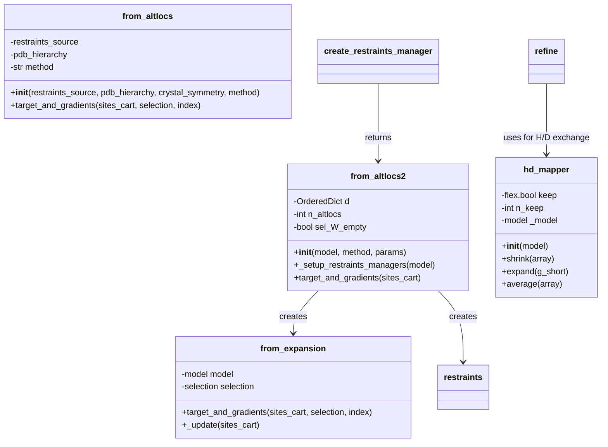
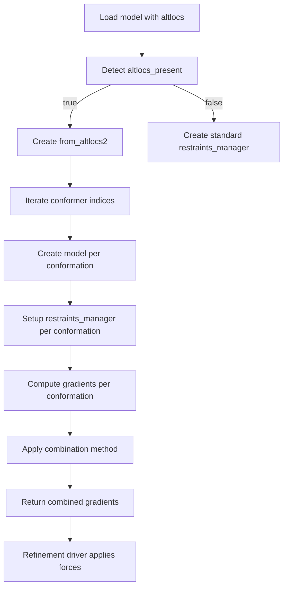

This documentation explains how qrefine handles alternative conformations (altlocs) during quantum refinement. Alternative conformations represent structural disorder where multiple atom arrangements exist at the same residue position, typically denoted by altloc identifiers like 'A', 'B', etc. The system employs sophisticated gradient combination strategies to properly refine these conformations while maintaining chemically realistic geometries.

## Architecture Overview

The alternative conformation handling in qrefine operates through a hierarchical class structure that processes each conformation independently, then combines the resulting energy gradients using mathematically defined combination methods. The core implementation resides in the `from_altlocs2` class, which serves as the production altloc handler, while `from_altlocs` provides an alternative developmental approach.



The architecture separates concerns between conformation management (`from_altlocs2`), H/D exchange handling (`hd_mapper`), and gradient computation (`from_expansion`). This modular design enables different combination strategies and facilitates testing of alternative approaches.

Sources: [restraints.py](restraints.py#L257-L388), [refine.py](refine.py#L99-L158), [refine.py](refine.py#L159-L217)

## Conformation Detection and Separation

The `from_altlocs2` class detects alternative conformations using CCTBX's conformer indices, where each atom is assigned an integer identifier: 0 for blank atoms (no altloc), 1+ for specific conformations. During initialization, the system iterates through all unique conformer indices and creates separate models for each.

The separation process involves creating selections that include both the specific conformation atoms and blank atoms, since blank atoms (altloc='') provide the structural framework that all conformations share. This design ensures proper gradient computation across the entire residue while maintaining conformational independence.

Sources: [restraints.py](restraints.py#L257-L280)

## Gradient Combination Strategies

qrefine implements two mathematically distinct gradient combination methods for alternative conformations, controlled by the `method` parameter (typically accessed via `params.cluster.altloc_method`).

### Subtract Method

The subtract method applies gradient scaling to prevent overcounting of blank atom contributions across multiple conformations. For models with `n_altlocs` conformations, the blank atom gradient is scaled by `(n_altlocs-1)` and subtracted from the accumulated blank atom gradients from each conformation.

**Mathematical formulation:**
```
g_blank_result = Σ(g_blank_conformation_i) - (n_altlocs-1) × g_blank_computed
```

This method ensures that blank atoms contribute appropriate force components without being over-represented in the gradient calculation.

Sources: [restraints.py](restraints.py#L291-L320), [restraints.py](restraints.py#L323-L365)

### Average Method

The average method distributes blank atom gradient contributions equally across all conformations, which can be more appropriate for certain types of structural disorder.

**Mathematical formulation:**
```
g_blank_result = Σ(g_blank_conformation_i) × (1/n_altlocs)
```

This approach treats blank atoms as shared resources whose influence should be evenly distributed across all conformational states.

Sources: [restraints.py](restraints.py#L321-L324)

## Restraints Manager Architecture

Each conformation requires its own restraints manager to compute quantum mechanical or classical geometric restraints independently. The `_setup_restraints_managers` method creates a `from_expansion` object that wraps a `restraints` instance, which in turn delegates to either `from_qm` for quantum mechanical restraints or `from_cctbx` for classical geometric restraints.

The `from_expansion` class handles model completion (adding hydrogen atoms, fixing incomplete residues) within a spherical expansion zone, ensuring that each conformational model is chemically complete before gradient computation. This is particularly important for quantum mechanical calculations where incomplete valence structures would cause computational errors.

Sources: [restraints.py](restraints.py#L281-L287), [restraints.py](restraints.py#L125-L240), [restraints.py](restraints.py#L48-L108)

## H/D Exchange Handling

Alternative conformations often involve H/D exchange at labile hydrogen sites (e.g., hydroxyl groups, amine nitrogens). The `hd_mapper` class provides sophisticated handling for these cases by converting models with both H and D atoms into single protonated models for gradient computation, then re-mapping the results.

The key operations include:

- **Shrink**: Select only atoms to keep (typically H atoms, excluding D)
- **Average**: Average gradient components across H/D exchange pairs
- **Expand**: Map compacted gradients back to full atom representation

> [!TIP]
> The `hd_mapper.average` method ensures that H/D exchange sites receive physically meaningful gradients by averaging the gradient vectors from both atoms in an exchange pair, preventing unrealistic force distributions during refinement.

Sources: [refine.py](refine.py#L99-L158)

## Implementation Flow

The complete workflow for alternative conformation handling during refinement follows this sequence:



The `create_restraints_manager` function serves as the factory that determines which restraint strategy to employ based on model properties. When alternative conformations are detected, it instantiates `from_altlocs2` and passes the user-specified combination method parameter.

Sources: [refine.py](refine.py#L159-L217)

## Production vs Development Code

The codebase contains both production and developmental implementations for alternative conformation handling:

**Production Implementation (`from_altlocs2`)**:
- Actively maintained and tested
- Used in real refinement workflows
- Integrated with the `from_expansion` system for model completion
- Properly handles edge cases like empty blank atom selections

**Development Implementation (`from_altlocs`)**:
- Marked as "NOT IN PRODUCTION" in comments
- Uses `from_cctbx_altlocs` for direct CCTBX gradient computation
- Lacks integration with the expansion system
- Primarily serves as a reference implementation

The production code's superiority stems from its integration with the model completion system, which ensures that all conformations are chemically complete before gradient calculation—a critical requirement for quantum mechanical calculations.

Sources: [restraints.py](restraints.py#L257-L290), [refine.py](refine.py#L165-L168)

## Integration with Clustering

When alternative conformations are present, qrefine enforces certain limitations to maintain computational feasibility and mathematical correctness. The `check_no_altlocs` function in the clustering module verifies that hierarchical structures contain at most one blank altloc identifier, ensuring that the gradient combination algorithms remain mathematically sound.

The current implementation does not support the combination of alternative conformations with the clustering approach for quantum mechanical restraints. When `altlocs_present` is true, the system returns `from_altlocs2` directly without attempting to apply clustering, even if `params.cluster.clustering` is enabled.

Sources: [cluster_restraints.py](cluster_restraints.py#L15-L28), [refine.py](refine.py#L165-L171)

## Configuration and Parameters

The behavior of alternative conformation handling is controlled through the refinement parameters:

**Key Parameters**:
- `params.cluster.altloc_method`: Specifies the gradient combination method ("subtract" or "average")
- `params.cluster.clustering`: Must be disabled when altlocs are present
- `params.expansion`: Controls model completion behavior (typically enabled for altloc handling)

> [!TIP]
> The default "subtract" method is recommended for most cases as it prevents overcounting of blank atom contributions, which is particularly important when working with quantum mechanical restraints where force magnitudes can vary significantly between different conformations.

The system automatically detects the presence of alternative conformations and selects the appropriate restraint manager implementation, requiring minimal user configuration for standard use cases.

Sources: [refine.py](refine.py#L159-L217), [restraints.py](restraints.py#L257-L290)

## Current Limitations

Several important limitations exist in the current implementation that users should be aware of:

1. **No Clustering with Altlocs**: The clustering approach for quantum mechanical restraints cannot be combined with alternative conformation handling. This is enforced by assertion checks that fail when both features are enabled.

2. **No H/D-only Altlocs**: The system asserts that models cannot have H/D alternative conformations without also having heavy atom alternative conformations. This is enforced by the `assert not model.altlocs_present_only_hd()` check.

3. **Development Status**: The alternative conformation handling remains under active development, with some code sections marked as developmental and subject to change in future versions.

4. **Energy Undefined**: The current implementation returns `energy=0` for alternative conformation gradient calculations, meaning that energy-based convergence criteria may not accurately reflect the system's energy landscape.

Sources: [refine.py](refine.py#L166-L167), [restraints.py](restraints.py#L257-L290)

## Next Steps

For developers working with alternative conformations, consider these additional topics:

- **Fragmentation Strategy**: Understanding how atoms are grouped for QM calculations in [Understanding Fragmentation](7-understanding-fragmentation)
- **QM vs CCTBX Restraints**: Detailed comparison of restraint sources in [QM vs CCTBX Restraints](20-qm-vs-cctbx-restraints)
- **Weight Factor Calculation**: How restraint weights are computed for refinement in [Weight Factor Calculation](24-weight-factor-calculation)
- **Charge Calculations**: Handling charges in alternative conformations in [Charge Calculations](28-charge-calculations)