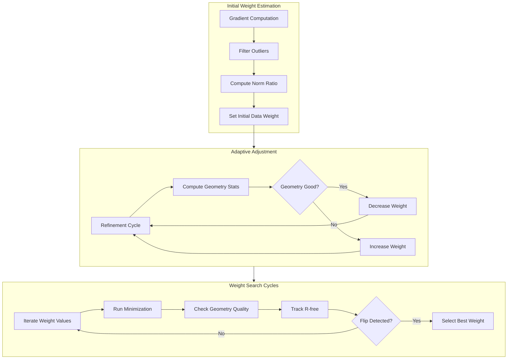

The weight factor calculation system in qrefine implements an adaptive approach to balancing crystallographic data against chemical restraints during quantum refinement. This system dynamically adjusts the relative contributions of experimental data and quantum-mechanical restraints to achieve optimal model quality.

## Overview of Weight Factor Architecture

The weight factor calculation operates through three complementary mechanisms: initial weight estimation, adaptive weight adjustment during refinement, and systematic weight search cycles. The core principle is to use gradient norm ratios and geometric quality metrics (bond and angle RMSD) to determine whether to increase or decrease the restraint contribution.



## Initial Weight Computation

The initial weight estimation computes the ratio between restraint gradient norms and crystallographic data gradient norms. This provides a mathematically sound starting point that reflects the relative strength of each contribution for the specific structure being refined.

The `compute_weight` function in `calculator.py` implements this estimation. It creates a temporary copy of the fmodel, optionally shakes coordinates to sample different configurations, then computes gradients from both the X-ray target and the restraints. A key feature is the outlier filtering mechanism that removes gradient components exceeding 6 times the mean gradient magnitude, preventing anomalous gradients from skewing the weight calculation [calculator.py:26-62](calculator.py#L26-L62).

The final data weight is computed as the ratio of filtered restraint gradient norm to filtered data gradient norm:

```python
data_weight = gc_norm_filtered / gx_norm_filtered
```

This approach ensures that the initial weight reflects the typical gradient behavior rather than being dominated by outliers or edge cases.

Sources: [calculator.py](calculator.py#L26-L62)

## Adaptive Weight Adjustment During Refinement

The adaptive weight adjustment system monitors geometric quality throughout refinement and dynamically adjusts weights to maintain optimal balance. This mechanism operates in both reciprocal space and real space refinement modes, though with slightly different implementations.

### Reciprocal Space Adaptation

In reciprocal space refinement, the weight adjustment occurs during systematic weight search cycles. The `refine` function in `driver.py` implements an iterative search that scales the `restraints_weight_scale` parameter up or down by a factor of 1.5 based on geometric quality [driver.py:320-407](driver.py#L320-L407).

The search operates through these key phases:

1. **Initial Setup**: Start with the computed initial data weight and `restraints_weight_scale = 1.0`
2. **Iterative Search**: For each cycle, run minimization with the current weight scale
3. **Quality Assessment**: Check if geometry meets criteria (bond RMSD ≤ max_bond_rmsd, angle RMSD ≤ max_angle_rmsd)
4. **Adjustment Decision**: If geometry is good, scale down restraints (decrease `restraints_weight_scale`); if bad, scale up
5. **Termination Detection**: Stop when a "flip" occurs (both up and down adjustments have been made) or when geometry stalls

The system tracks R-free values for each weight trial and ultimately selects the weight that produces the lowest R-free, ensuring optimal agreement with experimental data while maintaining reasonable geometry [driver.py:412-426](driver.py#L412-L426).

Sources: [driver.py](driver.py#L320-L407), [driver.py](driver.py#L412-L426)

### Real Space Adaptation

Real space refinement uses a more sophisticated adaptive mechanism in the `sites_real_space.macro_cycle` method. This approach monitors bond RMSD after each refinement cycle and implements graduated weight adjustments based on the severity of geometric deviation [calculator.py:396-461](calculator.py#L396-L461).

The adaptation logic includes:

- **Aggressive decrease**: When bond RMSD < 0.03 Å, weight is doubled (geometry is excellent, can afford weaker restraints)
- **Gradual decrease**: For moderate geometry quality, weight is reduced by 30% instead of halving
- **Oscillation detection**: The `slow_down` counter prevents rapid flipping between strategies
- **Stalled optimization detection**: Terminates when bond RMSD values repeat (stalled) or when the optimization oscillates between up and down adjustments

A critical component is the `geometry_is_good` method that evaluates both bond and angle RMSD against configurable thresholds (default: max_bond_rmsd and max_angle_rmsd ≤ 1.7) [calculator.py:391-394](calculator.py#L391-L394).

Sources: [calculator.py](calculator.py#L391-L394), [calculator.py](calculator.py#L396-L461)

## Weight Factor Application in Energy Functions

The computed weight factors are applied in the target function calculation that drives the minimization. The `sites.target_and_gradients` method in `calculator.py` demonstrates how both data and restraint contributions are combined using the weight factors [calculator.py:291-336](calculator.py#L291-L336).

The total target function and gradients are computed as:

```
total_target = data_weight × data_target + restraints_weight × restraints_weight_scale × restraints_target
total_gradients = data_weight × data_gradients + restraints_weight × restraints_weight_scale × restraints_gradients
```

This formulation separates three distinct weight concepts:
- **data_weight**: Balances X-ray data against restraints (computed from gradient ratios)
- **restraints_weight**: Fixed scaling factor for restraint contribution (typically 1.0)
- **restraints_weight_scale**: Adaptive scaling factor adjusted during refinement

The method also handles H/D exchange mapping for systems with exchangeable protons, ensuring that weight adjustments are properly applied to the full atom set [calculator.py:295-324](calculator.py#L295-L324).

Sources: [calculator.py](calculator.py#L291-L336)

## Real Space Weight Estimation

Real space refinement uses a specialized weight estimation method that computes gradient ratios from the electron density map rather than X-ray structure factors. The `sites_real_space.get_weight` method implements this [calculator.py:477-504](calculator.py#L477-L504).

Key differences from reciprocal space computation:
- Uses `maptbx.target_and_gradients_simple` to compute map gradients with tricubic interpolation
- Filters outliers at 3× mean (vs 6× for reciprocal space)
- Excludes hydrogen atoms from gradient computation via `hd_selection`
- Computes ratio of geometry gradient norm to map gradient norm

This approach is appropriate for real space refinement where the target is map correlation rather than traditional R-factors, requiring a different gradient computation strategy.

Sources: [calculator.py](calculator.py#L477-L504)

## Weight Control Methods

The calculator class provides methods for dynamic weight adjustment during optimization cycles. These enable the refinement engine to respond to changing geometric conditions [calculator.py:241-256](calculator.py#L241-L256).

Available control methods:
- **setw**: Directly set any of the three weight parameters
- **scale_restraints_weight_down**: Divide `restraints_weight_scale` by a factor (default 2)
- **scale_restraints_weight_up**: Multiply `restraints_weight_scale` by a factor (default 2)

These methods are called by the weight search logic in `driver.py` and the adaptive mechanisms in real space refinement.

Sources: [calculator.py](calculator.py#L241-L256)

## Stopping Criteria and Convergence

The weight adjustment systems incorporate multiple stopping criteria to prevent endless optimization:

1. **Flip detection**: Both reciprocal and real space methods detect when weight adjustments oscillate between up and down directions
2. **Stalled detection**: Real space refinement detects when bond RMSD values stop changing
3. **Geometry thresholds**: Reciprocal space refinement can stop immediately when acceptable geometry is achieved (if configured)

The reciprocal space search also implements a backup selection mechanism that chooses the weight from the trial that produced the lowest R-free if no other stopping criterion is triggered [driver.py:408-426](driver.py#L408-L426).

Sources: [driver.py](driver.py#L408-L426)

> [!TIP]
> The adaptive weight adjustment systems operate on different timescales: reciprocal space weight search runs once at the beginning of refinement to establish optimal `restraints_weight_scale`, while real space adaptation continuously monitors geometry throughout all refinement cycles and adjusts `weight` dynamically.

## Integration with Minimization Engine

The weight calculation system integrates with the LBFGS minimization through the `driver.minimizer` class. The minimizer calls `calculator.target_and_gradients` during each optimization step, automatically incorporating the current weight settings [driver.py:87-93](driver.py#L87-L93).

The driver's `refine` function orchestrates the entire process:
1. Perform weight search to find optimal `restraints_weight_scale`
2. Reset fmodel with best coordinates from weight search
3. Run refinement cycles with fixed weight settings
4. Optionally converge and stop early if improvement plateaus

This separation between weight optimization and refinement cycles ensures that the weight search doesn't interfere with the final refinement quality.

Sources: [driver.py](driver.py#L301-L462)

> [!TIP]
> When using QM restraints (vs CCTBX), the weight factor becomes particularly critical because QM energies and gradients have different magnitude characteristics than parameterized classical restraints. The adaptive mechanisms help compensate for these differences.

## Parameter Configuration

Key parameters controlling weight factor behavior are available in the refinement settings:

| Parameter | Default | Purpose |
|-----------|---------|---------|
| `skip_weight_search` | False | Skip automatic weight search (use provided weights) |
| `number_of_weight_search_cycles` | 10 | Maximum cycles for weight optimization |
| `max_bond_rmsd` | Configurable | Threshold for acceptable bond geometry |
| `max_angle_rmsd` | 1.7° | Threshold for acceptable angle geometry |
| `stop_one_found_first_good_weight` | False | Stop weight search immediately when geometry is good |

These parameters allow users to control the aggressiveness of weight search and the quality thresholds used for adaptation decisions.

Sources: [driver.py](driver.py#L320-L407)

## Next Steps

For deeper understanding of how weight factors interact with the optimization algorithms, see [Minimization Algorithms](25-minimization-algorithms). To understand the restraint systems that the weights scale against, explore [QM vs CCTBX Restraints](20-qm-vs-cctbx-restraints) and the [Restraint Manager Architecture](21-restraint-manager-architecture). For information on real space refinement alternatives, consult [Real Space Refinement](26-real-space-refinement).
