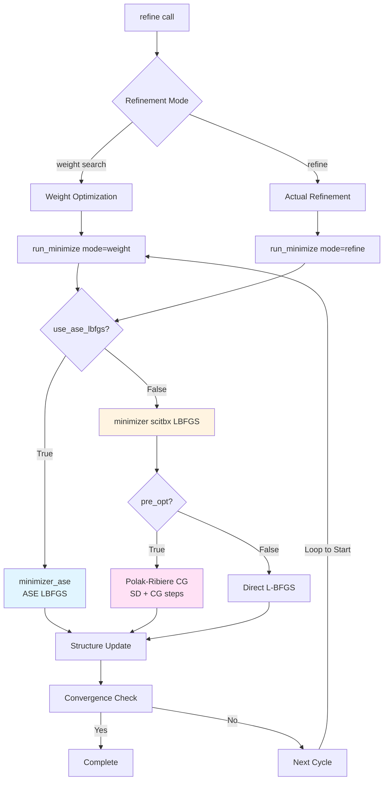

Quantum refinement in Q|R employs sophisticated minimization algorithms to optimize molecular structures by balancing crystallographic data agreement with quantum mechanical restraints. The system provides multiple optimization strategies tailored for different refinement modes, combining classical optimization techniques with quantum-level accuracy.

Sources: [driver.py](driver.py#L22-L159), [driver.py](driver.py#L185-L249), [qr.py](qr.py#L115-L216)

## Algorithm Architecture Overview

The minimization framework consists of two primary optimization engines and a comprehensive refinement workflow. The architecture supports both weight search optimization and actual refinement through flexible algorithm selection.

Sources: [driver.py](driver.py#L250-L287), [driver.py](driver.py#L301-L472)

## Primary Minimization Engines

### scitbx L-BFGS Minimizer

The default minimizer class implements the Limited-memory BFGS (L-BFGS) algorithm using the scitbx library. This algorithm is particularly efficient for large-scale optimization problems typical in macromolecular refinement.

The minimizer class is initialized with comprehensive configuration parameters including step size constraints, iteration limits, and bond RMSD monitoring. Key configuration parameters include:

- **stpmax**: Maximum step length (default 0.2 for QM methods, 3.0 for CCTBX)
- **line_search**: Enable/disable line search optimization
- **gradient_only**: Use gradient-only line search per JA Snyman 2005
- **max_iterations**: Iteration limits (50 for weight search, 50 for refinement)

The algorithm uses specialized exception handling to gracefully manage numerical instabilities during line search operations, ignoring common issues like rounding errors and step boundary failures.

Sources: [driver.py](driver.py#L22-L63), [qr.py](qr.py#L157-L165), [qr.py](qr.py#L148-L153)

### ASE L-BFGS Minimizer

The minimizer_ase class provides an alternative implementation using the Atomic Simulation Environment (ASE) LBFGS optimizer. This approach is primarily designed for debugging and offers integration with ASE's molecular dynamics framework.

The ASE minimizer synchronizes atomic positions across multiple coordinate systems (calculator, ASE atoms, and optimizer objects) to ensure consistency. The step method computes forces by inverting gradients and applies them through the ASE optimizer interface. Bond RMSD monitoring provides convergence feedback during optimization.

Sources: [driver.py](driver.py#L185-L249), [qr.py](qr.py#L154-L156)

> [!TIP]
> The ASE LBFGS minimizer includes extensive cross-validation checks (tolerance 1e-4) between calculator positions, ASE atom positions, and fmodel xray structure positions to ensure numerical consistency throughout optimization.

## Polak-Ribiere Conjugate Gradient (PRCG)

The PRCG algorithm provides a pre-optimization option that combines steepest descent and conjugate gradient methods. This hybrid approach is particularly useful for initial configuration optimization when the structure is far from optimal.

The algorithm transitions from steepest descent to conjugate gradient after a configurable number of iterations (default 2 steps). The Polak-Ribiere formula calculates the conjugate gradient coefficient β using gradient differences, providing better convergence for non-quadratic surfaces typical in molecular optimization.

The step size is controlled through a maximum step parameter (default 0.1 for pre-optimization), and convergence is determined by gradient norm thresholds (default 3000 for pre-optimization).

Sources: [driver.py](driver.py#L95-L159), [qr.py](qr.py#L202-L215)

## Refinement Workflow Phases

### Weight Search Optimization

The weight search phase determines optimal data/restraints weighting by iteratively adjusting the restraints weight scale factor. The system performs up to 50 weight search cycles, each involving a minimization run with the current weight.

The weight adjustment strategy follows an adaptive approach:
- **Good geometry** (bond RMSD ≤ 0.03 and angle RMSD ≤ 1.7): Scale restraints weight down by factor 1.5
- **Poor geometry**: Scale restraints weight up by factor 1.5

The search terminates when a "flip" occurs (transition from increasing to decreasing weight or vice versa), or when geometry metrics stall, or when the first acceptable weight is found (if `stop_one_found_first_good_weight=True`).

Sources: [driver.py](driver.py#L320-L430), [qr.py](qr.py#L131-L133), [qr.py](qr.py#L181-L189)

### Actual Refinement

Following weight optimization, the refinement phase applies the optimal weight to achieve final structure optimization. Multiple refinement cycles (default 5) are performed, each containing macro cycles (default 1) of minimization.

During refinement cycles, clustering re-evaluation can occur if the clustering algorithm is enabled and the structure has shifted significantly from initial positions. Convergence monitoring allows early termination when refinement goals are met.

Sources: [driver.py](driver.py#L431-L472), [qr.py](qr.py#L128-L140)

## Algorithm Selection and Configuration

### Minimization Engine Selection

The system offers two primary minimization pathways selectable via the `use_ase_lbfgs` parameter:

| Parameter | True | False |
|-----------|------|-------|
| **Engine** | ASE LBFGS | scitbx L-BFGS |
| **Primary Use** | Debugging | Production refinement |
| **Integration** | ASE atoms interface | CCTBX xray structure |
| **Features** | Force-based steps | Gradient-based LBFGS |
| **Pre-opt Support** | No | Yes |

Sources: [qr.py](qr.py#L154-L156), [driver.py](driver.py#L258-L287)

### Step Size and Line Search Configuration

Step size parameters are critical for stable quantum refinement:

- **stpmax** (0.2): Maximum step length for QM methods, significantly smaller than the 3.0 value typically used for CCTBX restraints
- **pre_opt_stpmax** (0.1): Conservative step size for pre-optimization
- **line_search**: Enabled by default, performs sophisticated line search to optimize step length
- **gradient_only**: Alternative line search strategy using only gradient information

The gradient-only approach (JA Snyman 2005) can be more efficient for high-dimensional problems but may sacrifice convergence precision.

Sources: [qr.py](qr.py#L157-L165), [qr.py](qr.py#L205-L208)

## Convergence Criteria

Multiple convergence mechanisms operate at different levels:

### Geometry-Based Convergence

- **max_bond_rmsd** (0.03): Maximum acceptable bond root-mean-square deviation in angstroms
- **max_angle_rmsd** (1.7): Maximum acceptable angle root-mean-square deviation in degrees
- **rmsd_tolerance** (0.01): Maximum acceptable RMSD change for clustering re-evaluation

### Iteration-Based Convergence

- **max_iterations_weight** (50): Maximum iterations for weight search minimization
- **max_iterations_refine** (50): Maximum iterations for actual refinement minimization
- **pre_opt_gconv** (3000): Gradient norm threshold for pre-optimization convergence

### R-Factor Convergence

- **r_tolerance** (0.001): R-factor delta between refinement cycles
- **max_r_work_r_free_gap** (5.0): Maximum acceptable difference between Rfree and Rwork

Sources: [qr.py](qr.py#L148-L198), [driver.py](driver.py#L376-L380)

## Pre-Optimization Strategy

The pre-optimization feature provides a two-stage initialization approach for challenging refinement problems:

1. **Steepest Descent Phase**: Uses simple steepest descent for initial iterations (controlled by `pre_opt_switch`, default 2)
2. **Conjugate Gradient Phase**: Transitions to Polak-Ribiere conjugate gradient for more efficient convergence

This hybrid approach is particularly beneficial when starting geometries are far from optimal, providing robust initial descent followed by efficient convergence. Pre-optimization can improve stability for difficult refinement cases but adds computational overhead.

Sources: [driver.py](driver.py#L42-L45), [qr.py](qr.py#L202-L215)

## Advanced Features

### Clustering Integration

When clustering is enabled for large systems, the `clustering_update` class monitors atomic position shifts and triggers re-clustering when the structure moves significantly from initial positions. The re-clustering threshold is controlled by `rmsd_tolerance` (default 0.5 × 100 = 50 in the refine function).

This dynamic re-clustering ensures QM regions remain relevant as the structure evolves during refinement, maintaining accuracy while managing computational cost.

Sources: [driver.py](driver.py#L160-L175), [driver.py](driver.py#L311-L316), [qr.py](qr.py#L73-L76)

### H/D Exchange Handling

For systems with exchangeable hydrogen/deuterium sites, the system uses a specialized H/D mapper that allows single-protonated model optimization by re-mapping between reduced and full gradient representations. This enables efficient optimization of neutron structures or systems with isotopic exchange.

The mapper supports shrinking arrays for gradient computation and expanding results back to full system size for coordinate updates.

Sources: [refine.py](refine.py#L99-L159)

## Practical Recommendations

### Algorithm Selection Guidelines

- **Default refinement**: Use scitbx L-BFGS with pre-optimization disabled for standard cases
- **Challenging starting models**: Enable pre-optimization to improve initial convergence
- **Large systems with clustering**: Enable ASE LBFGS for debugging gradient consistency
- **High-resolution data**: Use tighter convergence criteria and disable early stopping
- **Low-resolution data**: Enable `stop_one_found_first_good_weight` for conservative refinement

### Parameter Tuning

For most quantum refinement applications, the default parameters provide good balance between convergence speed and structural accuracy. Key adjustments for specific scenarios:

| Scenario | Adjustments |
|----------|-------------|
| Slow convergence | Reduce `stpmax`, increase `max_iterations` |
| Geometry distortion | Enable pre-optimization, increase `max_bond_rmsd` |
| Unstable refinement | Enable `gradient_only`, reduce line search aggressiveness |
| Large systems | Increase clustering tolerance, monitor re-clustering frequency |

Sources: [qr.py](qr.py#L157-L198), [driver.py](driver.py#L301-L472)

## Performance Considerations

The minimization algorithms are optimized for the computational characteristics of quantum mechanical calculations. The smaller step size (0.2 vs 3.0 for CCTBX) reflects the higher accuracy and sensitivity of QM gradients versus classical restraints.

> [!TIP]
> The system tracks total computation time and function evaluation counts for both weight search and refinement phases, enabling performance profiling and optimization of computational resources.

Convergence detection operates at multiple levels (calculator-level, geometry RMSD, R-factors), allowing early termination when refinement goals are achieved and avoiding unnecessary computational expense.
