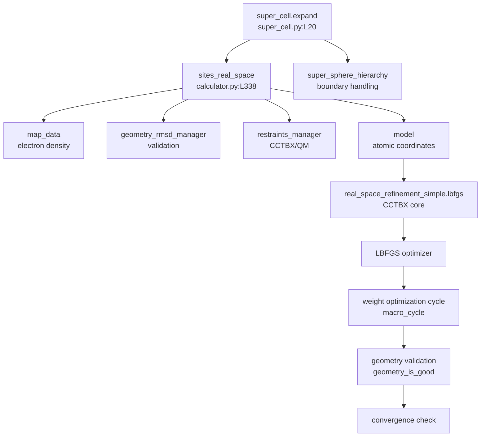

Real space refinement in Q|R provides an alternative optimization pathway that directly fits atomic coordinates into electron density maps, bypassing traditional structure factor calculations. This approach is particularly valuable for modeling ligands, solvent regions, or areas where density quality is exceptional. The implementation leverages CCTBX's real-space refinement engine with sophisticated weight optimization and geometry validation systems.

## Architecture Overview

Real space refinement operates through the `sites_real_space` class, which orchestrates coordinate optimization against density maps while maintaining geometric integrity through restraints. The architecture integrates three critical subsystems: a map fitting engine, a geometry restraints manager, and an adaptive weight optimization cycle.

The refinement process coordinates multiple components in a hierarchical structure:



This architecture enables direct optimization against density while maintaining the sophisticated restraint systems available in Q|R's full refinement pipeline. The real-space approach is particularly effective when working with high-quality density maps or focusing refinement on specific regions of interest.

## Core Refinement Engine

The real-space refinement engine centers on the `run_one()` method, which executes a single refinement cycle using LBFGS optimization with tricubic interpolation for gradient calculation from the density map [calculator.py](calculator.py#L515-L536).

**Key Implementation Details**:

```python
refined = cctbx.maptbx.real_space_refinement_simple.lbfgs(
  unit_cell                       = uc,
  gradients_method                = "tricubic",
  sites_cart                      = xrs.sites_cart(),
  density_map                     = self.map_data,
  geometry_restraints_manager     = self.restraints_manager,
  selection_variable_real_space   = not_hd_sel,
  real_space_target_weight        = weight,
  real_space_gradients_delta      = 0.25,
  gradient_only                   = self.gradient_only,
  line_search                     = self.line_search,
  lbfgs_core_params               = self.lbfgs_core_params,
  lbfgs_termination_params        = self.lbfgs_termination_params,
  lbfgs_exception_handling_params = self.lbfgs_exception_handling_params)
```

The implementation uses tricubic interpolation for gradient computation from the density map, providing accurate derivative calculations that respect the discrete nature of crystallographic data. Hydrogen/deuterium atoms are excluded from optimization (via `not_hd_sel`) due to their poor electron density visibility, maintaining geometry through restraints rather than direct map fitting.

LBFGS parameters are configured with strict step control (`stpmax=0.2`) appropriate for real-space refinement, where step sizes must be smaller than reciprocal-space refinement to prevent overshoot in density space. The `gradient_only` flag enables an efficient line-search variant according to Snyman 2005, reducing computational cost while maintaining convergence characteristics.

**LBFGS Configuration Parameters**:

| Parameter | Typical Value | Purpose |
|-----------|---------------|---------|
| `stpmax` | 0.2 | Maximum step size (smaller than reciprocal-space refinement) |
| `stpmin` | 1.e-9 | Minimum step size for convergence detection |
| `real_space_gradients_delta` | 0.25 | Finite difference step for gradient validation |
| `max_iterations` | 100 | Iteration limit per macro cycle |
| `line_search` | True | Enable line search for step optimization |

Sources: [calculator.py](calculator.py#L515-L536), [calculator.py](calculator.py#L357-L369)

## Weight Optimization Cycle

The `macro_cycle()` method implements an adaptive weight optimization strategy that balances map fit against geometric restraints through iterative refinement and validation [calculator.py](calculator.py#L396-L466). This system automatically determines the optimal `real_space_target_weight` parameter without requiring manual intervention.

The optimization follows a systematic pattern:

1. **Initial refinement** with current weight
2. **Geometry validation** using `geometry_is_good(stats)` to check bond and angle RMSD
3. **Weight adjustment** based on validation results:
   - If geometry is good (bond RMSD ≤ 0.03, angle RMSD ≤ 1.7): increase weight to improve map fit
   - If geometry degrades: decrease weight to restore geometric integrity
4. **Convergence detection** via oscillation detection (both up and down adjustments occurred)

```python
if(self.geometry_is_good(stats)):
  up += 1
  previous_good = weight
  if(b<0.03 or stalled(bond_rmsds)): weight = weight*2
  else: weight = weight + 0.3*weight
else:
  down += 1
  if(b>0.03): weight = weight/2
  else: # Gradual weight reduction for minor violations
    slow_down += 1
    if(slow_down<3): weight = weight - 0.3*weight
    else: weight = weight/2
```

The system implements intelligent weight scaling strategies based on the severity of geometric violations. Significant bond RMSD violations (>0.03) trigger aggressive weight halving, while minor violations use gradual 30% reductions with a safety mechanism that reverts to halving after three consecutive mild violations.

**Convergence Criteria**:

| Condition | Trigger | Action |
|-----------|---------|--------|
| Oscillation | Both up and down adjustments made | Terminate optimization |
| Stalled progress | Same bond RMSD value repeated 3+ times | Terminate optimization |
| Good geometry found | Bond RMSD ≤ 0.03 AND Angle RMSD ≤ 1.7 | Save as previous_good weight |
| Final refinement | After optimization cycle | Run 5 cycles with best weight |

Sources: [calculator.py](calculator.py#L396-L466), [calculator.py](calculator.py#L391-L395)

## Initial Weight Estimation

When `skip_weight_search=False`, the system calculates an initial weight estimate using the `get_weight()` method [calculator.py](calculator.py#L477-L505). This approach compares gradient norms from the density map and geometric restraints to establish an appropriate starting balance.

The estimation algorithm follows these steps:

1. **Compute map gradients** using `maptbx.target_and_gradients_simple` with tricubic interpolation
2. **Compute restraint gradients** from the geometry restraints manager
3. **Filter outliers** by excluding gradients exceeding 3× the mean norm
4. **Calculate weight ratio**: w = g_geo_norm / g_map_norm

```python
g_map_d = flex.sqrt(g_map.dot())
sel = g_map_d>flex.mean(g_map_d)*3
y = g_map.select(~sel).norm()

g_geo_d = flex.sqrt(g_geo.dot())
sel = g_geo_d>flex.mean(g_geo_d)*3
x = g_geo.select(~sel).norm()

if(y != 0.0): return x/y
else:         return 1.0  # Fallback for degenerate cases
```

The outlier filtering prevents extreme gradient values (often from poorly defined regions or artifacts) from biasing the initial weight estimate. This approach provides a robust starting point for subsequent iterative optimization.

> [!TIP]
> The weight estimation excludes hydrogen/deuterium atoms from gradient calculations due to their poor electron density visibility, relying instead on geometry restraints to maintain their proper positioning relative to heavy atoms.

Sources: [calculator.py](calculator.py#L477-L505), [refine.py](refine.py#L56-L70)

## Super-Cell Expansion

For molecules near crystallographic boundaries, real-space refinement requires proper treatment of symmetry mates to prevent artifacts. The `expand` class in `super_cell.py` creates a super-sphere environment that includes all atoms within a specified radius (default 15Å) of the refined region [super_cell.py](super_cell.py#L20-L46).

The expansion process:

1. **Initialize super-cell manager** with user-specified radius
2. **Extract super_sphere_hierarchy** containing all relevant symmetry mates
3. **Generate P1 box symmetry** encompassing the selected atoms
4. **Create geometry restraints manager** for the expanded region

```python
class expand(object):
  def __init__(self, pdb_hierarchy, crystal_symmetry, select_within_radius=15,
               create_restraints_manager=True):
    self.select_within_radius = select_within_radius
    self.cs_p1 = crystal.symmetry(self.crystal_symmetry.unit_cell(), "P1")
    self.sel_str_focus = " or ".join([
      "chain %s"%c.id for c in pdb_hierarchy.chains()])
    
    self.SCM = cctbx_super_cell.manager(
      pdb_hierarchy        = self.pdb_hierarchy,
      crystal_symmetry     = self.crystal_symmetry,
      select_within_radius = self.select_within_radius)
    self.ph_super_sphere = self.SCM.super_sphere_hierarchy
    self.cs_box = self.SCM.cs_super_sphere
```

The super-sphere hierarchy includes atoms from symmetry-related molecules that interact with the refinement region through van der Waals contacts or electrostatic interactions. This ensures that boundary effects are properly modeled without requiring full unit-cell expansion.

**Super-Cell Parameters**:

| Parameter | Default | Description |
|-----------|---------|-------------|
| `select_within_radius` | 15 Å | Inclusion radius for symmetry mates |
| `create_restraints_manager` | True | Auto-generate restraints for expanded region |
| `cs_p1` | Auto | P1 symmetry for super-sphere box |

Sources: [super_cell.py](super_cell.py#L20-L91), [super_cell.py](super_cell.py#L48-L56)

## Integration with Restraints

Real-space refinement supports both CCTBX geometry restraints and QM-based restraints through the same architecture used in reciprocal-space refinement. The `restraints_manager` parameter accepts either `from_cctbx` or `from_qm` instances, enabling quantum mechanical accuracy for critical regions while maintaining computational efficiency for bulk solvent [restraints.py](restraints.py#L434-L552).

The restraint calculation interface remains consistent:

```python
_, g_geo = self.restraints_manager.target_and_gradients(
  sites_cart = self.model.get_sites_cart())
```

This unified interface allows seamless switching between restraint types without modifying the refinement engine. For QM restraints, the fragmentation and clustering systems described in [Fragmentation Strategy](7-understanding-fragmentation) and [Clustering Algorithms](9-clustering-algorithms) are fully supported in real-space refinement.

**Restraint Selection Guide**:

| Scenario | Recommended Restraint | Rationale |
|----------|---------------------|-----------|
| Protein backbone | CCTBX | Well-parameterized geometry libraries |
| Metal coordination sites | QM (MOPAC/xTB) | Directional bonding requires electronic structure |
| Organic ligands | QM or CCTBX | Depends on chemical complexity and data quality |
| Water molecules | CCTBX | Fast, adequate for bulk solvent |
| Active site | QM (high-level) | Critical for accurate modeling of chemistry |

Sources: [restraints.py](restraints.py#L434-L560), [calculator.py](calculator.py#L351-L353)

## Geometry Validation

Real-space refinement includes continuous geometry validation through the `geometry_is_good()` method and the `geometry_rmsd_manager` [calculator.py](calculator.py#L391-L395). The system validates bond and angle deviations after each refinement cycle to detect overfitting to density at the expense of chemical accuracy.

Validation criteria are configurable through the refinement parameters:

```python
max_bond_rmsd = 0.03    # Maximum acceptable bond RMSD (Å)
max_angle_rmsd = 1.7    # Maximum acceptable angle RMSD (degrees)
```

The validation system tracks bond and angle RMSD values throughout refinement cycles, providing quantitative metrics for assessing model quality. These statistics are displayed after each macro cycle:

```
  start: weight=  1.5000 bond=0.023 angle=1.23 shift=0.1234 cc_mask=0.8765
  final: weight=  1.5000 bond=0.021 angle=1.19 shift=0.1456 cc_mask=0.8789
```

The `show()` method calculates additional metrics including:
- **Shift**: Mean atomic displacement from starting coordinates
- **cc_mask**: Correlation coefficient between model and map density
- **Geometry statistics**: Bond and angle RMSD values

These metrics provide comprehensive feedback on refinement progress and convergence status.

Sources: [calculator.py](calculator.py#L463-L476), [calculator.py](calculator.py#L381-L386)

## Convergence Detection

The refinement system implements multiple convergence criteria to detect optimization completion:

1. **Geometric convergence**: Bond and angle RMSD stabilize within tolerance
2. **Coordinate convergence**: Mean atomic displacement falls below threshold
3. **Oscillation detection**: Weight optimization cycles between increasing and decreasing
4. **Progress stagnation**: Bond RMSD values repeat without improvement

Convergence is checked both during weight optimization and final refinement cycles:

```python
def stalled(x):
  for it in x:
    if x.count(it) > 3:
      return True
  return False
```

The system stops refinement when geometric criteria are met or when further iterations show no meaningful improvement. This prevents unnecessary computation while ensuring that refinement proceeds sufficiently close to the optimal solution.

**Convergence Parameters**:

| Parameter | Default | Purpose |
|-----------|---------|---------|
| `max_bond_rmsd` | 0.03 | Target bond RMSD (Å) |
| `max_angle_rmsd` | 1.7 | Target angle RMSD (°) |
| `stall threshold` | 3 repetitions | Detect stagnation |
| `refine_cycles` | 5 | Maximum refinement iterations |

Sources: [calculator.py](calculator.py#L396-L466), [driver.py](calculator.py#L301-L472)

## Usage Patterns

Real-space refinement can be accessed through Q|R's parameter interface by setting appropriate refinement mode and providing map data:

```bash
qr.refine model.pdb data.mtz \
  refine.mode=refine \
  map_data=my_map.map \
  real_space=true
```

**Typical Use Cases**:

1. **Ligand refinement**: Fit ligand coordinates into high-quality density while maintaining proper geometry
2. **Water placement**: Optimize water molecule positions in clear density regions
3. **Side-chain rebuilding**: Refine flexible side chains with well-defined density
4. **Partial model refinement**: Focus refinement on specific regions without full unit-cell optimization

**Advantages over Reciprocal-Space Refinement**:

- Direct visualization of density fit during refinement
- Faster convergence for localized regions
- Reduced computational cost for small systems
- Natural integration with manual model building workflows
- Better suited for models with incomplete data or non-crystallographic symmetry

**Limitations**:

- Requires pre-computed electron density maps
- Less effective for low-resolution data
- Does not optimize B-factors or occupancy
- May struggle with weak or ambiguous density
- Boundary effects require careful treatment

Sources: [qr.py](qr.py#L126-L216), [refine.py](refine.py#L291-L447)

## Configuration Options

Real-space refinement provides extensive configuration options through the refinement parameter scope:

**Refinement Mode Parameters**:

```python
refine {
  mode = *refine              # Use refine for real-space
  max_iterations_refine = 50   # LBFGS iterations per cycle
  number_of_refine_cycles = 5  # Macro cycle iterations
  line_search = True          # Enable line search
  stpmax = 0.2                # Maximum step size
  gradient_only = False       # Gradient-only line search
}
```

**Real-Space Specific Parameters**:

```python
refine {
  data_weight = None          # Auto-estimate if None
  skip_weight_search = False  # Disable weight optimization
  max_bond_rmsd = 0.03        # Geometry tolerance
  max_angle_rmsd = 1.7        # Angle tolerance
}
```

**Super-Cell Expansion**:

```python
cluster {
  select_within_radius = 10    # Super-sphere radius (Å)
}
expansion = True               # Enable super-cell
```

Sources: [qr.py](qr.py#L126-L216), [calculator.py](calculator.py#L338-L369)

## Next Steps

Real-space refinement integrates with Q|R's broader architecture. For deeper understanding:

- Explore [Weight Factor Calculation](24-weight-factor-calculation) for the reciprocal-space weight optimization algorithm
- Review [Minimization Algorithms](25-minimization-algorithms) for alternative optimization approaches
- Study [QM vs CCTBX Restraints](20-qm-vs-cctbx-restraints) for restraint system details
- Consult [Convergence Criteria](27-convergence-criteria) for convergence detection strategies

For practical examples, examine the test suites in the repository that demonstrate real-space refinement on various molecular systems.