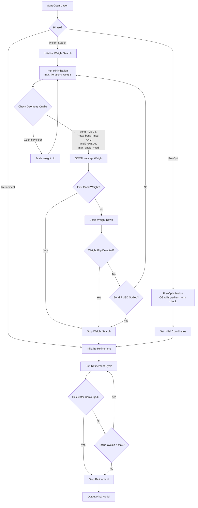

Convergence criteria in quantum refinement determine when the optimization process should terminate, balancing computational efficiency with structural accuracy. Qrefine implements a multi-layered convergence system that monitors geometry quality, energy landscapes, and refinement metrics across different optimization phases.

## Architecture Overview

The convergence system operates at three distinct levels: geometry-based criteria, energy-based thresholds, and iteration limits. Each optimization phase (weight search and refinement) employs specific convergence checks appropriate to its objectives. The architecture integrates these checks through the calculator and driver modules, with different behaviors for L-BFGS minimizers versus ASE-based optimizers.

Sources: [calculator.py](calculator.py#L85-L189), [driver.py](driver.py#L22-L63)

## Convergence Mechanisms

### Shift-Based Convergence (sites_opt Calculator)

The `sites_opt` calculator implements position-shift based convergence for optimization scenarios. This mechanism tracks atomic displacements from the starting coordinates and terminates when shifts fall below a configurable threshold multiple times.

The convergence logic in the `callback_after_step` method monitors mean root-mean-square displacement:

```python
def callback_after_step(self, minimizer=None):
  if not self.use_callback_after_step: return None
  shift_from_start = flex.mean(flex.sqrt(
    (self.sites_plus_x - self.sites_cart_start).dot()))
  if shift_from_start >= self.convergence_threshold:
    self._converged = True
    return True
  else: return None
```

The `apply_x` method provides additional convergence checking through tracking shifts between coordinate resets. When the maximum shift between resets is less than the convergence threshold, the convergence counter increments. Convergence is declared when this counter reaches `convergence_reached_times` (default: 3).

Sources: [calculator.py](calculator.py#L132-L184)

### Multi-Criteria Convergence (sites Calculator)

The primary `sites` calculator employs a more sophisticated convergence mechanism requiring the criteria to be satisfied multiple consecutive times. The `converged` method checks if `n_converged` has reached the threshold of 3, indicating stable convergence across multiple iterations.

Sources: [calculator.py](calculator.py#L287-L289)

## Weight Search Convergence

The weight search phase uses geometry quality metrics as the primary convergence criteria. This phase searches for optimal data/restraints weight factors while maintaining acceptable bond and angle geometry.

### Geometry Quality Thresholds

Convergence during weight search is determined by the "GOOD" condition:

```python
GOOD = monitor.b_rmsd <= params.refine.max_bond_rmsd and \
       monitor.a_rmsd <= params.refine.max_angle_rmsd
```

When both bond RMSD ≤ `max_bond_rmsd` (default: 0.03 Å) and angle RMSD ≤ `max_angle_rmsd` (default: 1.7°), the weight is considered acceptable. The system then scales the restraints weight down by the factor specified in `adjust_restraints_weight_scale_value` (default: 1.5) and continues searching for better weights.

Sources: [driver.py](driver.py#L375-L387)

### Weight Search Stopping Rules

The weight search terminates under multiple conditions:

1. **First Good Weight**: If `stop_one_found_first_good_weight=True` (default), stops immediately upon finding the first acceptable weight
2. **Weight Flip**: Stops when the system transitions from increasing to decreasing restraints weight (or vice versa), indicating the optimal region has been bracketed
3. **Bond RMSD Stall**: Detects when bond RMSD values remain constant across the last two weight search cycles
4. **Maximum Cycles**: Exhausts all `number_of_weight_search_cycles` (default: 50)

Sources: [driver.py](driver.py#L375-L407)

## Refinement Convergence

The refinement phase monitors overall convergence through the calculator's converged status and iteration limits.

### Calculator Convergence Checks

During refinement cycles, the system checks `calculator.converged()` after each macro cycle. When convergence is detected, refinement terminates early with the message "Refinement converged. Stopping now." This leverages the multi-criteria checking mechanism in the `sites` calculator class.

Sources: [driver.py](driver.py#L460-L462)

### Iteration Limits

Both weight search and refinement phases enforce maximum iteration limits:

| Parameter | Default | Purpose | Context |
|-----------|---------|---------|---------|
| `max_iterations_weight` | 50 | Maximum iterations for weight search | Weight optimization phase |
| `max_iterations_refine` | 50 | Maximum iterations per refine cycle | Actual refinement phase |
| `number_of_refine_cycles` | 5 | Maximum refinement macro cycles | Outer refinement loop |

Sources: [driver.py](driver.py#L252-L257), [qr.py](qr.py#L148-L153)

## Pre-Optimization Convergence

The optional pre-optimization phase uses a Polak-Ribiere conjugate gradient algorithm with gradient norm-based convergence. This phase activates when `pre_opt=True` and uses dedicated parameters:

| Parameter | Default | Description |
|-----------|---------|-------------|
| `pre_opt_stpmax` | 0.1 | Maximum step size during pre-optimization |
| `pre_opt_iter` | 10 | Maximum iterations for pre-optimizer |
| `pre_opt_switch` | 2 | Iterations before switching from steepest descent to conjugate gradient |
| `pre_opt_gconv` | 3000 | Gradient norm convergence threshold |

The pre-optimizer terminates when the gradient norm falls below `pre_opt_gconv` or when maximum iterations are reached.

Sources: [driver.py](driver.py#L95-L159), [qr.py](qr.py#L202-L215)

## Clustering Update Convergence

When clustering is enabled, the system monitors atomic positions to determine when fragment clusters need re-calculation. The `clustering_update` class tracks RMSD displacement from the initial positions:

```python
class clustering_update(object):
  def __init__(self, pre_sites_cart, log, rmsd_tolerance):
    self.pre_sites_cart = pre_sites_cart
    self.rmsd_tolerance = rmsd_tolerance  # = params.refine.rmsd_tolerance * 100
```

When the model shifts exceed the `rmsd_tolerance` (default: 0.01, multiplied by 100 = 1.0 in the clustering update), clusters are recalculated to ensure accurate quantum mechanical calculations for the current geometry.

Sources: [driver.py](driver.py#L160-L176)

## ASE L-BFGS Convergence

When `use_ase_lbfgs=True`, the system uses Atomic Simulation Environment's L-BFGS implementation with convergence handled internally by ASE. However, Qrefine adds custom convergence checks:

During refinement mode with ASE L-BFGS, the system monitors bond RMSD and may stop early if geometry quality degrades:
```python
if(self.params.refine.mode=="refine" and
   self.b_rmsd>self.params.refine.max_bond_rmsd and
   self.number_of_function_and_gradients_evaluations>20):
  return False
```

This prevents excessive bond length deviations during ASE-based refinement.

Sources: [driver.py](driver.py#L185-L248)

## Convergence Parameter Summary

| Parameter | Type | Default | Phase | Effect |
|-----------|------|---------|-------|--------|
| `max_bond_rmsd` | float | 0.03 | Weight Search | Maximum acceptable bond length deviation |
| `max_angle_rmsd` | float | 1.7 | Weight Search | Maximum acceptable angle deviation |
| `r_tolerance` | float | 0.001 | Refinement | R-factor delta for cycle-to-cycle comparison |
| `rmsd_tolerance` | float | 0.01 | Clustering | Position shift threshold for re-clustering |
| `stop_one_found_first_good_weight` | bool | True | Weight Search | Immediate stop on first good weight |
| `max_iterations_weight` | int | 50 | Weight Search | Maximum L-BFGS iterations |
| `max_iterations_refine` | int | 50 | Refinement | Maximum L-BFGS iterations per cycle |
| `number_of_weight_search_cycles` | int | 50 | Weight Search | Outer loop maximum cycles |
| `number_of_refine_cycles` | int | 5 | Refinement | Outer refinement cycles |
| `use_convergence_test` | bool | True | Refinement | Enable convergence checking |
| `pre_opt` | bool | False | Pre-Optimization | Enable pre-optimization phase |

Sources: [qr.py](qr.py#L131-L198)

> [!TIP]
> The relationship between convergence criteria and resolution is crucial: for low-resolution structures, use `stop_one_found_first_good_weight=True` to avoid overfitting; for high-resolution structures, set it to `False` to explore the weight landscape more thoroughly and achieve optimal geometry quality.

## Convergence Flow Diagram



Sources: [driver.py](driver.py#L301-L472), [calculator.py](calculator.py#L183-L184)

## Best Practices

1. **Low-Resolution Structures (≤ 3.0 Å)**: Keep `stop_one_found_first_good_weight=True` and use default `max_bond_rmsd` (0.03) to prevent overfitting
2. **High-Resolution Structures (< 1.5 Å)**: Consider `stop_one_found_first_good_weight=False` and tighter `max_bond_rmsd` (0.02) for improved geometry
3. **Problematic Convergence**: Enable pre-optimization (`pre_opt=True`) to improve initial coordinate quality before main refinement
4. **Clustering Systems**: Monitor re-clustering frequency; excessive re-clustering suggests `rmsd_tolerance` is too tight
5. **ASE vs. CCTBX L-BFGS**: Use `use_ase_lbfgs=False` (default) for production refinement; ASE L-BFGS is primarily for debugging
