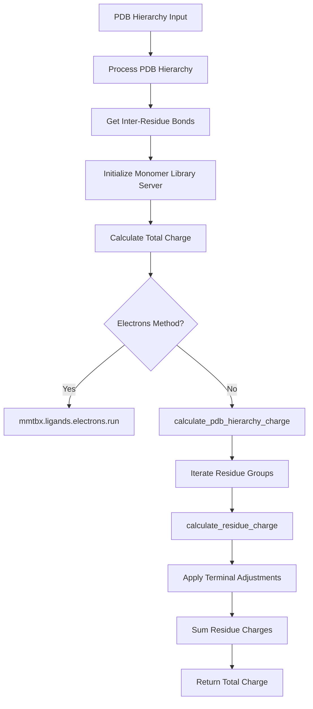
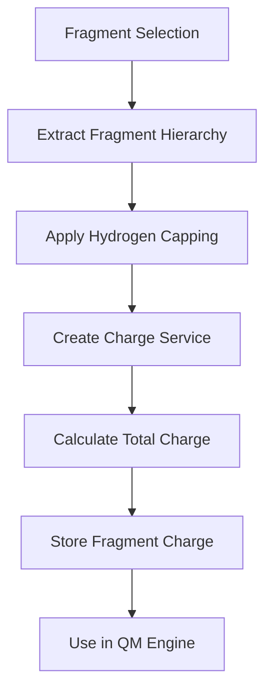

This page documents the charge calculation infrastructure in Q|R, which provides essential electrostatic information for quantum refinement calculations. The system handles both formal charge assignment at the residue level and partial point charges at the atomic level, supporting accurate quantum mechanical calculations with proper electrostatic environment modeling.

## Overview of Charge Architecture

Q|R implements a comprehensive charge calculation system that operates at multiple levels of granularity. The architecture integrates formal charge determination from structural dictionaries with partial charge extraction from chemical component definitions, creating a complete electrostatic description for both classical and quantum mechanical calculations.

Sources: [charges.py](charges.py#L74-L180), [charges.py](charges.py#L1-L72)

The charge calculation system serves multiple critical functions in the quantum refinement workflow:
- **Formal charge validation** ensures total charge consistency before QM calculations
- **Partial charge extraction** provides atomic charges for electrostatic embedding
- **Fragment charge determination** assigns correct charges to QM fragments
- **Heteroatom charge handling** manages non-standard residues and metal ions

## Formal Charge Calculations

### Residue-Level Charge Assignment

The core of the charge calculation system is the `charges_class`, which computes formal charges by analyzing the complete protein hierarchy and applying structural rules based on chemical component dictionaries.

Sources: [charges.py](charges.py#L74-L180), [charges.py](charges.py#L486-L540)



The `charges_class` initialization processes the input structure through several key steps:

- **Hierarchy processing**: Converts raw PDB records into a structured hierarchy with crystal symmetry
- **Bond identification**: Detects inter-residue covalent bonds (e.g., disulfide bridges)
- **Monomer library setup**: Establishes access to chemical component dictionaries
- **Heteroatom handling**: Loads default ion charges for common metal ions

Sources: [charges.py](charges.py#L86-L120)

### Terminal Residue Charge Adjustments

The system automatically adjusts charges for terminal residues by detecting specific hydrogenation patterns. This ensures N-terminal and C-terminal residues receive the correct formal charge state.

Sources: [charges.py](charges.py#L636-L850)

| Terminal Type | Detection Pattern | Charge Adjustment |
|--------------|------------------|-------------------|
| N-terminal | H1, H2, H3 atoms present | +1 to base charge |
| NH3-terminal | HT1, HT2, HT3 atoms present | +1 to base charge |
| NH2-terminal | HT1, HT2 atoms present | +1 to base charge |
| N-capping | H1, H2 or H, H2 atoms present | +1 to base charge |
| C-terminal | OXT atom present | -1 to base charge |
| C-capping | HC atom present | 0 adjustment |

The charge calculation algorithm validates hydrogen content against expected values from chemical component dictionaries, then adjusts the base polymer charge based on terminal patterns:

Sources: [charges.py](charges.py#L695-L775)

```python
# Base charge from chemical component dictionary
charge = get_aa_charge(ag.resname)

# Calculate expected vs actual hydrogens
poly_hs = len(get_aa_polymer_hydrogens(ag.resname)) - 2
diff_hs = hs - poly_hs

# Apply terminal adjustments
if n_terminal(ag.resname, atom_names):
    diff_hs -= 1
    max_charge += 1
elif c_terminal(atom_names):
    diff_hs -= 1
    max_charge += 1

# Final charge calculation
charge += diff_hs
```

The system enforces allowable charge ranges for ionizable amino acids (ARG, CYS, GLU, ASP) to ensure chemical plausibility.

Sources: [charges.py](charges.py#L25-L30), [charges.py](charges.py#L805-L815)

### Inter-Residue Bond Considerations

When residues form covalent bonds across residue boundaries (such as disulfide bridges or unusual linkages), the charge calculation accounts for the electron sharing by adjusting the hydrogen count:

Sources: [charges.py](charges.py#L777-L785)

> [!TIP]
> Disulfide bonds between cysteine residues are detected through inter-residue bond analysis, and the charge calculation correctly accounts for the electron sharing by reducing the effective hydrogen count for bonded cysteines. This ensures that CYS-CYS pairs receive the appropriate formal charge state.

## Partial Point Charges

### Atomic-Level Charge Extraction

For QM calculations requiring electrostatic embedding, Q|R extracts partial point charges from chemical component dictionaries. These charges are typically derived from quantum chemical calculations and stored in CIF format files.

Sources: [charges.py](charges.py#L863-L925)

The `get_partial_point_charges` function retrieves partial charges by:

1. **Accessing residue restraints** through the monomer library server
2. **Looking up atomic charges** in the chemical component dictionary
3. **Handling special cases** for terminal hydrogens and alternative naming conventions

Sources: [charges.py](charges.py#L863-L925)

Special handling exists for several atomic types:

| Atom Type | Special Handling |
|-----------|-----------------|
| Terminal H1, H2, H3 | Fixed charge of 0.26 e⁻ |
| HXT (oxygen extension) | Zero charge (dummy atom) |
| HA3, HB3, HG3, etc. | Mapped to HA1, HB1, HG1 equivalents |
| Ions (CL, ZN, MG, etc.) | Use full formal charge from PDB |

Sources: [charges.py](charges.py#L882-L915)

### Charge File Formats

Partial point charges are written in multiple formats depending on the QM engine requirements:

- **xyzq format**: `[x, y, z, charge]` - Used by Turbomole
- **qxyz format**: `[charge, x, y, z]` - Used by Terachem, xTB, MOPAC

Sources: [charges.py](charges.py#L926-L945), [fragment.py](fragment.py#L460-L480)

The charge file writing function supports optional scaling of charges for specific atomic positions, which is used in cluster QM/MM calculations to prevent overcounting at the QM/MM boundary.

Sources: [charges.py](charges.py#L942-L961)

## Charge Embedding in QM Calculations

### Fragment Charge Determination

When the protein is fragmented for quantum refinement, each fragment receives its own total charge calculated from the capped structure. The system uses hydrogen capping to complete valences before charge calculation.

Sources: [fragment.py](fragment.py#L316-L395)

The fragment charge calculation workflow:



Sources: [fragment.py](fragment.py#L316-L395)

The `get_fragment_hierarchies_and_charges` method processes each fragment by:

1. **Selecting fragment atoms** from the super hierarchy
2. **Applying hydrogen capping** to complete valences at fragment boundaries
3. **Creating a charge service instance** for the capped fragment
4. **Calculating and storing** the total charge for each fragment

Sources: [fragment.py](fragment.py#L316-L395)

### Electrostatic Embedding with Point Charges

For accurate QM calculations, Q|R supports electrostatic embedding where the QM region feels the electrostatic field from surrounding MM atoms. The `write_mm_charge_file` function generates point charge files representing the non-QM environment.

Sources: [fragment.py](fragment.py#L418-L480)

The embedding process includes:

- **Distance-based selection**: Only MM atoms within a cutoff distance (default 8.0 Å) are included
- **Charge scaling**: Edge atoms near the QM boundary have their charges scaled to prevent double-counting
- **Alternative conformation handling**: Ensures charge consistency across altloc groups

Sources: [fragment.py](fragment.py#L428-L480)

> [!TIP]
> The charge scaling at QM/MM boundaries prevents overcounting of electrostatic interactions. Edge atoms that would be counted in both QM and MM calculations have their partial charges scaled down, typically by a factor of 0.5, to maintain electrostatic consistency.

## QM Engine Integration

### Charge Parameter passing to QM Engines

Different QM engines receive charge information through specific mechanisms. The ASE plugin architecture standardizes charge parameter delivery:

| QM Engine | Charge Parameter | Implementation |
|-----------|-----------------|----------------|
| xTB | `--chrg` command line flag | [xtb_qr.py](plugin/ase/xtb_qr.py#L145-L155) |
| MOPAC | `CHARGE=` keyword in input | [mopac_qr.py](plugin/ase/mopac_qr.py#L1-L100) |
| ORCA | `*xyz <charge> <spin>` header | [orca_qr.py](plugin/ase/orca_qr.py) |
| Gaussian | `Charge=<n>` route section | [gaussian_qr.py](plugin/ase/gaussian_qr.py) |
| Terachem | `charge <n>` in input file | [terachem_qr.py](plugin/ase/terachem_qr.py) |

Sources: [plugin/ase/xtb_qr.py](plugin/ase/xtb_qr.py#L115-L155), [plugin/ase/mopac_qr.py](plugin/ase/mopac_qr.py#L30-L50)

### xTB Charge Example

The xTB interface demonstrates typical charge handling:

```python
# Build command with charge parameter
command='%s %s --chrg %s --grad %s --parallel %s > xtb.out' % (
        binary,
        str(self.coordinates),
        str(self.key_parameters["charge"]),
        str(self.key_parameters['method']),
        str(self.key_parameters['nproc']))
```

Sources: [plugin/ase/xtb_qr.py](plugin/ase/xtb_qr.py#L145-L155)

The charge is passed as an integer representing the net molecular charge, which is essential for correct SCF convergence in quantum mechanical calculations.

## Command-Line Interface

### qr.charges Utility

Q|R provides a command-line tool for charge calculation and validation:

```bash
qr.charges model.pdb ligand.cif list_charges=True verbose=True
```

Sources: [command_line/charge.py](command_line/charge.py#L1-L108)

Key parameters:

| Parameter | Type | Description |
|-----------|------|-------------|
| `model_file_name` | path | Input PDB model file |
| `ligand_cif_file_name` | path | Optional ligand CIF restraints |
| `list_charges` | bool | Print individual residue charges |
| `electrons` | bool | Use electron counting method (default) |
| `assert_correct_chain_terminii` | bool | Validate terminal hydrogens |
| `verbose` | bool | Detailed output |

Sources: [command_line/charge.py](command_line/charge.py#L16-L46)

The utility instantiates `charges_class` and returns either the total charge or a detailed list of per-residue charges with annotations.

Sources: [command_line/charge.py](command_line/charge.py#L72-L108)

## API Reference

### charges_class

**Constructor**

```python
charges_class(pdb_hierarchy=None,
              crystal_symmetry=None,
              pdb_filename=None,
              raw_records=None,
              pdb_inp=None,
              ligand_cif_file_names=None,
              cif_objects=None,
              electrons=True,
              verbose=False)
```

**Methods**

- `get_total_charge(list_charges=False, assert_correct_chain_terminii=True, check=False, verbose=False)` - Returns total charge or detailed charge list
- `write_pdb_hierarchy_qxyz_file(file_name="qxyz_cctbx.dat", exclude_water=True, charge_scaling_positions=None, scale=0)` - Writes charges in qxyz format
- `calculate_residue_charge(rg, assert_contains_hydrogens=True, assert_no_alt_loc=True, hetero_charges=None, inter_residue_bonds=None, verbose=False)` - Calculates charge for a single residue group

Sources: [charges.py](charges.py#L74-L260)

### Utility Functions

- `get_partial_point_charges(rg, mon_lib_server, hetero_charges=None)` - Extracts atomic partial charges
- `get_hetero_charges_FORMUL(pdb_inp)` - Parses heteroatom charges from PDB FORMUL records
- `scale_partial_point_charges(qxyz, charge_scaling_positions=None, scale=0)` - Scales charges for specific positions

Sources: [charges.py](charges.py#L863-L1062)

## Practical Considerations

### Terminal Residue Validation

The system requires proper hydrogenation of terminal residues. Missing terminal hydrogens will trigger validation errors unless the `assert_correct_chain_terminii` parameter is disabled.

Sources: [charges.py](charges.py#L523-L540)

### Alternative Conformations

Charge calculations currently require squashing alternative locations or processing single conformations. The `assert_no_alt_loc` parameter controls this behavior.

Sources: [charges.py](charges.py#L488-L500)

### Metal Ion Handling

Default charges are provided for common metal ions (PT, CL, CD, ZN, MG, CU). For non-standard metals, charges must be specified in the PDB file or through the hetero_charges dictionary.

Sources: [charges.py](charges.py#L17-L22), [charges.py](charges.py#L122-L124)

### Water Exclusion

By default, water molecules are excluded from partial charge calculations to reduce computational cost in QM/MM calculations. The `exclude_water` parameter controls this behavior.

Sources: [charges.py](charges.py#L926-L930)

## Next Steps

- For detailed information on partial charge usage in refinement, see [Partial Point Charges](29-partial-point-charges)
- To understand how charges integrate with QM engines, review [Supported QM Engines Overview](11-supported-qm-engines-overview)
- For fragmentation strategies that determine how charges are calculated, see [Understanding Fragmentation](7-understanding-fragmentation)