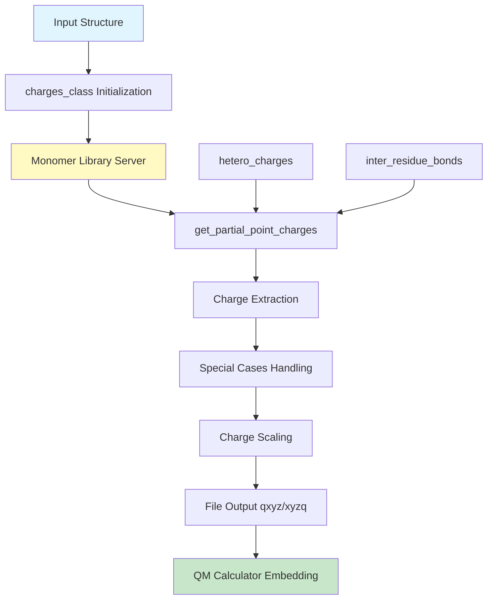
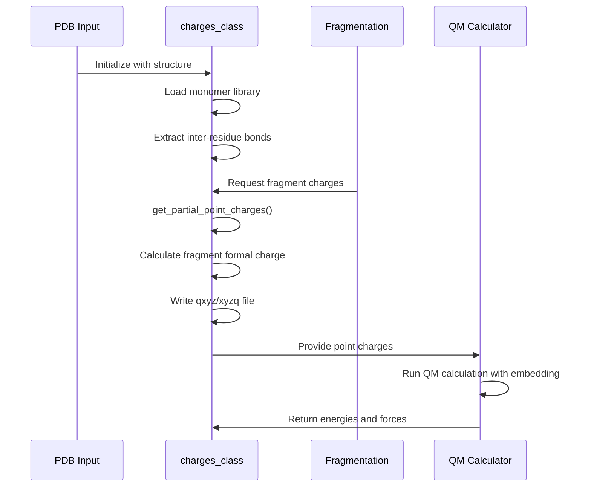

Partial point charges enable electrostatic embedding in QM-refinement, allowing QM calculations to incorporate the electrostatic influence of the surrounding macromolecular environment. This critical feature bridges the quantum mechanical treatment of active sites with the classical description of the bulk protein, ensuring accurate electronic structure calculations in biologically relevant contexts.

## Overview of Partial Charge System

The partial point charge system in qrefine operates through a multi-layered architecture that extracts atomic partial charges from monomer library restraints and makes them available to QM calculators. The system handles standard amino acids, modified residues, hetero compounds, and ions, providing the electrostatic environment necessary for accurate QM calculations on molecular fragments.



## Core Charge Calculation Architecture

The `charges_class` serves as the primary interface for charge management in qrefine, initialized with PDB hierarchy, crystal symmetry, and optional ligand CIF files [charges.py#L74-L145](/charges.py#L74-L145). The class maintains critical components including the monomer library server, inter-residue bond information, and hetero charge definitions that together enable accurate charge determination for complex biomolecular systems.

Upon initialization, the system processes the PDB hierarchy through `get_processed_pdb()` and establishes connections to the monomer library server, which contains CIF-based chemical component definitions with pre-computed partial charges [charges.py#L86-L107](/charges.py#L86-L107). The class also automatically determines inter-residue bonds (such as disulfide bridges) which are essential for correct charge assignment across covalently linked residues.

## Partial Charge Extraction

The `get_partial_point_charges()` function performs the core charge extraction from monomer library restraints, handling atom-level charge assignment with comprehensive fallback mechanisms [charges.py#L863-L925](/charges.py#L863-L925). The function processes each atom group within a residue, mapping atom names to their corresponding CIF restraints and extracting the `partial_charge` field.

**Special Handling Cases**:

| Atom Type | Charge Assignment Strategy | Example |
|-----------|---------------------------|---------|
| Ions (common_element) | From PDB charge field or hetero_charges dictionary | Na+, Mg2+ |
| Terminal Hydrogens | Fixed values (0.26 for H1/H2/H3) | N-terminal NH3+ |
| Capping Hydrogens | Zero charges (HXT) | Fragment capping |
| Modified Atoms | Name mapping (HA3→HA1, HT1→HA1) | Alternate nomenclature |

The function implements robust atom name matching with a comprehensive mapping table for version 2 to version 3 PDB atom name conversions [charges.py#L866-L876](/charges.py#L866-L876). This ensures compatibility with different PDB file formats and historical naming conventions.

> [!TIP]
> The monomer library must contain CIF definitions for all residues in the structure. Missing definitions will cause assertion failures in `_get_restraints_from_resname()`, which attempts fallback lookup using the three-letter amino acid dictionary before raising an error [charges.py#L852-L862](/charges.py#L852-L862).

## Formal Charge Calculation

While partial charges represent electrostatic distribution, the `calculate_residue_charge()` function determines the total formal charge of residues based on protonation state and terminal modifications [charges.py#L636-L850](/charges.py#L636-L850). This calculation is essential for maintaining charge neutrality in QM calculations and determining the appropriate charge state for molecular fragments.

**Terminal Residue Detection**:
- **N-terminal**: Detects H1/H2/H3, HN1/HN2, or H2/H3 patterns (PRO-specific)
- **C-terminal**: Detects OXT or OT1/OT2 oxygen atoms
- **Capping**: Identifies HC (C-terminal) and various N-terminal cap patterns
- **NH3/NH2 terminals**: Special handling for ammonium and amine terminations

The function calculates charge by starting from the residue's base charge and adjusting based on hydrogen count deviations from polymer reference values [charges.py#L748-L835](/charges.py#L748-L835). Each terminal detection modifies the hydrogen count, which in turn affects the formal charge calculation. This approach ensures that capped clusters used in QM calculations maintain proper charge accounting.

## File Output and Format

The `write_charge_and_coordinates_from_hierarchy()` method generates charge-coordinate files for QM calculators, supporting two output formats through the `qxyz_order` parameter [charges.py#L194-L251](/charges.py#L194-L251):

**Format Comparison**:

| Format | Structure | Usage |
|--------|-----------|-------|
| **qxyz** | `[charge, x, y, z, "\n"]` | TeraChem, general QM packages |
| **xyzq** | `[x, y, z, charge, "\n"]` | Alternative format compatibility |

The method iterates through all residues (optionally excluding water), extracts partial charges using `get_partial_point_charges()`, and applies charge scaling if specified [charges.py#L214-L233](/charges.py#L214-L233). The output includes atom count and comment headers for the qxyz format, following standard coordinate file conventions.

**Output Parameters**:
- `file_name`: Output file path (default: "qxyz_cctbx.dat")
- `exclude_water`: Skip water residues (default: True)
- `charge_scaling_positions`: List of XYZ coordinates for selective scaling
- `scale`: Scaling factor (typically 0 for no scaling)

## Charge Scaling Mechanism

The `scale_partial_point_charges()` function enables selective modification of atomic charges based on spatial criteria [charges.py#L942-L960](/charges.py#L942-L960). This allows users to attenuate electrostatic effects from specific regions, such as distant residues or solvent molecules, by reducing their contribution to the QM electrostatic embedding.

The scaling operation identifies atoms within 1.0×10⁻³ Å of specified coordinates and applies the scaling factor to their partial charges. This provides fine-grained control over the electrostatic environment without modifying the underlying structural data.

## Integration with QM Calculators

Partial point charges integrate with QM calculators through the `pointcharges` parameter in the ASE calculator interface. Multiple QM engines support this feature:

**QM Calculator Support**:

| Calculator | Point Charges Support | Implementation |
|------------|----------------------|----------------|
| TeraChem | Yes | Through `pointcharges` key parameter [terachem_qr.py#L9](/plugin/ase/terachem_qr.py#L9) |
| ORCA | Yes | Via `pointcharges` parameter [orca_qr.py#L19](/plugin/ase/orca_qr.py#L19) |
| MOPAC | Yes | Electrostatic embedding capability |
| RestAPI | Planned | Future support in server interface |

The calculators receive charge-coordinate data generated by qrefine and incorporate it into their QM calculations, typically using point charge embedding schemes that add the electrostatic potential from external charges to the Hamiltonian. This allows accurate description of the electronic structure while accounting for the influence of the surrounding protein environment.

> [!TIP]
> Point charge embedding is most effective when charges are placed at atomic positions of well-ordered residues. Highly flexible regions or disordered solvent may require charge reduction or exclusion to avoid convergence issues in QM calculations.

## Hetero Compound Charge Handling

The system provides multiple strategies for handling charges in hetero compounds (non-standard residues, ligands, cofactors):

1. **PDB Charge Field**: Charges specified directly in the PDB file atom records
2. **FORMUL Records**: Chemical formulas parsed from PDB FORMUL entries [charges.py#L963-L979](/charges.py#L963-L979)
3. **Database Lookup**: Charges retrieved from restraint definitions [charges.py#L983-L995](/charges.py#L983-L995)
4. **User-Specified**: Custom hetero_charges dictionary passed to functions

The `get_hetero_charges()` function consolidates these sources, prioritizing user-specified charges, then FORMUL records, then restraint database lookups [charges.py#L997-L1002](/charges.py#L997-L1002). This hierarchical approach ensures maximum flexibility for handling diverse chemical components in crystallographic models.

## Command Line Interface

The charge calculation functionality is accessible through the `qr.charges` command line tool [command_line/charge.py#L10-L107](/command_line/charge.py#L10-L107). While primarily called internally by the clustering code, the standalone tool provides capabilities for:

- Calculating total formal charge of a model
- Determining charges for individual clusters
- Capping clusters with hydrogens for neutral buffer layers

**Command Usage**:
```bash
qr.charges model_file_name.pdb
```

The tool validates hydrogen presence, checks chain termini, and provides detailed charge listings when requested through the `list_charges` parameter.

## Error Handling and Validation

The charge calculation system implements comprehensive validation to ensure data integrity:

- **Hydrogen Validation**: Checks for required hydrogens in amino acid polymers [charges.py#L597-L629](/charges.py#L597-L629)
- **Alternative Location Checks**: Prevents charge calculation on residues with alternate conformations
- **Charge Range Validation**: Ensures calculated charges fall within allowable ranges for amino acids
- **Covalent Bond Accounting**: Adjusts charge for inter-residue covalent linkages

Violations raise `Sorry` exceptions with detailed messages indicating the problematic residue and nature of the issue, enabling rapid debugging and correction of structural problems before QM calculations.

## Data Flow in QM-Refinement Pipeline

The partial charge system integrates seamlessly into the broader qrefine workflow:



This integration ensures that each QM calculation operates with the appropriate electrostatic environment, accounting for the specific molecular context of each fragment while maintaining computational efficiency through charge scaling and water exclusion options.

## Best Practices

For optimal results with partial point charges in qrefine:

1. **CIF Availability**: Ensure all non-standard residues have corresponding CIF definitions in the monomer library
2. **Charge Validation**: Run `qr.charges` as a standalone tool before refinement to verify charge calculations
3. **Scaling Strategy**: Use charge scaling for highly mobile regions to improve QM convergence
4. **Water Exclusion**: Default water exclusion is recommended for most QM calculations; include only tightly bound water molecules
5. **Terminal Capping**: Verify that terminal residues have appropriate hydrogen capping for neutral QM fragments
6. **Charge Conservation**: Confirm that total charge of capped fragments matches expected values for each multiplicity state

Sources: [charges.py](/charges.py#L74-L145), [charges.py](/charges.py#L194-L251), [charges.py](/charges.py#L636-L850), [charges.py](/charges.py#L863-L925), [charges.py](/charges.py#L942-L960), [command_line/charge.py](/command_line/charge.py#L10-L107), [terachem_qr.py](/plugin/ase/terachem_qr.py#L1-L150), [orca_qr.py](/plugin/ase/orca_qr.py#L1-L150), [mopac_qr.py](/plugin/ase/mopac_qr.py#L1-L150)

## Next Steps

To deepen your understanding of the charge calculation context:

- **[QM Interfaces Overview](11-supported-qm-engines-overview)**: Learn how different QM engines implement point charge embedding
- **[Understanding Fragmentation](7-understanding-fragmentation)**: See how charges are applied to molecular fragments
- **[Clustering Algorithms](9-clustering-algorithms)**: Understand how charge neutrality is maintained in cluster creation
- **[Real Space Refinement](26-real-space-refinement)**: Discover how charges influence refinement target functions