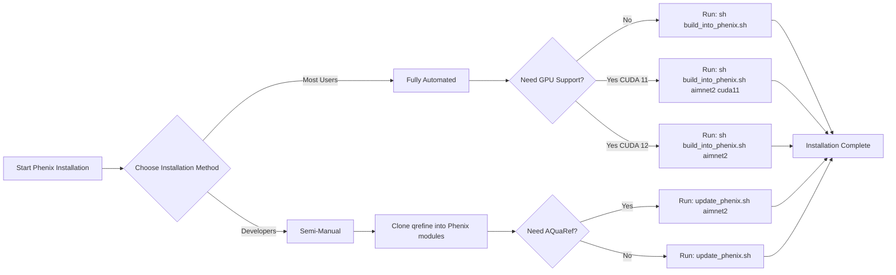

This guide provides comprehensive instructions for installing Q|R (Quantum Refinement) into an existing Phenix installation. Q|R extends Phenix's refinement capabilities by integrating quantum chemical restraints, enabling more accurate structure refinement for biomolecules using quantum mechanical methods. The installation process supports both standard installer versions and developer source builds of Phenix, with options for GPU-accelerated AQuaRef components.

## Installation Overview

Before proceeding with Phenix installation, ensure you meet the following prerequisites:
- Python ≥ 3.9
- Existing Phenix installation (installer or source build)
- Conda binary (miniconda recommended)
- Appropriate system permissions (may require sudo)
- For GPU acceleration: NVIDIA GPU with CUDA support (optional)

The Phenix installation offers two primary approaches: **fully automated installation** (recommended for most users) and **semi-manual installation** (preferred for developers). Both methods detect your Phenix installation type automatically and configure Q|R accordingly.



## Fully Automated Installation (Recommended)

The fully automated approach provides the simplest installation path, automatically detecting your Phenix installation type (installer or source build) and configuring all necessary components. This method copies the Q|R module files into your Phenix installation and updates the conda environment with required dependencies.

### Standard Installation

For a minimal installation without GPU acceleration, execute the following commands from the qrefine repository:

```bash
# Activate your Phenix environment
source path_to_phenix/phenix_env.sh

# Navigate to the qrefine repository
cd qrefine

# Run the automated installer
sh build_into_phenix.sh
```

The installer performs these operations automatically [build_into_phenix.sh](build_into_phenix.sh#L26-L85):
1. Detects Phenix installation type and location
2. Creates required directories (`modules/qrefine`, `build`)
3. Copies Q|R module files to Phenix
4. Updates Phenix's conda environment with base dependencies
5. Creates a symbolic link to `setpaths.sh` for easy activation

### Installation with AQuaRef (GPU Support)

For GPU-accelerated quantum refinement using AQuaRef (AIMNet2), include the `aimnet2` flag. This installs PyTorch and CUDA dependencies for GPU-accelerated calculations:

```bash
# For CUDA 12 (default, recommended for modern GPUs)
sh build_into_phenix.sh aimnet2

# For CUDA 11 (legacy GPU support)
sh build_into_phenix.sh aimnet2 cuda11
```

The AQuaRef components include [cuda12.yaml](config/cuda12.yaml#L1-L16):
- PyTorch with CUDA 12.1 support
- CUDA runtime and compiler components
- PyG (PyTorch Geometric) for graph neural networks
- Additional GPU-optimized dependencies

### Architecture Integration

The installation integrates Q|R into Phenix's modular architecture:

```mermaid
flowchart LR
    subgraph Phenix [Phenix Installation]
        direction TB
        P[Phenix Core]
        C[Conda Environment]
        M[modules/]
        B[build/]
        
        subgraph Qrefine [Q|R Integration]
            QR[modules/qrefine/]
            QC[qrefine_configure.log]
            SP[setpaths.sh]
        end
        
        subgraph Deps [Installed Dependencies]
            ASE[ASE 3.22.1]
            PM[PyMongo 4.8.0]
            XTB[xtb]
            TORCH[PyTorch + CUDA<br/>aimnet2 only]
        end
    end
    
    M --> QR
    B --> QC
    B --> SP
    C --> Deps
    
    style QR fill:#e1f5ff
    style Deps fill:#fff4e1
```

## Semi-Manual Installation (Developer Build)

The semi-manual approach provides greater flexibility for developers who need to update Q|R frequently, modify components during development, or add AQuaRef components at a later stage. This method gives you direct control over when updates are applied to your Phenix environment.

### Initial Setup

Clone the Q|R repository directly into your Phenix modules directory:

```bash
# Navigate to your Phenix installation directory
cd <phenix_installation>

# Clone qrefine into the modules directory
git clone https://github.com/qrefine/qrefine modules/qrefine
```

### Updating Phenix Environment

Use the `update_phenix.sh` script to update the Phenix conda environment with Q|R dependencies. This script supports multiple options for customization:

```bash
# Navigate to the qrefine module directory
cd modules/qrefine

# Standard installation (no GPU support)
sh config/update_phenix.sh

# Installation with AQuaRef (CUDA 12)
sh config/update_phenix.sh aimnet2

# Installation with AQuaRef (CUDA 11)
sh config/update_phenix.sh aimnet2 cuda11

# Skip confirmation prompt
sh config/update_phenix.sh aimnet2 -y
```

The update script [update_phenix.sh](config/update_phenix.sh#L14-L116):
1. Detects Phenix installation type (installer vs. source build)
2. Identifies the correct conda environment path
3. Detects system architecture (including Apple Silicon)
4. Configures Q|R module in the Phenix build system
5. Installs Python dependencies via pip
6. Optionally installs PyTorch and CUDA components for AQuaRef

### Dependency Installation

The script installs dependencies through two mechanisms. Base dependencies are installed via pip [phenix.txt](config/phenix.txt):

| Package | Version | Purpose |
|---------|---------|---------|
| ASE | 3.22.* | Atomic Simulation Environment for QM interface |
| PyMongo | 4.8.0 | Database connectivity for results storage |
| xtb | latest | Semi-empirical QM calculator |

For AQuaRef installations, GPU dependencies are managed through conda environment files [cuda12.yaml](config/cuda12.yaml#L1-L16) or [cuda11.yaml](config/cuda11.yaml#L1-L14):

| Component | CUDA 11 | CUDA 12 |
|-----------|---------|---------|
| PyTorch | `pytorch::pytorch=*=*cuda11*` | `pytorch::pytorch=*=*cuda12*` |
| PyTorch CUDA | 11.8 | 12.1 |
| CUDA Python | 11.8 | 12.1 |
| CUDA Toolkit | 11.8 | 12.1 + NVCC |
| BLAS | MKL | MKL |

> [!TIP]
> The AQuaRef installation via pip also installs the AIMNet2 calculation package directly from GitHub: `git+https://github.com/zubatyuk/aimnet2calc.git` [update_phenix.sh](config/update_phenix.sh#L110-L116)

## Platform-Specific Considerations

### Apple Silicon (M1/M2/M3)

Apple Silicon (ARM64 architecture) requires special consideration. The installation script automatically detects ARM64 systems and skips AQuaRef installation due to compatibility issues [update_phenix.sh](config/update_phenix.sh#L52-L58):

```bash
if [[ $(uname -m) == "arm64" ]]; then
    ARM64=true
    echo "Found osx-arm64 (Apple Silicon) machine."
    echo "installation of aimnet2 will be skipped if requested"
    echo "Contact a developer to use aimnet2 on Apple Silicon"
    TORCH=false
fi
```

For Phenix installations on Apple Silicon, switch the BLAS implementation to Apple's Accelerate framework for optimal performance:

```bash
conda install -p <phenix_conda> libblas=*=*accelerate
```

> [!TIP]
> Clustering functionality is not recommended on Apple Silicon machines due to unreliable pair interactions. For CCTBX-only installations on Apple Silicon, use: `conda env create -n qrefine -f config/arm64-osx.yaml` [README.md](README.md#L40-L44)

### Permission Requirements

Depending on your Phenix installation location, you may need elevated permissions. If you encounter permission errors during installation:

```bash
# Use sudo if required
sudo sh build_into_phenix.sh aimnet2
```

## Post-Installation Configuration

### Activating Q|R in Phenix

After installation, activate the Q|R+Phenix environment in each new terminal session:

```bash
# Activate the configured environment
source <phenix_installation>/build/setpaths.sh
```

The automated installer creates a convenient symbolic link in the current directory for easy access [build_into_phenix.sh](build_into_phenix.sh#L82-L85):

```bash
ln -s $PHENIX/build/setpaths.sh .

# Future activation is simplified:
source ./setpaths.sh
```

**Recommendation**: Add the activation command to your `.bashrc` or `.zshrc` to automatically activate Q|R when starting terminal sessions:

```bash
echo "source <phenix_installation>/build/setpaths.sh" >> ~/.bashrc
```

### Verifying Installation

Test your Q|R installation by running the built-in test suite in an empty directory:

```bash
# Create and enter a test directory
mkdir tests
cd tests

# Run Q|R tests
qr.test
```

If any tests fail, please raise an issue on the [GitHub issue tracker](https://github.com/qrefine/qrefine/issues) [README.md](README.md#L52-L55).

## Installation Comparison

| Feature | Automated Installation | Semi-Manual Installation |
|---------|----------------------|--------------------------|
| **Complexity** | Simple, single command | Moderate, requires multiple steps |
| **Control** | Automatic configuration | Manual control over updates |
| **Use Case** | Production environments | Development environments |
| **Updates** | Re-run full script | Update selectively via update_phenix.sh |
| **AQuaRef** | Supported via flags | Supported via flags |
| **Developer Access** | Limited | Full access to source code |

## Troubleshooting

### Common Issues

**Phenix not detected**:
```bash
Error: "activate the phenix installation first!"
```
**Solution**: Ensure you've activated Phenix before running the installer:
```bash
source path_to_phenix/phenix_env.sh
```

**Conda permission errors**:
```bash
Error: Permission denied when updating conda environment
```
**Solution**: Use sudo or ensure you have write permissions to the Phenix directory.

**CUDA compatibility issues**:
```bash
Error: PyTorch CUDA version mismatch
```
**Solution**: Verify your GPU driver supports the requested CUDA version and install the appropriate variant (CUDA 11 or 12).

### Installation Logs

The installation process generates log files for troubleshooting:
- `qrefine_configure.log`: CCTBX configuration output [update_phenix.sh](config/update_phenix.sh#L88-L91)
- `qrefine_req.out`: Python dependency installation output [update_phenix.sh](config/update_phenix.sh#L96)
- `conda_aimnet2.out`: Conda environment updates for AQuaRef

Check these logs if installation encounters errors.

## Next Steps

After completing the Phenix installation, you can proceed to:

- **[CCTBX Installation](4-cctbx-installation)**: Alternative installation method for open-source CCTBX without Phenix
- **[Docker Setup](5-docker-setup)**: Containerized installation for reproducible environments
- **[Quick Start](2-quick-start)**: Begin using Q|R with example workflows
- **[Overview](1-overview)**: Learn more about Q|R's quantum refinement capabilities

For detailed information about AQuaRef performance optimization and configuration, refer to the [AQuaRef documentation](aimnet2.md) [README.md](README.md#L32-L35).
