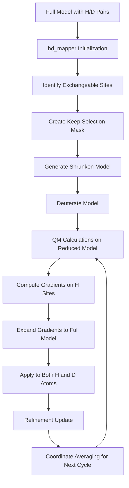
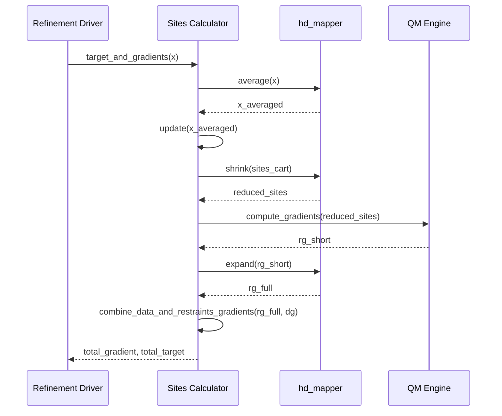

Quantum refinement of neutron diffraction structures requires sophisticated handling of exchangeable hydrogen/deuterium (H/D) sites. This system enables efficient QM calculations by treating exchangeable H/D pairs as single protonated sites during computation, while maintaining proper gradient mapping for subsequent refinement cycles.

## Architecture Overview

The H/D exchange handling architecture centers on the `hd_mapper` utility class that manages the transformation between full-size models (containing both H and D atoms) and reduced-size models (containing only H atoms from exchangeable sites). This approach optimizes computational efficiency while ensuring physical accuracy.



## Core Components

### hd_mapper Class

The `hd_mapper` class provides bidirectional transformation between coordinate spaces and manages gradient mapping for exchangeable sites. Located in `refine.py`, this utility enables the refinement engine to work with a reduced coordinate representation [refine.py](refine.py#L99-L159).

**Initialization Process**: The constructor identifies exchangeable H/D pairs using the model's hierarchy selection system. It creates a boolean keep mask that preserves H atoms from exchangeable pairs while excluding their D counterparts. The system extracts element information to distinguish between hydrogen and deuterium atoms, then generates a deuterated-free single model [refine.py](refine.py#L106-L120).

**Key Methods**:

| Method | Purpose | Direction |
|--------|---------|-----------|
| `get_single_model()` | Returns the reduced model without D atoms | Full → Reduced |
| `shrink(array)` | Removes D atoms from gradient/coordinate arrays | Full → Reduced |
| `expand(g_short)` | Maps H gradients to both H and D atoms | Reduced → Full |
| `average(array)` | Computes mean coordinates for H/D pairs | Internal |
| `check(array)` | Validates H/D pair equivalence | Validation |

## Gradient Transformation Mechanism

The gradient transformation follows a critical symmetry-preserving pattern. During QM calculations, only H atoms from exchangeable pairs contribute to the energy surface. The resulting gradients must then be properly propagated to ensure both H and D atoms experience equivalent forces.

### Shrink Operation

The shrink operation filters arrays to contain only atoms marked by the keep selection. This removes all D atoms from exchangeable pairs, reducing the gradient vector dimensionality while preserving H atom gradients [refine.py](refine.py#L124-L125).

### Expand Operation

The expand operation performs the inverse transformation, mapping reduced gradients back to the full coordinate space. The algorithm follows these rules:

1. Initialize full-size gradient array with zeros
2. Populate kept positions (H atoms) with computed gradients
3. For each exchangeable H/D pair:
   - If H gradient exists, copy to D position
   - If D gradient exists (edge case), copy to H position
   - Validate that final gradients are non-zero [refine.py](refine.py#L144-L156)

> [!TIP]
> The expand operation enforces a critical constraint: exactly one atom in each H/D pair must carry the gradient. This prevents undefined forces and ensures physical consistency during refinement updates.

### Coordinate Averaging

Before each refinement cycle, the system averages coordinates between exchangeable H/D pairs. This ensures that both atoms share identical positions, a necessary condition for proper gradient symmetry [refine.py](refine.py#L133-L142).

## Integration with Refinement Engine

The H/D mapper integrates seamlessly into the refinement pipeline through the calculator's target and gradient computation workflow.

### Sites Calculator Integration

The `sites` calculator class in `calculator.py` accepts an optional `hdm` parameter during initialization [calculator.py](calculator.py#L190-L200). During the `target_and_gradients` computation cycle:

1. **Pre-processing**: Coordinates are averaged across H/D pairs before QM evaluation [calculator.py](calculator.py#L292-L293)
2. **Gradient Computation**: QM gradients computed on reduced model [calculator.py](calculator.py#L298-L300)
3. **Post-processing**: Gradients expanded to full model and combined with crystallographic gradients [calculator.py](calculator.py#L302-L310)

### Execution Flow



## Physical Considerations

The H/D exchange handling system embodies several key physical principles:

**Equivalence Constraint**: Exchangeable H/D sites are treated as quantum-mechanically equivalent during refinement. This reflects the experimental reality where hydrogen and deuterium can exchange with solvent, making their positions indistinguishable in neutron diffraction data.

**Symmetry Preservation**: The gradient expansion ensures that forces applied to exchangeable sites respect the underlying molecular symmetry. Both atoms experience identical displacements, maintaining proper bonding geometry throughout refinement.

**Computational Efficiency**: By reducing the QM problem size through D atom elimination, the system significantly decreases computational cost while preserving accuracy. For proteins with numerous exchangeable sites, this can reduce QM calculation time by 10-20% depending on the number of exchangeable positions.

> [!TIP]
> Deuterated models typically contain fewer atoms than their protonated counterparts when considering only exchangeable sites. The reduction efficiency scales with the number of exchangeable hydrogens present in the structure, particularly in solvent-accessible regions.

## Implementation Details

### Exchangeable Site Identification

The system identifies exchangeable H/D pairs using the hierarchy's `exchangeable_hd_selections()` method [refine.py](refine.py#L108). This method returns pairs of atom indices representing connected H and D atoms that can exchange in solution.

### Element-Based Filtering

The keep selection logic examines element symbols to distinguish H from D atoms [refine.py](refine.py#L109-L112):

```python
self.elements = [e.strip().upper() for e in
  model.get_hierarchy().atoms().extract_element()]
# ...
for pair in self.ehd:
  i,j = pair[0][0], pair[1][0]
  for it in [i,j]:
    if self.elements[it]=="D": self.keep[it] = False
```

This ensures that only H atoms from exchangeable pairs are retained in the reduced model.

## Usage Patterns

### Standard Refinement Workflow

For typical quantum refinement with H/D exchange handling, the system automatically invokes the appropriate transformations:

1. Model preprocessing detects exchangeable sites
2. `hd_mapper` instance created and attached to calculator
3. Each refinement cycle applies averaging → shrinking → QM computation → expanding sequence
4. Final coordinates maintain proper H/D symmetry

### Parameter Configuration

The H/D exchange handling operates automatically when the input model contains deuterium atoms. No additional user configuration is required beyond standard refinement parameters. The system's behavior is controlled by the internal logic in `create_restraints_manager` [refine.py](refine.py#L159-L218) and `create_calculator` [refine.py](refine.py#L218-L240).

## Validation and Testing

The system includes validation mechanisms to ensure proper H/D handling:

**Gradient Checking**: The `check` method verifies that H/D pairs have identical gradient values before transformations, preventing asymmetric forces from being introduced [refine.py](refine.py#L127-L132).

**Non-zero Enforcement**: The expand operation asserts that all gradient values are non-zero after expansion, catching cases where gradient propagation may have failed [refine.py](refine.py#L150-L156).

These checks maintain mathematical consistency and prevent numerical instabilities during refinement.

## Advanced Considerations

### Interaction with Alternative Conformations

The H/D exchange handling system operates independently of the alternative conformation handling mechanism described in [Alternative Conformation Handling](23-alternative-conformation-handling). However, when both features are present, the refinement engine must properly coordinate between altloc-specific gradients and H/D gradient expansion.

### Neutron Data Integration

For neutron diffraction refinement, the system integrates with neutron-specific distance restraints as demonstrated in the unit test framework [tests/unit/tst_01.py](tests/unit/tst_01.py#L17-L24). The `use_neutron_distances=True` parameter ensures appropriate bond length restraints for H and D atoms.

## Related Features

The H/D exchange handling system connects to several other qrefine components:

- **QM Engines**: The reduced model size affects all QM interface integrations, see [Supported QM Engines Overview](11-supported-qm-engines-overview)
- **Restraints System**: Gradient expansion interacts with restraint gradient combination, see [QM vs CCTBX Restraints](20-qm-vs-cctbx-restraints)
- **Fragmentation Strategy**: Exchangeable site handling must coordinate with fragment boundary definitions, see [Understanding Fragmentation](7-understanding-fragmentation)

For comprehensive understanding of the complete refinement workflow, refer to [Quantum Refinement Concepts](6-quantum-refinement-concepts).