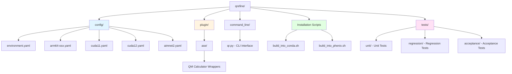

This guide provides a comprehensive walkthrough for installing Q|R using the open-source CCTBX (Computational Crystallography Toolbox) route. This installation method gives you full control over the environment and is ideal for developers or users who need access to the underlying framework. The installation process integrates Q|R directly into a CCTBX conda environment, enabling quantum-based refinement capabilities for biomolecular structures.

Sources: [cctbx.md](cctbx.md), [README.md](README.md)

## Prerequisites and Requirements

Before beginning the installation process, ensure your system meets the following requirements. The CCTBX installation path requires conda/mamba as the package manager and provides flexibility for different computing environments. For Apple Silicon users, special considerations are necessary due to platform-specific dependencies and BLAS library requirements.

The minimum system requirements include Python 3.9 or higher (with Q|R using 3.10 by default), a conda binary such as miniconda or mambaforge, and sufficient disk space for the complete CCTBX environment. For users planning to use GPU-accelerated features like AQuaRef with AIMNet2, a compatible NVIDIA GPU with appropriate CUDA drivers is required.

Sources: [README.md](README.md#L20-L30), [environment.yaml](environment.yaml#L9-L10)

## Installation Architecture Overview

The CCTBX installation architecture follows a modular integration pattern where Q|R becomes a module within the CCTBX framework. This architecture enables seamless access to CCTBX's crystallographic tools while leveraging Q|R's quantum refinement capabilities. The installation process creates a structured environment where components are organized into specific directories within the Python site-packages.

```mermaid
flowchart TD
    A[Conda Environment Creation] --> B[CCTBX Installation]
    B --> C[Q|R Module Integration]
    C --> D[External Dependencies]
    D --> E[Build Configuration]
    E --> F[Runtime Setup]
    
    subgraph Environment
        A
        B
        C
    end
    
    subgraph Dependencies
        D
    end
    
    subgraph Runtime
        E
        F
    end
    
    style A fill:#e1f5ff
    style B fill:#e1f5ff
    style C fill:#fff4e1
    style D fill:#ffe1f5
    style E fill:#e1ffe1
    style F fill:#ffe1e1
```

This architectural flow demonstrates how the installation progresses from creating the conda environment through integrating Q|R as a module, handling external dependencies like reduce and probe, configuring the build system, and finally setting up runtime paths for execution.

Sources: [build_into_conda.sh](build_into_conda.sh#L15-L57), [README.md](README.md)

## Base Installation Process

The base installation follows a four-step process that establishes the complete CCTBX environment with Q|R integration. Each step builds upon the previous one, ensuring all components are properly configured and accessible.

**Step 1: Clone the Repository**

Begin by cloning the Q|R repository and entering its directory. This ensures you have the latest version of the codebase with all necessary configuration files and installation scripts.

```bash
git clone https://github.com/qrefine/qrefine.git qrefine && cd qrefine
```

Sources: [cctbx.md](cctbx.md#L2-L6)

**Step 2: Create Conda Environment**

The `environment.yaml` file defines all necessary dependencies including CCTBX nightly builds, essential Python packages like numpy and networkx, cheminformatics tools like rdkit, and quantum chemistry packages like MOPAC and xTB. Execute the following commands to create and activate the qrefine environment:

```bash
conda env create -n qrefine -f environment.yaml
conda activate qrefine
```

This step creates a complete environment with Python 3.10, CCTBX libraries, and all supporting packages. The environment activation command must be run in every new shell session where you intend to use Q|R.

Sources: [cctbx.md](cctbx.md#L8-L17), [environment.yaml](environment.yaml)

**Step 3: Integrate Q|R into CCTBX**

The integration process is automated through the `build_into_conda.sh` script, which performs several critical operations. First, it identifies the Python site-packages directory and copies the Q|R module into a structured modules hierarchy. The script then downloads and configures external dependencies including reduce (for hydrogen atom placement), creates the build directory structure, and establishes symbolic links to executable files. Finally, it runs `libtbx.configure` to register Q|R, reduce, and probe with the CCTBX system, and rebuilds necessary rotamer and backbone dihedral angle caches.

```bash
bash ./build_into_conda.sh
```

Sources: [build_into_conda.sh](build_into_conda.sh#L12-L57)

**Step 4: Configure Runtime Paths**

The installation script concludes by outputting a `source` command that sets up the required runtime paths. This command must be executed in every new shell session to ensure all CCTBX and Q|R executables and libraries are accessible. The command typically appears as:

```bash
source <path>/setpaths.sh
```

For convenience, this command can be added to your `.bashrc` or equivalent shell configuration file to automate the setup for new sessions.

Sources: [cctbx.md](cctbx.md#L24-L26), [build_into_conda.sh](build_into_conda.sh#L53-L56)

## Platform-Specific Configurations

Different computing platforms require specific configuration adjustments to ensure optimal performance and compatibility. The Q|R project provides specialized configuration files for various scenarios.

### Standard Linux Installation

The standard Linux installation uses `environment.yaml` with the default BLAS configuration. This configuration is suitable for most x86-64 systems and provides access to all core features including CUDA support through pytorch integration.

Sources: [environment.yaml](environment.yaml), [config/cuda12.yaml](config/cuda12.yaml)

### Apple Silicon (M1/M2/M3) Installation

Apple Silicon systems require special handling due to architecture differences and BLAS library compatibility. Use the specialized configuration file for arm64-osx systems:

```bash
conda env create -n qrefine -f config/arm64-osx.yaml
conda activate qrefine
```

The arm64-osx configuration switches to Apple's accelerate BLAS implementation and uses a specific CCTBX version (2024.12) rather than the nightly builds. **Important limitation**: Clustering functionality is unreliable on Apple Silicon machines due to unknown issues with pair interaction calculations. The configuration also omits xtb and numba packages which may have compatibility issues on this platform.

Sources: [README.md](README.md#L37-L44), [config/arm64-osx.yaml](config/arm64-osx.yaml)

> [!TIP]
> Apple Silicon users experiencing stability issues with clustering should consider using alternative fragmentation strategies or running the workload on x86-64 hardware for production calculations.

### CUDA and GPU Acceleration

For GPU-accelerated calculations using AQuaRef with AIMNet2, additional CUDA dependencies are required. The project provides configuration files for both CUDA 11.8 and CUDA 12.1 versions. After the base installation, update the environment with CUDA support:

```bash
conda env update -f config/cuda12.yaml  # or cuda11.yaml
```

These configurations add PyTorch with CUDA support, CUDA Python bindings, numba for just-in-time compilation, and PyTorch Geometric for graph neural network operations. The choice between CUDA versions depends on your GPU hardware and driver compatibility.

Sources: [config/cuda11.yaml](config/cuda11.yaml), [config/cuda12.yaml](config/cuda12.yaml)

## AQuaRef and AIMNet2 Integration

AQuaRef provides AI-powered quantum refinement capabilities using the AIMNet2 neural network potential. This advanced feature requires additional installation steps beyond the base CCTBX setup. AIMNet2 enables significantly faster calculations compared to traditional quantum chemistry methods while maintaining high accuracy.

### Installation Steps

After completing the base CCTBX installation, install the AIMNet2 calculator package:

```bash
conda env update -f config/aimnet2.yaml
qrefine.python -m pip install git+https://github.com/zubatyuk/aimnet2calc.git
```

The `config/aimnet2.yaml` file adds PyTorch with CUDA support, CUDA Python libraries, numba, PyTorch Geometric, and other dependencies required for neural network potentials. The pip command installs the AIMNet2 calculator interface that connects Q|R to the neural network model.

Sources: [aimnet2.md](aimnet2.md#L1-L14), [config/aimnet2.yaml](config/aimnet2.yaml)

### Performance Optimization

For optimal performance with CUDA-accelerated calculations, set the following environment variable:

```bash
export NUMBA_CUDA_USE_NVIDIA_BINDING=1
```

Add this to your `.bashrc` file to make it persistent across sessions. To verify that CUDA components are working correctly, run the following test commands:

```bash
qrefine.python -c "import numba.cuda; print(numba.cuda.is_available())"
qrefine.python -c "import torch; print(torch.cuda.is_available())"
```

Both commands should return `True` indicating that CUDA is properly detected and accessible.

Sources: [aimnet2.md](aimnet2.md#L30-L55)

## Configuration Comparison

The following table summarizes the different configuration options available for CCTBX installation:

| Configuration File | Target Platform | CCTBX Version | BLAS Library | CUDA Support | Special Features |
|-------------------|-----------------|--------------|--------------|--------------|------------------|
| environment.yaml | Standard Linux | Nightly build | Default (MKL) | PyTorch CUDA | Full feature set |
| config/arm64-osx.yaml | Apple Silicon | 2024.12 | Apple Accelerate | None | Optimized for M1/M2/M3 |
| config/cuda11.yaml | Linux + NVIDIA | Nightly build | MKL | CUDA 11.8 | Older GPU support |
| config/cuda12.yaml | Linux + NVIDIA | Nightly build | MKL | CUDA 12.1 | Latest GPU support |
| config/aimnet2.yaml | Linux + NVIDIA | Nightly build | MKL | Flexible | Neural network potentials |

Sources: [environment.yaml](environment.yaml), [config/arm64-osx.yaml](config/arm64-osx.yaml), [config/cuda11.yaml](config/cuda11.yaml), [config/cuda12.yaml](config/cuda12.yaml), [config/aimnet2.yaml](config/aimnet2.yaml)

## Directory Structure After Installation

After successful installation, Q|R integrates into the CCTBX environment with the following directory structure within your Python site-packages:

```
<site-packages>/
├── build/
│   ├── setpaths.sh                    # Runtime configuration script
│   ├── probe/exe/                      # Probe executable symlink
│   └── reduce/exe/                     # Reduce executable symlink
├── modules/
│   └── qrefine/                        # Complete Q|R source code
│       ├── command_line/               # Command-line interfaces
│       ├── plugin/ase/                 # QM calculator wrappers
│       ├── config/                     # Configuration files
│       ├── qr.py                       # Main refinement module
│       └── ...
├── iotbx/pdb/
│   └── hybrid_36_c.c                   # Reduce hybrid-36 encoding
└── ...
```

The build directory contains the runtime configuration and symbolic links to external executables. The modules/qrefine directory holds the complete Q|R codebase, enabling seamless integration with CCTBX tools.

Sources: [build_into_conda.sh](build_into_conda.sh#L27-L56), [command_line/qr.py](command_line/qr.py), [plugin/ase/README.md](plugin/ase/README.md)

## Verification and Testing

After installation, verify that Q|R is properly configured by running the built-in test suite. Tests must be executed in an empty directory to avoid conflicts with existing files:

```bash
mkdir tests
cd tests
qr.test
```

The test suite covers core functionality including fragmentation, restraint generation, quantum calculations, and refinement processes. If any tests fail, please report the issue through the [GitHub issue tracker](https://github.com/qrefine/qrefine/issues) with details about your system configuration and the specific test failures.

For a quick verification of available command-line options and default values, use:

```bash
qr.refine --show-defaults
```

This displays all configurable parameters and their default settings, providing insight into the available refinement options.

Sources: [README.md](README.md#L48-L57), [README.md](README.md#L63-L69)

## Project Repository Structure

The following diagram illustrates the key directories in the Q|R repository that are relevant to CCTBX installation:



Sources: [README.md](README.md), [cctbx.md](cctbx.md), [build_into_conda.sh](build_into_conda.sh)

## Docker Alternative

For users who prefer containerized environments, a Docker image is available that encapsulates the complete CCTBX + Q|R setup with CUDA12 support. The Dockerfile demonstrates the complete installation process in a reproducible format:

```bash
docker pull qrefine/cctbx-qr
```

The Docker image includes the base CCTBX environment, CUDA12 dependencies, complete Q|R integration, and the AIMNet2 calculator. This approach eliminates environment configuration issues and provides consistency across different host systems.

Sources: [Dockerfile](Dockerfile#L1-L37), [README.md](README.md#L3-L6)

## Alternative Installation Routes

While this guide focuses on the CCTBX installation route, alternative installation methods are available depending on your use case. For users with existing Phenix installations, the [Phenix Installation](3-phenix-installation) route provides tighter integration with the Phenix refinement suite and may be more suitable for crystallography workflows. The Docker setup offers another containerization option with pre-configured environments.

Sources: [README.md](README.md#L19-L22), [phenix.md](phenix.md)

## Next Steps

After successful CCTBX installation, you're ready to explore Q|R's capabilities. The following documentation pages provide logical next steps for understanding and using the system:

- [Overview](1-overview) - High-level introduction to quantum refinement concepts
- [Quick Start](2-quick-start) - Tutorial for your first refinement run
- [Understanding Fragmentation](7-understanding-fragmentation) - Learn about Q|R's fragmentation strategy for scaling quantum calculations
- [Supported QM Engines Overview](11-supported-qm-engines-overview) - Explore available quantum chemistry calculators
- [QM vs CCTBX Restraints](20-qm-vs-cctbx-restraints) - Understand how quantum restraints differ from classical methods

These resources will help you progress from installation to productive use of Q|R for quantum-based refinement of biomolecular structures.
