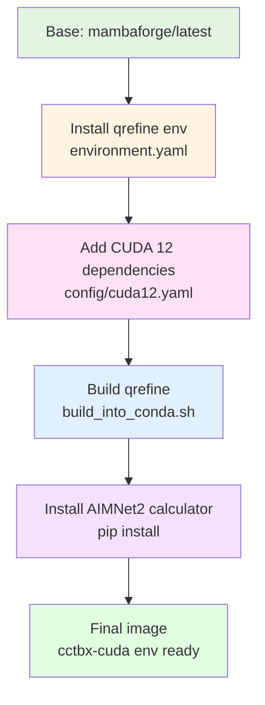

The Docker setup for qrefine provides a **complete, pre-configured environment** that eliminates the complexity of manual installation. This approach delivers a reproducible computational environment with all dependencies—including CCTBX, quantum chemistry calculators, and CUDA support—pre-installed and ready to use. The Docker images are particularly valuable for researchers who need immediate access to quantum refinement capabilities without navigating complex dependency resolution.


## Docker Image Architecture

The qrefine Docker implementation follows a **layered build strategy** designed around conda-forge's mambaforge as the base layer. This architecture provides a clean separation between the base conda environment, CUDA/PyTorch dependencies, and qrefine-specific installation. The build process systematically creates a complete scientific computing stack with optimized linear algebra libraries (MKL) and GPU acceleration capabilities.



The Docker image creation involves several critical stages that transform the base conda distribution into a fully functional quantum refinement environment. Each layer builds upon the previous one, starting with CCTBX essentials and extending through CUDA integration to the final qrefine module installation.

Sources: [Dockerfile](Dockerfile#L1-L37), [environment.yaml](environment.yaml#L1-L22), [config/cuda12.yaml](config/cuda12.yaml#L1-L16)

## Available Docker Images

qrefine provides pre-built Docker images through Docker Hub, with support for different CUDA versions to match your hardware environment. The images are optimized for NVIDIA GPU acceleration but can also run in CPU-only mode for testing or smaller systems.

| Image Variant | CUDA Version | Base Image | PyTorch Backend | Best For |
|--------------|--------------|------------|----------------|----------|
| `qrefine/cctbx-qr:latest` | 12.1 | mambaforge | CUDA 12.1 | Modern NVIDIA GPUs (RTX 30xx/40xx) |
| `qrefine/cctbx-qr:cuda11` | 11.8 | mambaforge | CUDA 11.8 | Legacy NVIDIA GPUs |
| Custom builds | 11.8 or 12.1 | mambaforge | Configurable | Specific CUDA requirements |

The **default image** includes CUDA 12.1 support, which provides access to the latest GPU-accelerated quantum chemistry calculators including AIMNet2 through PyTorch. For systems with older GPU hardware that doesn't support CUDA 12, the CUDA 11.8 variant ensures compatibility while maintaining full functionality.

Sources: [Dockerfile](Dockerfile#L7-L8), [config/cuda12.yaml](config/cuda12.yaml#L4-L6), [config/cuda11.yaml](config/cuda11.yaml#L4-L6)

## Build Process Details

The Docker build process orchestrates the installation of qrefine through a sequence of carefully controlled steps. The Dockerfile executes `build_into_conda.sh` which handles the complex CCTBX module configuration, including setting up the necessary build directories, creating symbolic links for external tools (probe, reduce), and running the libtbx configure process. This ensures that qrefine is properly integrated into the CCTBX ecosystem.

> [!TIP]
> The build script creates a special build directory structure (`$PACKAGES/build/`) that contains symlinks to the probe and reduce executables. This is critical for the libtbx configure step to locate these dependencies correctly. The final environment must be activated using `source setpaths.sh` from this build directory to properly configure the CCTBX runtime environment.

The installation process also downloads and compiles the reduce tool from GitHub, patching the CCTBX source with the updated `hybrid_36_c.c` file for improved handling of residue numbering. This level of integration ensures that all tools work seamlessly together within the Docker environment.

Sources: [build_into_conda.sh](build_into_conda.sh#L1-L57), [Dockerfile](Dockerfile#L19-L20)

## Environment Configuration

The Docker image configures several critical environment variables to optimize performance and ensure proper execution of quantum refinement calculations. These settings control OpenMP thread behavior, Python buffering, and CUDA integration.

| Environment Variable | Value | Purpose |
|---------------------|-------|---------|
| `OMP_MAX_ACTIVE_LEVELS` | 1 | Prevents nested parallelism issues |
| `OMP_STACKSIZE` | 4G | Allocates sufficient stack for large calculations |
| `PYTHONUNBUFFERED` | true | Immediate output streaming |
| `GFORTRAN_UNBUFFERED_ALL` | 1 | Ensures Fortran output is not buffered |
| `NUMBA_CUDA_USE_NVIDIA_BINDING` | 1 | Enables proper CUDA Numba integration |
| `PATH` | Extended | Includes conda env and build tools |

The conda environment is named `cctbx-cuda` and is automatically activated through the bashrc configuration. This environment contains the complete scientific stack including numpy, networkx, rdkit, ASE, and both MOPAC and xtb calculators pre-installed and configured.

Sources: [Dockerfile](Dockerfile#L25-L33), [environment.yaml](environment.yaml#L10-L20)

## Running qrefine in Docker

### Basic Usage

Running qrefine in Docker requires mounting your data directories into the container to access input files and store results. The default working directory is `/mnt`, making it straightforward to map your data directory to this location.

```bash
# Pull the latest image
docker pull qrefine/cctbx-qr:latest

# Run qrefine with mounted data directory
docker run --gpus all -it \
  -v /path/to/your/data:/mnt \
  qrefine/cctbx-qr:latest \
  qr.refine your_protein.pdb your_map.mtz mode=refine engine=mopac
```

The `--gpus all` flag is essential for GPU-accelerated calculations. For CPU-only operation or testing, omit this flag to run in container mode without GPU access.

### Advanced GPU Configuration

For systems with multiple GPUs or specific GPU requirements, you can control GPU access more precisely:

```bash
# Use specific GPU device
docker run --gpus '"device=0"' -it \
  -v /path/to/your/data:/mnt \
  qrefine/cctbx-qr:latest \
  qr.refine your_protein.pdb your_map.mtz engine=aimnet2

# Limit GPU memory usage
docker run --gpus all -e CUDA_VISIBLE_DEVICES=0 -it \
  -v /path/to/your/data:/mnt \
  qrefine/cctbx-qr:latest \
  qr.refine your_protein.pdb your_map.mtz engine=xtb
```

### Interactive Development

For interactive development and testing, you can access a shell within the container:

```bash
docker run --gpus all -it \
  -v /path/to/your/data:/mnt \
  qrefine/cctbx-qr:latest \
  /bin/bash

# Inside container, run qrefine commands
conda activate cctbx-cuda
qr.refine --show-defaults
```

Sources: [Dockerfile](Dockerfile#L35-L36), [README.md](README.md#L68-L77)

## Calculator Support

The Docker image comes with **multiple quantum chemistry calculators** pre-configured and ready to use. The selection of calculator depends on your specific requirements for accuracy, speed, and system size.

| Calculator | Pre-installed | GPU Accelerated | Use Case |
|------------|---------------|------------------|----------|
| MOPAC | ✓ | ✗ | Fast semi-empirical, large systems |
| xTB | ✓ | ✗ | Tight-binding, good accuracy/speed balance |
| AIMNet2 | ✓ | ✓ | Machine learning, very fast for large proteins |
| Gaussian | Additional install | ✗ | High accuracy DFT/ab initio |
| ORCA | Additional install | ✗ | Advanced quantum chemistry methods |

> [!TIP]
> AIMNet2 is particularly effective in the Docker environment because it leverages the pre-installed PyTorch CUDA stack. The installation command `qrefine.python -m pip install git+https://github.com/zubatyuk/aimnet2calc.git` is executed during the Docker build, ensuring that the neural network potentials are available without additional configuration.

For calculators not pre-installed (like Gaussian or ORCA), you can install them within the Docker container or mount external installations into the container. The ASE plugin architecture in `/plugin/ase/` provides interfaces for all supported calculators.

Sources: [Dockerfile](Dockerfile#L23), [environment.yaml](environment.yaml#L18-L19), [plugin/ase](plugin/ase/)

## Building Custom Images

While pre-built images are available, you may need to build custom images for specific requirements, such as different CUDA versions or additional system packages. The build process uses the repository's Dockerfile and configuration files.

```bash
# Clone the repository
git clone https://github.com/qrefine/qrefine.git
cd qrefine

# Build with CUDA 12 (default)
docker build -t my-qrefine:latest .

# Build with modified CUDA version
# Edit Dockerfile to use config/cuda11.yaml instead
docker build -t my-qrefine:cuda11 .
```

The build process requires approximately **2-4 GB of disk space** for the final image and may take 15-30 minutes depending on your internet connection speed (for downloading conda packages) and CPU performance (for compilation steps).

## Troubleshooting

### GPU Access Issues

If you encounter GPU-related errors, verify your NVIDIA driver and Docker installation:

```bash
# Check NVIDIA driver
nvidia-smi

# Verify Docker GPU support
docker run --rm --gpus all nvidia/cuda:12.1-base-ubuntu22.04 nvidia-smi
```

### Memory Limitations

For large systems, increase Docker's memory allocation:

```bash
# Docker Desktop: Settings > Resources > Memory > 8GB+
# Linux: Edit /etc/docker/daemon.json
# {
#   "default-runtime": "nvidia",
#   "runtimes": {
#     "nvidia": {
#       "path": "nvidia-container-runtime",
#       "runtimeArgs": []
#     }
#   }
# }
```

### Path Configuration

If qrefine commands are not found, ensure the conda environment is activated:

```bash
docker run -it qrefine/cctbx-qr:latest /bin/bash
source /opt/conda/envs/cctbx-cuda/bin/activate
which qr.refine  # Should show path in cctbx-cuda environment
```

Sources: [Dockerfile](Dockerfile#L24-L26), [build_into_conda.sh](build_into_conda.sh#L47-L53)

## Next Steps

After successfully setting up the Docker environment, you can proceed to explore qrefine's capabilities:

- **[Quantum Refinement Concepts](6-quantum-refinement-concepts)** - Understand the theoretical foundations of quantum-based refinement
- **[Quick Start](2-quick-start)** - Run your first refinement with example data
- **[Understanding Fragmentation](7-understanding-fragmentation)** - Learn how qrefine divides large macromolecules for quantum calculations

The Docker setup provides an ideal environment for experimentation and production use, ensuring that you have all necessary tools and dependencies properly configured without manual intervention.