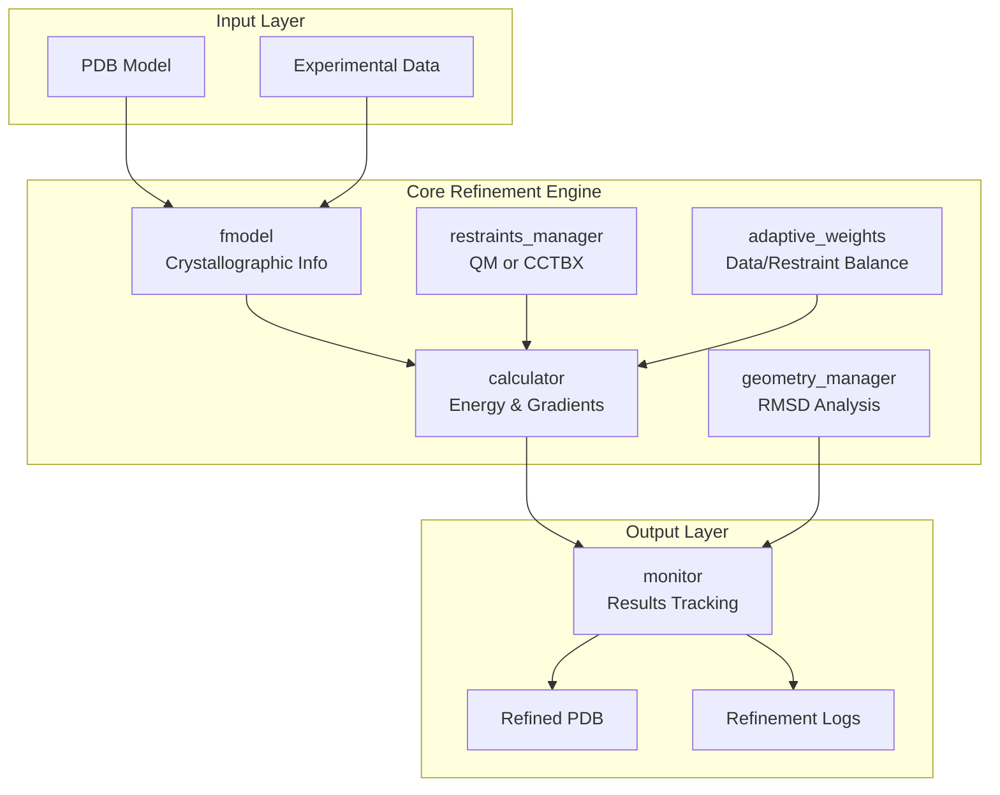

Quantum refinement represents a fundamental paradigm shift in macromolecular structure determination, replacing traditional parameterized library-based restraints with quantum chemical restraints derived from first principles. This approach offers two critical advantages: increased accuracy for non-standard molecules (novel cofactors, drug molecules) and the ability to generate chemically meaningful restraints for systems lacking comprehensive library parameters. The implementation addresses computational scaling challenges through a sophisticated fragmentation-based divide-and-conquer strategy.

Sources: [README.md](README.md#L1-L35), [refine.py](refine.py#L1-L20)

## Core Architecture

The quantum refinement system implements a modular architecture that integrates quantum mechanical calculations with crystallographic refinement machinery. The system orchestrates multiple specialized components to achieve simultaneous optimization against experimental data and quantum chemical potentials.

The architectural foundation rests on five primary components that collaborate during refinement cycles:

- **fmodel**: Crystallographic information container managing structure factors, electron density maps, and the x-ray structure model
- **calculator**: Composite object computing total energy and gradients by combining data terms with restraint terms
- **restraints_manager**: Selects between quantum mechanical (QM) or classical (CCTBX) restraint sources for energy and gradient calculations
- **geometry_restraints_manager**: Analyzes geometric quality through bond and angle RMSD metrics
- **weights**: Adaptive scale factors balancing experimental data against restraint contributions

Sources: [refine.py](refine.py#L5-L19), [driver.py](driver.py#L1-L30)

The calculator module serves as the central integration point, implementing an adaptive weight factor calculator that dynamically adjusts restraint influence based on geometric quality. When bond RMSD exceeds thresholds, the system scales restraint weights upward to maintain geometric integrity, while high-quality geometry triggers weight reduction to allow greater influence from experimental data.

Sources: [calculator.py](calculator.py#L1-L10), [calculator.py](calculator.py#L26-L62)

## Restraint Systems

Quantum refinement provides two fundamentally different restraint sources that can be applied selectively or complementarily across molecular regions.

**CCTBX Classical Restraints**: Standard crystallographic restraints derived from comprehensive parameter libraries containing idealized bond lengths, angles, and torsions. These restraints are computationally efficient but may lack accuracy for novel chemical entities or unusual bonding patterns. The `from_cctbx` class wraps the standard CCTBX restraints manager, providing seamless integration with legacy refinement workflows.

Sources: [restraints.py](restraints.py#L389-L433)

**Quantum Mechanical Restraints**: First-principles restraints computed directly from quantum chemical calculations on molecular fragments. The `from_qm` class interfaces with various QM engines to compute electronic structure energies and analytic gradients, providing chemically rigorous force information. This approach eliminates dependence on parameter libraries and can handle arbitrary chemical systems with appropriate quantum methods.

The QM restraints system supports multiple computational methods and basis sets:
- Semi-empirical methods (PM7, AM1) for rapid evaluation
- Density functional theory with various functionals
- Hartree-Fock with flexible basis set selection
- Machine learning potentials (AIMNet2) for acceleration

Sources: [restraints.py](restraints.py#L434-L479), [refine.py](refine.py#L240-L275)

> [!TIP]
> The choice between CCTBX and QM restraints can be made atom-wise through selection mechanisms, allowing hybrid approaches where novel regions use quantum restraints while well-characterized regions use efficient classical restraints.

| Restraint Type | Advantages | Limitations | Computational Cost |
|----------------|------------|-------------|-------------------|
| CCTBX Classical | Fast, well-tested, extensive libraries | Limited accuracy for novel chemistries | Very Low |
| QM Semi-empirical | Good accuracy for diverse chemistry | Parameter-specific approximations | Low-Medium |
| QM DFT/HF | First-principles accuracy | High computational demand | High |
| ML Potentials | Near-DFT accuracy, fast | Training set dependence, transferability | Low |

## Weight Factor Optimization

A critical innovation in quantum refinement is the adaptive weight factor calculation that automatically balances experimental data against restraint contributions. The system computes initial weights by comparing gradient magnitudes from crystallographic data and restraint sources, then iteratively adjusts based on geometric quality metrics.

The weight optimization cycle follows a disciplined search pattern:
1. Compute initial data weight from gradient norm ratios
2. Execute refinement with current weights
3. Evaluate geometry quality (bond/angle RMSD)
4. If geometry exceeds quality thresholds, increase restraint weight
5. If geometry is within quality bounds, decrease restraint weight
6. Terminate when weight adjustment direction reverses, indicating optimal balance

This adaptive approach eliminates the need for manual weight tuning while ensuring that refinement respects both experimental data and chemical reality. The gradient-based weight calculation filters outliers (large gradient components) to avoid skewing the balance from problematic atoms.

Sources: [calculator.py](calculator.py#L26-L62), [driver.py](driver.py#L330-L380)

## Fragmentation Strategy

To achieve quantum refinement of macromolecular systems, Q|R implements a sophisticated fragmentation strategy that divides large systems into computationally tractable quantum chemical regions. The `fragments` class manages this process, creating clusters that expand beyond the core fragment to include environmental effects through embedding atoms.

Key fragmentation parameters control the computational scale:
- **maxnum_residues_in_cluster**: Limits cluster size to maintain QM tractability
- **select_within_radius**: Defines the spatial extent of cluster expansion (default 10 Å)
- **bcc_threshold**: Determines buffer atom selection criteria
- **charge_embedding**: Whether to include electrostatic embedding from distant atoms
- **two_buffers**: Controls whether to use dual buffer layers for environmental capture

The fragmentation process identifies covalent fragments, generates spatially-expanded clusters for QM evaluation, and coordinates the distribution of QM calculations across fragments. For systems with substantial conformational changes during refinement, dynamic re-clustering can be triggered based on RMSD thresholds.

Sources: [fragment.py](fragment.py#L43-L113), [driver.py](driver.py#L128-L150)

## Refinement Optimization Engine

The refinement process employs multiple optimization algorithms tailored to different refinement scenarios. The primary engine uses the L-BFGS (Limited-memory Broyden-Fletcher-Goldfarb-Shanno) quasi-Newton method, which provides efficient convergence for large-scale optimization problems by approximating the Hessian matrix from gradient history.

The minimization process operates through the `minimizer` class, which:
- Coordinates L-BFGS iteration with configurable line search options
- Monitors function and gradient evaluations for convergence detection
- Tracks geometric quality through RMSD calculations
- Supports gradient-only mode for scenarios where line search is computationally expensive
- Implements exception handling to manage numerical challenges in optimization

Alternative optimization paths include:
- **Pre-conjugate gradient minimization**: Initial steepest descent steps before transitioning to conjugate gradient methods
- **ASE LBFGS interface**: Integration with Atomic Simulation Environment optimization tools
- **Real-space refinement**: Direct map-based optimization using real-space correlation targets

The refinement cycles execute macro-level iterations where weights may be adjusted between minimization runs, allowing the system to find the optimal balance between data and restraints.

Sources: [driver.py](driver.py#L25-L98), [driver.py](driver.py#L100-L200)

## Results Monitoring and Convergence

The `results.manager` class provides comprehensive tracking of refinement progress through multiple metrics that characterize model quality. This monitoring system captures:

- **Crystallographic metrics**: R-work and R-free values measuring agreement with experimental data
- **Geometric metrics**: Bond and angle RMSDs quantifying stereochemical quality
- **Coordinate shifts**: Atomic displacement statistics comparing initial, previous, and current coordinates
- **Convergence tracking**: Iteration history showing optimization progress

Convergence criteria balance multiple objectives:
- Gradient norms approaching zero (mathematical stationarity)
- R-factor stabilization (data fit saturation)
- Geometry within acceptable bounds (chemical reasonableness)
- Coordinate shifts diminishing (model stability)

The system writes checkpoint files (`.rst.pickle`) enabling restart capabilities and provides final PDB output files with complete refinement annotations.

Sources: [results.py](results.py#L1-L50), [driver.py](driver.py#L380-L400)

> [!TIP]
> The monitoring system computes mean shifts between refinement stages, enabling early detection of oscillatory behavior that may indicate weight factor instability or problematic local minima.

## Hybrid Approaches and Alternative Conformations

Quantum refinement supports sophisticated handling of structural complexity through specialized restraint managers for systems with alternative conformations.

The `from_altlocs` and `from_altlocs2` classes provide mechanisms for:
- **Alternative conformation handling**: Managing multiple conformational states while maintaining proper restraint application
- **Selective refinement**: Applying quantum restraints to specific conformations while using classical restraints elsewhere
- **Gradient combination**: Combining contributions from multiple conformational states with appropriate statistical weighting

These capabilities enable refinement of dynamic systems where atoms occupy multiple discrete positions, ensuring that quantum chemical restraints properly account for conformational heterogeneity. The system can subtract or combine gradients from alternate states based on user-specified methods.

Sources: [restraints.py](restraints.py#L257-L366)

## Next Steps

To apply quantum refinement concepts practically, continue to [Understanding Fragmentation](7-understanding-fragmentation) to learn how the fragmentation strategy is implemented and configured for specific systems. For details on available quantum chemical engines, proceed to [Supported QM Engines Overview](11-supported-qm-engines-overview).