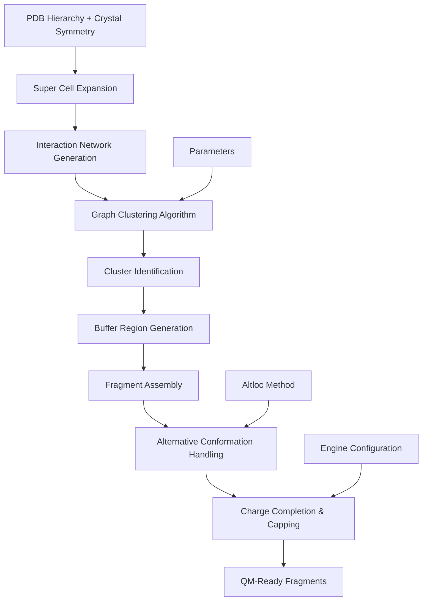
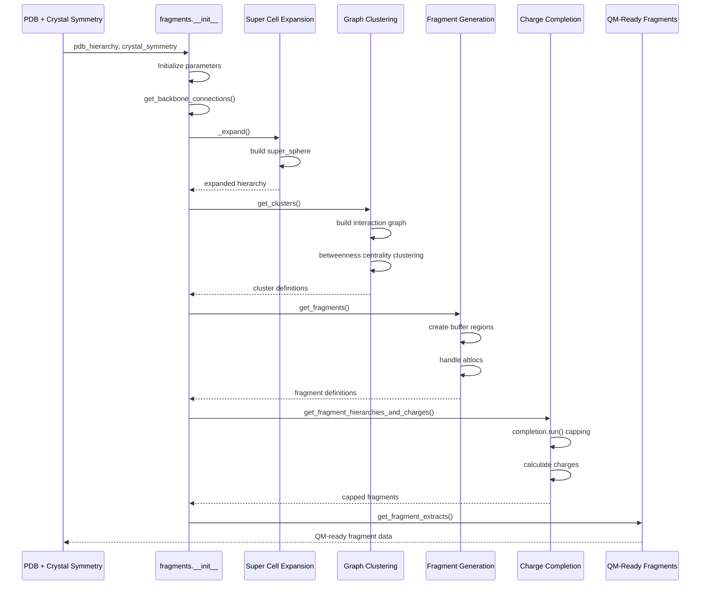

Fragmentation is a fundamental strategy that enables quantum mechanical refinement of macromolecular structures by dividing complex systems into computationally tractable pieces. This approach balances quantum mechanical accuracy with practical computational efficiency, allowing QM refinement of proteins and nucleic acids that would otherwise be prohibitively expensive to calculate as whole systems. The fragmentation system orchestrates a sophisticated workflow from initial molecular decomposition through to quantum-ready fragments with proper boundary conditions and electrostatic embedding.

## The Fragmentation Architecture

The fragmentation architecture implements a hierarchical decomposition strategy that transforms a complete macromolecular system into a collection of quantum-mechanically tractable fragments. At its core, the system operates through three distinct but interconnected phases: clustering creates molecular groupings based on interaction networks, expansion builds buffer regions around each cluster, and electrostatic embedding establishes the QM/MM boundary conditions. This multi-layered approach ensures that each quantum calculation operates on a chemically meaningful subset while maintaining the essential intermolecular interactions present in the full system.

The architecture is built around the `fragments` class in [fragment.py](fragment.py#L43-L120), which serves as the central coordinator for the entire decomposition process. This class manages the workflow from initial hierarchy parsing through fragment generation, handling complex scenarios like alternative conformations, periodic boundary conditions, and charge embedding. The design deliberately separates concerns: clustering algorithms identify coherent molecular groups, super-cell expansion handles spatial boundaries, and completion modules establish proper capping groups for fragment termini.

## Clustering Phase: Creating Molecular Groups

The clustering phase represents the foundation of the fragmentation strategy, where the system decomposes into coherent molecular groups based on interaction networks. This process constructs a graph where vertices represent individual residues and edges encode pairwise interactions, then applies community detection algorithms to identify natural molecular neighborhoods. The default clustering algorithm is betweenness centrality clustering, though Girvan-Newman clustering remains available as an alternative implementation.

Betweenness centrality clustering, implemented in the `betweenness_centrality_clustering` class ([clustering.py#L83-L133](clustering.py#L83-L133)), progressively removes edges with high betweenness centrality values to reveal natural community structures. The algorithm builds an undirected graph from interaction pairs ([clustering.py#L121-L133](clustering.py#L121-L133)), then iteratively applies edge removal at decreasing threshold values until no cluster exceeds the `maxnum_residues_in_cluster` parameter ([clustering.py#L94-L104](clustering.py#L94-L104)). This adaptive threshold approach ensures clusters respect both interaction density and size constraints.

> [!TIP]
> The interaction network intentionally includes backbone connections from [`fragment_utils.get_backbone_connections()`](utils/fragment_utils.py#L2-L17), ensuring polypeptide chains remain coherent even when intra-chain interactions are weak. This prevents unnatural fragmentation that would break peptide bonds in proteins or phosphate backbones in nucleic acids.

The clustering process automatically handles special structural cases. For proteins, backbone connections between consecutive amino acids are explicitly added to preserve peptide bond continuity ([fragment.py#L122-L124](fragment.py#L122-L124)). The system identifies amino acids through the presence of N, CA, C, and O atoms ([utils/fragment_utils.py#L20-L34](utils/fragment_utils.py#L20-L34)), ensuring backbone tracking applies specifically to polypeptide rather than general molecular connections.

| **Clustering Parameter** | **Default** | **Purpose** | **Impact on QM Calculations** |
|-------------------------|-------------|-------------|-------------------------------|
| `maxnum_residues_in_cluster` | 20 | Maximum cluster size | Direct QM cost scaling, larger clusters are more expensive |
| `bcc_threshold` | 9 | Initial betweenness centrality cutoff | Controls cluster granularity, higher values create fewer, larger clusters |
| `clustering_method` | betweenness_centrality | Algorithm selection | Determines interaction sensitivity and cluster characteristics |

## Fragment Generation: From Clusters to QM Regions

Once clustering identifies molecular neighborhoods, the fragment generation phase expands each cluster into a quantum-mechanically complete region. This expansion creates buffer regions of surrounding molecules that provide boundary conditions for the QM calculation while avoiding explicit quantum treatment of distant portions of the system. The `get_fragments()` method in the fragments class ([fragment.py#L130-L290](fragment.py#L130-L290)) orchestrates this complex transformation, handling atomic indexing, spatial selection, and hierarchical organization across multiple conformational states.

The fragment generation process operates on an expanded coordinate system that includes periodic boundary conditions. The `_expand()` method ([fragment.py#L98-L107](fragment.py#L98-L107)) creates a super-cell expansion using the [`super_cell.expand`](super_cell.py#L20-L91) class, which generates symmetry-related molecules within a specified radius (`select_within_radius`, default 10.0 Å). This expansion ensures that fragments near unit cell boundaries have access to relevant neighboring molecules that would otherwise be excluded by simple distance calculations.

Each fragment consists of two distinct components: the cluster itself and a surrounding buffer region. The cluster contains the core molecules identified during the clustering phase, while the buffer includes additional molecules within interaction range. This distinction is crucial because cluster atoms typically receive QM treatment with full weighting, whereas buffer atoms may receive different treatment depending on the embedding strategy. The system tracks these regions separately through `cluster_atoms` and `fragment_super_atoms` attributes ([fragment.py#L166-L170](fragment.py#L166-L170)).

> [!TIP]
> Optional double buffering (`two_buffers=True`) creates an additional expansion layer, useful when fragments require even larger boundary regions to capture long-range electrostatic effects or when studying charge transfer phenomena that extend beyond typical interaction distances.

The fragment generation pipeline demonstrates sophisticated handling of alternative conformations. When alternative locations (altlocs) are present, the system generates separate hierarchy selections for each conformational state ([fragment.py#L138-L152](fragment.py#L138-L152)), allowing independent fragment definitions for structural variants. This prevents mixing incompatible conformations in single QM calculations while maintaining proper accounting of occupancies across the full ensemble.

## Alternative Conformation Strategies

Alternative conformations represent a significant challenge in fragmentation because atoms at the same position may exist in multiple mutually exclusive states. The fragmentation system provides two sophisticated strategies for handling these situations: the "subtract" method and the "average" method, selectable through the `altloc_method` parameter. Both approaches address the fundamental problem that atoms with alternative conformations cannot simultaneously participate in QM calculations with incompatible neighbors.

The "subtract" strategy implements a clean separation approach where each alternative conformation receives independent fragment definitions. When fragments differ between conformations, the system subtracts overlapping contributions to prevent double-counting ([fragment.py#L195-L213](fragment.py#L195-L213)). This method scales fragment contributions by -1.0 for overlapping regions, effectively removing duplicate energetic contributions from the total system energy. The approach is particularly useful when alternative conformations represent distinct structural states that should be treated independently, such as sidechain rotamers or ligand binding modes.

In contrast, the "average" strategy distributes contributions across overlapping regions using fractional scaling based on overlap frequency ([fragment.py#L215-L289](fragment.py#L215-L289)). When multiple conformations contribute to the same spatial region, the system calculates the frequency of each atom's appearance across conformations and scales its contribution by 1/frequency ([fragment.py#L256-L263](fragment.py#L256-L263)). This approach creates a smooth transition between conformational states and is particularly appropriate for highly mobile or disordered regions where atoms sample multiple positions.

Both strategies include special handling for bonds involving alternative conformations through the `bond_with_altloc()` method ([fragment.py#L289-L301](fragment.py#L289-L301)). This optional analysis identifies atoms participating in bonds across alternative conformations, allowing the system to apply consistent treatment decisions based on the `bond_with_altloc_flag` parameter. Proper handling of these cross-conformation bonds is essential for maintaining realistic molecular geometry and preventing unphysical strain in QM calculations.

| **Alternative Conformation Strategy** | **Best Use Case** | **Scaling Method** | **Complexity** |
|--------------------------------------|-------------------|-------------------|----------------|
| **Subtract** | Distinct structural states | -1.0 for overlaps, 1.0 otherwise | Moderate |
| **Average** | Disordered regions, mobile loops | 1/frequency based on overlap count | High |

## Electrostatic Embedding and Capping

The final phase of fragmentation prepares fragments for quantum mechanical calculations by establishing proper electrostatic boundaries and chemical completeness. QM calculations require complete valence satisfaction at fragment boundaries, necessitating capping groups that terminate dangling bonds, and also require representation of the electrostatic environment from atoms not explicitly included in the QM region. The system addresses both requirements through coordinated charge completion and point charge embedding.

The `get_fragment_hierarchies_and_charges()` method ([fragment.py#L316-L363](fragment.py#L316-L363)) orchestrates this preparation process. For each fragment, the system generates a capped hierarchy using the [`completion.run()`](completion.py) function, which adds hydrogen atoms to satisfy valence requirements at fragment boundaries. This capping is essential because fragments extracted from larger systems typically have dangling bonds that would otherwise produce unrealistic electronic structures in QM calculations. The completion process respects chemical bonding patterns while maintaining consistency with the original molecular geometry.

Charge embedding creates the electrostatic environment surrounding each QM fragment through a system of point charges representing excluded atoms. The system calculates these charges using the charges_class implementation ([fragment.py#L339-L341](fragment.py#L339-L341)), which determines appropriate partial charges for all atoms in the capped fragment hierarchy. When `charge_embedding=True`, these charges are written to external files that QM engines read to establish the electrostatic potential during calculations.

The distinction between cluster and buffer regions becomes particularly important for charge embedding. The system maintains separate selections for `cluster_selections` and `buffer_selections` ([fragment.py#L348-L352](fragment.py#L348-L352)), allowing different treatment strategies for each region. In typical implementations, cluster atoms receive full QM treatment while buffer atoms may be handled through embedded charges or lower-level quantum methods, depending on the specific computational requirements and engine capabilities.

The charge embedding process respects system boundaries through the `charge_cutoff` parameter (default 8.0 Å), which limits the spatial extent of included point charges. This cutoff balances computational efficiency against electrostatic accuracy, as distant charges contribute less to the potential but still require computational resources to evaluate. The super-cell expansion ensures that this cutoff works correctly even for fragments near unit cell boundaries by providing access to periodic images.

## Fragmentation Workflow

The complete fragmentation workflow follows a deterministic sequence that transforms raw PDB coordinates into quantum-ready fragments with all necessary boundary conditions. This workflow is orchestrated by the fragments class initialization ([fragment.py#L45-L97](fragment.py#L45-L97)), which calls setup methods in a carefully designed order to ensure proper data dependencies and validation.

The workflow begins with backbone connection identification, which establishes the covalent bonding framework that guides subsequent clustering decisions. The system then expands the coordinate system to include periodic images within the specified radius, ensuring proper boundary treatment for all subsequent operations. This expansion is particularly critical for crystalline systems where unit cell boundaries would otherwise create artificial discontinuities.

Clustering follows the expansion phase, with the system building interaction networks from spatial proximity and covalent connectivity information. The betweenness centrality algorithm progressively refines these networks into coherent molecular neighborhoods, with adaptive threshold adjustment ensuring cluster sizes respect the `maxnum_residues_in_cluster` constraint. The clustering results are stored as sorted lists of residue indices, facilitating efficient fragment generation.

Fragment generation takes the cluster definitions and expands them into spatially complete quantum regions through buffer addition. This phase handles the complex mapping from residue indices to specific atom selections across potentially multiple alternative conformation states. The resulting fragment definitions distinguish between cluster cores and buffer regions, enabling differentiated treatment in subsequent quantum calculations.

The final workflow phase completes fragments chemically and electrostatically through capping and charge embedding. The completion process adds hydrogen atoms to terminate dangling bonds, while charge calculation creates point charge representations of the excluded environment. The system validates each capped fragment through hierarchy checking ([fragment.py#L361-L363](fragment.py#L361-L363)), ensuring that all generated fragments are chemically reasonable and suitable for quantum mechanical treatment.

## Integration with QM Refinement

The fragmentation system serves as the foundation for quantum refinement, providing the structural decomposition that makes QM calculations tractable. Once fragments are generated through the workflow described above, they become the fundamental units processed by QM engines during refinement cycles. The integration between fragmentation and refinement occurs through the `get_fragment_extracts()` method ([fragment.py#L365-L387](fragment.py#L365-L387)), which packages all fragment data into a structured format suitable for distribution to QM calculators.

Each fragment extract contains cluster selections, fragment selections, charge information, and capped hierarchy data, providing complete information needed for independent QM calculations. The refinement system iterates through these fragments, submitting each to the configured QM engine and collecting energetic results that inform subsequent geometry optimization steps. This fragmentation-aware refinement approach enables quantum-level accuracy while maintaining computational feasibility for macromolecular systems.

The fragmentation parameters directly influence refinement efficiency and accuracy. Larger cluster sizes and buffer regions improve accuracy by including more of the local chemical environment but increase computational cost. The choice of clustering algorithm and threshold parameters affects the chemical appropriateness of fragment boundaries, influencing both convergence behavior and physical realism of refined structures. Careful parameter tuning based on system characteristics and computational resources is essential for optimal performance.

## Next Steps

To fully leverage fragmentation in quantum refinement, continue with [Fragmentation Parameters](8-fragmentation-parameters) to understand detailed configuration options and their effects on computational performance and accuracy. Then explore [Clustering Algorithms](9-clustering-algorithms) for deeper insight into how different graph-based approaches affect fragment composition and QM calculation characteristics. For practical implementation details across different QM engines, refer to the specific integration guides in the QM Engines section, beginning with [MOPAC Integration](12-mopac-integration).