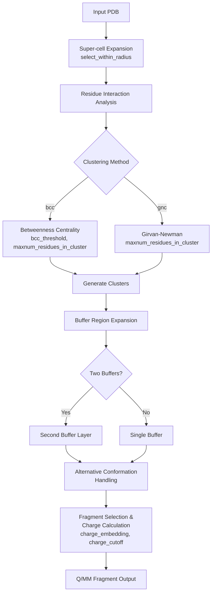

The fragmentation system in qrefine transforms large macromolecular systems into computationally tractable fragments through sophisticated clustering algorithms. This page provides a comprehensive technical reference for the parameters that control how your system is decomposed, enabling precise control over fragment size, buffer regions, and QM/MM interface construction. Understanding these parameters is essential for optimizing the trade-off between computational efficiency and quantum mechanical accuracy.

Sources: [qr.py](qr.py#L36-L77)

## Core Fragmentation Architecture

The fragmentation system operates through a multi-stage pipeline controlled by the `cluster` parameter scope. The process begins with super-cell expansion, applies graph-theoretic clustering to identify coherent residue groups, adds buffer regions for QM calculations, and manages alternative conformations through specialized strategies. The `fragments` class in [fragment.py](fragment.py#L45-L96) serves as the central orchestrator, coordinating these stages through configurable parameters that determine the ultimate composition of each QM fragment.

> [!TIP]
> The entire fragmentation pipeline is parameterized through the `cluster.*` scope in the master PHIL string. These parameters determine both the initial cluster composition and the subsequent buffer expansion strategy, directly impacting computational cost and QM accuracy.

## Cluster Definition Parameters

### Clustering Control

| Parameter | Type | Default | Range | Purpose |
|-----------|------|---------|-------|---------|
| `cluster.clustering` | bool | True | - | Enable/disable fragmentation system |
| `cluster.clustering_method` | choice | `bcc` | bcc, gnc | Algorithm for residue group identification |
| `cluster.maxnum_residues_in_cluster` | int | 15 | 1-50 | Maximum residues per cluster core |
| `cluster.bcc_threshold` | int | 9 | 4-20 | Edge removal threshold for BCC algorithm |

The `clustering` parameter acts as the master switch. When set to False, the entire system is treated as a single QM region, which is practical only for very small systems. The choice of clustering method determines how residue groups are identified: the BCC (Betweenness Centrality Clustering) method [clustering.py](clustering.py#L83-L119) uses graph-theoretic edge betweenness centrality to iteratively remove edges from the interaction network until clusters satisfy size constraints, while the GNC (Girvan-Newman Clustering) method [clustering.py](clustering.py#L16-L81) applies community detection through recursive subdivision.

The BCC algorithm operates by iteratively reducing the threshold parameter starting from `bcc_threshold`. At each iteration, edges with betweenness centrality exceeding the threshold are removed, and the resulting connected components are analyzed. If any component exceeds `maxnum_residues_in_cluster`, the threshold decreases by 1 and the process repeats. This adaptive thresholding enables automatic adjustment to system complexity. The algorithm enforces a minimum threshold of 4 to prevent over-fragmentation.

Sources: [clustering.py](clustering.py#L94-L119), [qr.py](qr.py#L50-L61)

### Alternative Conformation Handling

| Parameter | Type | Default | Options | Purpose |
|-----------|------|---------|---------|---------|
| `cluster.altloc_method` | choice | `subtract` | subtract, average | Strategy for altloc energy combination |
| `cluster.bond_with_altloc` | bool | True | - | Include bonds to altloc atoms in fragmentation |

Proteins often contain multiple conformations for residues (alternate locations indicated in column 27 of PDB records). The `altloc_method` parameter determines how energies from different conformations are combined. The `subtract` method [fragment.py](fragment.py#L219-L287) handles overlapping regions between alternative conformations by identifying shared atoms and applying scaling factors to prevent double-counting. When fragments from different altloc versions overlap, atoms appearing in multiple versions receive fractional contributions (1/N where N is the overlap frequency), ensuring proper partitioning of the total system energy.

The `bond_with_altloc` parameter controls whether bonds to atoms with alternate conformations should be included in the fragmentation analysis. When enabled (True), the fragmentation system respects bonds crossing altloc boundaries; when disabled, these bonds are ignored, potentially creating disconnected fragments. This flag affects the `bond_with_altloc()` method [fragment.py](fragment.py#L289-L293) which determines whether to apply overlap scaling to atoms involved in cross-altloc bonds.

Sources: [fragment.py](fragment.py#L289-L293), [fragment.py](fragment.py#L204-L224)

## Spatial Expansion Parameters

### Super-cell Construction

| Parameter | Type | Default | Units | Purpose |
|-----------|------|---------|-------|---------|
| `cluster.select_within_radius` | int | 10 | Angstroms | Radius for supersphere expansion |

The fragmentation process begins by expanding the input model into a supersphere using crystallographic symmetry operations. The `select_within_radius` parameter defines the radius of this sphere centered on the asymmetric unit. This expansion ensures that all atoms within the specified distance from the original system are included, accounting for crystallographic neighbors and boundary effects. The expansion is handled by the `expand` class in [super_cell.py](super_cell.py#L20-L46) which uses CCTBX's super-cell manager to generate the P1 expanded system.

The supersphere serves as the pool from which fragments are selected. Larger radii increase the pool of available atoms for buffer regions but also increase memory requirements for the expansion hierarchy. The supersphere coordinates are stored in `self.pdb_hierarchy_super` and updated during refinement through the `update_xyz()` method.

Sources: [super_cell.py](super_cell.py#L20-L46), [fragment.py](fragment.py#L98-L106)

### Buffer Region Configuration

| Parameter | Type | Default | Purpose |
|-----------|------|---------|---------|
| `cluster.two_buffers` | bool | False | Enable two-layer buffer strategy |
| `cluster.charge_embedding` | bool | False | Use point charge embedding |
| `cluster.charge_cutoff` | float | 8.0 | Å, point charge cutoff distance |

Once clusters are defined, each is expanded with a buffer region consisting of all molecules with atoms within interaction distance of any cluster atom. The `two_buffers` parameter [fragment.py](fragment.py#L186-L193) controls whether a second buffer layer is added. This is particularly important when gradient matching between fragment calculations and the full system is problematic with a single buffer. The two-buffer strategy surrounds the first buffer with an additional layer, providing better electrostatic environment for the QM region at increased computational cost.

The `charge_embedding` parameter enables point charge embedding, where atoms outside the QM region but within `charge_cutoff` distance are represented as fixed point charges. This approach improves electrostatic boundary conditions for QM calculations. When disabled, the QM calculation sees only the explicitly included atoms. The charge cutoff defines the maximum distance from the QM region for including point charges.

> [!TIP]
> The two_buffers parameter should be enabled when you observe significant discrepancies between gradients computed on fragments versus the full system, particularly in regions with strong long-range electrostatic interactions. This comes at the cost of approximately doubling the buffer region size.

Sources: [fragment.py](fragment.py#L186-L193), [fragment.py](fragment.py#L316-L363)

## Output and Debugging Parameters

### Fragment Persistence

| Parameter | Type | Default | Purpose |
|-----------|------|---------|---------|
| `cluster.save_clusters` | bool | True | Write PDB files for clusters and fragments |
| `debug` | bool | False | Enable verbose fragmentation output |

When `save_clusters` is enabled, the fragmentation system writes PDB files to the working directory (default: `./ase/`) showing both the cluster core atoms and the complete fragments including buffer regions. These files are invaluable for visual inspection and debugging the fragmentation strategy. The cluster files contain only the atoms identified by the clustering algorithm, while fragment files include the complete QM region with buffers and capping groups.

The `debug` flag enables detailed logging throughout the fragmentation process, including interaction lists, clustering decisions, and buffer selection details. This output is written to the standard output stream and can help diagnose issues with fragment composition or cluster boundary placement.

Sources: [fragment.py](fragment.py#L46-L96), [fragment.py](fragment.py#L492-L508)

### Dynamic Recalculation

| Parameter | Type | Default | Units | Purpose |
|-----------|------|---------|-------|---------|
| `cluster.re_calculate_rmsd_tolerance` | float | 0.5 | Å | Model shift threshold for reclustering |

During refinement cycles, the model undergoes coordinate updates. The `re_calculate_rmsd_tolerance` parameter defines the RMSD threshold at which the fragmentation should be recalculated. If the model shifts by more than this distance from its initial conformation, the clustering process repeats to ensure fragments remain appropriate for the new geometry. This dynamic adaptation prevents fragment composition from becoming suboptimal as the model evolves through refinement cycles.

Small values (e.g., 0.2 Å) trigger frequent reclustering, increasing computational overhead but ensuring fragments are always optimal. Large values (e.g., 1.0 Å) reduce reclustering frequency but risk using inappropriate fragment compositions for significantly shifted geometries.

## Parameter Interdependence and Tuning Strategies

The fragmentation parameters exhibit complex interdependencies that require systematic tuning for optimal performance. The following relationships should guide parameter selection:

1. **Max Residues vs. BCC Threshold**: Smaller `maxnum_residues_in_cluster` values (e.g., 10-12) often require lower `bcc_threshold` values (e.g., 7-8) to achieve the desired fragmentation. Higher threshold values with small max residues may fail to converge, requiring manual adjustment.

2. **Select Within Radius vs. Two Buffers**: Larger `select_within_radius` values (e.g., 15 Å) provide more atoms for buffer construction, potentially reducing the need for the two-buffer strategy. Conversely, smaller radii (e.g., 8 Å) with `two_buffers=True` can achieve similar electrostatic boundary conditions with lower memory overhead.

3. **Charge Cutoff vs. Buffer Size**: When `charge_embedding=True`, the `charge_cutoff` should generally be larger than the buffer region to ensure proper electrostatic embedding. A common strategy is to set `charge_cutoff = select_within_radius * 0.8`.

### Recommended Parameter Sets

| Application Type | maxnum_residues_in_cluster | bcc_threshold | two_buffers | charge_embedding | charge_cutoff |
|-----------------|----------------------------|---------------|-------------|------------------|---------------|
| Small proteins (<200 residues) | 20 | 11 | False | False | - |
| Medium proteins (200-500 residues) | 15 | 9 | False | True | 8.0 |
| Large proteins (500-1000 residues) | 12 | 8 | True | True | 10.0 |
| Very large systems (>1000 residues) | 10 | 7 | True | True | 12.0 |

Sources: [qr.py](qr.py#L36-L77), [fragment.py](fragment.py#L45-L96)

## Integration with QM Engines

The fragmentation parameters directly interface with QM engine configuration through the `qm_engine_name` parameter passed to the `fragments` class. The system automatically adjusts fragment composition based on engine capabilities:

- **Fast semi-empirical methods** (MOPAC, xTB, TorchANI): Can handle larger fragments (maxnum_residues_in_cluster up to 25) efficiently
- **DFT methods** (Gaussian, ORCA, Terachem): Benefit from smaller fragments (maxnum_residues_in_cluster 10-15) with two_buffers enabled for accurate gradient matching
- **Machine learning potentials** (AIMNet2, FairChem): Can process intermediate fragment sizes (maxnum_residues_in_cluster 15-20)

The working folder (`working_folder` parameter) contains QM input files, output files, and the intermediate PDB structures used for each fragment calculation. The file naming scheme follows the pattern `fragment_<index>.<extension>` where extension depends on the QM engine requirements.

Sources: [fragment.py](fragment.py#L113-L117), [fragmentation.py](fragmentation.py#L49-L69)

## Next Steps

Having understood the fragmentation parameters, you may want to explore:

- **[Understanding Fragmentation](7-understanding-fragmentation)** - Learn about the theoretical foundations and decomposition strategy
- **[Clustering Algorithms](9-clustering-algorithms)** - Deep dive into the BCC and GNC implementations and graph-theoretic foundations
- **[Fragment Management](10-fragment-management)** - Understand how fragments are tracked, updated, and combined during refinement
- **[QM Interfaces Overview](11-supported-qm-engines-overview)** - Explore how different QM engines integrate with the fragmentation system