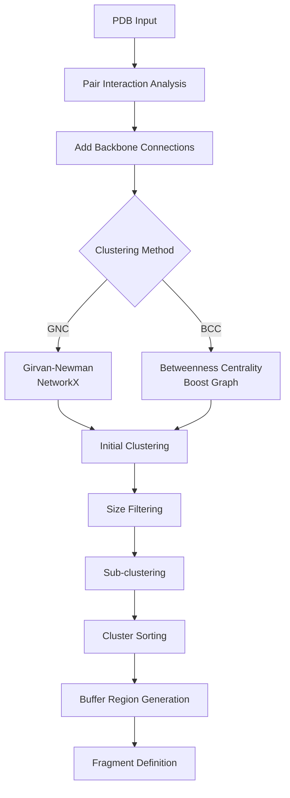

Clustering algorithms in Q|Refine form the foundational layer that decomposes macromolecular systems into computationally tractable quantum mechanical regions. This decomposition is essential for making QM/MM refinement feasible for large biological systems while maintaining the accuracy required for high-resolution structural refinement.

## Algorithm Architecture Overview

The clustering subsystem employs graph-based community detection algorithms to identify groups of interacting residues that form natural QM calculation domains. Two distinct algorithms are implemented, each offering different trade-offs between computational efficiency and cluster quality.



## Core Clustering Algorithms

### Girvan-Newman Clustering (GNC)

The Girvan-Newman algorithm implements a hierarchical community detection approach that progressively removes edges with high betweenness centrality. This algorithm is accessed through NetworkX and a custom community detection module (`plugin.cmty`).

**Implementation Details:**

The algorithm operates in two phases to ensure cluster size constraints:

1. **Initial Clustering Phase**: Builds a weighted graph where vertices represent residues and edges represent inter-residue interactions. Edge weights are uniformly set to 1.0 for simplicity. The algorithm identifies natural community boundaries by iteratively removing edges that bridge communities.

2. **Sub-clustering Phase**: Applies recursive decomposition to any clusters exceeding the maximum residue limit. Each oversized cluster is re-analyzed with a more aggressive community detection depth parameter (depth=5), splitting it into smaller sub-clusters until all components satisfy the size constraint.

**Key Characteristics:**

- **Dependency**: Requires NetworkX and the custom `plugin.cmty` module
- **Default Parameters**: `maxnum_residues_in_cluster=15`
- **Recursive Depth**: Uses depth=5 for sub-clustering oversized clusters
- **Edge Weighting**: Uniform edge weights (1.0) across all interactions

Sources: [clustering.py](clustering.py#L16-L82)

### Betweenness Centrality Clustering (BCC)

The BCC algorithm represents the default and recommended clustering method. It leverages the Boost Graph Library's efficient betweenness centrality calculation, providing robust performance on large systems.

**Algorithm Mechanics:**

The algorithm employs an adaptive threshold strategy:

1. **Graph Construction**: Creates an undirected graph using Boost's adjacency list data structure, with vertices representing residues and edges representing interactions from the pair interaction analysis.

2. **Iterative Edge Removal**: Starting from a configurable threshold (default 9), the algorithm progressively removes edges with betweenness centrality values exceeding the threshold. After each removal round, it checks if the resulting connected components satisfy the maximum cluster size constraint.

3. **Adaptive Threshold Adjustment**: If components exceed the size limit, the threshold decrements by 1 and the process repeats. This continues until either the size constraint is met or the threshold reaches a minimum value of 4.

4. **Final Size Enforcement**: Any remaining oversized clusters are split at their median index, ensuring a hard upper bound on cluster size.

**Key Characteristics:**

- **Default Parameters**: `maxnum_residues_in_cluster=15`, `bcc_threshold=9`
- **Minimum Threshold**: 4 (prevents excessive fragmentation)
- **Graph Type**: Undirected with vertex storage in vectors and edges in sets
- **Splitting Strategy**: Median-index splitting for final size enforcement

Sources: [clustering.py](clustering.py#L83-L131)

## Algorithm Comparison

| Feature | Girvan-Newman (GNC) | Betweenness Centrality (BCC) |
|---------|---------------------|------------------------------|
| **Implementation** | NetworkX + custom plugin | Boost Graph Library |
| **Default Max Size** | 15 residues | 15 residues |
| **Adaptive Threshold** | No | Yes (9→4 range) |
| **Recursion Strategy** | Sub-clustering with depth control | Iterative edge removal |
| **Performance** | Moderate (Python overhead) | High (C++ Boost) |
| **Status** | Available | **Default/Recommended** |
| **External Dependencies** | NetworkX, plugin.cmty | Boost (bundled) |

Sources: [clustering.py](clustering.py#L16-L131), [qr.py](qr.py#L30-L53)

## Integration with Fragmentation Pipeline

The clustering algorithms serve as the foundation for the complete fragment generation workflow:

### Interaction Graph Construction

Before clustering begins, the system builds a comprehensive interaction graph using `pair_interaction.run()`. This analysis identifies:

- **Non-covalent interactions**: Van der Waals contacts, electrostatic interactions
- **Covalent connectivity**: Direct bond connections between residues
- **Backbone connections**: Added explicitly to maintain chain continuity (commented as "XXX WHY IS THIS?" in the code, suggesting this deserves investigation)

The interaction list serves as edges in the clustering graph, with residues (or residue groups) forming vertices.

Sources: [fragment.py](fragment.py#L136-L145)

### Cluster Sorting and Management

After clustering completes, the algorithm sorts clusters by size in descending order:

```python
self.clusters = sorted(clusters,
    key=cmp_to_key(lambda x, y: 1 if len(x) < len(y) else -1 if len(x) > len(y) else 0))
```

This ensures the largest clusters are processed first, which has implications for:

- **Memory allocation**: Largest QM calculations occur early
- **Parallel scheduling**: Load balancing across compute resources
- **Debugging visibility**: Issues in largest clusters surface first

Sources: [fragment.py](fragment.py#L145-L148)

### Buffer Region Generation

Each cluster is surrounded by a buffer region to create a complete fragment suitable for QM calculation. The buffer includes:

- **Primary buffer**: Atoms within a defined radius of the cluster (typically 10Å)
- **Optional secondary buffer**: Enabled via `two_buffers` parameter when gradients from single-buffer calculations don't match whole-system gradients
- **Charge embedding region**: Atoms within `charge_cutoff` distance (default 8.0) for point charge embedding

The buffer ensures:
- Boundary effects are minimized
- QM calculations include sufficient environmental context
- Electrostatic embedding represents the surrounding system accurately

Sources: [fragment.py](fragment.py#L64-L71), [qr.py](qr.py#L32-L37)

## Configuration Parameters

### Primary Clustering Parameters

| Parameter | Type | Default | Description |
|-----------|------|---------|-------------|
| `clustering_method` | choice | `bcc` | Algorithm selection: `gnc` or `bcc` |
| `maxnum_residues_in_cluster` | int | 15 | Maximum residues per cluster |
| `bcc_threshold` | int | 9 | Starting threshold for BCC edge removal |
| `select_within_radius` | int | 10 | Supersphere expansion radius (Å) |

### Advanced Parameters

| Parameter | Type | Default | Description |
|-----------|------|---------|-------------|
| `clustering` | bool | True | Enable/disable clustering entirely |
| `charge_embedding` | bool | False | Enable point charge embedding |
| `charge_cutoff` | float | 8.0 | Distance cutoff for charge embedding (Å) |
| `two_buffers` | bool | False | Enable dual buffer layers for gradient consistency |
| `save_clusters` | bool | True | Save clusters and fragments as PDB files |

Sources: [qr.py](qr.py#L30-L53)

## Alternative Conformation Handling

The clustering system must handle proteins with alternate conformations (altlocs). The implementation supports two strategies:

### Subtract Method (Default)

When altlocs are present:

1. **Generate separate hierarchies** for each altloc state
2. **Process each state independently** to create clusters
3. **Identify overlapping regions** where altlocs share atoms
4. **Subtract overlapping contributions** to avoid double-counting
5. **Create separate clusters** for non-overlapping altloc-specific regions

This approach ensures each atom's energy contribution is counted exactly once across the refinement.

### Average Method

An alternative strategy averages contributions from overlapping altloc regions. However, this method is documented as non-functional ("altloc_method=average does not work! (known issue)") and should not be used.

Sources: [fragment.py](fragment.py#L184-L234), [qr.py](qr.py#L43-L46)

> [!TIP]
> The subtract method for altloc handling requires careful validation. Check that your protein's altloc assignments are consistent (no partially occupied regions without complete altloc definitions) to ensure accurate energy decomposition.

## Execution Workflow

### Command-Line Interface

Execute clustering via the dedicated `qr.cluster` program:

```bash
qr.cluster model.pdb cluster.maxnum_residues_in_cluster=20 cluster.bcc_threshold=10
```

The program outputs:
- Number of clusters generated
- Residue count for each cluster
- Validation of input PDB structure

Sources: [clustering.py](clustering.py#L133-L176), [command_line/cluster.py](command_line/cluster.py#L1-L9)

### Programmatic Usage

For integration into custom workflows:

```python
from qrefine.fragment import fragments
from qrefine import clustering

# Build interaction graph
interaction_list = pair_interaction.run(pdb_hierarchy)

# Run clustering algorithm
clusters = clustering.betweenness_centrality_clustering(
    interaction_list,
    size=n_residues,
    maxnum_residues_in_cluster=15,
    bcc_threshold=9
).get_clusters()

# Sort clusters by size
clusters = sorted(clusters, key=lambda x: -len(x))
```

Sources: [fragment.py](fragment.py#L136-L148)

## Testing and Validation

The clustering system is validated through multiple test suites:

### Regression Tests

- **test_reg_02_chunk.py**: Validates clustering indices, chunk indices, and atom counts in each chunk to ensure fragmentation consistency across runs.

### Unit Tests

- **tst_40.py**: Exercises the underlying pair interaction analysis that feeds into the clustering graph construction.

These tests verify:
- Consistent cluster numbering
- Correct atom-to-cluster assignments
- Reproducibility across multiple executions

Sources: [tests/regression/test_reg_02_chunk.py](tests/regression/test_reg_02_chunk.py#L13-L32), [tests/unit/tst_40.py](tests/unit/tst_40.py#L9-L20)

## Integration with Restraints System

Clusters generated by these algorithms directly feed into the QM restraints system. The `from_cluster` class in [cluster_restraints.py](cluster_restraints.py#L29-L161) manages:

1. **Parallel QM calculations** across all clusters
2. **Gradient assembly** by combining fragment gradients into system-wide gradients
3. **Energy summation** from all cluster calculations
4. **Buffer region handling** (zeroing gradients for buffer atoms to ensure proper boundary conditions)

The clustering strategy fundamentally determines:
- Number of parallel QM jobs
- Computational cost per job
- Memory requirements
- Total refinement wall-clock time

Sources: [cluster_restraints.py](cluster_restraints.py#L29-L161)

## Performance Considerations

### Cluster Size Trade-offs

**Smaller clusters** (e.g., 10 residues):
- **Pros**: Faster per-job calculation, lower memory per job, better parallel scaling
- **Cons**: More QM jobs total, increased overhead from parallel communication, potentially less accurate local environment representation

**Larger clusters** (e.g., 20+ residues):
- **Pros**: Fewer QM jobs, better representation of local environment, reduced parallel overhead
- **Cons**: Higher memory per job, longer per-job wall time, potential load imbalance

> [!TIP]
> For optimal performance, monitor the distribution of cluster sizes. If many clusters are significantly smaller than the max threshold, consider increasing `maxnum_residues_in_cluster` to reduce total job count. If many clusters hit the maximum size, reduce it to improve parallel scaling.

### BCC Threshold Selection

The `bcc_threshold` parameter controls cluster granularity:

- **Higher values** (9-12): Fewer, larger clusters (less aggressive edge removal)
- **Lower values** (4-8): More, smaller clusters (more aggressive edge removal)

The adaptive threshold mechanism automatically adjusts downward from the starting value until size constraints are met, but the starting value influences the final distribution.

Sources: [clustering.py](clustering.py#L97-L115)

## Troubleshooting

### Issue: Clusters exceed maximum size

**Symptoms**: Output shows clusters with residue counts above `maxnum_residues_in_cluster`

**Resolution**:
- Check that `bcc_threshold` is not set too high (try reducing by 1-2)
- Verify that the interaction graph is properly constructed
- For GNC method, ensure `plugin.cmty` is correctly installed

### Issue: Too many small clusters

**Symptoms**: Excessive fragmentation creates hundreds of tiny clusters

**Resolution**:
- Increase `maxnum_residues_in_cluster` to allow larger groups
- Increase `bcc_threshold` for BCC method
- Verify that backbone connections are being added to the interaction list

### Issue: Altloc handling errors

**Symptoms**: Crashes or incorrect energy values for proteins with alternate conformations

**Resolution**:
- Ensure `altloc_method` is set to "subtract" (the default)
- Validate that altloc assignments are complete (no partial occupancies)
- Check that `bond_with_altloc` parameter is appropriate for your system

## Next Steps

Understanding clustering algorithms provides the foundation for effective QM refinement. Continue your exploration with these related topics:

- [Understanding Fragmentation](7-understanding-fragmentation) - Learn how clusters expand into complete QM fragments with capping and buffer regions
- [Fragmentation Parameters](8-fragmentation-parameters) - Detailed configuration options for the complete fragmentation workflow
- [Cluster Restraints](22-cluster-restraints) - How clusters integrate with the QM restraints system during refinement
- [QM Interfaces](11-supported-qm-engines-overview) - The quantum chemistry engines that compute energies for each cluster
