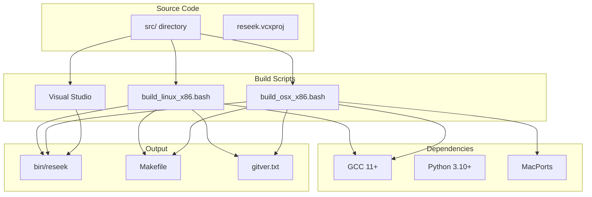
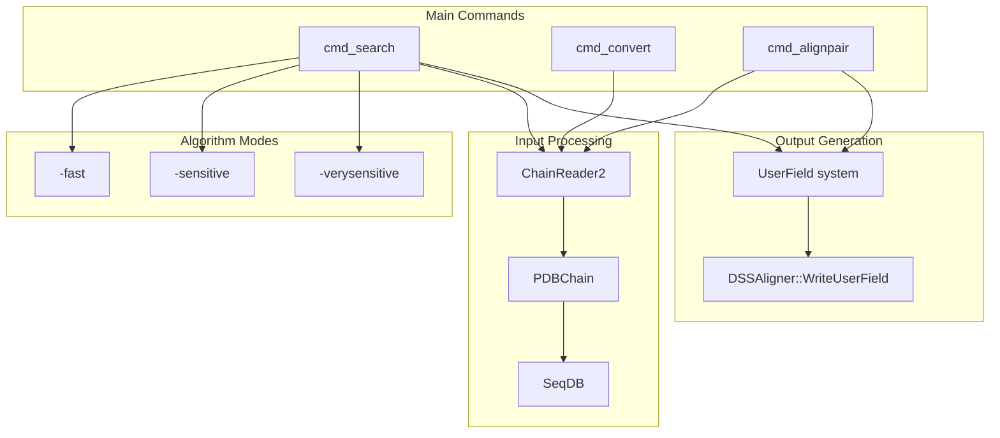
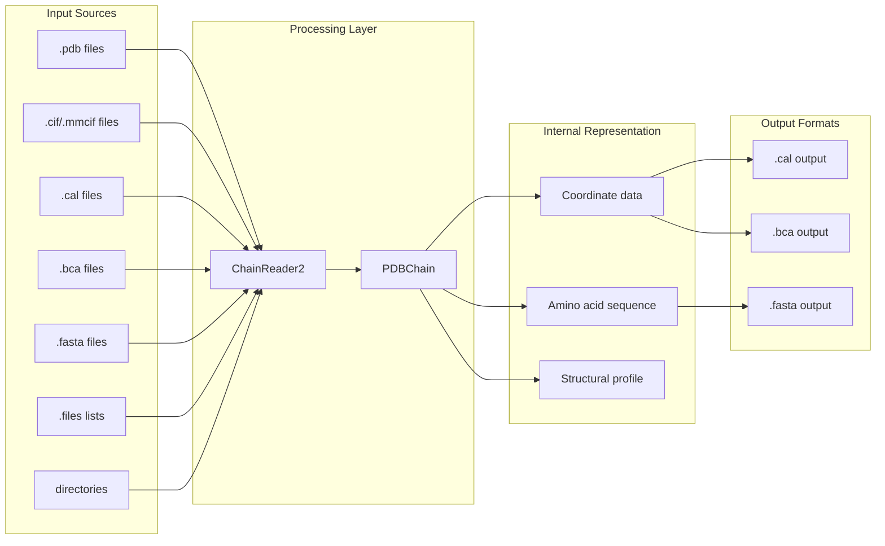
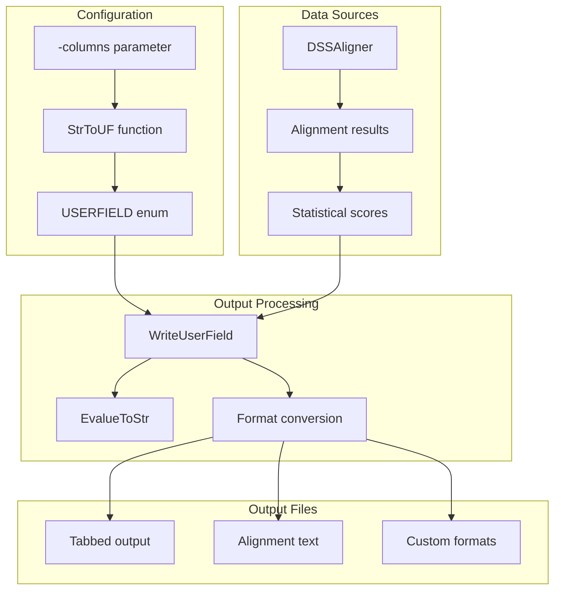

# Getting Started

<details>
<summary>Relevant source files</summary>

The following files were used as context for generating this wiki page:

- [.github/workflows/build_linux_x86.yml](.github/workflows/build_linux_x86.yml)
- [.github/workflows/build_osx_x86.yml](.github/workflows/build_osx_x86.yml)
- [README.md](README.md)
- [src/.gitignore](src/.gitignore)
- [src/usage.h](src/usage.h)
- [src/userfieldnames.h](src/userfieldnames.h)
- [src/userfields.cpp](src/userfields.cpp)

</details>


This document provides installation instructions, build procedures, and basic usage examples for the reseek protein structure search and alignment tool. It covers the essential steps needed to compile, install, and run reseek for common use cases including database searches, pairwise alignments, and format conversions.

For detailed information about the core alignment algorithms, see [Core Alignment Engine](#3). For comprehensive command-line reference, see [Command-Line Interface](#6). For data format specifications, see [Data Processing and Formats](#5).

## Installation and Build Process

Reseek supports compilation on Linux, macOS, and Windows platforms. The build system uses platform-specific bash scripts that handle dependency resolution and linking.

### Build Requirements

The build process requires:
- C++ compiler with C++11 support
- Standard development tools (make, shell)
- For automated builds: Python 3.10+ and platform-specific package managers

### Linux x86_64 Build

```bash
cd src/
chmod +x build_linux_x86.bash
./build_linux_x86.bash
```

The build script creates a static binary at `bin/reseek`. Static linking warnings about `dlopen` are expected and safe to ignore [README.md:108-112]().

### macOS x86_64 Build

```bash
cd src/
chmod +x build_osx_x86.bash
./build_osx_x86.bash
```

The macOS build requires GCC 11 and uses MacPorts for dependency management.

### Windows Build

Load `reseek.vcxproj` into Microsoft Visual Studio and use the Build command [README.md:105]().

### Build Artifacts

The build process generates these key files:
- `bin/reseek` - Main executable
- `Makefile` - Generated build configuration
- `gitver.txt` - Version information

**Build Process Flow**



Sources: [README.md:94-112](), [.github/workflows/build_linux_x86.yml:1-37](), [.github/workflows/build_osx_x86.yml:1-35](), [src/.gitignore:1-7]()

## Basic Usage Workflow

Reseek operates through three primary commands that handle different alignment scenarios. Each command requires specific algorithm sensitivity settings.

### Core Commands and Algorithm Modes



Sources: [README.md:15-34](), [src/usage.h:4-11](), [src/userfields.cpp:45-151]()

### Database Search Example

```bash
# Create binary database (recommended for large datasets)
reseek -convert /data/PDB_mirror/ -bca PDB.bca

# Search against database
reseek -search query.pdb -db PDB.bca -sensitive -output hits.txt
```

### Pairwise Alignment Example

```bash
# Align and superpose two structures
reseek -alignpair 1XYZ.pdb -input2 2ABC.pdb -sensitive \
       -aln alignment.txt -output superposed.pdb
```

### All-vs-All Search Example

```bash
# Compare all structures against each other
reseek -search structures/ -fast -output all_hits.txt
```

## File Format Support

Reseek supports multiple input and output formats optimized for different use cases. The format conversion system handles automatic detection and conversion between formats.

### Input Formats

| Format | Extension | Description | Use Case |
|--------|-----------|-------------|----------|
| PDB | `.pdb` | Legacy PDB format | Individual structures |
| mmCIF | `.cif`, `.mmcif` | Modern PDBx/mmCIF format | Large structures, NMR |
| CAL | `.cal` | C-alpha coordinates (text) | Reduced representation |
| BCA | `.bca` | Binary C-alpha format | Large databases |
| FASTA | `.fasta` | Amino acid sequences | Sequence-only analysis |
| Files List | `.files` | List of structure files | Batch processing |

### Format Conversion

```bash
# Convert PDB files to binary database
reseek -convert input_dir/ -bca output.bca

# Convert to multiple formats
reseek -convert structures.pdb -cal output.cal -fasta output.fasta
```

**Format Processing Pipeline**



Sources: [README.md:70-87](), [src/usage.h:60-81]()

## Output Configuration

Reseek provides extensive output customization through the UserField system. Users can specify exactly which columns to include in results using the `-columns` parameter.

### Standard Output Columns

The UserField system defines these output options [src/userfieldnames.h:5-32]():

| Field | Description | Example |
|-------|-------------|---------|
| `query` | Query structure label | `1ABC_A` |
| `target` | Target structure label | `2XYZ_B` |
| `evalue` | E-value statistical significance | `1.2e-5` |
| `pvalue` | P-value statistical significance | `3.4e-6` |
| `qlo`, `qhi` | Query alignment bounds | `15`, `127` |
| `tlo`, `thi` | Target alignment bounds | `8`, `119` |
| `ql`, `tl` | Query/target sequence lengths | `150`, `142` |
| `pctid` | Percent identity | `34.5` |
| `aq` | Alignment quality (0-1) | `0.742` |
| `cigar` | CIGAR alignment string | `25M3D47M` |

### Custom Output Examples

```bash
# Default output (AQ + labels + statistics)
reseek -search query.pdb -db target.bca -sensitive -output hits.txt

# Custom columns
reseek -search query.pdb -db target.bca -sensitive \
       -columns "query+target+evalue+pctid+aq" -output custom.txt

# Standard format with all basic fields
reseek -search query.pdb -db target.bca -sensitive \
       -columns "std" -output standard.txt
```

### Output Generation System



Sources: [src/userfields.cpp:6-151](), [src/userfieldnames.h:1-34](), [README.md:36-59](), [src/usage.h:25-48]()

## Common Parameters

### Required Algorithm Mode

Every alignment command requires one of these sensitivity modes:
- `-fast`: Fastest execution, lower sensitivity
- `-sensitive`: Balanced speed and sensitivity  
- `-verysensitive`: Highest sensitivity, slower execution

### Optional Parameters

| Parameter | Description | Default |
|-----------|-------------|---------|
| `-evalue E` | Maximum E-value threshold | `10` (except `-verysensitive`) |
| `-pvalue P` | Minimum P-value threshold | `1` |
| `-threads N` | Number of parallel threads | Number of CPU cores |
| `-gapopen X` | Gap opening penalty | Algorithm-dependent |
| `-gapext X` | Gap extension penalty | Algorithm-dependent |
| `-log FILE` | Log file for errors and timing | None |

### Example with Parameters

```bash
reseek -search query.pdb -db large_db.bca -sensitive \
       -evalue 0.01 -threads 8 -log search.log \
       -columns "query+target+evalue+aq+pctid" \
       -output results.txt
```

Sources: [README.md:61-69](), [src/usage.h:50-85]()

---