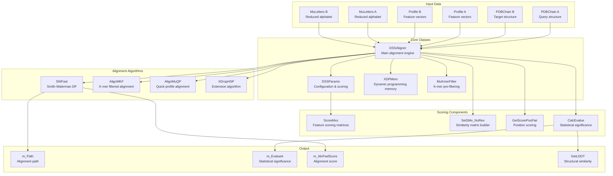
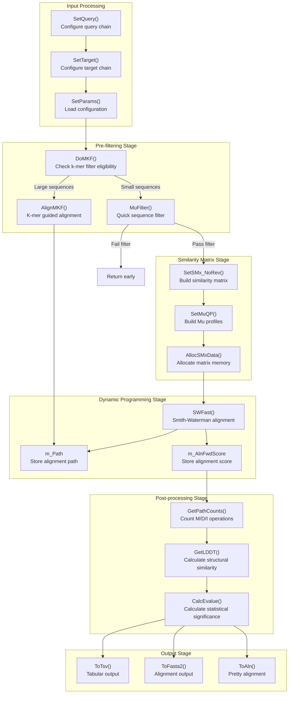
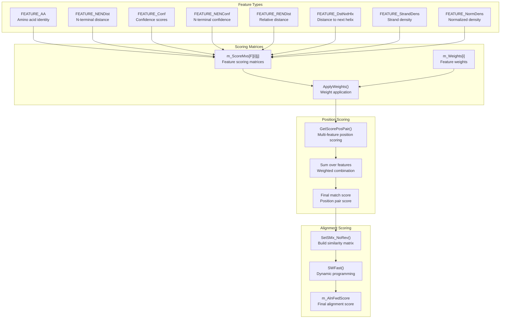

# Core Alignment Engine

<details>
<summary>Relevant source files</summary>

The following files were used as context for generating this wiki page:

- [src/dssaligner.cpp](src/dssaligner.cpp)
- [src/dssaligner.h](src/dssaligner.h)
- [src/dssparams.cpp](src/dssparams.cpp)
- [src/dssparams.h](src/dssparams.h)
- [src/namedparams.cpp](src/namedparams.cpp)

</details>


The Core Alignment Engine is the computational heart of the reseek protein structure search system. It performs pairwise sequence and structural alignments between query and target protein chains using a sophisticated multi-feature scoring system combined with dynamic programming algorithms. This engine handles the computationally intensive task of finding optimal alignments and calculating statistical significance values.

For database search orchestration and multi-threading, see [Database Search System](#4). For input/output format handling, see [Data Processing and Formats](#5). For parameter configuration details, see [Parameter Configuration](#3.2).

## Architecture Overview

The alignment engine centers around the `DSSAligner` class, which coordinates multiple alignment algorithms, scoring systems, and performance optimizations.



Sources: [src/dssaligner.h:18-231](), [src/dssaligner.cpp:92-103](), [src/dssparams.h:27-118]()

## Core Alignment Workflow

The alignment process follows a multi-stage pipeline with progressive filtering and refinement stages.



Sources: [src/dssaligner.cpp:783-821](), [src/dssaligner.cpp:923-939](), [src/dssaligner.cpp:1358-1403]()

## DSSAligner Class Structure

The `DSSAligner` class maintains alignment state and provides the main interface for performing alignments.

### Key Member Variables

| Variable | Type | Purpose |
|----------|------|---------|
| `m_ChainA`, `m_ChainB` | `const PDBChain*` | Input protein chains |
| `m_ProfileA`, `m_ProfileB` | `const vector<vector<byte>>*` | Multi-feature profiles |
| `m_MuLettersA`, `m_MuLettersB` | `const vector<byte>*` | Reduced alphabet sequences |
| `m_Path` | `string` | Alignment path (M/D/I operations) |
| `m_LoA`, `m_LoB` | `uint` | Alignment start positions |
| `m_HiA`, `m_HiB` | `uint` | Alignment end positions |
| `m_EvalueA`, `m_EvalueB` | `float` | Statistical significance values |
| `m_AlnFwdScore` | `float` | Forward alignment score |
| `m_SMx_Data` | `float**` | Similarity matrix data |

### Core Alignment Methods

#### Primary Alignment Interface
- `AlignQueryTarget()` - Main alignment entry point [src/dssaligner.cpp:783-821]()
- `SetQuery()` - Configure query sequence and features [src/dssaligner.cpp:664-689]()
- `SetTarget()` - Configure target sequence and features [src/dssaligner.cpp:691-703]()

#### Specialized Alignment Algorithms
- `Align_NoAccel()` - Standard Smith-Waterman alignment [src/dssaligner.cpp:923-939]()
- `AlignMKF()` - K-mer filtered alignment for large sequences [src/dssaligner.cpp:1358-1363]()
- `AlignMuQP()` - Quick profile alignment with reduced alphabet [src/dssaligner.cpp:1041-1061]()

#### Scoring and Evaluation
- `GetScorePosPair()` - Calculate score for aligned position pair [src/dssaligner.cpp:320-347]()
- `CalcEvalue()` - Calculate statistical significance using LDDT and other features [src/dssaligner.cpp:844-898]()
- `GetLDDT()` - Calculate local distance difference test score [src/dssaligner.cpp:1283-1294]()

Sources: [src/dssaligner.h:18-231](), [src/dssaligner.cpp:100-139]()

## Multi-Feature Scoring System

The alignment engine uses a sophisticated multi-feature scoring system that combines sequence and structural information.

### Feature Integration Architecture



### Feature Scoring Implementation

The `GetScorePosPair()` method implements the multi-feature scoring:

```cpp
// For each feature in the parameter set
for (uint FeatureIdx = 0; FeatureIdx < FeatureCount; ++FeatureIdx) {
    FEATURE F = m_Params->m_Features[FeatureIdx];
    uint AlphaSize = g_AlphaSizes2[F];
    float **ScoreMx = m_Params->m_ScoreMxs[F];
    
    // Get feature values at aligned positions
    byte ia = ProfileA[FeatureIdx][PosA];
    byte ib = ProfileB[FeatureIdx][PosB];
    
    // Add weighted feature contribution
    MatchScore += ScoreMx[ia][ib];
}
```

Sources: [src/dssaligner.cpp:320-347](), [src/dssparams.cpp:343-363](), [src/namedparams.cpp:32-53]()

## Performance Optimizations

The alignment engine implements several performance optimizations to handle large-scale protein structure searches efficiently.

### Multi-Stage Filtering Pipeline

| Stage | Method | Purpose | Threshold Parameters |
|-------|--------|---------|---------------------|
| K-mer Filter | `DoMKF()` | Skip small sequences | `m_MKFL` (sequence length) |
| Mu Filter | `MuFilter()` | Quick sequence pre-screening | `m_Omega` (score threshold) |
| Smith-Waterman | `SWFast()` | Full dynamic programming | `m_MinFwdScore` (score threshold) |
| Statistical Filter | `CalcEvalue()` | Significance testing | E-value thresholds |

### Memory Management Optimizations

- **Similarity Matrix Pooling**: `AllocSMxData()` reuses matrix memory to avoid allocation overhead [src/dssaligner.cpp:1415-1434]()
- **Dynamic Programming Row Pooling**: `AllocDProw()` reuses DP row memory [src/dssaligner.cpp:1030-1039]()
- **Profile Caching**: `SetMuQP()` pre-computes profile data for repeated use [src/dssaligner.cpp:432-454]()

### Parallel Processing Support

- **Thread-Safe Output**: `m_OutputLock` mutex protects output operations [src/dssaligner.cpp:16]()
- **Atomic Counters**: Performance statistics use atomic operations [src/dssaligner.cpp:34-40]()
- **Parasail Integration**: `m_ProfPara` enables vectorized alignment [src/dssaligner.h:37-38]()

Sources: [src/dssaligner.cpp:705-722](), [src/dssaligner.cpp:1415-1454](), [src/dssaligner.cpp:1030-1039]()

## Statistical Significance Calculation

The alignment engine calculates statistical significance using a combination of alignment score, structural similarity (LDDT), and sequence length normalization.

### E-value Calculation Formula

The `CalcEvalue()` method implements a composite test statistic:

```cpp
const float dpw = 1.7f;      // DP score weight
const float lddtw = 0.13f;   // LDDT weight  
const float ladd = 250.0f;   // Length adjustment
const float revtsw = 2.0f;   // Reverse score weight

m_NewTestStatisticA = lddtw * LDDT;
m_NewTestStatisticA += (dpw * m_AlnFwdScore - revtsw * RevDPScore) / (L + ladd);
```

### Statistical Components

| Component | Variable | Purpose |
|-----------|----------|---------|
| LDDT Score | `GetLDDT()` | Structural similarity measure |
| DP Score | `m_AlnFwdScore` | Dynamic programming alignment score |
| Reverse Score | `RevDPScore` | Self-reverse alignment normalization |
| Length Normalization | `L + ladd` | Sequence length adjustment |

Sources: [src/dssaligner.cpp:844-898](), [src/dssaligner.cpp:1283-1294]()

---