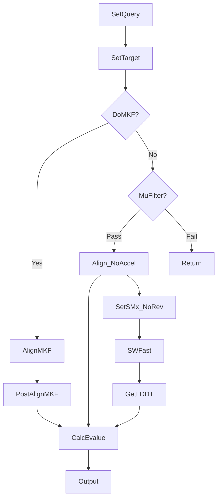
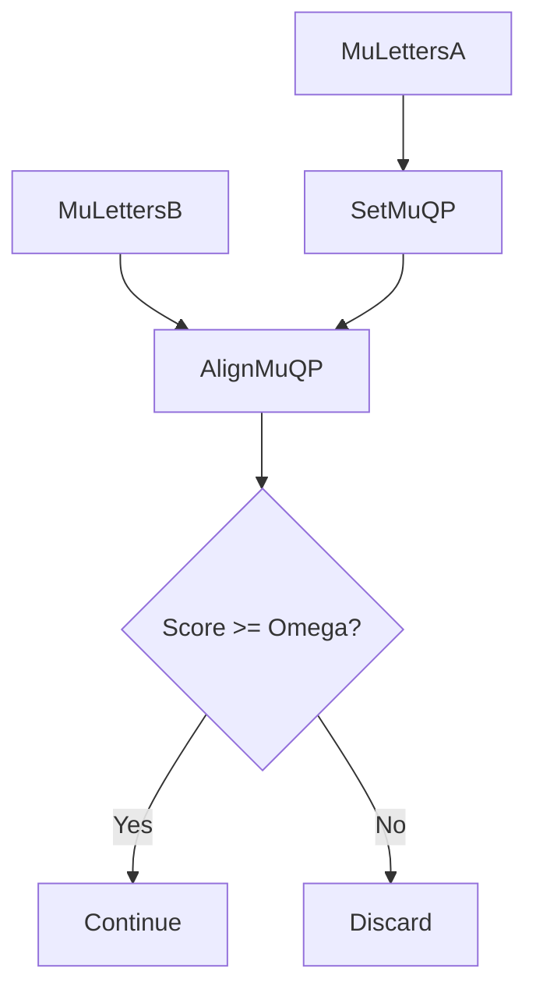
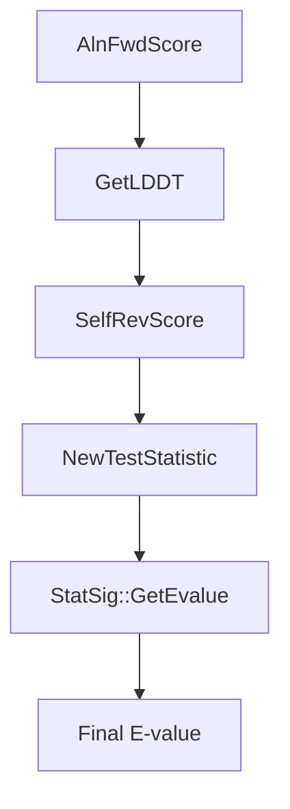

# DSSAligner Class

Relevant source files

The following files were used as context for generating this wiki page:

- [src/dssaligner.cpp](src/dssaligner.cpp)
- [src/dssaligner.h](src/dssaligner.h)

## Purpose and Scope

The `DSSAligner` class is the core alignment engine in the reseek protein structure search system. It performs pairwise sequence and structure alignments between protein chains using multiple scoring features and sophisticated filtering strategies. This class orchestrates the entire alignment workflow from input processing through statistical significance calculation to output formatting.

For information about the broader alignment pipeline and filtering systems, see [Filtering Pipeline](#4.2). For details on parameter configuration and scoring matrices, see [Parameter Configuration](#3.2).

## Class Overview

The `DSSAligner` class implements a multi-stage alignment system that combines sequence-based pre-filtering with structure-aware dynamic programming algorithms. It supports several alignment modes optimized for different speed-accuracy trade-offs and provides comprehensive statistical analysis of alignment results.

### Core Alignment Workflow

Sources: [src/dssaligner.h:102-231](), [src/dssaligner.cpp:783-821]()

## Key Data Members

The `DSSAligner` class maintains several categories of data members that support its alignment functionality:

### Input Data Pointers
- `m_ChainA`, `m_ChainB` - Pointers to `PDBChain` objects being aligned
- `m_ProfileA`, `m_ProfileB` - Multi-feature sequence profiles
- `m_MuLettersA`, `m_MuLettersB` - Reduced alphabet representations
- `m_MuKmersA`, `m_MuKmersB` - K-mer vectors for filtering

### Alignment Results
- `m_Path` - CIGAR-style alignment path string
- `m_LoA`, `m_LoB`, `m_HiA`, `m_HiB` - Alignment boundaries
- `m_AlnFwdScore` - Forward alignment score
- `m_Ids`, `m_Gaps` - Identity and gap counts

### Statistical Measures
- `m_EvalueA`, `m_EvalueB` - E-values for statistical significance
- `m_PvalueA`, `m_PvalueB` - P-values
- `m_QualityA`, `m_QualityB` - Quality scores
- `m_TestStatisticA`, `m_TestStatisticB` - Test statistics

Sources: [src/dssaligner.h:24-84]()

## Alignment Modes and Methods

### MKF (MuKmerFilter) Alignment

The `AlignMKF()` method implements an accelerated alignment strategy using k-mer filtering and X-drop extension:

This mode is selected when `DoMKF()` returns true, typically for longer sequences where k-mer pre-filtering provides significant speedup.

Sources: [src/dssaligner.cpp:1358-1403]()

### Standard Smith-Waterman Alignment

The `Align_NoAccel()` method performs full Smith-Waterman alignment:

1. **Score Matrix Construction**: `SetSMx_NoRev()` builds the similarity matrix
2. **Dynamic Programming**: `SWFast()` performs optimized Smith-Waterman
3. **Statistical Analysis**: `CalcEvalue()` computes significance scores

Sources: [src/dssaligner.cpp:923-939]()

### MuFilter Pre-filtering

The `MuFilter()` method provides a fast pre-screening step:

This filtering uses a reduced alphabet alignment to quickly eliminate unlikely alignment pairs.

Sources: [src/dssaligner.cpp:609-620]()

## Scoring System Integration

The `DSSAligner` integrates with the broader scoring system through several key methods:

### Multi-Feature Scoring

The `GetScorePosPair()` method computes position-specific scores across multiple features:

| Feature Type | Score Matrix | Purpose |
|-------------|-------------|---------|
| Amino Acid | `m_ScoreMxs[F]` | Sequence similarity |
| Secondary Structure | Feature-specific | Structural compatibility |
| Solvent Accessibility | Feature-specific | Surface properties |
| Other Features | Configurable | Extensible scoring |

Sources: [src/dssaligner.cpp:320-347]()

### Gap Penalty System

Gap penalties are applied consistently across alignment modes:
- `m_GapOpen` - Gap opening penalty
- `m_GapExt` - Gap extension penalty
- Applied in `GetDPScorePath()` and related methods

Sources: [src/dssaligner.cpp:247-318]()

## Statistical Analysis

### E-value Calculation

The `CalcEvalue()` method implements sophisticated statistical analysis:

The calculation incorporates:
- **LDDT scoring** for structural similarity
- **Self-reverse scores** for normalization
- **Length normalization** factors
- **Database size** for significance testing

Sources: [src/dssaligner.cpp:844-898]()

### LDDT Integration

The `GetLDDT()` method provides structural quality assessment by extracting aligned positions and computing Local Distance Difference Test scores.

Sources: [src/dssaligner.cpp:1283-1294]()

## Output Generation

The `DSSAligner` supports multiple output formats through specialized methods:

### TSV Output
`ToTsv()` generates tabular output with configurable columns through the `UserField` system.

### FASTA Alignment Output
`ToFasta2()` produces aligned sequences in FASTA format with embedded statistics.

### Pretty Alignment Output
`ToAln()` creates human-readable alignment displays with scoring information.

Sources: [src/dssaligner.cpp:1010-1028](), [src/dssaligner.cpp:975-1008](), [src/dssaligner.cpp:959-973]()

## Memory Management

The class implements custom memory management for large scoring matrices:

- `AllocSMxData()` - Allocates 2D scoring matrix with overflow protection
- `FreeSMxData()` - Deallocates matrix memory
- `m_SMx_Buffer` - Contiguous memory buffer for cache efficiency

Sources: [src/dssaligner.cpp:1415-1454]()

## Thread Safety and Statistics

The class maintains thread-safe global statistics through atomic counters:

- `m_AlnCount` - Total alignments performed
- `m_MuFilterDiscardCount` - Alignments filtered out
- `m_XDropAlnCount` - X-drop alignments performed
- Static mutex `m_OutputLock` for thread-safe output

Sources: [src/dssaligner.cpp:34-41](), [src/dssaligner.h:86-96]()

## Integration with Parameter System

The `DSSAligner` receives its configuration through the `DSSParams` class via `SetParams()`. This includes:
- Scoring matrices and feature weights
- Gap penalties and thresholds
- Algorithm selection flags
- Output formatting options

Sources: [src/dssaligner.cpp:648-652]()

---