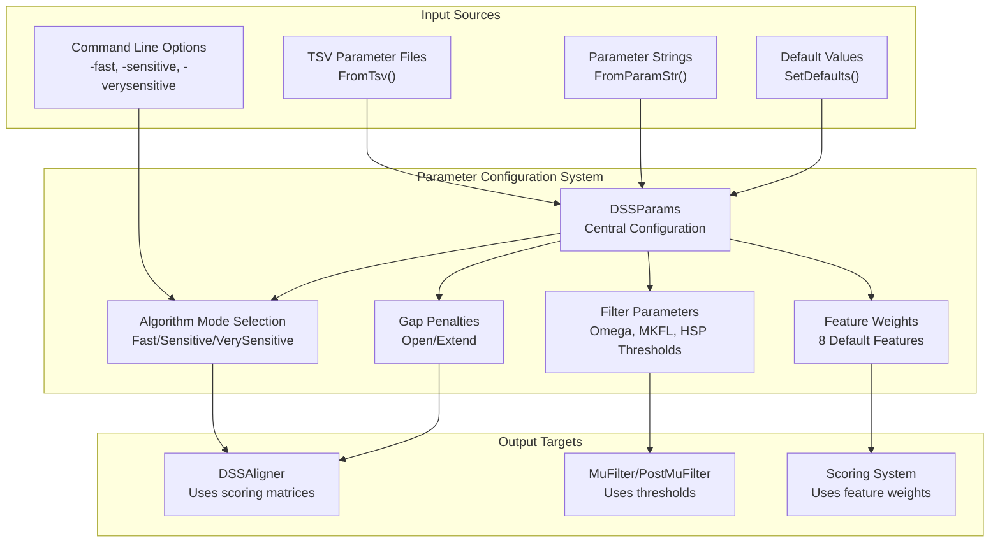
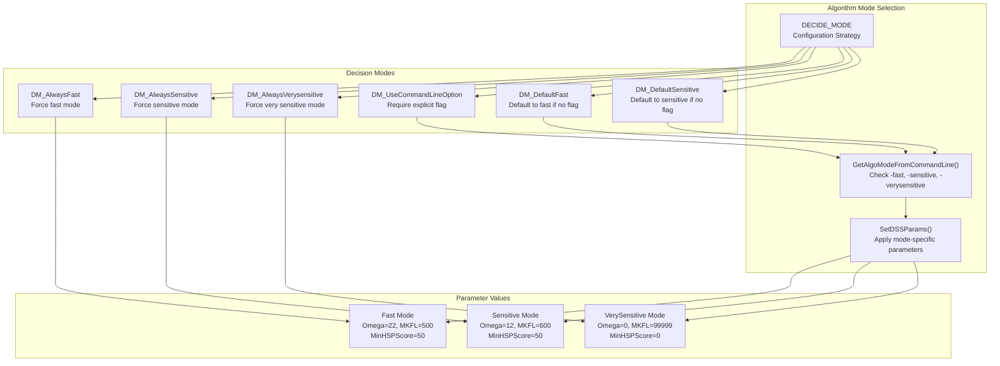
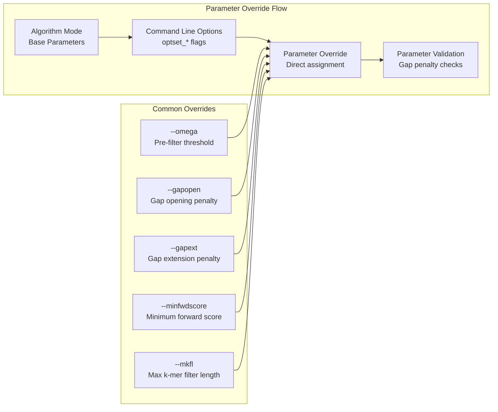
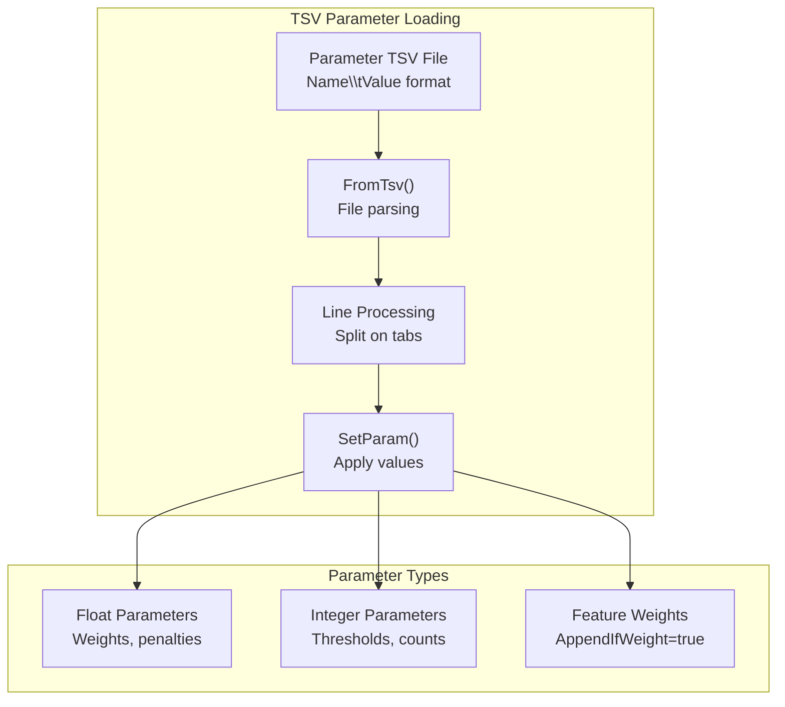
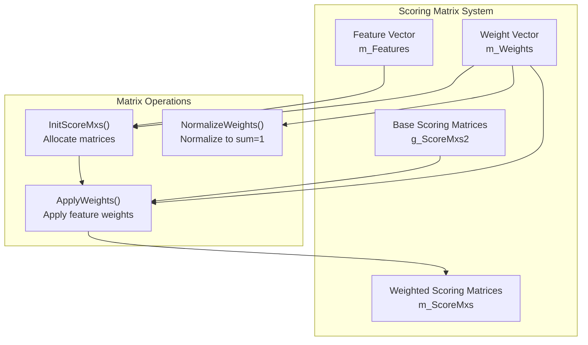
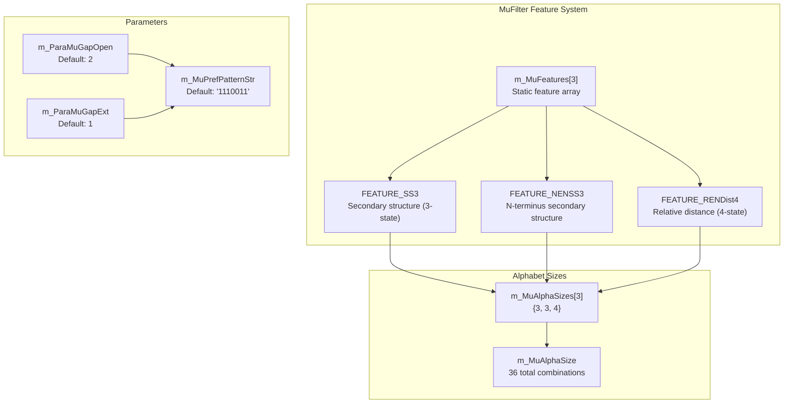
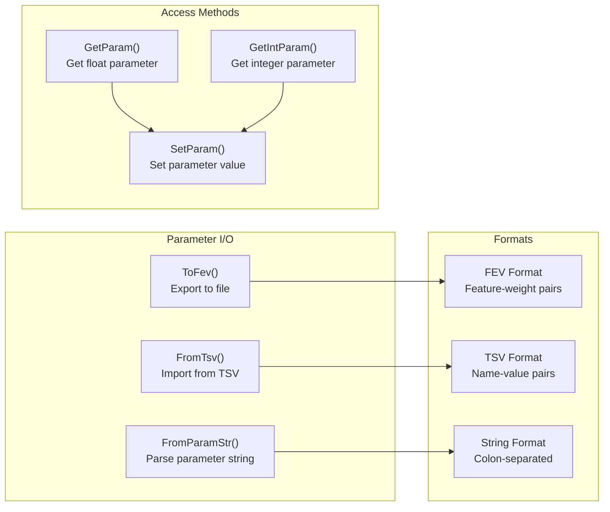
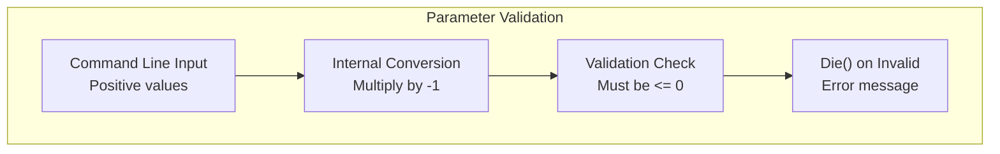

# Parameter Configuration

Relevant source files

The following files were used as context for generating this wiki page:

- [src/dssparams.cpp](src/dssparams.cpp)
- [src/dssparams.h](src/dssparams.h)
- [src/namedparams.cpp](src/namedparams.cpp)

This document covers the parameter configuration system in reseek, specifically the `DSSParams` class and its role in controlling the behavior of the core alignment engine. The parameter system provides three algorithm modes with different speed-accuracy tradeoffs, configurable feature weights, gap penalties, and filtering thresholds.

For information about the alignment algorithms themselves, see [DSSAligner Class](#3.1). For command-line options and usage, see [Commands and Options](#6.1).

## DSSParams Class Overview

The `DSSParams` class serves as the central configuration hub for the alignment engine. It manages algorithm mode selection, feature weights, scoring matrices, gap penalties, and various filtering parameters that control the speed-accuracy tradeoff of the search process.

Sources: [src/dssparams.h:27-118](), [src/dssparams.cpp:44-110]()

## Algorithm Modes

The system provides three predefined algorithm modes that balance speed and sensitivity by adjusting filtering parameters:

| Mode | Speed | Sensitivity | Omega | OmegaFwd | MKFL | Use Case |
|------|-------|-------------|-------|----------|------|----------|
| **Fast** | Highest | Lowest | 22 | 50 | 500 | Large-scale screening |
| **Sensitive** | Medium | Medium | 12 | 20 | 600 | Balanced searches |
| **VerySensitive** | Lowest | Highest | 0 | 0 | 99999 | Exhaustive searches |

Sources: [src/dssparams.cpp:16-84](), [src/dssparams.h:8-25]()

## Parameter Configuration Methods

The `DSSParams` class provides multiple methods for configuring parameters:

### Command-Line Parameter Override

After setting the algorithm mode, individual parameters can be overridden using command-line options:

Sources: [src/dssparams.cpp:92-110]()

### TSV File Loading

Parameters can be loaded from tab-separated value files containing parameter name-value pairs:

Sources: [src/dssparams.cpp:112-127]()

## Feature Weights and Scoring

The system uses weighted combinations of structural features for alignment scoring:

### Default Feature Set

The default configuration includes 8 features with optimized weights:

| Feature | Weight | Description |
|---------|--------|-------------|
| `FEATURE_AA` | 0.398145 | Amino acid sequence similarity |
| `FEATURE_NENDist` | 0.129367 | N-terminus to C-terminus distance |
| `FEATURE_Conf` | 0.202354 | Conformational similarity |
| `FEATURE_NENConf` | 0.149383 | N-terminus to C-terminus conformational similarity |
| `FEATURE_RENDist` | 0.0937677 | Relative distance features |
| `FEATURE_DstNxtHlx` | 0.00475462 | Distance to next helix |
| `FEATURE_StrandDens` | 0.0183853 | Beta strand density |
| `FEATURE_NormDens` | 0.00384384 | Normalized density |

### Scoring Matrix Generation

Sources: [src/namedparams.cpp:32-53](), [src/dssparams.cpp:271-296](), [src/dssparams.cpp:343-363]()

## MuFilter Parameters

The system uses a specialized mu-filtering system with three features for fast pre-screening:

### Mu Features Configuration

Sources: [src/dssparams.cpp:7-14](), [src/dssparams.h:69-72]()

## Parameter Persistence

The system provides methods for saving and loading parameter configurations:

### Parameter Export/Import

Sources: [src/dssparams.cpp:129-145](), [src/dssparams.cpp:154-215](), [src/namedparams.cpp:4-30]()

## Parameter Validation

The system includes validation for critical parameters:

### Gap Penalty Validation

Gap penalties must be non-positive values (represented as negative numbers internally):

The validation ensures that gap opening and extension penalties are properly specified as non-negative values on the command line but stored as negative values internally for the alignment algorithm.

Sources: [src/dssparams.cpp:105-108]()

---