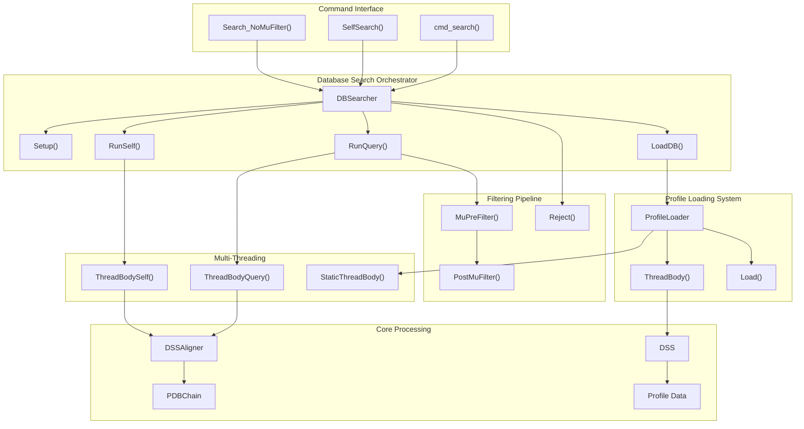
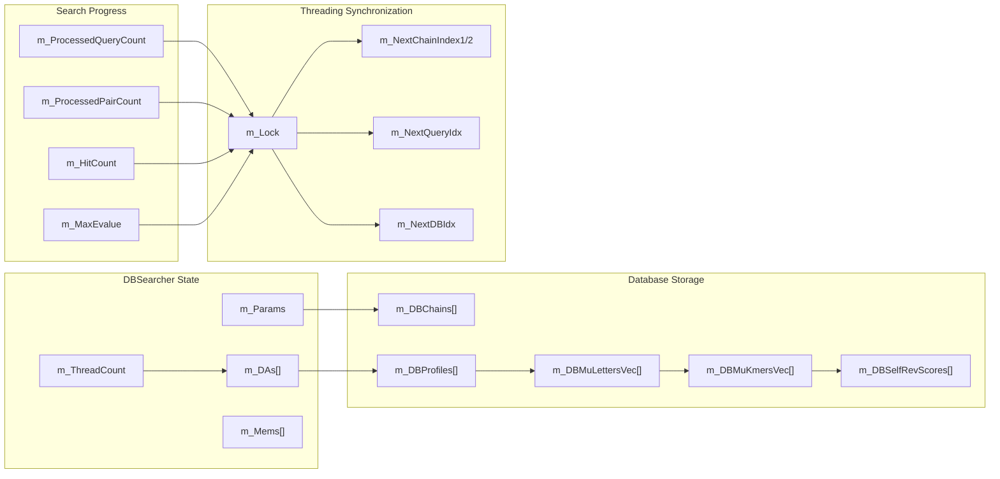
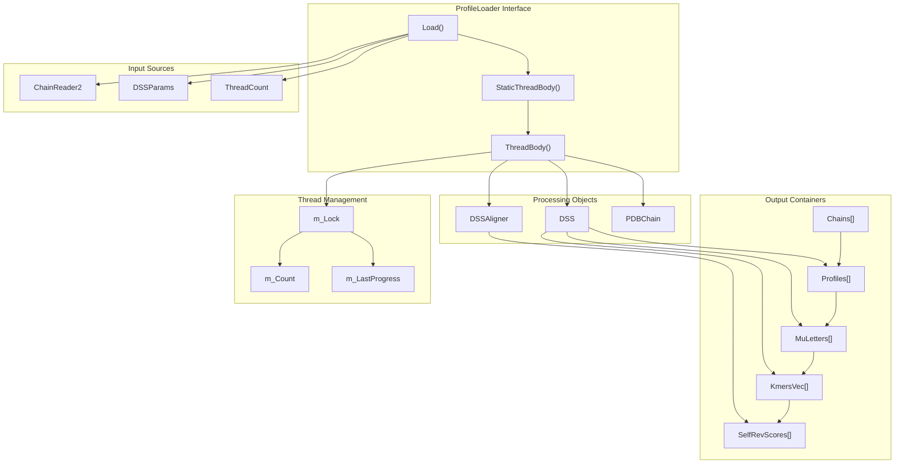
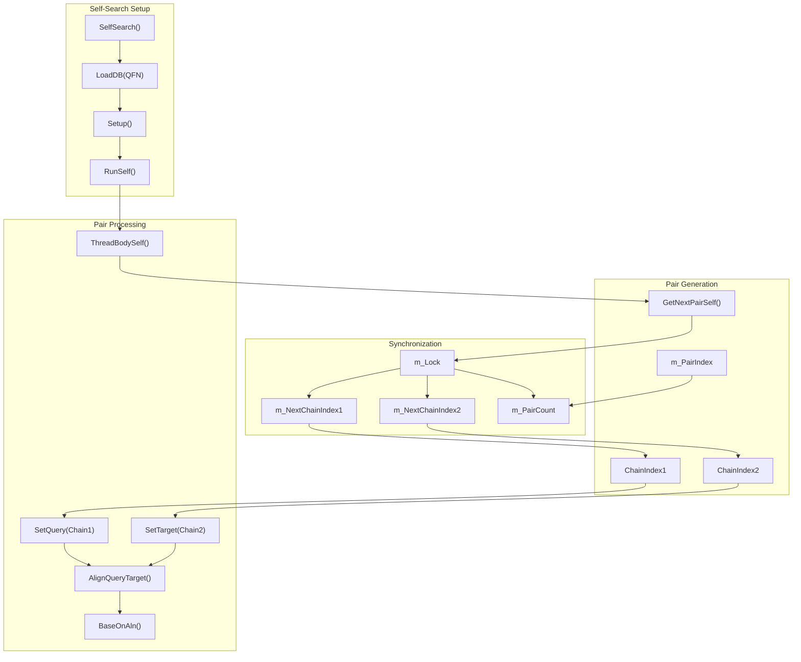
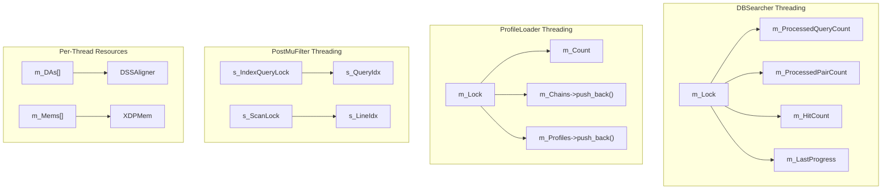
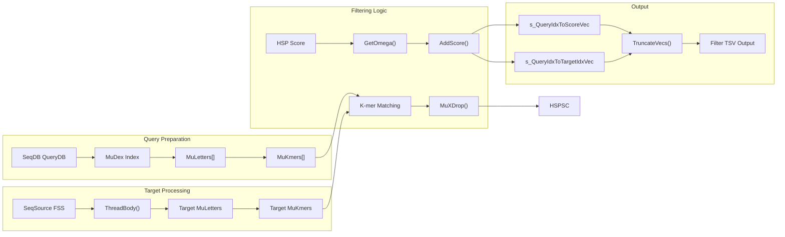
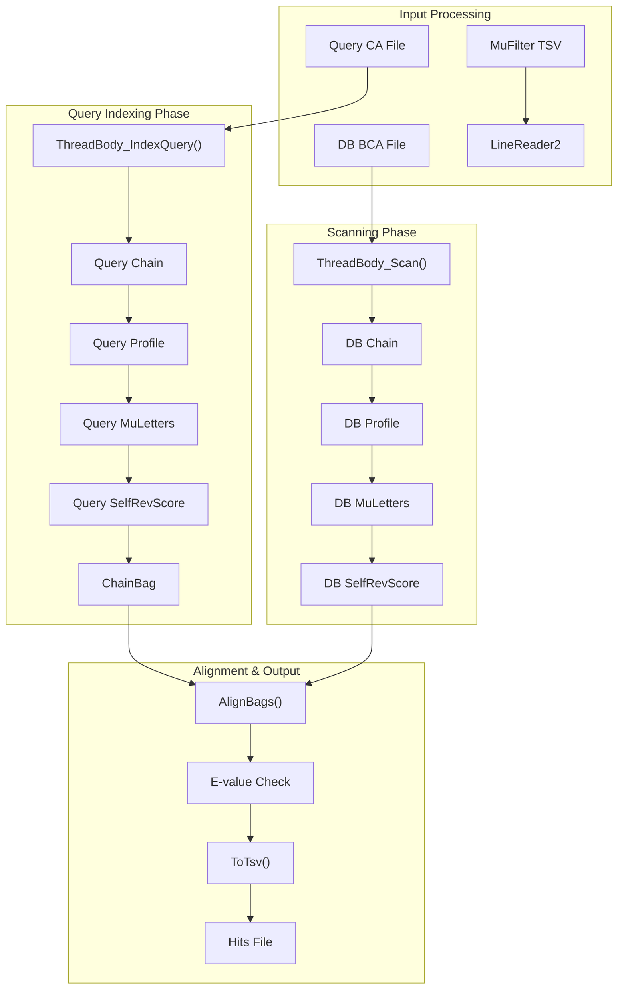
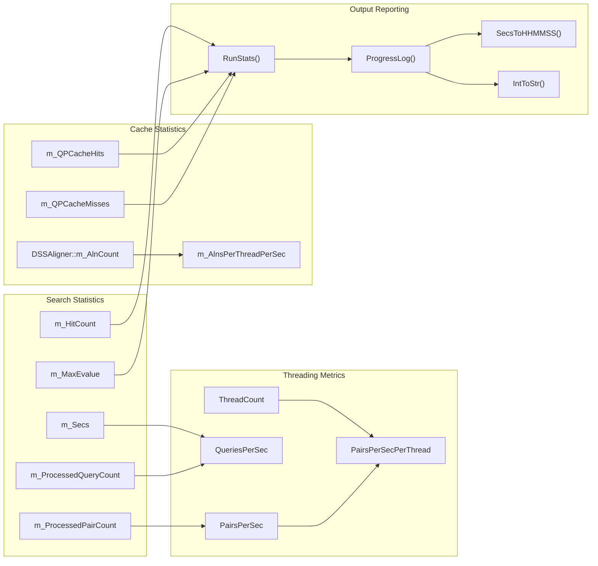

# Database Search System

Relevant source files

The following files were used as context for generating this wiki page:

- [src/dbsearcher.cpp](src/dbsearcher.cpp)
- [src/dbsearcher.h](src/dbsearcher.h)
- [src/mufilter.cpp](src/mufilter.cpp)
- [src/postmufilter.cpp](src/postmufilter.cpp)
- [src/profileloader.cpp](src/profileloader.cpp)
- [src/profileloader.h](src/profileloader.h)
- [src/runquery.cpp](src/runquery.cpp)
- [src/search.cpp](src/search.cpp)

## Purpose and Scope

The Database Search System is the core component responsible for performing protein structure searches against databases of protein chains. It orchestrates multi-threaded database loading, query processing, and filtering operations to efficiently find structurally similar proteins. This system handles both query-versus-database searches and self-searches (all-versus-all comparisons within a single database).

For information about the underlying alignment algorithms, see [Core Alignment Engine](#3). For details about data format handling, see [Data Processing and Formats](#5).

## Architecture Overview

The Database Search System employs a multi-stage architecture designed for scalability and performance:

**Database Search System Architecture**

Sources: [src/search.cpp:1-116](), [src/dbsearcher.h:14-109](), [src/dbsearcher.cpp:1-283](), [src/profileloader.h:8-37]()

## Core Components

### DBSearcher Class

The `DBSearcher` class serves as the primary orchestrator for database search operations:

| Component | Purpose | Key Methods |
|-----------|---------|-------------|
| Database Management | Loads and manages database chains | `LoadDB()`, `GetDBChainCount()` |
| Threading Control | Manages multi-threaded execution | `ThreadBodyQuery()`, `ThreadBodySelf()` |
| Search Orchestration | Coordinates query and self-search modes | `RunQuery()`, `RunSelf()` |
| Result Filtering | Applies E-value and statistical filters | `Reject()`, `BaseOnAln()` |

**DBSearcher Class Structure**

Sources: [src/dbsearcher.h:14-109](), [src/dbsearcher.cpp:12-283]()

### ProfileLoader Class

The `ProfileLoader` handles multi-threaded loading of protein chain profiles:

**ProfileLoader Multi-threading Architecture**

Sources: [src/profileloader.cpp:1-112](), [src/profileloader.h:8-37]()

## Search Workflow

The database search follows a structured workflow depending on the search mode:

### Query vs Database Search

```mermaid
graph TD
    subgraph "Initialization"
        LOADDB["LoadDB(DBFN)"]
        SETUP["Setup()"]
        STATSIG["StatSig::Init()"]
    end
    
    subgraph "Query Processing"
        OPENQUERY["Open Query CR"]
        RUNQUERY["RunQuery(CR)"]
        THREADBODY["ThreadBodyQuery()"]
    end
    
    subgraph "Per-Query Processing"
        GETCHAIN["GetNext() Chain"]
        INITDSS["D.Init(*Chain)"]
        GETPROFILE["D.GetProfile()"]
        GETMULETTERS["D.GetMuLetters()"]
        GETMUKMERS["D.GetMuKmers()"]
        SETQUERY["DA.SetQuery()"]
    end
    
    subgraph "Database Scanning"
        DBLOOP["for DBChainIdx in DB"]
        SETTARGET["DA.SetTarget()"]
        ALIGN["DA.AlignQueryTarget()"]
        BASEONALN["BaseOnAln()"]
        REJECT["Reject()"]
    end
    
    subgraph "Output"
        TOTSV["DA.ToTsv()"]
        TOALN["DA.ToAln()"]
        TOFASTA["DA.ToFasta2()"]
    end
    
    LOADDB --> SETUP
    SETUP --> STATSIG
    STATSIG --> OPENQUERY
    OPENQUERY --> RUNQUERY
    RUNQUERY --> THREADBODY
    
    THREADBODY --> GETCHAIN
    GETCHAIN --> INITDSS
    INITDSS --> GETPROFILE
    GETPROFILE --> GETMULETTERS
    GETMULETTERS --> GETMUKMERS
    GETMUKMERS --> SETQUERY
    
    SETQUERY --> DBLOOP
    DBLOOP --> SETTARGET
    SETTARGET --> ALIGN
    ALIGN --> BASEONALN
    BASEONALN --> REJECT
    
    REJECT --> TOTSV
    TOTSV --> TOALN
    TOALN --> TOFASTA
```

**Query vs Database Search Workflow**

Sources: [src/search.cpp:40-62](), [src/runquery.cpp:18-125]()

### Self-Search Mode

**Self-Search Workflow**

Sources: [src/search.cpp:20-38](), [src/runself.cpp:1-100]()

## Multi-Threading Model

The system employs a sophisticated multi-threading approach across multiple components:

### Thread Distribution

| Component | Thread Function | Purpose |
|-----------|----------------|---------|
| ProfileLoader | `StaticThreadBody()` | Load chain profiles in parallel |
| DBSearcher Query | `ThreadBodyQuery()` | Process query chains against DB |
| DBSearcher Self | `ThreadBodySelf()` | Process chain pairs in self-search |
| PostMuFilter | `ThreadBody_IndexQuery()` | Index queries for post-filtering |
| PostMuFilter | `ThreadBody_Scan()` | Scan filtered pairs |

### Thread Synchronization

**Multi-Threading Synchronization Model**

Sources: [src/dbsearcher.cpp:73-115](), [src/profileloader.cpp:41-70](), [src/postmufilter.cpp:36-101]()

## Filtering Pipeline

The system implements a two-stage filtering approach for efficient search:

### Pre-filtering (MuFilter)

**Pre-filtering Pipeline (MuFilter)**

Sources: [src/mufilter.cpp:313-569]()

### Post-filtering (PostMuFilter)

**Post-filtering Pipeline (PostMuFilter)**

Sources: [src/postmufilter.cpp:194-308]()

## Performance Monitoring

The system provides comprehensive performance tracking:

### Statistics Collection

**Performance Monitoring System**

Sources: [src/dbsearcher.cpp:29-56](), [src/runquery.cpp:118-125]()

---