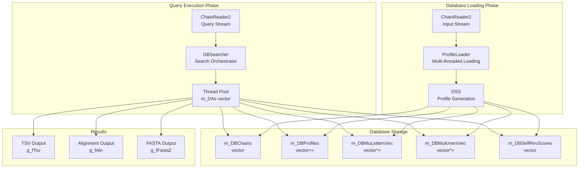
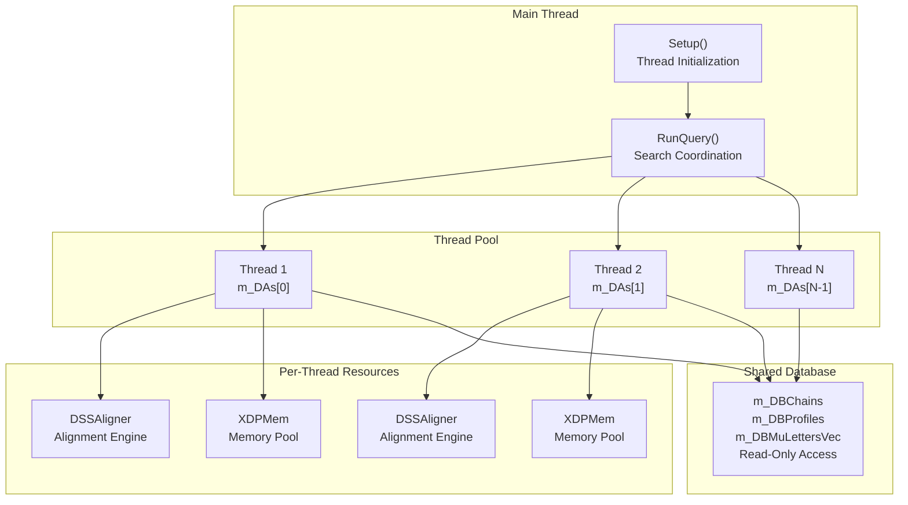
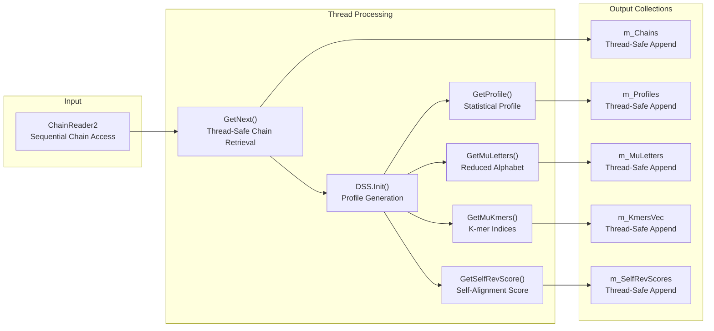

# DBSearcher and ProfileLoader

<details>
<summary>Relevant source files</summary>

The following files were used as context for generating this wiki page:

- [src/dbsearcher.cpp](src/dbsearcher.cpp)
- [src/dbsearcher.h](src/dbsearcher.h)
- [src/profileloader.cpp](src/profileloader.cpp)
- [src/profileloader.h](src/profileloader.h)
- [src/runquery.cpp](src/runquery.cpp)

</details>


## Purpose and Scope

The `DBSearcher` and `ProfileLoader` classes form the core database search system in reseek, responsible for loading protein structure databases and executing multi-threaded searches against them. `DBSearcher` orchestrates the entire search process, while `ProfileLoader` handles the multi-threaded loading of database chains and their derived profiles.

For information about the core alignment algorithms used by these classes, see [DSSAligner Class](#3.1). For details about the filtering pipeline that works with the search system, see [Filtering Pipeline](#4.2).

## Architecture Overview

The database search system operates as a two-phase process: database loading followed by query execution. The `ProfileLoader` handles the computationally intensive task of converting raw protein chains into searchable profiles, while `DBSearcher` manages the search execution across multiple threads.



**Database Loading and Search Architecture**

Sources: [src/dbsearcher.h:1-110](), [src/dbsearcher.cpp:242-256](), [src/profileloader.h:1-38](), [src/profileloader.cpp:73-111]()

## DBSearcher Class Structure

The `DBSearcher` class serves as the primary coordinator for database searches, managing both the database loading process and query execution phases.

### Core Data Members

| Member | Type | Purpose |
|--------|------|---------|
| `m_Params` | `const DSSParams*` | Algorithm configuration parameters |
| `m_ThreadCount` | `uint` | Number of worker threads |
| `m_DAs` | `vector<DSSAligner*>` | Per-thread alignment engines |
| `m_DBChains` | `vector<PDBChain*>` | Database protein chains |
| `m_DBProfiles` | `vector<vector<vector<byte>>*>` | Pre-computed profiles |
| `m_DBMuLettersVec` | `vector<vector<byte>*>` | Reduced alphabet representations |
| `m_DBMuKmersVec` | `vector<vector<uint>*>` | K-mer indices for filtering |
| `m_Lock` | `mutex` | Thread synchronization |

### Key Methods

The `DBSearcher` class provides several key methods for database operations:

- `LoadDB(const string &DBFN)` - Loads database using `ProfileLoader`
- `RunQuery(ChainReader2 &QCR)` - Executes query search with threading
- `RunSelf()` - Performs all-vs-all database comparison
- `Setup()` - Initializes thread pool and alignment engines
- `ThreadBodyQuery(uint ThreadIndex, ChainReader2 *ptrQueryCR)` - Worker thread implementation

Sources: [src/dbsearcher.h:14-109](), [src/dbsearcher.cpp:73-115]()

### Threading Model

The `DBSearcher` implements a multi-threaded architecture where each thread maintains its own `DSSAligner` instance and memory pool:



**Multi-threaded Search Architecture**

Sources: [src/dbsearcher.cpp:98-106](), [src/runquery.cpp:82-125]()

## ProfileLoader Class Structure

The `ProfileLoader` class handles the multi-threaded conversion of raw protein chains into searchable profiles and derived data structures.

### Core Functionality

The `ProfileLoader::Load()` method coordinates the loading process:

```cpp
void Load(
  const DSSParams &Params,
  ChainReader2 &CR,
  vector<PDBChain *> *Chains,
  vector<vector<vector<byte> > *> *Profiles,
  vector<vector<byte> *> *MuLetters,
  vector<vector<uint> *> *KmersVec,
  vector<float> *SelfRevScores,
  uint ThreadCount)
```

### Thread Body Implementation

Each worker thread in `ProfileLoader` performs the following operations:

1. **Chain Reading**: Retrieves next chain from `ChainReader2`
2. **Profile Generation**: Creates statistical profiles using `DSS`
3. **MuLetters Generation**: Computes reduced alphabet representation
4. **MuKmers Generation**: Generates k-mer indices for filtering
5. **Self-Reverse Score**: Calculates self-alignment score for normalization

Sources: [src/profileloader.cpp:17-71](), [src/profileloader.h:24-32]()

### Data Flow Pipeline



**ProfileLoader Processing Pipeline**

Sources: [src/profileloader.cpp:30-70]()

## Query Execution Process

The query execution process in `DBSearcher` follows a systematic approach where query chains are processed against the entire database:

### Query Thread Implementation

Each query thread processes chains sequentially:

1. **Query Setup**: Load and process query chain using `DSS`
2. **Database Iteration**: Compare against all database chains
3. **Alignment**: Use `DSSAligner` for pairwise comparison
4. **Result Output**: Generate results if alignment passes thresholds

### Performance Tracking

The `DBSearcher` maintains comprehensive performance statistics:

| Metric | Member | Purpose |
|--------|--------|---------|
| `m_ProcessedQueryCount` | `atomic<uint>` | Total queries processed |
| `m_ProcessedPairCount` | `atomic<uint>` | Total pairwise comparisons |
| `m_HitCount` | `atomic<uint>` | Alignments passing thresholds |
| `m_QPCacheHits` | `atomic<uint>` | Query-profile cache hits |
| `m_QPCacheMisses` | `atomic<uint>` | Query-profile cache misses |

Sources: [src/runquery.cpp:18-80](), [src/dbsearcher.cpp:29-56]()

## Statistical Calibration Support

The `DBSearcher` supports two types of statistical calibration for accurate E-value computation:

### Slope Calibration
When `SLOPE_CALIB` is enabled, the system loads calibrated slopes for each database chain:
- `m_ms` and `m_bs` vectors store slope parameters
- `LoadCalibratedSlopes()` reads calibration data from file
- Used for computing: `PredMinusLogP = m*TS + b`

### Gumbel Calibration
When `GUMBEL_CALIB` is enabled, the system loads Gumbel distribution parameters:
- `m_Gumbel_mus` and `m_Gumbel_betas` vectors store parameters
- `LoadGumbelCalib()` reads calibration data from file
- Used for statistical significance assessment

Sources: [src/dbsearcher.cpp:117-240]()

---