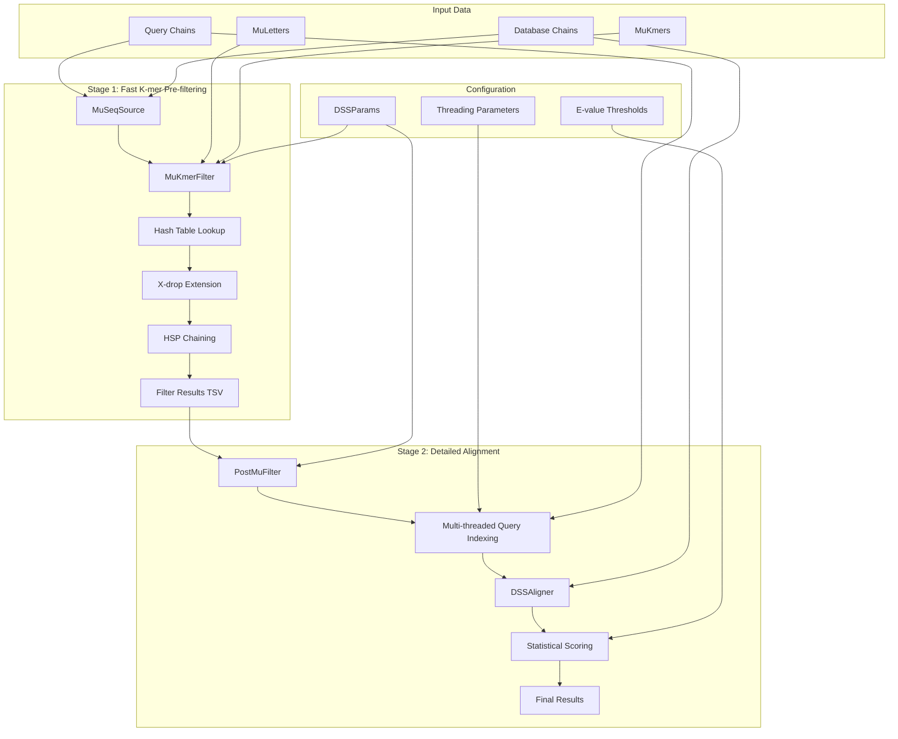
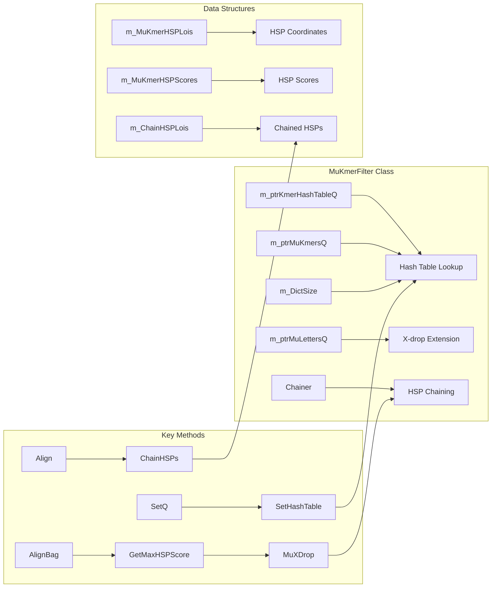
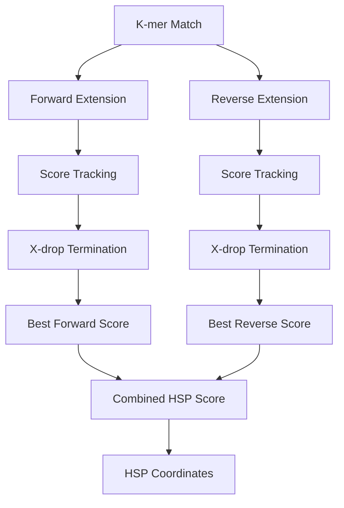
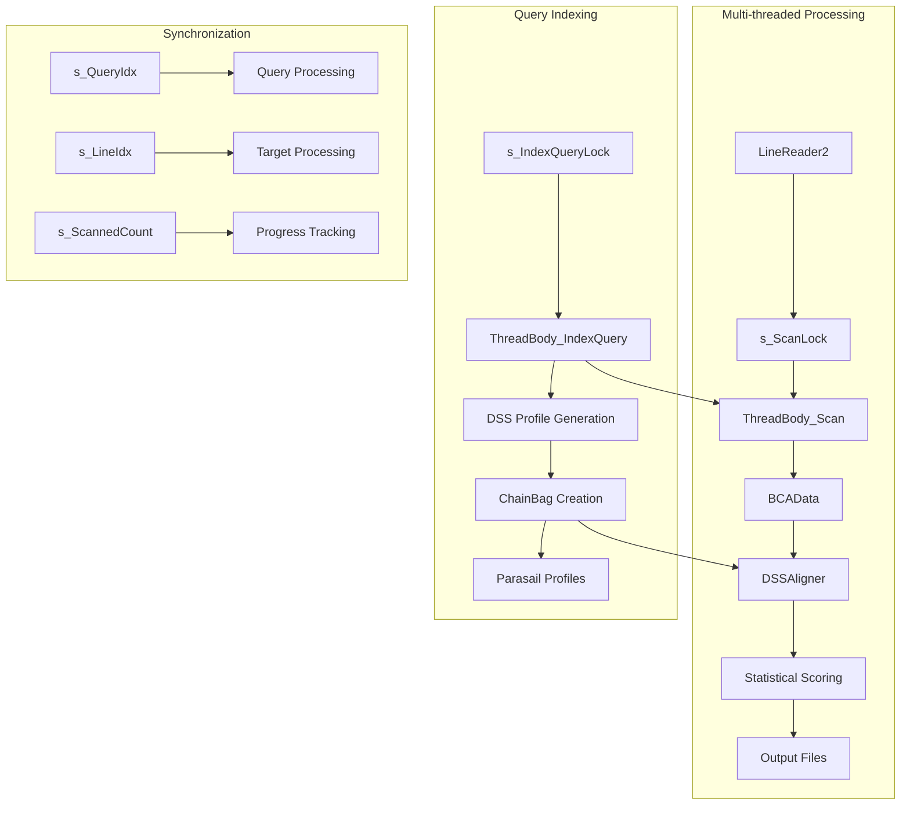
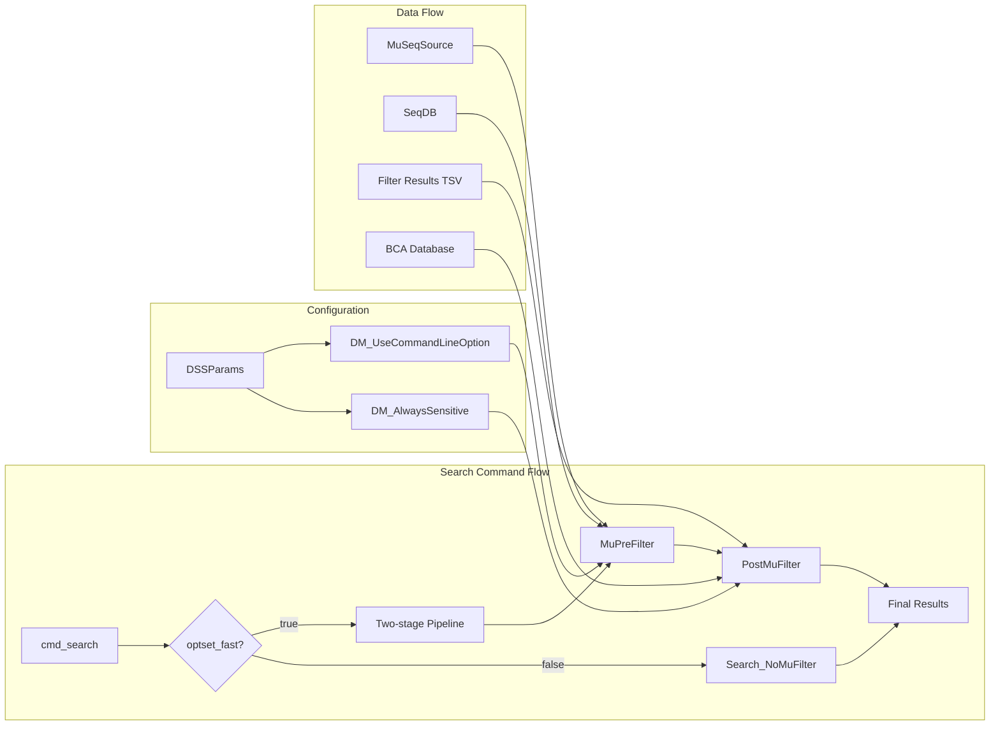

# Filtering Pipeline

<details>
<summary>Relevant source files</summary>

The following files were used as context for generating this wiki page:

- [src/mufilter.cpp](src/mufilter.cpp)
- [src/mukmerfilter.cpp](src/mukmerfilter.cpp)
- [src/mukmerfilter.h](src/mukmerfilter.h)
- [src/mukmerfilter2.cpp](src/mukmerfilter2.cpp)
- [src/postmufilter.cpp](src/postmufilter.cpp)
- [src/search.cpp](src/search.cpp)

</details>


## Purpose and Scope

The filtering pipeline implements a two-stage pre-filtering system designed to efficiently reduce the search space before performing expensive structural alignments. This system balances speed and sensitivity by using fast k-mer matching followed by detailed alignment of promising candidates.

For information about the core alignment algorithms that process the filtered results, see [Core Alignment Engine](#3). For database search orchestration and threading models, see [DBSearcher and ProfileLoader](#4.1).

## Architecture Overview

The filtering pipeline consists of two main stages that work together to identify promising alignment candidates:



**Two-Stage Filtering Architecture**

Sources: [src/search.cpp:64-115](), [src/postmufilter.cpp:195-284](), [src/mukmerfilter.cpp:314-387]()

## Stage 1: MuKmerFilter

The first stage performs rapid k-mer based screening using hash tables and X-drop extension algorithms.

### Core Components



**MuKmerFilter Internal Architecture**

The `MuKmerFilter` class implements the core k-mer matching algorithm:

| Component | Type | Purpose |
|-----------|------|---------|
| `m_ptrKmerHashTableQ` | `uint16_t*` | Hash table for query k-mers |
| `m_DictSize` | `uint` | Size of k-mer dictionary (36^k) |
| `m_ptrMuLettersQ` | `vector<byte>*` | Query sequence in reduced alphabet |
| `m_ptrMuKmersQ` | `vector<uint>*` | Query k-mers |
| `m_C` | `Chainer` | Chains HSPs into longer alignments |

Sources: [src/mukmerfilter.h:9-97](), [src/mukmerfilter.cpp:96-102]()

### X-drop Extension Algorithm

The `MuXDrop` method implements bidirectional X-drop extension from k-mer seeds:



**X-drop Extension Process**

The algorithm extends matches in both directions until the score drops more than X below the best score seen so far. This efficiently identifies high-scoring local alignments without exhaustive dynamic programming.

Sources: [src/mukmerfilter.cpp:104-174]()

## Stage 2: PostMuFilter

The second stage performs detailed structural alignment on candidates identified by the first stage.

### Threading Architecture



**PostMuFilter Threading Model**

The `PostMuFilter` uses a two-phase threading approach:

1. **Index Phase**: Multi-threaded query indexing using `ThreadBody_IndexQuery`
2. **Scan Phase**: Multi-threaded scanning using `ThreadBody_Scan`

Sources: [src/postmufilter.cpp:36-101](), [src/postmufilter.cpp:103-192]()

### Key Data Structures

| Structure | Purpose | Thread Safety |
|-----------|---------|---------------|
| `s_ptrChainBagsQ` | Pre-computed query profiles | Protected by `s_IndexQueryLock` |
| `s_ptrLR` | Line reader for filter results | Protected by `s_ScanLock` |
| `s_fTsv` | Output file handles | Protected by `s_ScanLock` |
| `s_MaxEvalue` | E-value threshold | Read-only after initialization |

Sources: [src/postmufilter.cpp:19-34]()

## Integration with Search System

The filtering pipeline integrates with the broader search system through the `cmd_search` function:



**Search System Integration**

The pipeline is activated when the `--fast` option is specified, using different parameter sets for each stage:
- Stage 1: `DM_UseCommandLineOption` for fast filtering
- Stage 2: `DM_AlwaysSensitive` for accurate alignment

Sources: [src/search.cpp:64-115]()

## Performance Considerations

### Memory Management

The filtering pipeline uses several memory optimization strategies:

| Strategy | Implementation | Benefit |
|----------|---------------|---------|
| Hash Table Reuse | `CreateEmptyHashTable()` | Reduces allocations |
| Profile Caching | `ChainBag` structures | Avoids recomputation |
| Thread-local Storage | Per-thread `DSSAligner` | Eliminates contention |

### Statistical Tracking

The `MuKmerFilter` maintains performance statistics:

```cpp
static uint m_PairCount;
static uint m_PairWithHSPCount;
static uint m_ChainCount;
static uint m_ChainHSPCount;
```

These metrics help optimize the balance between speed and sensitivity.

Sources: [src/mukmerfilter.h:49-55](), [src/mukmerfilter.cpp:456-465]()

### Filtering Thresholds

Key parameters that control the filtering stringency:

| Parameter | Default | Purpose |
|-----------|---------|---------|
| `m_MKF_MinHSPScore` | 30 | Minimum HSP score to retain |
| `m_MKF_X1` | 12 | X-drop threshold |
| `s_MaxEvalue` | 10.0 | E-value cutoff for final results |
| `HASHW` | 4 | Hash table width for collision handling |

Sources: [src/mukmerfilter.cpp:337-338](), [src/postmufilter.cpp:31-32](), [src/mukmerfilter.h:7]()

---