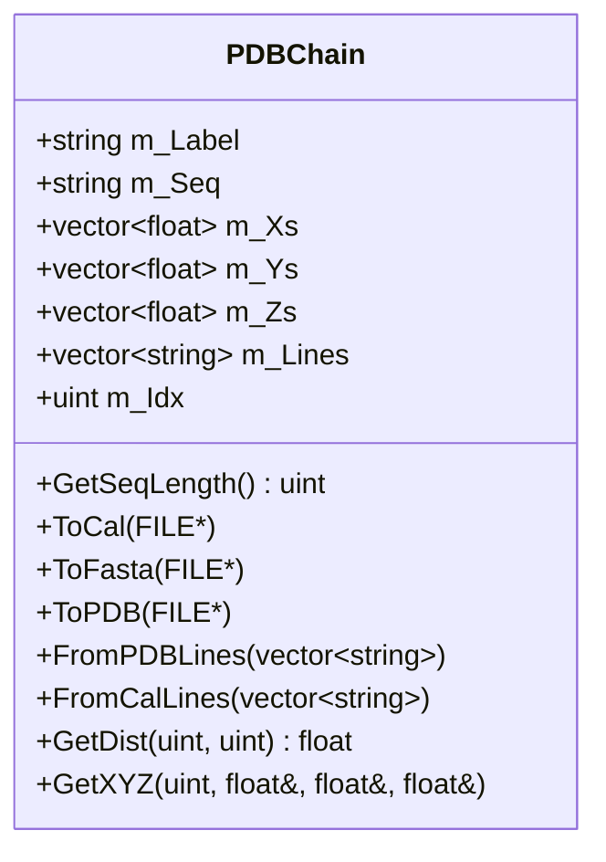
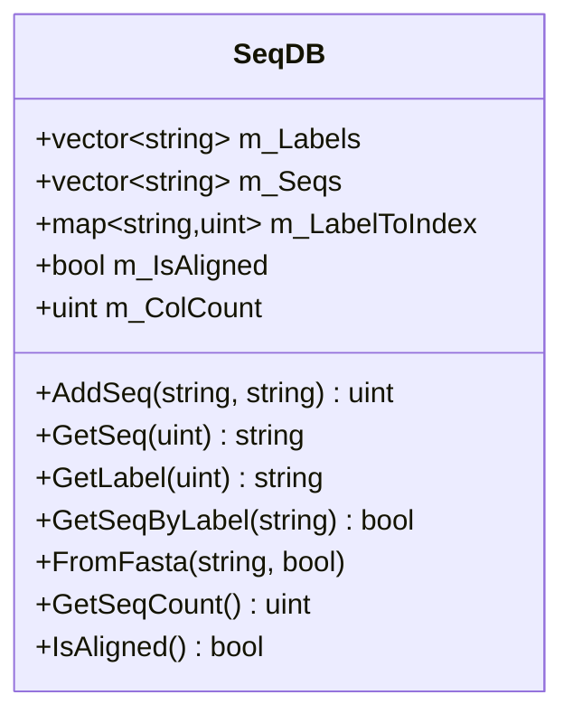
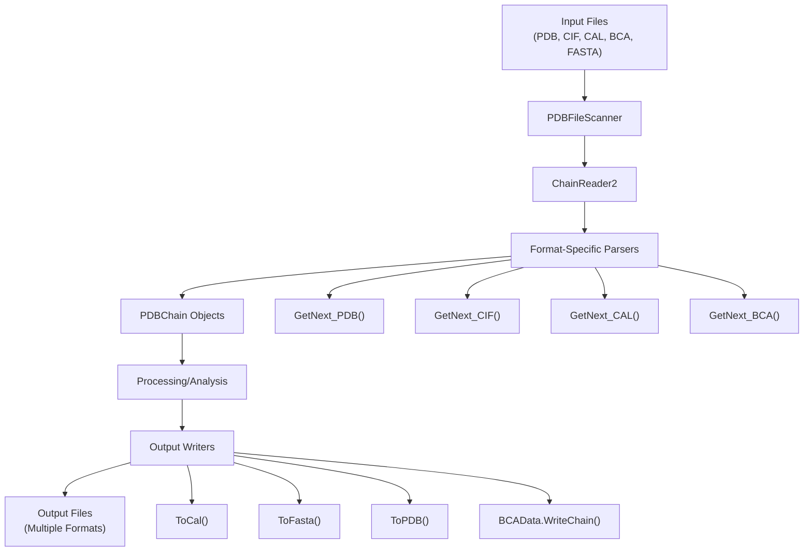
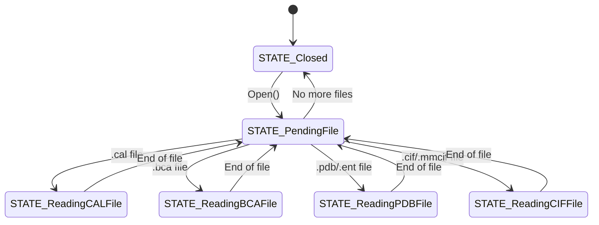
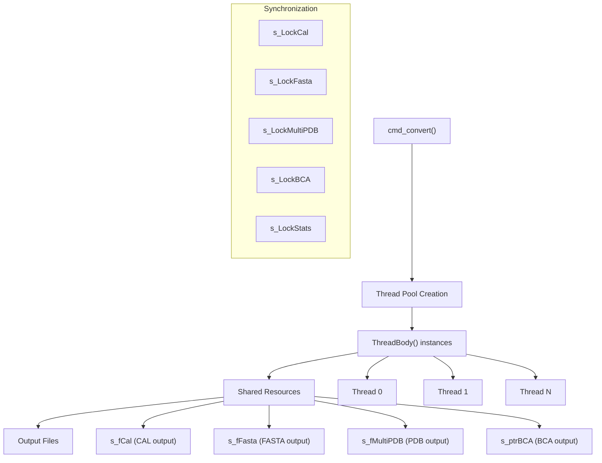

# Data Processing and Formats

<details>
<summary>Relevant source files</summary>

The following files were used as context for generating this wiki page:

- [src/chainreader2.cpp](src/chainreader2.cpp)
- [src/chainreader2.h](src/chainreader2.h)
- [src/cif.cpp](src/cif.cpp)
- [src/convert.cpp](src/convert.cpp)
- [src/msta_scores.cpp](src/msta_scores.cpp)
- [src/pdbchain.cpp](src/pdbchain.cpp)
- [src/pdbchain.h](src/pdbchain.h)
- [src/seqdb.cpp](src/seqdb.cpp)
- [src/seqdb.h](src/seqdb.h)

</details>


This document covers the data processing pipeline and file format handling systems in reseek. It describes the supported input/output formats, core data structures for representing protein chains, and the unified processing architecture that converts between different structural biology file formats.

For specific details about the conversion commands and utilities, see [Format Conversion System](#5.1). For information about the internal data structures and chain management, see [Sequence and Structure Data](#5.2).

## Supported File Formats

Reseek supports multiple structural biology file formats for both input and output:

| Format | Extension | Type | Description |
|--------|-----------|------|-------------|
| PDB | `.pdb`, `.ent` | Text | Legacy Protein Data Bank format |
| CIF/mmCIF | `.cif`, `.mmcif` | Text | Modern crystallographic format |
| CAL | `.cal` | Text | C-alpha coordinate format |
| BCA | `.bca` | Binary | Binary C-alpha format |
| FASTA | `.fasta`, `.fa` | Text | Sequence-only format |

The system handles both compressed (`.gz`) and uncompressed versions of these formats automatically.

Sources: [src/chainreader2.cpp:49-87](), [src/convert.cpp:248-376]()

## Core Data Structures

### PDBChain Class

The `PDBChain` class serves as the universal internal representation for protein structures:



Key components:
- **Sequence data**: `m_Seq` stores the amino acid sequence
- **Coordinates**: `m_Xs`, `m_Ys`, `m_Zs` store C-alpha coordinates
- **Metadata**: `m_Label` for chain identification, `m_Lines` for original file content
- **Conversion methods**: `ToCal()`, `ToFasta()`, `ToPDB()` for format output

Sources: [src/pdbchain.h:10-95](), [src/pdbchain.cpp:1-498]()

### SeqDB Class

The `SeqDB` class manages collections of sequences for analysis:



Sources: [src/seqdb.h:9-62](), [src/seqdb.cpp:9-373]()

## Processing Pipeline Architecture

The data processing pipeline follows a multi-stage architecture:



### Key Processing Components

1. **PDBFileScanner**: Discovers and queues input files
2. **ChainReader2**: Universal file reader with format detection
3. **Format-specific parsers**: Handle PDB, CIF, CAL, BCA formats
4. **PDBChain**: Universal internal representation
5. **Output writers**: Generate multiple output formats

Sources: [src/chainreader2.cpp:21-367](), [src/convert.cpp:74-246]()

## ChainReader2 State Machine

The `ChainReader2` class implements a state machine for processing different file formats:



Each state corresponds to a specific file format parser with dedicated `GetNext_*()` methods.

Sources: [src/chainreader2.h:12-21](), [src/chainreader2.cpp:116-184]()

## Multi-threaded Conversion System

The conversion system uses a thread-safe architecture for high-performance processing:



Thread safety is ensured through mutex locks for shared resources:
- `s_LockCal`: Protects CAL file writing
- `s_LockFasta`: Protects FASTA file writing  
- `s_LockMultiPDB`: Protects multi-PDB file writing
- `s_LockBCA`: Protects BCA file writing
- `s_LockStats`: Protects progress statistics

Sources: [src/convert.cpp:8-33](), [src/convert.cpp:314-325]()

## Format-Specific Processing

### PDB Format Processing

PDB files are processed using `GetFieldsFromATOMLine()` to extract:
- Atom coordinates from columns 31-54
- Amino acid type from columns 18-20
- Chain identifier from column 22
- Atom name filtering (CA atoms only)

Sources: [src/pdbchain.cpp:231-263]()

### CIF Format Processing

CIF/mmCIF files use a tabular parser that:
1. Identifies `loop_` sections with `_atom_site.*` fields
2. Maps field names to column indices
3. Extracts data from ATOM records
4. Handles model numbers and chain identifiers

Sources: [src/cif.cpp:133-309]()

### CAL Format Processing

CAL format uses a simple tab-delimited structure:
```
>chain_label
AA    X_coord    Y_coord    Z_coord
M     43.619     -1.924     8.869
N     40.445     -0.876     10.670
```

Sources: [src/chainreader2.cpp:224-288]()

### BCA Format Processing

BCA format provides binary storage for efficient access:
- Uses `BCAData` class for reading/writing
- Supports random access by chain index
- Compressed coordinate representation

Sources: [src/chainreader2.cpp:204-222]()

## Output Generation

The system supports multiple output formats simultaneously:

| Output Type | Implementation | Thread Safety |
|-------------|----------------|---------------|
| CAL | `PDBChain::ToCal()` | `s_LockCal` |
| FASTA | `PDBChain::ToFasta()` | `s_LockFasta` |
| Multi-PDB | `PDBChain::ToPDB()` | `s_LockMultiPDB` |
| BCA | `BCAData::WriteChain()` | `s_LockBCA` |
| Feature FASTA | DSS feature extraction | `s_LockFasta` |

Sources: [src/convert.cpp:157-238](), [src/pdbchain.cpp:152-188]()

---