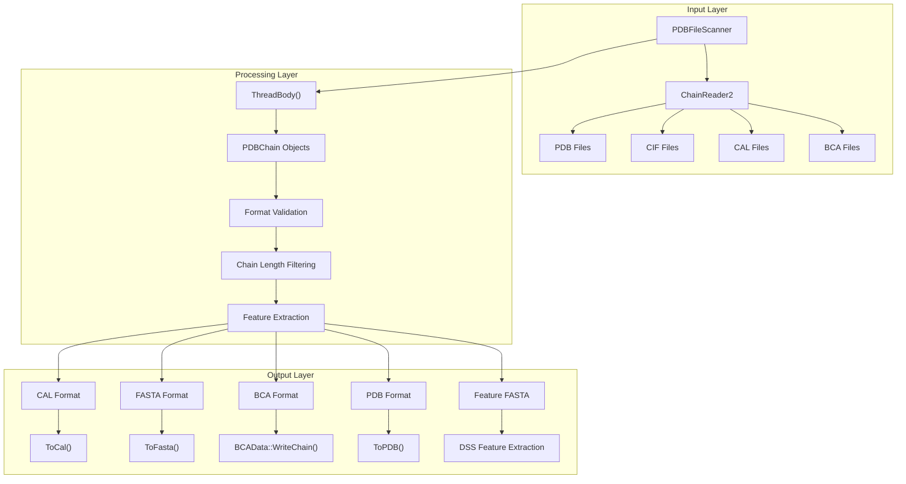
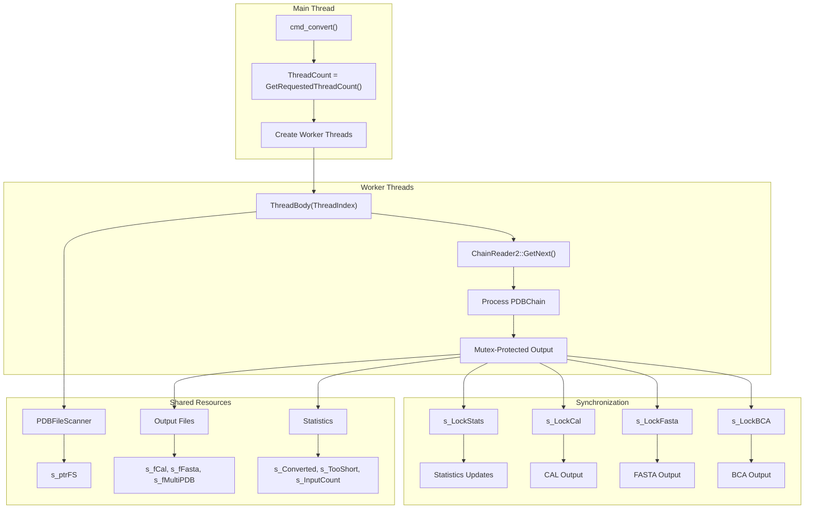
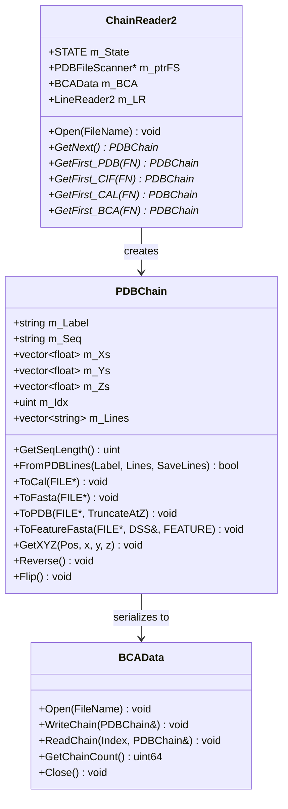
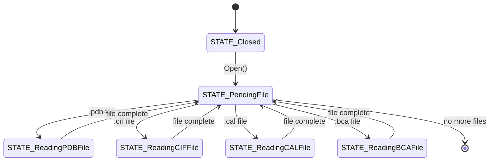
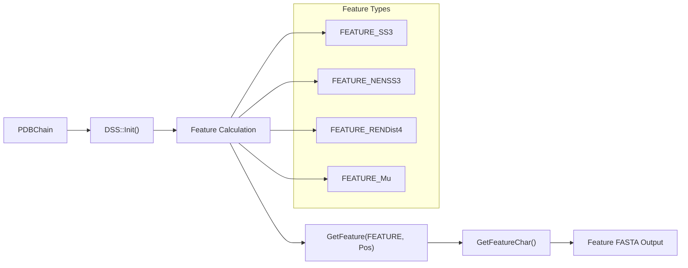
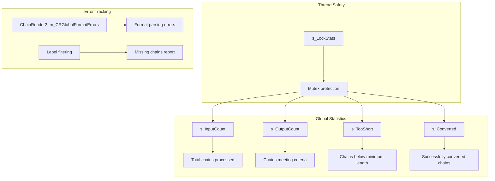

# Format Conversion System

<details>
<summary>Relevant source files</summary>

The following files were used as context for generating this wiki page:

- [src/chainreader2.cpp](src/chainreader2.cpp)
- [src/chainreader2.h](src/chainreader2.h)
- [src/cif.cpp](src/cif.cpp)
- [src/convert.cpp](src/convert.cpp)
- [src/pdbchain.cpp](src/pdbchain.cpp)
- [src/pdbchain.h](src/pdbchain.h)

</details>


The Format Conversion System provides comprehensive conversion capabilities between multiple protein structure data formats. This system handles the ingestion, processing, and output of protein chain data in formats including PDB, CIF, CAL, BCA, and FASTA. It serves as the primary data preprocessing pipeline for the reseek structural search engine.

For information about the core alignment algorithms that process converted data, see [Core Alignment Engine](#3). For details about database search operations using converted formats, see [Database Search System](#4).

## System Overview

The format conversion system is implemented primarily through the `cmd_convert()` function and supporting classes. It employs a multi-threaded architecture to efficiently process large datasets while maintaining data integrity through mutex-protected operations.

## Core Architecture

### Conversion Pipeline



The conversion pipeline processes input files through a state machine implemented in `ChainReader2`, converts them to `PDBChain` objects, and outputs them in the requested formats.

Sources: [src/convert.cpp:248-376](), [src/chainreader2.cpp:90-184]()

### Threading Model



The system uses multiple worker threads that share a common file scanner and synchronize access to output files and statistics through dedicated mutexes.

Sources: [src/convert.cpp:74-246](), [src/convert.cpp:315-325]()

## Format Support Matrix

| Input Format | Extension | Reader Method | Output Formats |
|--------------|-----------|---------------|----------------|
| PDB | `.pdb`, `.pdb.gz`, `.ent`, `.ent.gz` | `GetFirst_PDB()` | CAL, FASTA, BCA, PDB, Feature FASTA |
| CIF/mmCIF | `.cif`, `.cif.gz`, `.mmcif`, `.mmcif.gz` | `GetFirst_CIF()` | CAL, FASTA, BCA, PDB, Feature FASTA |
| CAL | `.cal` | `GetFirst_CAL()` | CAL, FASTA, BCA, PDB, Feature FASTA |
| BCA | `.bca` | `GetFirst_BCA()` | CAL, FASTA, BCA, PDB, Feature FASTA |

Sources: [src/chainreader2.cpp:49-88]()

## Core Data Structures

### PDBChain Class



The `PDBChain` class serves as the central data structure, containing both sequence information and 3D coordinates. It provides methods for conversion to all supported output formats.

Sources: [src/pdbchain.h:10-91](), [src/pdbchain.cpp:110-498]()

### State Machine Implementation



The `ChainReader2` class implements a state machine that handles the sequential processing of multiple files and formats within each file.

Sources: [src/chainreader2.h:12-21](), [src/chainreader2.cpp:116-184]()

## Format-Specific Processing

### CAL Format Processing

CAL (C-Alpha List) format stores protein chains as tab-separated values with amino acid and coordinates:

```
>102l
M    43.619  -1.924  8.869
N    40.445  -0.876  10.670
I    38.254   2.240  11.220
```

The `GetNext_CAL()` method processes these files line by line, extracting amino acid sequences and 3D coordinates.

Sources: [src/chainreader2.cpp:234-288]()

### CIF Format Processing

CIF (Crystallographic Information Format) parsing involves:

1. **Parser State Machine**: `PS_WaitingForLoop` → `PS_AtLoop` → `PS_InFieldList` → `PS_InATOMs` → `PS_Finished`
2. **Field Mapping**: Dynamic field index resolution using `FieldToIdx` map
3. **Required Fields**: `_atom_site.auth_asym_id`, `_atom_site.label_atom_id`, `_atom_site.Cartn_x/y/z`

Sources: [src/cif.cpp:124-310]()

### BCA Format Processing

BCA (Binary C-Alpha) format provides efficient storage for large datasets:

- **Binary serialization** of coordinate data
- **Random access** capability through `ChainIdx_BCA`
- **Compact storage** using 16-bit integer coordinates via `CoordToIC()` conversion

Sources: [src/chainreader2.cpp:204-222](), [src/pdbchain.cpp:423-471]()

## Feature Extraction

### DSS Feature Processing

When outputting feature FASTA, the system uses the `DSS` class for structural feature extraction:



The `GetFeatureFromCmdLine()` function maps command-line alphabet specifications to internal feature types.

Sources: [src/convert.cpp:34-72](), [src/convert.cpp:185-203]()

## Error Handling and Statistics

The system maintains comprehensive statistics and error tracking:

- **Format Errors**: Tracked via `ChainReader2::m_CRGlobalFormatErrors`
- **Chain Filtering**: Minimum length filtering with `MinChainLength`
- **Progress Reporting**: Thread-safe progress updates with statistics
- **Label Filtering**: Optional filtering by specific chain labels

### Statistics Tracking



Sources: [src/convert.cpp:89-108](), [src/convert.cpp:327-368]()

## Command-Line Interface

The format conversion system integrates with the broader command-line interface supporting:

- **Input specification**: Single files or directories via `g_Arg1`
- **Output format selection**: Multiple simultaneous output formats
- **Feature extraction**: Configurable alphabet types for feature FASTA
- **Threading control**: Automatic thread count determination
- **Filtering options**: Chain length, label filtering, coordinate transformations

Key options processed by `cmd_convert()`:
- `opt(cal)`, `opt(fasta)`, `opt(bca)` - Output file specifications
- `opt(minchainlength)` - Minimum chain length filter
- `opt(alpha)` - Feature alphabet for feature FASTA
- `opt(labels)`, `opt(label)` - Chain label filtering

Sources: [src/convert.cpp:248-376]()

---