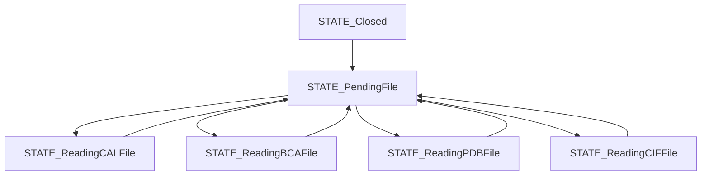
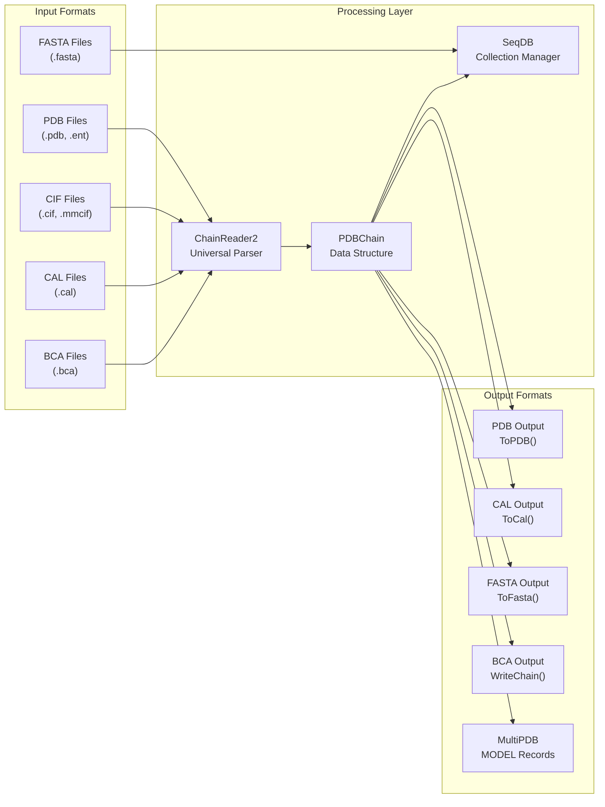
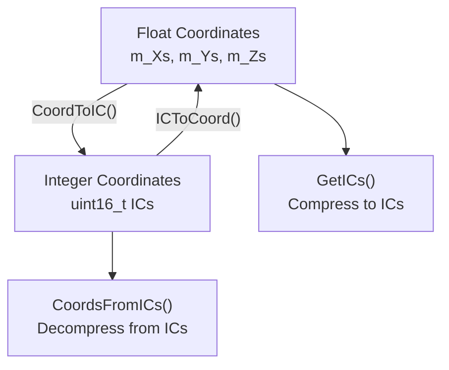
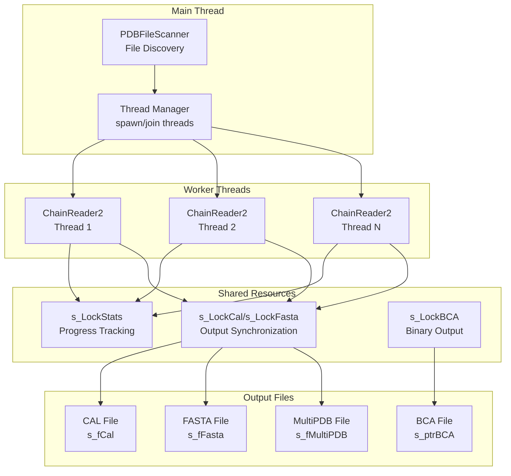

# Sequence and Structure Data

Relevant source files

The following files were used as context for generating this wiki page:

- [src/chainreader2.cpp](src/chainreader2.cpp)
- [src/chainreader2.h](src/chainreader2.h)
- [src/cif.cpp](src/cif.cpp)
- [src/convert.cpp](src/convert.cpp)
- [src/msta_scores.cpp](src/msta_scores.cpp)
- [src/pdbchain.cpp](src/pdbchain.cpp)
- [src/pdbchain.h](src/pdbchain.h)
- [src/seqdb.cpp](src/seqdb.cpp)
- [src/seqdb.h](src/seqdb.h)

This document covers the core data structures and I/O systems for managing protein sequences and 3D structural data in reseek. The system provides unified access to multiple structural biology file formats through a set of classes that handle sequence data, coordinate information, and format conversions.

For information about database search and alignment algorithms that operate on these data structures, see [Database Search System](#4). For details about the format conversion command-line interface, see [Format Conversion System](#5.1).

## Core Data Structures

The reseek system uses three primary classes to manage sequence and structural data:

### PDBChain Class

`PDBChain` represents a single protein chain containing both sequence and structural information:

| Member | Type | Purpose |
|--------|------|---------|
| `m_Label` | `string` | Chain identifier/label |
| `m_Seq` | `string` | Amino acid sequence |
| `m_Xs`, `m_Ys`, `m_Zs` | `vector<float>` | 3D coordinates (Å) |
| `m_Idx` | `uint` | Global chain index |
| `m_Lines` | `vector<string>` | Original file lines (optional) |

Key methods include coordinate access (`GetXYZ`, `GetDist`), transformations (`Reverse`, `Flip`, `GetXFormChain_tR`), and format I/O (`ToPDB`, `ToCal`, `ToFasta`, `FromPDBLines`).

### SeqDB Class

`SeqDB` manages collections of sequences with optional alignment information:

| Member | Type | Purpose |
|--------|------|---------|
| `m_Labels` | `vector<string>` | Sequence identifiers |
| `m_Seqs` | `vector<string>` | Sequence data |
| `m_LabelToIndex` | `map<string, uint>` | Fast label lookup |
| `m_IsAligned` | `bool` | Whether sequences are aligned |
| `m_ColCount` | `uint` | Column count for alignments |

The class supports sequence addition (`AddSeq`), retrieval (`GetSeq`, `GetSeqByLabel`), and FASTA I/O (`FromFasta`, `FromFasta_Seqs`).

### ChainReader2 Class

`ChainReader2` provides universal access to multiple file formats through a state machine architecture:

Sources: [src/chainreader2.h:12-20](), [src/chainreader2.cpp:116-184]()

## Format Support and Data Flow

The system supports multiple structural biology file formats with automatic format detection:

Sources: [src/chainreader2.cpp:49-88](), [src/pdbchain.h:46-57](), [src/seqdb.h:51-52]()

### Format-Specific Processing

Each format has dedicated parsing methods:

| Format | Detection | Parser Method | Key Features |
|--------|-----------|---------------|--------------|
| PDB | `.pdb`, `.ent` extensions | `GetFirst_PDB()`, `GetNext_PDB()` | ATOM records, chain IDs |
| CIF | `.cif`, `.mmcif` extensions | `GetFirst_CIF()`, `GetNext_CIF()` | Loop structures, field mapping |
| CAL | `.cal` extension | `GetFirst_CAL()`, `GetNext_CAL()` | Tab-delimited coordinates |
| BCA | `.bca` extension | `GetFirst_BCA()`, `GetNext_BCA()` | Binary coordinate format |

Sources: [src/chainreader2.cpp:71-86](), [src/cif.cpp:133-309](), [src/chainreader2.cpp:224-287]()

## Coordinate Systems and Transformations

### Integer Coordinate Compression

`PDBChain` uses a compressed coordinate system for efficient storage:

- Coordinates are stored as 16-bit unsigned integers
- Conversion: `CoordToIC(X) = (X + 1000) * 10 + 0.5`
- Reverse: `ICToCoord(IC) = IC/10.0 - 1000.0`
- Range: -1000.0 to +5553.5 Å

Sources: [src/pdbchain.cpp:42-68](), [src/pdbchain.h:89-90](), [src/pdbchain.cpp:423-471]()

### Geometric Operations

The system provides various geometric operations:

- Distance calculation: `GetDist()`, `GetDist2()`
- Coordinate transformations: `GetXFormChain_tR()` 
- Structural manipulations: `Reverse()`, `Flip()`
- Point operations: `GetPt()`, `SetPt()`, `GetXYZ()`

Sources: [src/pdbchain.cpp:310-497]()

## Multi-threaded Processing Pipeline

The `convert.cpp` system demonstrates multi-threaded processing of structural data:

Sources: [src/convert.cpp:74-246](), [src/convert.cpp:315-325]()

## Integration with Analysis Systems

The data structures integrate with reseek's analysis systems:

### DALI Scoring Integration

`DALIScorer` uses these structures for structural comparison:

- `LoadChains()` loads `PDBChain` objects from files
- `SetMSA()` processes `SeqDB` multiple sequence alignments
- Calculates Z-scores and LDDT metrics for structural similarity

Sources: [src/msta_scores.cpp:16-17](), [src/msta_scores.cpp:65-70]()

### Feature Extraction

The system supports feature extraction for structure analysis:

- Secondary structure prediction
- Density calculations  
- Conformational features
- Distance-based features

Feature alphabets are converted to sequence-like representations using `GetFeatureChar()` and output via `ToFeatureFasta()`.

Sources: [src/pdbchain.cpp:70-81](), [src/pdbchain.cpp:110-125](), [src/convert.cpp:185-203]()

## Memory Management and Performance

### Object Lifecycle

- `PDBChain` objects are dynamically allocated and must be explicitly deleted
- `SeqDB` manages vector storage automatically
- `ChainReader2` maintains file handles and buffers

### Thread Safety

- Global counters use `m_CRGlobalLock` for synchronization
- Per-thread locks (`m_CRPerThreadLock`) protect individual readers
- Output operations use format-specific mutexes

Sources: [src/chainreader2.cpp:97-111](), [src/convert.cpp:25-32]()

---