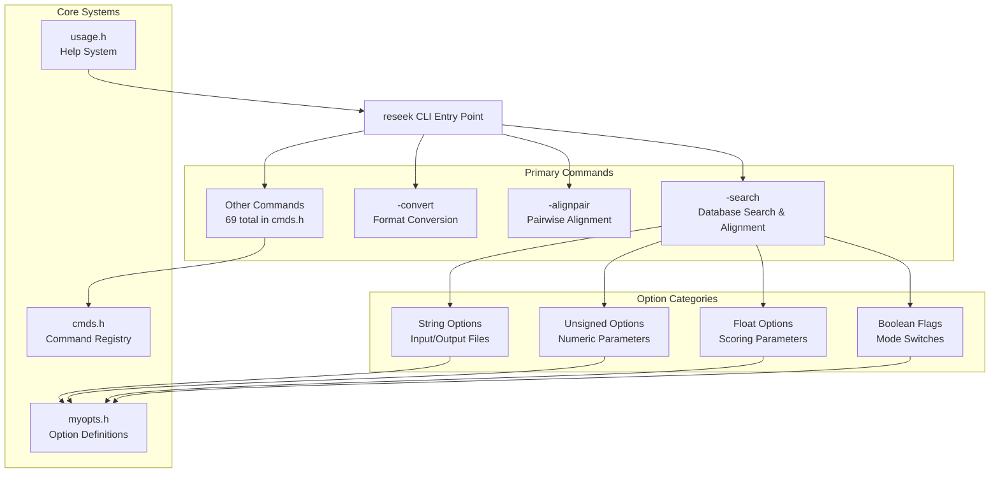
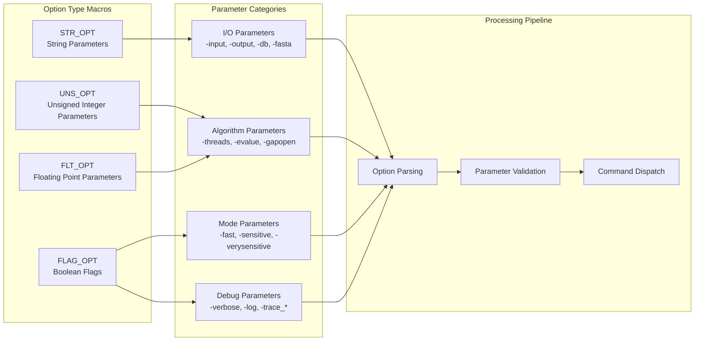
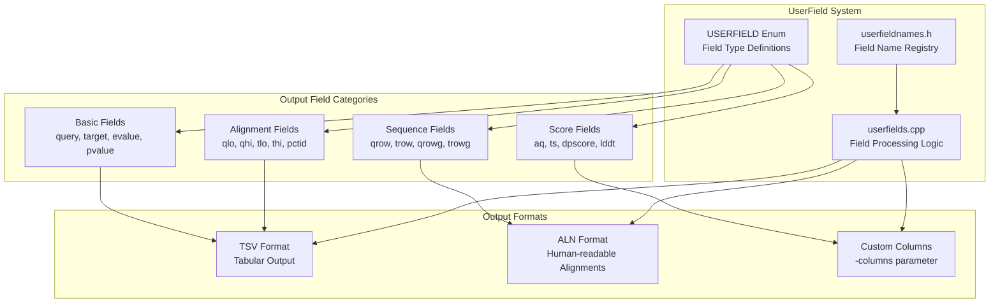
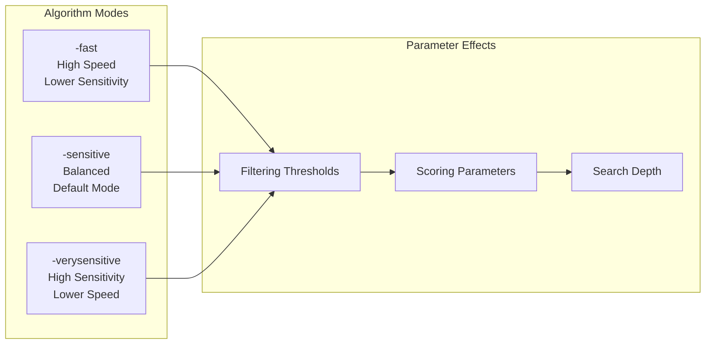

# Command-Line Interface

Relevant source files

The following files were used as context for generating this wiki page:

- [README.md](README.md)
- [src/cmds.h](src/cmds.h)
- [src/myopts.h](src/myopts.h)
- [src/reseek.vcxproj](src/reseek.vcxproj)
- [src/reseek.vcxproj.filters](src/reseek.vcxproj.filters)
- [src/usage.h](src/usage.h)
- [src/userfieldnames.h](src/userfieldnames.h)
- [src/userfields.cpp](src/userfields.cpp)

This document provides an overview of the reseek command-line interface architecture, including command dispatch, parameter processing, and output formatting systems. For detailed listings of all available commands and parameters, see [Commands and Options](#6.1). For information about customizable output columns and formats, see [Output Formatting](#6.2).

## Overview

The reseek command-line interface provides a comprehensive system for protein structure search, alignment, and format conversion operations. The CLI is built around a command-dispatch architecture where users specify a primary command followed by various options and parameters. The system supports 69 distinct commands and over 217 configuration parameters, making it highly flexible for diverse bioinformatics workflows.

## Command Architecture

The CLI system is organized around a two-level hierarchy: primary commands that determine the operation type, and options that configure the behavior of those commands.

**Command Dispatch System**

The command system uses a macro-based approach to define available commands. Each command is registered in `cmds.h` using the `C()` macro, which generates the necessary dispatch table entries.

Sources: [src/cmds.h:1-78](), [src/myopts.h:1-150](), [src/usage.h:1-90]()

## Parameter Processing System

The parameter system uses a sophisticated macro-based approach to handle different types of command-line options with type safety and automatic help generation.

**Option Definition System**

The options are defined using four primary macros in `myopts.h`:
- `STR_OPT()` for string parameters like file paths and labels
- `UNS_OPT()` for unsigned integer parameters like thread counts and sizes
- `FLT_OPT()` for floating-point parameters like scoring weights and thresholds
- `FLAG_OPT()` for boolean flags that enable/disable features

Sources: [src/myopts.h:8-64](), [src/myopts.h:66-96](), [src/myopts.h:98-116](), [src/myopts.h:117-145]()

## Output Formatting Architecture

The CLI provides a flexible output formatting system through the UserField mechanism, allowing users to customize which columns appear in their results.

**Field Processing Pipeline**

The output system converts internal alignment results into user-specified output formats through the `DSSAligner::WriteUserField()` method, which handles formatting and value conversion for each field type.

Sources: [src/userfields.cpp:45-151](), [src/userfieldnames.h:1-34]()

## Usage Patterns

The CLI supports three primary usage patterns, each optimized for different bioinformatics workflows:

| Usage Pattern | Command | Primary Purpose | Key Options |
|---------------|---------|-----------------|-------------|
| Database Search | `-search` | Search query structures against a database | `-db`, `-output`, `-evalue`, `-threads` |
| Format Conversion | `-convert` | Convert between file formats | `-cal`, `-bca`, `-fasta` |
| Pairwise Alignment | `-alignpair` | Align and superpose two structures | `-input2`, `-aln`, `-output` |

**Algorithm Mode Selection**

All search operations require specifying an algorithm mode that balances speed versus sensitivity:

**Input Format Support**

The system supports multiple input formats through a unified interface:

| Format | Extension | Description | Use Case |
|--------|-----------|-------------|----------|
| PDB | `.pdb` | Legacy PDB format | Small datasets, compatibility |
| mmCIF | `.cif`, `.mmcif` | Modern PDB format | Large structures, complete metadata |
| CAL | `.cal` | C-alpha text format | Custom preprocessing |
| BCA | `.bca` | Binary C-alpha format | Large databases, performance |
| Directory | (none) | Directory traversal | Batch processing |

Sources: [src/usage.h:2-89](), [README.md:15-92]()

## Help and Documentation System

The CLI includes a comprehensive help system that provides usage information, parameter descriptions, and example commands. The help text is generated from the same macro definitions used for option processing, ensuring consistency between the implementation and documentation.

Sources: [src/usage.h:2-89](), [README.md:15-92]()

---