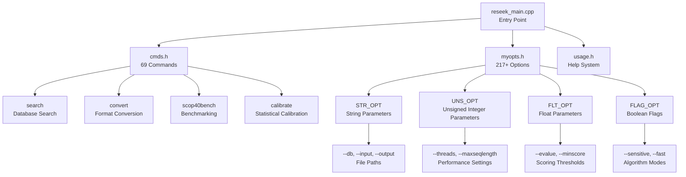
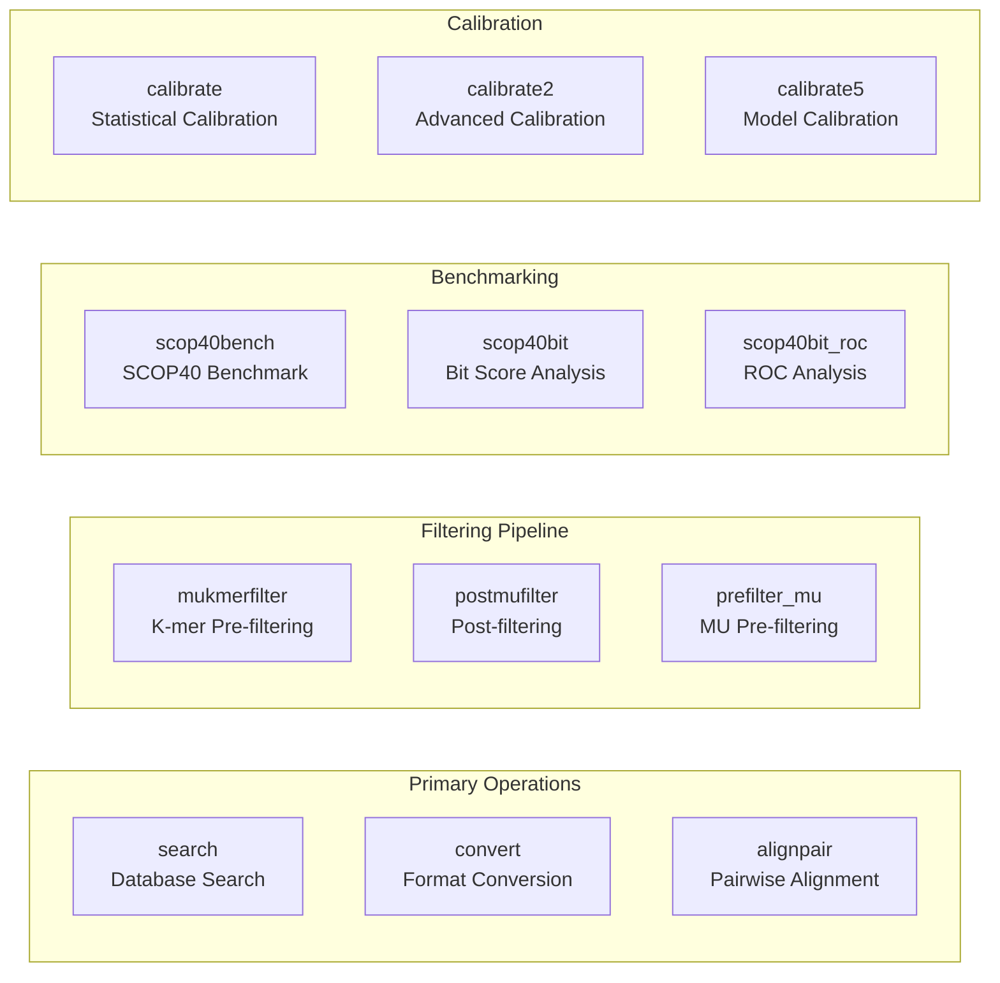
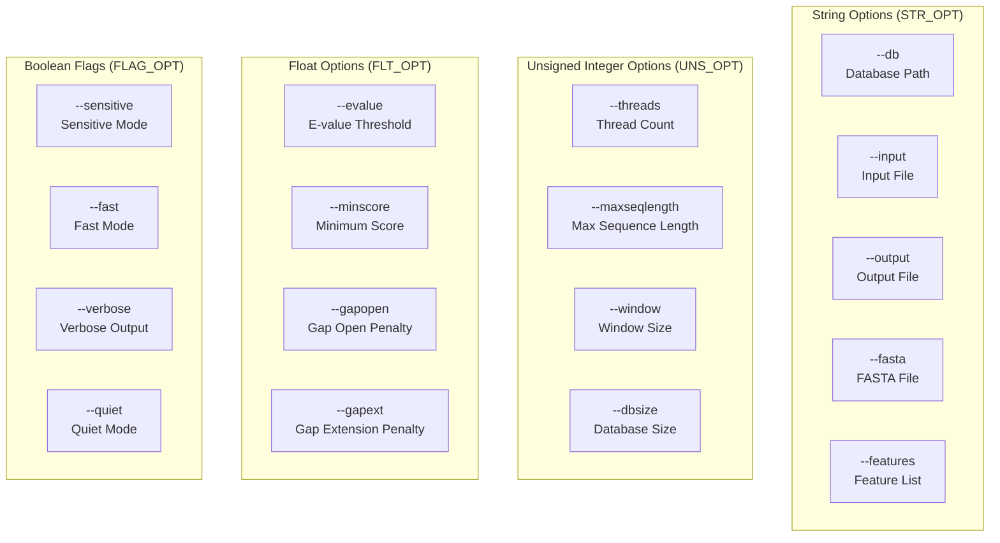
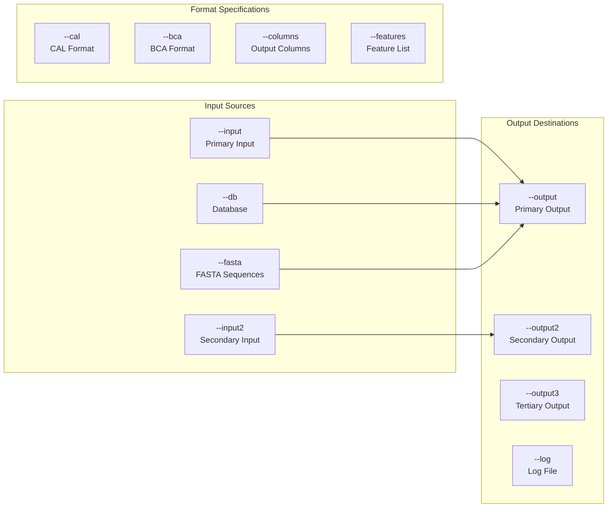
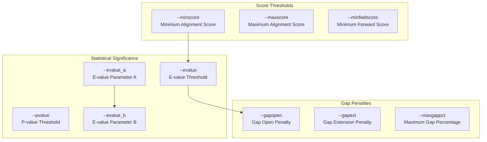
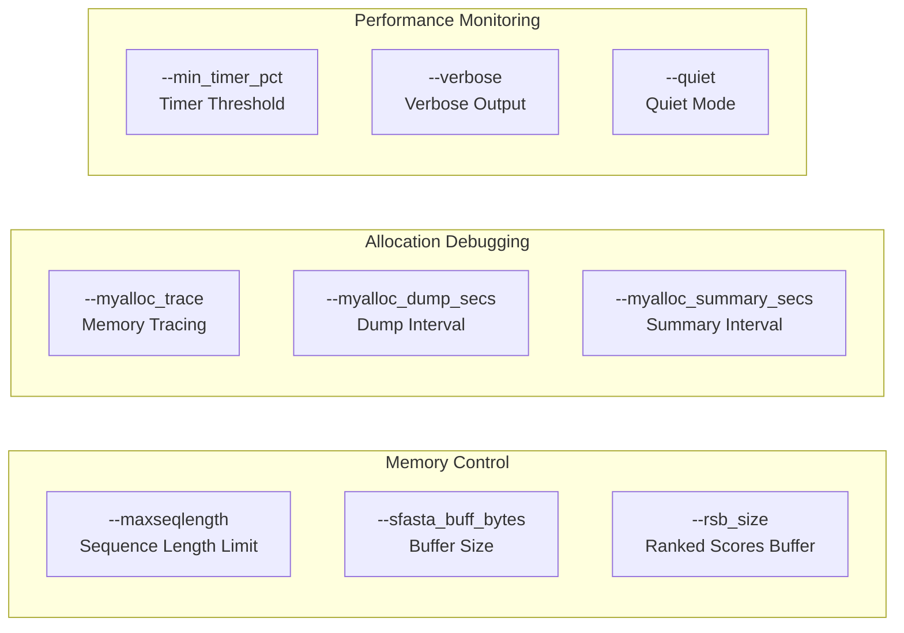

# Commands and Options

<details>
<summary>Relevant source files</summary>

The following files were used as context for generating this wiki page:

- [src/cmds.h](src/cmds.h)
- [src/myopts.h](src/myopts.h)
- [src/reseek.vcxproj](src/reseek.vcxproj)
- [src/reseek.vcxproj.filters](src/reseek.vcxproj.filters)

</details>


This document provides a comprehensive reference for reseek's command-line interface, covering all 69 available commands and 217+ configuration parameters. The command-line interface serves as the primary entry point for all reseek functionality, from basic protein structure searches to advanced benchmarking and calibration tasks.

For information about customizing output formats and columns, see [Output Formatting](#6.2). For details about the core alignment algorithms that these commands control, see [Core Alignment Engine](#3).

## Command-Line Interface Architecture

The reseek command-line interface follows a structured approach where commands define the operation to perform, and options configure the behavior of those operations. The interface is implemented through a macro-based system that ensures type safety and comprehensive parameter handling.



**Sources:** [src/myopts.h:1-150](), [src/cmds.h:1-79](), [src/reseek_main.cpp]()

## Command Categories

The 69 available commands are organized into functional categories, each serving specific aspects of protein structure analysis and system maintenance.

### Core Search and Analysis Commands



**Sources:** [src/cmds.h:25-76]()

### Specialized Analysis Commands

| Command | Purpose | Key Options |
|---------|---------|-------------|
| `daliscore_msa` | DALI scoring for MSAs | `--input`, `--output`, `--columns` |
| `lddt_msa` | LDDT scoring for MSAs | `--input`, `--output`, `--feature` |
| `msta_scores` | Multiple structure alignment scoring | `--input`, `--features`, `--output` |
| `distmx` | Distance matrix calculation | `--input`, `--output`, `--minchainlength` |
| `cluster` | Structure clustering | `--input`, `--output`, `--minscore` |

**Sources:** [src/cmds.h:38-53]()

## Option Type System

The option system uses a macro-based approach to define four distinct parameter types, each with specific validation and handling characteristics.



**Sources:** [src/myopts.h:8-144]()

## Core Configuration Options

### Algorithm Mode Selection

The algorithm behavior is controlled through mutually exclusive mode flags that configure the entire processing pipeline:

| Flag | Purpose | Impact |
|------|---------|---------|
| `--fast` | High-speed mode | Reduced sensitivity, faster execution |
| `--sensitive` | Balanced mode | Default sensitivity/speed tradeoff |
| `--verysensitive` | High-accuracy mode | Maximum sensitivity, slower execution |

**Sources:** [src/myopts.h:124-125](), [src/myopts.h:140]()

### Input/Output Configuration



**Sources:** [src/myopts.h:50-54](), [src/myopts.h:26-28](), [src/myopts.h:44-45]()

### Performance and Threading Options

| Option | Type | Purpose | Default Range |
|--------|------|---------|---------------|
| `--threads` | UNS_OPT | CPU thread count | System-dependent |
| `--maxseqlength` | UNS_OPT | Maximum sequence length | Memory-dependent |
| `--window` | UNS_OPT | Sliding window size | Algorithm-dependent |
| `--randseed` | UNS_OPT | Random seed for reproducibility | Time-based |

**Sources:** [src/myopts.h:66](), [src/myopts.h:80](), [src/myopts.h:72](), [src/myopts.h:82]()

### Scoring and Threshold Parameters

The scoring system provides fine-grained control over alignment sensitivity and statistical significance:



**Sources:** [src/myopts.h:99-115]()

## Specialized Configuration Categories

### Benchmarking and Calibration Options

| Option | Type | Purpose |
|--------|------|---------|
| `--benchlevel` | STR_OPT | Benchmark detail level |
| `--roc` | STR_OPT | ROC analysis output |
| `--calib_output` | STR_OPT | Calibration results |
| `--slopes` | STR_OPT | Score slope parameters |
| `--alpha` | STR_OPT | Alpha parameter for statistics |

**Sources:** [src/myopts.h:14](), [src/myopts.h:11](), [src/myopts.h:18](), [src/myopts.h:23](), [src/myopts.h:25]()

### Advanced Filtering Parameters

| Option | Type | Purpose |
|--------|------|---------|
| `--mkfl` | UNS_OPT | MU k-mer filter length |
| `--mun` | UNS_OPT | MU sequence number |
| `--muhsp` | UNS_OPT | MU HSP count |
| `--xdrop1` | UNS_OPT | X-drop threshold 1 |
| `--xdrop2` | UNS_OPT | X-drop threshold 2 |

**Sources:** [src/myopts.h:76-78](), [src/myopts.h:74-75]()

### Memory and Resource Management



**Sources:** [src/myopts.h:80-96](), [src/myopts.h:143-144](), [src/myopts.h:119-120]()

## Common Usage Patterns

### Basic Database Search
```bash
reseek search --db database.bca --input query.fasta --output results.tsv
```

### Sensitive Search with Custom Scoring
```bash
reseek search --db database.bca --input query.fasta --output results.tsv --sensitive --evalue 1e-5 --minscore 50
```

### Format Conversion
```bash
reseek convert --input structures.pdb --output structures.cal --format cal
```

### Benchmarking with ROC Analysis
```bash
reseek scop40bench --db scop40.bca --roc results.roc --benchlevel detailed
```

**Sources:** [src/cmds.h:25](), [src/cmds.h:37](), [src/cmds.h:10]()

---