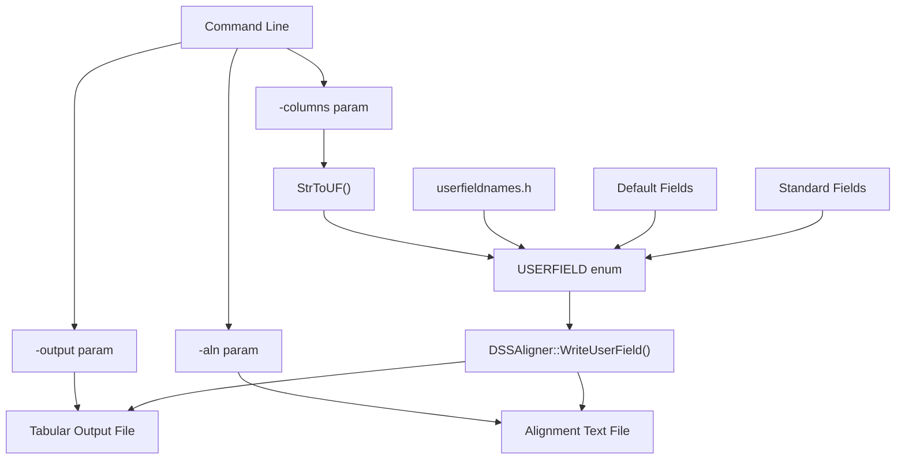
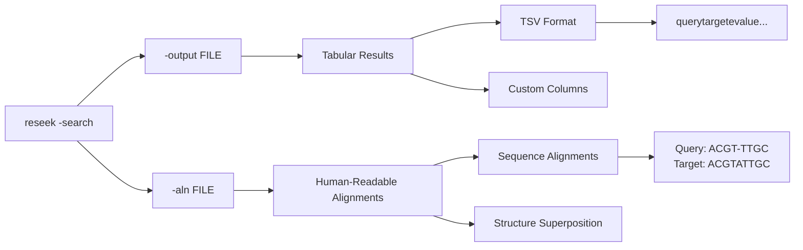
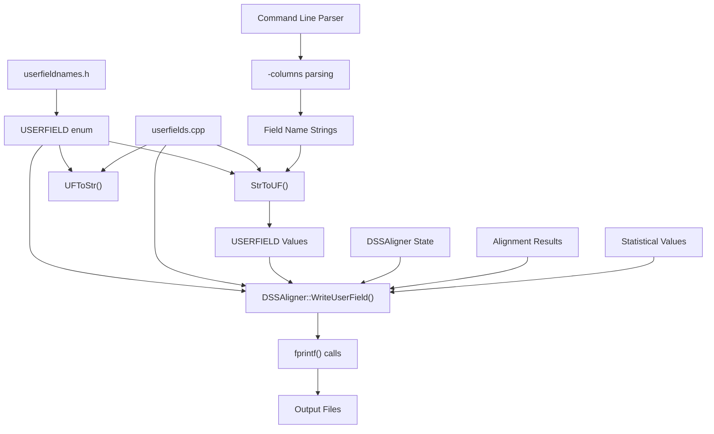
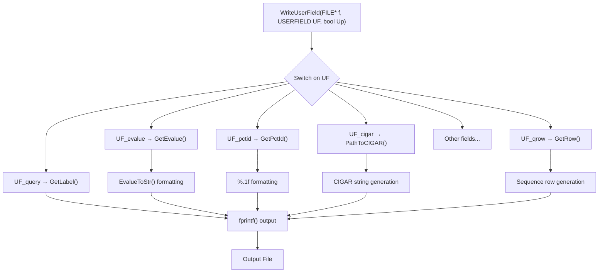

# Output Formatting

<details>
<summary>Relevant source files</summary>

The following files were used as context for generating this wiki page:

- [README.md](README.md)
- [src/usage.h](src/usage.h)
- [src/userfieldnames.h](src/userfieldnames.h)
- [src/userfields.cpp](src/userfields.cpp)

</details>


This document describes the output formatting system in reseek, which provides flexible control over what information is included in search results and how it is presented. The system is built around a configurable field selection mechanism that allows users to specify exactly which columns they want in their output files.

For information about the search commands that generate this output, see [Commands and Options](#6.1). For details about the alignment algorithms that compute these values, see [Core Alignment Engine](#3).

## Overview

The output formatting system is centered around the `USERFIELD` system, which allows users to specify custom output columns via the `-columns` command-line parameter. The system supports both tabular output (via `-output`) and human-readable alignment output (via `-aln`).



**UserField System Architecture**

Sources: [src/userfields.cpp:1-152](), [src/userfieldnames.h:1-34](), [README.md:36-60]()

## Available Output Fields

The system supports 31 different output fields, each providing specific information about alignments and search results:

| Field Name | Description | Example Value |
|------------|-------------|---------------|
| `query` | Query structure label | `1XYZ_A` |
| `target` | Target structure label | `2ABC_B` |
| `evalue` | E-value from log-linear null model | `1.2e-5` |
| `pvalue` | P-value from log-linear null model | `3.4e-8` |
| `ql` | Query length (residues) | `150` |
| `tl` | Target length (residues) | `200` |
| `qlo` | Alignment start in query (1-based) | `10` |
| `qhi` | Alignment end in query (1-based) | `140` |
| `tlo` | Alignment start in target (1-based) | `15` |
| `thi` | Alignment end in target (1-based) | `180` |
| `pctid` | Percent identity of alignment | `25.3` |
| `cigar` | CIGAR string describing alignment | `20M5D30M` |
| `aq` | Alignment quality (0-1, >0.5 suggests homology) | `0.75` |
| `qrow` | Aligned query sequence with gaps (local) | `ACGT-TTGC` |
| `trow` | Aligned target sequence with gaps (local) | `ACGTATTGC` |
| `qrowg` | Aligned query sequence with gaps (global) | `ACGT-TTGC` |
| `trowg` | Aligned target sequence with gaps (global) | `ACGTATTGC` |

### Statistical and Scoring Fields

| Field Name | Description |
|------------|-------------|
| `ts` | Test statistic |
| `newts` | New test statistic |
| `dpscore` | Dynamic programming score |
| `lddt` | LDDT score |
| `gscore` | Global score |
| `raw` | Raw alignment score |
| `ids` | Number of identities |
| `gaps` | Number of gaps |
| `muhsp` | Mu HSP score |
| `muchain` | Mu chain score |

### Predefined Field Sets

The system provides convenient predefined field combinations:

- **`std`**: Standard fields = `query+target+qlo+qhi+ql+tlo+thi+tl+pctid+evalue`
- **Default**: `aq+query+target+evalue+pvalue` (used when no `-columns` specified)

Sources: [src/userfieldnames.h:1-34](), [README.md:41-59](), [src/usage.h:29-48]()

## Command-Line Usage

### Basic Output Control

```bash
# Use default columns
reseek -search query.pdb -db database.bca -output results.txt

# Specify custom columns
reseek -search query.pdb -db database.bca -output results.txt \
       -columns query+target+evalue+pctid+aq

# Use standard column set
reseek -search query.pdb -db database.bca -output results.txt \
       -columns std

# Generate both tabular and alignment output
reseek -search query.pdb -db database.bca \
       -output results.txt -aln alignments.txt
```

### Output File Types



**Output File Generation Flow**

Sources: [README.md:25-39](), [src/usage.h:25-27]()

## Implementation Architecture

The output formatting system is implemented through several key components:

### Core Components



**UserField System Implementation**

### Field Name Resolution

The system uses a macro-based approach to define field names and their corresponding enum values:

```cpp
// From userfieldnames.h - defines both enum and string conversion
#define x(name) UF_##name,
enum USERFIELD { 
    #include "userfieldnames.h"
};

// String to enum conversion
USERFIELD StrToUF(const string &Str) {
    #define x(name) if (Str == #name) return UF_##name;
    #include "userfieldnames.h"
    // ... error handling
}
```

### Output Generation

The `WriteUserField` method in `DSSAligner` handles the actual output formatting:



**Field Output Generation Process**

Sources: [src/userfields.cpp:45-151](), [src/userfieldnames.h:1-34]()

## Output Format Examples

### Default Output Format

When no `-columns` parameter is specified, the system outputs:
```
aq      query   target  evalue  pvalue
0.7500  1XYZ_A  2ABC_B  1.2e-5  3.4e-8
0.6200  1XYZ_A  3DEF_C  2.1e-4  5.7e-7
```

### Custom Column Selection

Using `-columns query+target+pctid+cigar+aq`:
```
query   target  pctid   cigar           aq
1XYZ_A  2ABC_B  25.3    20M5D30M2I15M   0.7500
1XYZ_A  3DEF_C  18.7    15M3D25M        0.6200
```

### Standard Format

Using `-columns std`:
```
query   target  qlo qhi ql  tlo thi tl  pctid   evalue
1XYZ_A  2ABC_B  10  140 150 15  180 200 25.3    1.2e-5
1XYZ_A  3DEF_C  5   135 150 20  170 190 18.7    2.1e-4
```

### Alignment Output

The `-aln` parameter generates human-readable alignment files:
```
Query: 1XYZ_A (150 residues)
Target: 2ABC_B (200 residues)
E-value: 1.2e-5, P-value: 3.4e-8, AQ: 0.75

Query   10  ACGTTTGCAAAAATTTGCCC-AAATTTGGGCCCAAATTT  48
            ||||  ||     ||||||| ||| ||||||||||||||
Target  15  ACGTAAGC-----TTTGCCCAAAATTTGGGCCCAAATTT  48
```

Sources: [README.md:36-60](), [src/usage.h:25-48]()

## Special Field Handling

### E-value Formatting

The `EvalueToStr` function provides intelligent formatting for E-values:

- Values > 100: displayed as "100"
- Values > 1: displayed with 1 decimal place (e.g., "2.5")
- Values > 0.001: displayed with 4 decimal places (e.g., "0.0125")
- Values ≤ 0.001: displayed in scientific notation (e.g., "1.25e-4")

### Orientation Handling

The system handles query/target orientation through the `Up` parameter in `WriteUserField`, which determines whether the alignment should be interpreted as Query=A/Target=B or Query=B/Target=A based on the search direction.

### Row Generation

The `qrow`, `trow`, `qrowg`, and `trowg` fields generate aligned sequences with gaps:
- Local alignment rows (`qrow`/`trow`): Show only the aligned portion
- Global alignment rows (`qrowg`/`trowg`): Show the complete alignment including flanking regions

Sources: [src/userfields.cpp:19-30](), [src/userfields.cpp:45-151]()

---