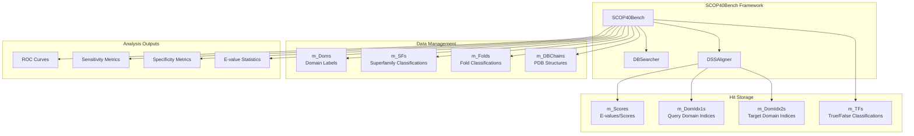
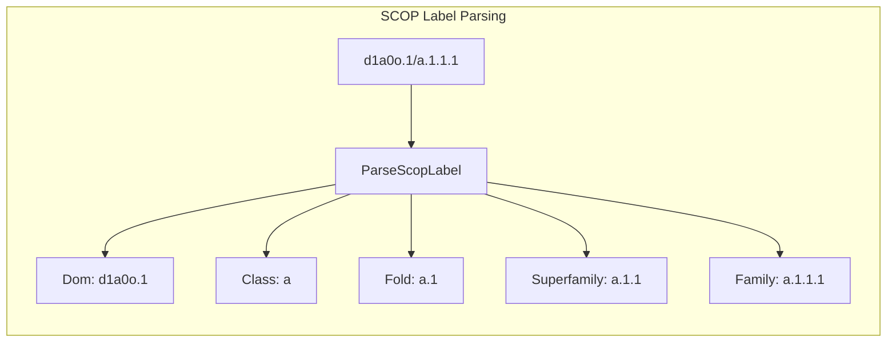
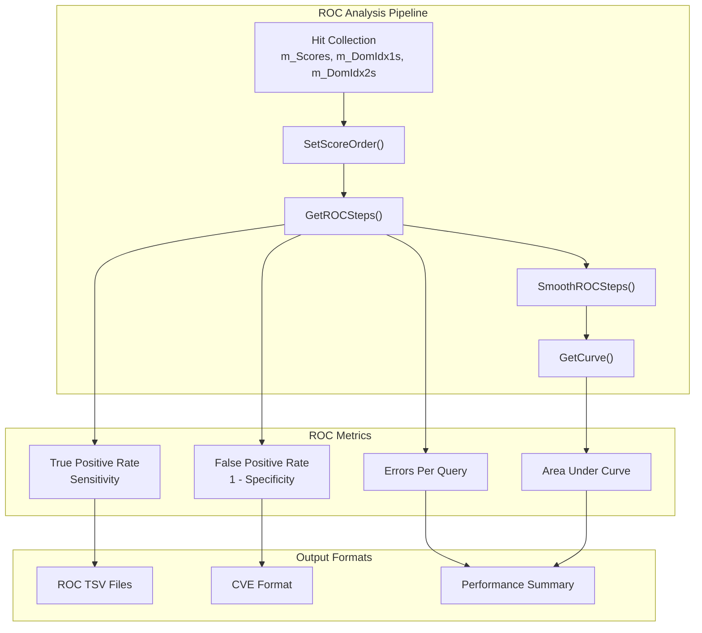
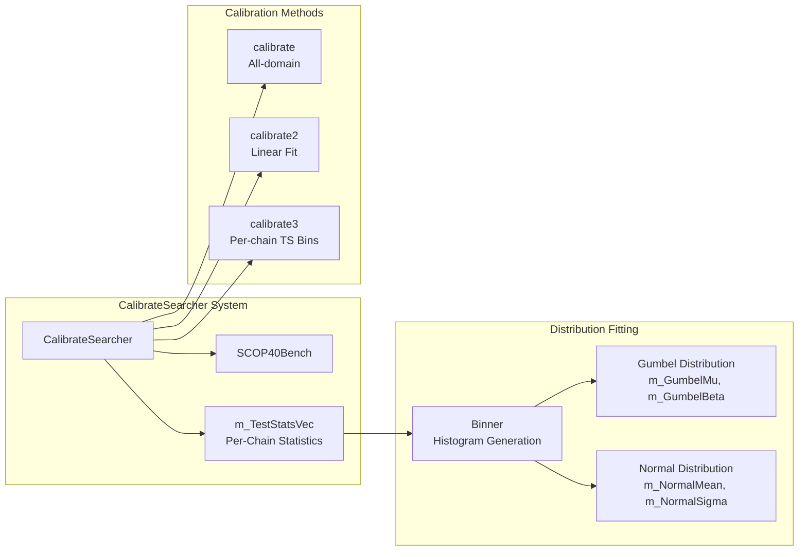
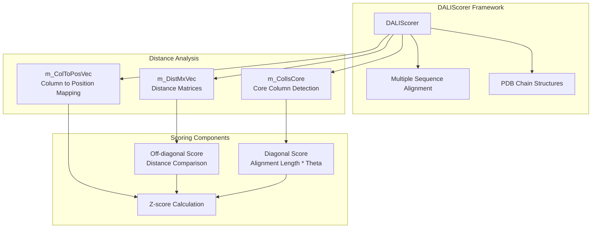

# Analysis and Benchmarking

<details>
<summary>Relevant source files</summary>

The following files were used as context for generating this wiki page:

- [src/calibrate.cpp](src/calibrate.cpp)
- [src/calibrate2.cpp](src/calibrate2.cpp)
- [src/calibrate3.cpp](src/calibrate3.cpp)
- [src/calibrate5.cpp](src/calibrate5.cpp)
- [src/calibratesearcher.cpp](src/calibratesearcher.cpp)
- [src/calibratesearcher.h](src/calibratesearcher.h)
- [src/dali.cpp](src/dali.cpp)
- [src/daliscore_msa.cpp](src/daliscore_msa.cpp)
- [src/daliscore_tsv.cpp](src/daliscore_tsv.cpp)
- [src/daliscorer.cpp](src/daliscorer.cpp)
- [src/daliscorer.h](src/daliscorer.h)
- [src/scop40bench.cpp](src/scop40bench.cpp)
- [src/scop40bench.h](src/scop40bench.h)
- [src/scop40benchroc.cpp](src/scop40benchroc.cpp)

</details>


This section covers the performance evaluation tools, statistical calibration systems, and specialized scoring methods used to assess and optimize the protein structure search capabilities of reseek. The analysis framework provides comprehensive benchmarking against gold standard datasets, statistical model calibration, and multiple scoring methodologies for alignment quality assessment.

For information about the core alignment algorithms being benchmarked, see [Core Alignment Engine](#3). For database search optimization, see [Database Search System](#4).

## SCOP40 Benchmarking Framework

The primary benchmarking system is built around the SCOP40 database, which provides a gold standard for protein structure classification. The `SCOP40Bench` class serves as the foundation for all performance evaluation.



**SCOP40Bench Architecture Overview**

The benchmarking system processes protein domain classifications and generates comprehensive performance statistics through ROC analysis and sensitivity measurements.

Sources: [src/scop40bench.h:9-178](), [src/scop40bench.cpp:19-90]()

### Domain Classification and Indexing

The system organizes protein domains according to SCOP hierarchy levels:

| Level | Description | Code Reference |
|-------|-------------|----------------|
| **Superfamily** | `m_Level = "sf"` | Proteins with similar structure and function |
| **Fold** | `m_Level = "fold"` | Proteins with similar overall topology |
| **Family** | Individual protein families | Highest resolution classification |



**SCOP Label Processing Pipeline**

The `ParseScopLabel` method extracts hierarchical classification information from domain identifiers for true positive/false positive determination.

Sources: [src/scop40bench.cpp:57-90](), [src/scop40bench.cpp:146-188]()

### True Positive/False Positive Classification

The core evaluation logic determines whether domain pairs represent true positives based on SCOP classification:

```cpp
// Return 1=TP, 0=FP, -1=ignore
int SCOP40Bench::IsT(uint DomIdx1, uint DomIdx2) const
{
    if (m_Level == "sf") {
        if (SFIdx1 == SFIdx2) return 1;  // Same superfamily = TP
        else return 0;                   // Different superfamily = FP
    }
    // Additional logic for fold and family levels
}
```

Sources: [src/scop40benchroc.cpp:166-216]()

## ROC Analysis and Performance Metrics

The system generates Receiver Operating Characteristic (ROC) curves to evaluate search sensitivity and specificity across different score thresholds.



**ROC Analysis Workflow**

The ROC analysis processes alignment hits through multiple stages to generate comprehensive performance statistics and visualization data.

Sources: [src/scop40benchroc.cpp:454-513](), [src/scop40benchroc.cpp:325-391]()

### Key Performance Metrics

The benchmarking system calculates several critical performance indicators:

| Metric | Formula | Description |
|--------|---------|-------------|
| **TPR (Sensitivity)** | `TP / (TP + FN)` | Fraction of true relationships detected |
| **FPR** | `FP / (FP + TN)` | Fraction of false alarms |
| **EPQ** | `FP / QueryCount` | Expected false positives per query |
| **Sens@1FP** | Special calculation | Sensitivity before first false positive |

Sources: [src/scop40bench.cpp:523-541](), [src/scop40bench.cpp:587-611]()

## Statistical Calibration

The calibration subsystem fits statistical models to test statistic distributions for accurate E-value calculation.



**Statistical Calibration Architecture**

The calibration system extends SCOP40Bench to collect test statistics and fit probability distributions for E-value computation.

Sources: [src/calibratesearcher.h:12-58](), [src/calibrate.cpp:12-45]()

### Distribution Fitting Methods

The system supports multiple approaches to statistical calibration:

**Gumbel Distribution Fitting:**
- Used for extreme value statistics of alignment scores
- Implemented in `FitGumbel()` method
- Parameters: `m_GumbelMu` (location), `m_GumbelBeta` (scale)

**Per-Chain Calibration:**
- Collects test statistics for each database chain
- Bins statistics into histograms for distribution analysis
- Accounts for sequence length and composition effects

Sources: [src/calibratesearcher.cpp:132-142](), [src/calibrate3.cpp:242-360]()

## Specialized Scoring Methods

### DALI Scoring Implementation

The DALI (Distance matrix ALIgnment) scoring system provides an alternative structural similarity metric based on distance matrices.



**DALI Scoring System Architecture**

The DALI scorer processes multiple sequence alignments and structure data to compute distance-based similarity scores with statistical significance.

Sources: [src/daliscorer.h:10-99](), [src/daliscorer.cpp:75-98]()

### DALI Score Calculation

The DALI score combines distance matrix comparisons with alignment length penalties:

```cpp
double DALIScore = OffDiagScore + Lali * g_DALI_Theta;
double Z = GetDALIZFromScoreAndLengths(DALIScore, QL, TL);
```

**Key Parameters:**
- `g_DALI_D = 20.0` - Envelope radius for distance weighting
- `g_DALI_d0 = 0.2` - Distance tolerance parameter  
- `g_DALI_Theta = 0.2` - Diagonal score contribution per aligned position

Sources: [src/dali.cpp:93-110](), [src/daliscorer.cpp:187-226]()

## Command-Line Interface for Analysis

The analysis and benchmarking tools are accessible through several specialized commands:

| Command | Purpose | Key Options |
|---------|---------|-------------|
| `scop40bench` | Full SCOP40 benchmarking | `-benchlevel`, `-maxfpr`, `-roc` |
| `calibrate` | Statistical calibration | `-sensitive`, `-output` |
| `calibrate2` | Linear fit calibration | `-benchlevel`, `-maxfpr` |
| `calibrate3` | Per-chain TS binning | `-calib_output`, `-calib_output2` |
| `daliscore_msa` | DALI scoring for MSA | `-input`, `-core` |

### Example Benchmarking Workflow

```bash
# Run SCOP40 benchmark with ROC analysis
reseek -scop40bench scop40_family.cal -roc results.tsv -curve curve.tsv

# Perform statistical calibration  
reseek -calibrate scop40_family.cal -output calibration.tsv

# Generate DALI scores for MSA
reseek -daliscore_msa alignment.fasta -input structures.cal -output dali_scores.tsv
```

Sources: [src/scop40bench.cpp:767-824](), [src/calibrate.cpp:12-45](), [src/daliscore_msa.cpp:6-54]()

The analysis and benchmarking framework provides comprehensive tools for evaluating protein structure search performance, from gold standard database comparison to statistical calibration and specialized scoring methodologies. This enables systematic optimization and validation of the core alignment algorithms.

---