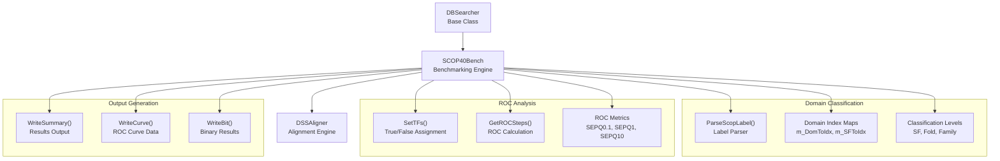
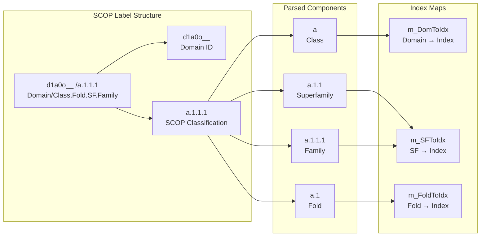
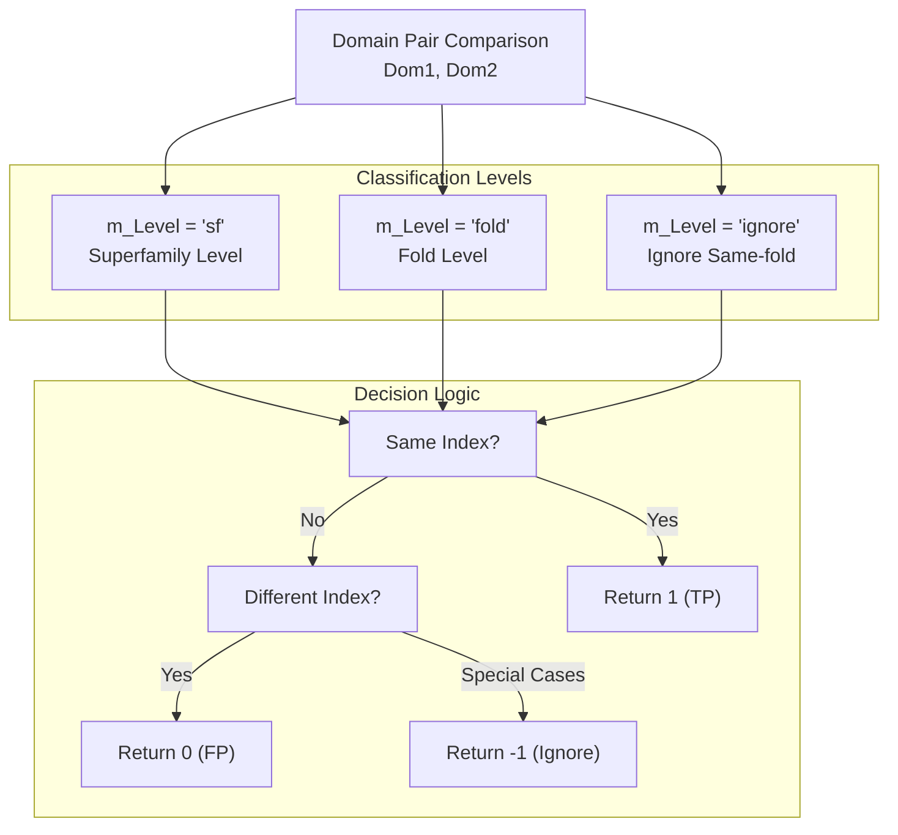
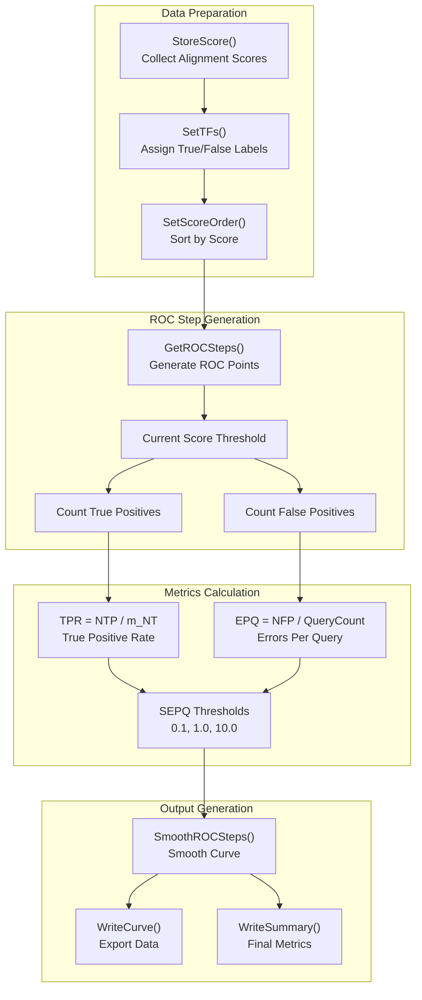
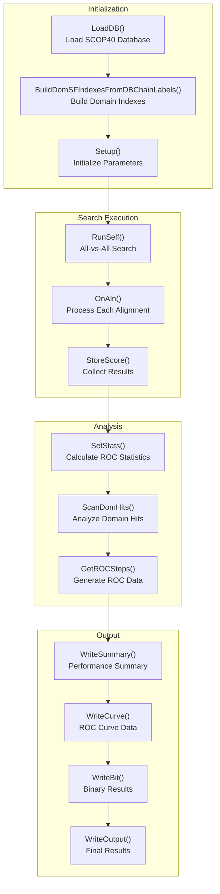
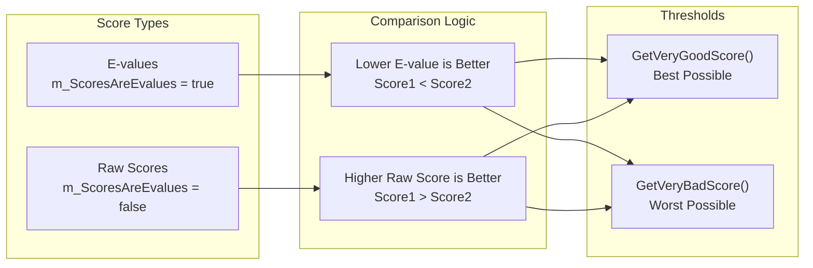
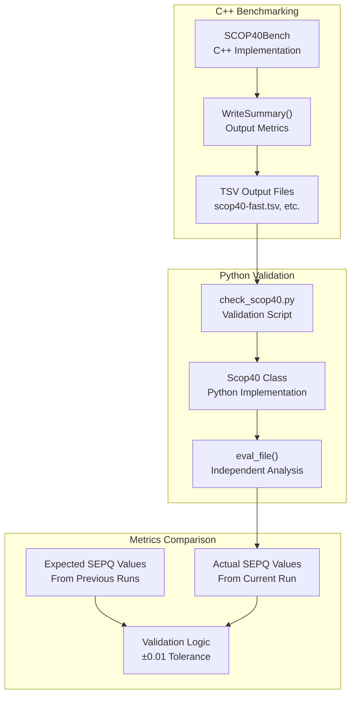

# SCOP40 Benchmarking

<details>
<summary>Relevant source files</summary>

The following files were used as context for generating this wiki page:

- [src/scop40bench.cpp](src/scop40bench.cpp)
- [src/scop40bench.h](src/scop40bench.h)
- [src/scop40benchroc.cpp](src/scop40benchroc.cpp)
- [test_data/dom_scopid.tsv](test_data/dom_scopid.tsv)
- [test_results/success_list.txt](test_results/success_list.txt)
- [test_scripts/check_scop40.py](test_scripts/check_scop40.py)
- [test_scripts/scop40.py](test_scripts/scop40.py)

</details>


This document covers the SCOP40 benchmarking system used for evaluating protein structure search performance in reseek. The system performs ROC analysis against the SCOP40 gold standard database to measure search sensitivity and specificity.

For information about the core alignment engine being benchmarked, see [Core Alignment Engine](#3). For database search implementation details, see [Database Search System](#4).

## System Overview

The SCOP40 benchmarking system evaluates protein structure search algorithms using the Structural Classification of Proteins (SCOP) database as ground truth. It performs comprehensive ROC analysis to generate sensitivity metrics at various error rate thresholds.

### SCOP40Bench Class Architecture



Sources: [src/scop40bench.h:9-178](), [src/scop40bench.cpp:133-144]()

## SCOP Domain Classification System

The system uses hierarchical protein structure classification to determine true and false positives:

### Domain Label Format and Parsing



The `ParseScopLabel` function extracts hierarchical classification from domain labels:

| Level | Format | Example | Description |
|-------|--------|---------|-------------|
| Class | `a` | `a` | Protein class |
| Fold | `a.1` | `a.1` | Structural fold |
| Superfamily | `a.1.1` | `a.1.1` | Superfamily |
| Family | `a.1.1.1` | `a.1.1.1` | Family |

Sources: [src/scop40bench.cpp:57-90](), [src/scop40bench.cpp:29-40]()

### True/False Positive Determination



The `IsT` function determines classification based on the benchmarking level:

```cpp
int SCOP40Bench::IsT(uint DomIdx1, uint DomIdx2) const
{
    if (m_Level == "sf") {
        if (SFIdx1 == SFIdx2) return 1;  // TP
        else return 0;  // FP
    }
    // Similar logic for fold and ignore levels
}
```

Sources: [src/scop40benchroc.cpp:166-216]()

## ROC Analysis and Metrics

### ROC Calculation Workflow



### Key Performance Metrics

The system calculates several standard benchmarking metrics:

| Metric | Description | Calculation |
|--------|-------------|-------------|
| `m_nt_epq0_1` | True positives at EPQ ≤ 0.1 | `GetNTPAtEPQThreshold(0.1)` |
| `m_nt_epq1` | True positives at EPQ ≤ 1.0 | `GetNTPAtEPQThreshold(1.0)` |
| `m_nt_epq10` | True positives at EPQ ≤ 10.0 | `GetNTPAtEPQThreshold(10.0)` |
| `m_nt_firstfp` | Sensitivity to first FP | `GetSens1stFP()` |
| `m_Area` | Area under ROC curve | `GetArea(TPRs, Log10EPQs)` |

Sources: [src/scop40benchroc.cpp:454-513](), [src/scop40bench.cpp:566-585]()

## Benchmarking Process

### Complete Benchmarking Workflow



### Command Entry Point

The main benchmarking command is `cmd_scop40bench()` which:

1. Loads the SCOP40 database from `.cal` format
2. Initializes `DSSParams` for alignment configuration
3. Executes all-vs-all search using `RunSelf()`
4. Processes results and generates performance metrics
5. Outputs summary statistics and detailed results

Sources: [src/scop40bench.cpp:767-824]()

## Configuration and Scoring

### Scoring Modes

The system supports different scoring interpretations:



### Benchmark Levels

The system supports different classification levels via `m_Level`:

- `"sf"` - Superfamily level (default)
- `"fold"` - Fold level
- `"ignore"` - Ignore same-fold different-superfamily pairs

Sources: [src/scop40bench.cpp:376-405](), [src/scop40benchroc.cpp:188-214]()

## Output and Results

### Result Files Generated

| File Type | Function | Description |
|-----------|----------|-------------|
| CVE | `WriteCVE()` | Curve vs E-value data |
| ROC | `ROCStepsToTsv()` | ROC curve points |
| Curve | `WriteCurve()` | Smoothed curve data |
| Summary | `WriteSummary()` | Performance metrics |
| Binary | `WriteBit()` | Compressed results |

### Performance Summary Format

```
SEPQ0.1=0.2107 SEPQ1=0.3144 SEPQ10=0.3882 Area=7.14 secs=120 [git-version]
```

Where:
- `SEPQ0.1` = Sensitivity at 0.1 errors per query
- `SEPQ1` = Sensitivity at 1.0 errors per query  
- `SEPQ10` = Sensitivity at 10.0 errors per query
- `Area` = Area under ROC curve
- `secs` = Execution time

Sources: [src/scop40bench.cpp:587-611](), [src/scop40bench.cpp:660-676]()

## Integration with Test Framework

The benchmarking system integrates with Python test scripts for validation:

### Test Validation Process



The Python validation ensures consistency across different algorithm modes:
- Fast mode: `SEPQ0.1=0.2107, SEPQ1=0.3144, SEPQ10=0.3882`
- Sensitive mode: `SEPQ0.1=0.2173, SEPQ1=0.3411, SEPQ10=0.4745`
- E-value mode: `SEPQ0.1=0.2106, SEPQ1=0.2950, SEPQ10=0.2950`

Sources: [test_scripts/check_scop40.py:44-50](), [test_scripts/scop40.py:26-468]()

---