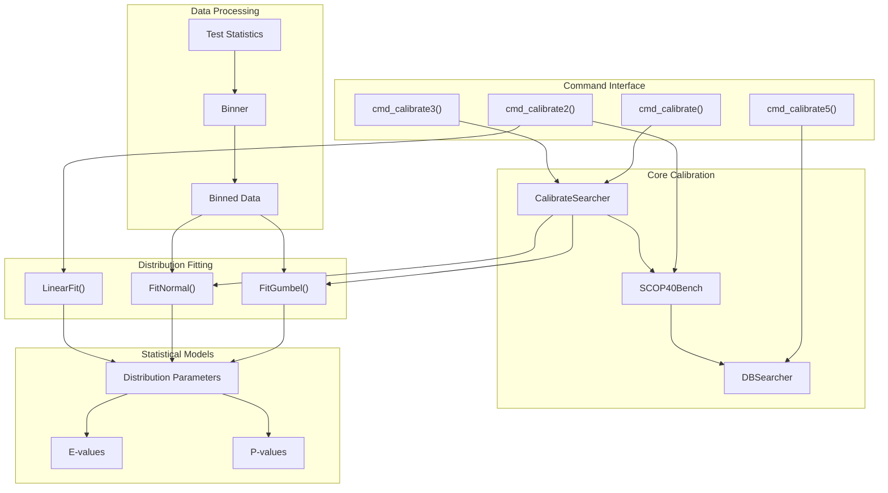
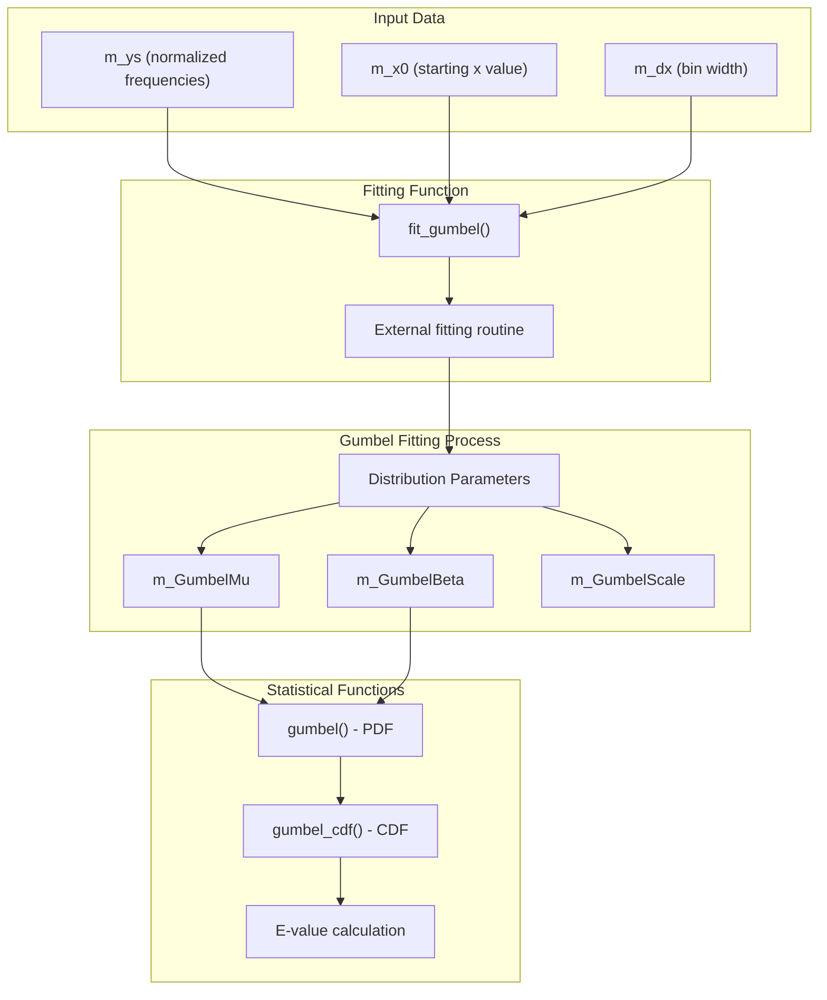

# Statistical Calibration

<details>
<summary>Relevant source files</summary>

The following files were used as context for generating this wiki page:

- [src/calibrate.cpp](src/calibrate.cpp)
- [src/calibrate2.cpp](src/calibrate2.cpp)
- [src/calibrate3.cpp](src/calibrate3.cpp)
- [src/calibrate5.cpp](src/calibrate5.cpp)
- [src/calibratesearcher.cpp](src/calibratesearcher.cpp)
- [src/calibratesearcher.h](src/calibratesearcher.h)

</details>


## Purpose and Scope

The Statistical Calibration system provides methods for calibrating statistical models used in protein structure search scoring. This module fits empirical distributions of test statistics to theoretical distributions (Gumbel and Normal) to enable accurate calculation of E-values and P-values for search results. The calibration is essential for determining the statistical significance of structural alignments and controlling false positive rates in database searches.

For information about the broader benchmarking framework that uses these calibrated statistics, see [SCOP40 Benchmarking](#7.1). For details about the core alignment scoring system that generates the test statistics being calibrated, see [Core Alignment Engine](#3).

## Calibration System Architecture

The calibration system is built around the `CalibrateSearcher` class and provides multiple calibration approaches for different use cases:



**Sources:** [src/calibratesearcher.h:1-61](), [src/calibrate.cpp:1-46](), [src/calibrate2.cpp:1-143](), [src/calibrate3.cpp:1-361](), [src/calibrate5.cpp:1-110]()

## Core Calibration Workflow

The calibration process follows a systematic workflow for collecting test statistics, binning them, and fitting distributions:

```mermaid
graph LR
    subgraph "Data Collection"
        QUERY["Query Structures"]
        DB["Database Structures"]
        ALN["DSSAligner"]
    end
    
    subgraph "Test Statistic Collection"
        ONALN["OnAln()"]
        TSVEC["m_TestStatsVec"]
        HITIDX["m_HitChainIdxs"]
    end
    
    subgraph "Preprocessing"
        SCANALL["ScanAll()"]
        OUTLIERS["Remove Outliers"]
        ALLTS["m_AllTSs"]
    end
    
    subgraph "Binning Process"
        SETBINS["SetAllBins()"]
        BINNER["m_ptrAllBinner"]
        BINS["m_AllBins"]
    end
    
    subgraph "Distribution Fitting"
        SETXY["Setxys()"]
        FITDIST["FitGumbel() / FitNormal()"]
        PARAMS["Distribution Parameters"]
    end
    
    subgraph "Output Generation"
        WRITEBINS["WriteBins()"]
        RESULTS["Calibration Results"]
    end
    
    QUERY --> ALN
    DB --> ALN
    ALN --> ONALN
    ONALN --> TSVEC
    ONALN --> HITIDX
    
    TSVEC --> SCANALL
    SCANALL --> OUTLIERS
    OUTLIERS --> ALLTS
    
    ALLTS --> SETBINS
    SETBINS --> BINNER
    BINNER --> BINS
    
    BINS --> SETXY
    SETXY --> FITDIST
    FITDIST --> PARAMS
    
    PARAMS --> WRITEBINS
    WRITEBINS --> RESULTS
```



**Sources:** [src/calibratesearcher.cpp:32-56](), [src/calibratesearcher.cpp:175-199](), [src/calibratesearcher.cpp:104-130](), [src/calibratesearcher.cpp:71-102]()

## Calibration Approaches

The system provides four distinct calibration approaches, each suited for different scenarios:

### Standard Calibration (`cmd_calibrate`)

The standard calibration approach performs all-vs-all comparison within a database and fits a Gumbel distribution to false positive scores:

| Feature | Description |
|---------|-------------|
| **Input** | Single database file (used as both query and database) |
| **Method** | Gumbel distribution fitting |
| **Output** | Binned distribution with fitted parameters |
| **Use Case** | General-purpose calibration for E-value calculation |

### Linear Calibration (`cmd_calibrate2`)

This approach uses linear regression to fit test statistics to negative log P-values:

| Feature | Description |
|---------|-------------|
| **Input** | SCOP40 database |
| **Method** | Linear fit: `y = mx + b` where `y = -log(P)` |
| **Parameters** | Superfamily: m=20.5, b=2.89; Fold: m=26.6, b=2.42 |
| **Range** | NFP between NQ/100 and NQ*100 |

### Per-Chain Calibration (`cmd_calibrate3`)

The most sophisticated approach that generates training data for machine learning models:

| Feature | Description |
|---------|-------------|
| **Bins** | 16 bins for test statistics (0.0 to 1.0) |
| **Features** | Per-chain test statistic histograms |
| **Sampling** | Balanced TP/FP sampling with noise injection |
| **Output** | Training data with features and labels |

### Query-Specific Calibration (`cmd_calibrate5`)

Collects test statistics and dynamic programming scores for each query structure:

| Feature | Description |
|---------|-------------|
| **Mode** | Very sensitive search mode |
| **Tracking** | Both test statistics and DP scores |
| **Output** | Per-query score distributions |

**Sources:** [src/calibrate.cpp:12-45](), [src/calibrate2.cpp:54-142](), [src/calibrate3.cpp:242-360](), [src/calibrate5.cpp:89-109]()

## Distribution Fitting Methods

The calibration system supports two primary distribution types for modeling test statistics:

### Gumbel Distribution

The Gumbel distribution is the primary model for fitting false positive score distributions:



### Normal Distribution

The Normal distribution provides an alternative model for certain calibration scenarios:

| Parameter | Description | Calculation |
|-----------|-------------|-------------|
| **Mean** | `m_NormalMean` | Weighted average: `Σ(x*y) / Σ(y)` |
| **Sigma** | `m_NormalSigma` | Standard deviation: `√(Σ(y*(x-μ)²))` |

**Sources:** [src/calibratesearcher.cpp:132-142](), [src/calibratesearcher.cpp:144-173](), [src/calibratesearcher.cpp:8-16]()

## Binning and Data Processing

The calibration system uses sophisticated binning strategies to handle test statistic distributions:

### Binning Configuration

| Parameter | Value | Purpose |
|-----------|-------|---------|
| **NBINS** | 101 | Number of bins for distribution fitting |
| **NOUTLIERS** | 3 | Number of outliers to discard per chain |
| **BIN_COUNT** | 16 | Bins for per-chain calibration |

### Data Transformation

Test statistics undergo logarithmic transformation for better distribution fitting:

```cpp
// Transform: TS -> -log(TS)
float logTs = -logf(TS);
```

### Outlier Handling

The system automatically removes outliers to improve distribution fitting:

- Discards top 3 scores per chain (`NOUTLIERS = 3`)
- Trims low-frequency bins near x=0 during curve fitting
- Normalizes bin frequencies to create proper probability distributions

**Sources:** [src/calibratesearcher.cpp:104-130](), [src/calibratesearcher.cpp:175-199](), [src/calibratesearcher.h:59-61]()

## Command-Line Interface

Each calibration command provides specific options and outputs:

### Common Parameters

| Parameter | Description | Default |
|-----------|-------------|---------|
| `--sensitive` | Use sensitive search mode | Automatically set |
| `--minchainlength` | Minimum chain length | 1 |
| `--evalue` | E-value threshold | 10 |

### Output Options

| Option | Purpose | Format |
|--------|---------|---------|
| `--calib_output` | Main calibration output | Binned distributions |
| `--calib_output2` | TP/FP bin counts | Per-domain statistics |
| `--calib_output3` | ML training data | Feature vectors with labels |
| `--calib_output5a` | Test statistics per query | Tab-separated values |
| `--calib_output5b` | DP scores per query | Tab-separated values |

### Usage Examples

```bash
# Standard calibration
reseek -calibrate database.cal -calib_output results.tsv

# Linear calibration with SCOP40
reseek -calibrate2 scop40.cal -benchlevel sf -output linear_fit.tsv

# Per-chain calibration for ML training
reseek -calibrate3 database.cal -calib_output bins.tsv -calib_output2 tpfp.tsv -calib_output3 features.tsv

# Query-specific calibration
reseek -calibrate5 query.fasta -db database.cal -calib_output5a ts_scores.tsv -calib_output5b dp_scores.tsv
```

**Sources:** [src/calibrate.cpp:12-45](), [src/calibrate2.cpp:54-142](), [src/calibrate3.cpp:242-360](), [src/calibrate5.cpp:89-109]()

---