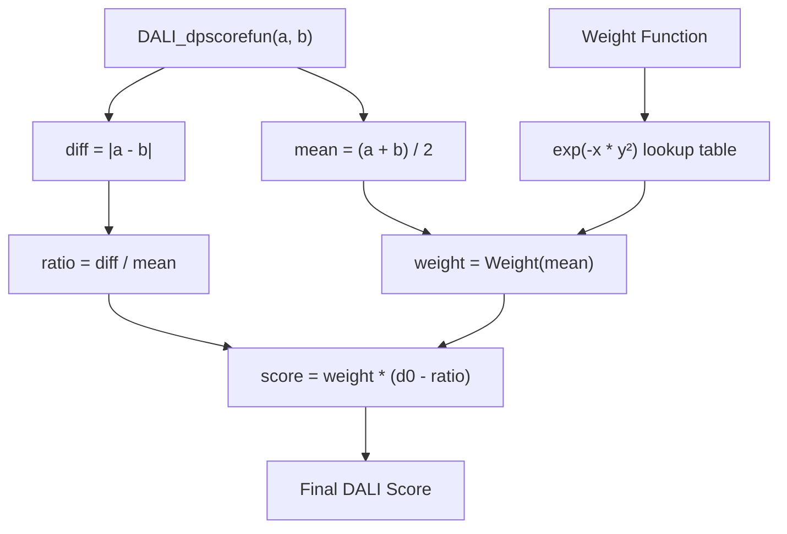
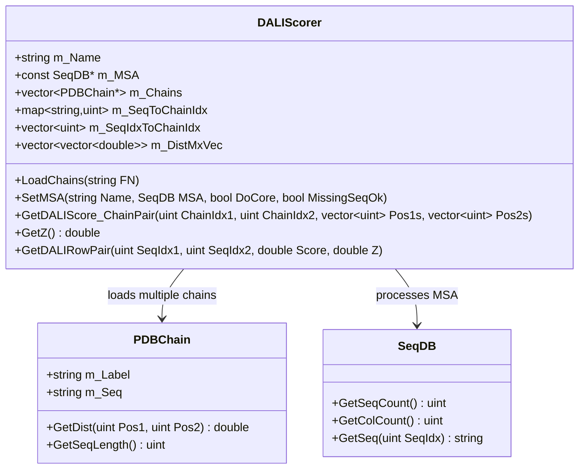
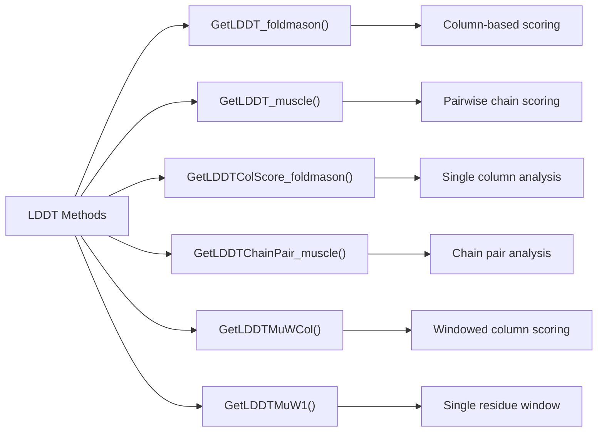
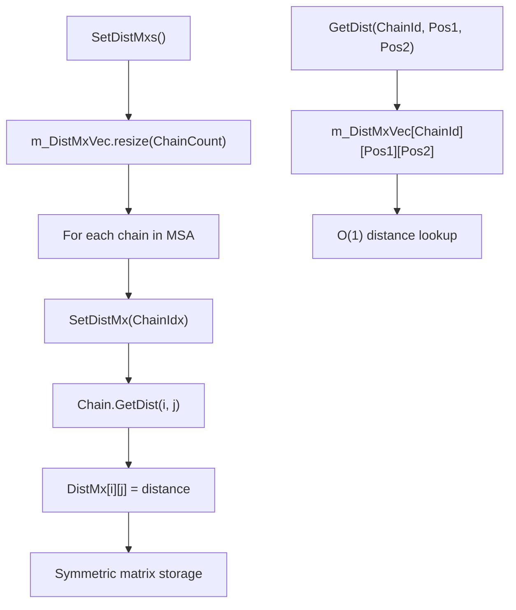
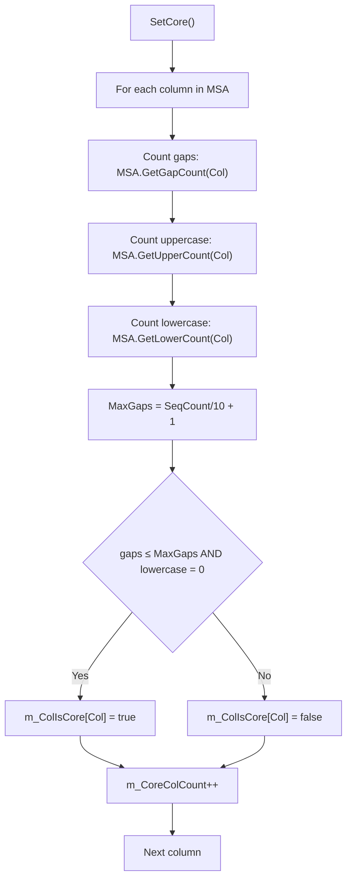

# Specialized Scoring Methods

<details>
<summary>Relevant source files</summary>

The following files were used as context for generating this wiki page:

- [src/dali.cpp](src/dali.cpp)
- [src/daliscore_msa.cpp](src/daliscore_msa.cpp)
- [src/daliscore_tsv.cpp](src/daliscore_tsv.cpp)
- [src/daliscorer.cpp](src/daliscorer.cpp)
- [src/daliscorer.h](src/daliscorer.h)

</details>


This page documents the specialized scoring algorithms implemented in reseek for evaluating protein structure alignments and multiple sequence alignments. These methods complement the core alignment engine by providing standardized metrics for structural similarity assessment.

For general alignment scoring and configuration, see [Parameter Configuration](#3.2). For benchmarking and performance evaluation workflows, see [SCOP40 Benchmarking](#7.1) and [Statistical Calibration](#7.2).

## DALI Scoring System

The DALI (Distance Alignment) scoring system is the primary specialized scoring method implemented in reseek. It evaluates structural similarity by comparing intramolecular distance matrices between aligned protein structures.

### Core Algorithm

The DALI scoring algorithm is implemented through the `DALI_dpscorefun` function, which computes similarity scores based on distance differences between corresponding residue pairs:



The algorithm uses configurable parameters:
- `g_DALI_D = 20.0` - envelope radius for weight calculation
- `g_DALI_d0 = 0.2` - base distance threshold  
- `g_DALI_Theta = 0.2` - diagonal contribution weight

Sources: [src/dali.cpp:93-110](), [src/dali.cpp:23-40]()

### DALIScorer Class Architecture

The `DALIScorer` class provides the primary interface for DALI scoring operations:



Sources: [src/daliscorer.h:10-99](), [src/daliscorer.cpp:75-98]()

### MSA Processing Workflow

The DALI scoring system processes multiple sequence alignments through a structured workflow:

```mermaid
flowchart TD
    A["`cmd_daliscore_msa()`"] --> B["`SeqDB.FromFasta()`"]
    B --> C["`DALIScorer.LoadChains()`"]
    C --> D["`DALIScorer.SetMSA()`"]
    D --> E["`SetSeqIdxToChainIdx()`"]
    E --> F["`SetCore()` if core mode"]
    F --> G["`SetColToPosVec()`"]
    G --> H["`SetDistMxs()`"]
    H --> I["`Calculate pairwise scores`"]
    I --> J["`GetDALIRowPair()` for each pair"]
    J --> K["`Output results`"]
    
    L["`GetAlignedPositions()`"] --> M["`Extract aligned residue positions`"]
    M --> N["`GetDALIScore_ChainPair()`"]
    N --> O["`GetDALIZFromScoreAndLengths()`"]
    
    J --> L
    O --> K
```

The workflow supports both full alignment and core-only modes, where core positions are defined as columns with minimal gaps and consistent case.

Sources: [src/daliscore_msa.cpp:6-54](), [src/daliscorer.cpp:164-185]()

## LDDT Scoring Methods

Local Distance Difference Test (LDDT) provides an alternative structural similarity metric focusing on local distance preservation within defined radius thresholds.

### LDDT Configuration

The `DALIScorer` class includes LDDT-specific parameters:

| Parameter | Default Value | Purpose |
|-----------|---------------|---------|
| `m_LDDT_R0` | 15.0 | Reference radius for local environment |
| `m_LDDT_thresholds` | [0.5, 1.0, 2.0, 4.0] | Distance difference thresholds |
| `m_LDDT_symm` | `SYMM_First` | Symmetry handling mode |

### LDDT Implementation Methods

The class provides multiple LDDT calculation approaches:



Sources: [src/daliscorer.h:87-98]()

## Implementation Architecture

### Distance Matrix Management

The scoring system maintains precomputed distance matrices for efficient score calculation:



This approach trades memory for computation speed by precomputing all pairwise distances within each protein chain.

Sources: [src/daliscorer.cpp:518-534](), [src/daliscorer.cpp:481-491]()

### Core Position Detection

The system implements core position detection for focused scoring on well-aligned regions:



Sources: [src/daliscorer.cpp:112-132]()

## Command-Line Interface

### daliscore_msa Command

The `cmd_daliscore_msa` command provides MSA-based DALI scoring:

```bash
reseek -daliscore_msa input.fasta -input chains.pdb -output results.tsv
```

Key options:
- `-core` - Use core positions only
- `-missingtestseqok` - Allow missing sequences in chain database

Output format includes pairwise scores and Z-values for all sequence pairs in the MSA.

### daliscore_tsv Command

The `cmd_daliscore_tsv` command processes existing TSV alignment files:

```bash
reseek -daliscore_tsv alignment.tsv -input chains.pdb -output validated.tsv
```

This command validates and recalculates DALI scores from alignment data, useful for benchmarking and validation workflows.

Sources: [src/daliscore_msa.cpp:6-54](), [src/daliscore_tsv.cpp:28-93]()

### Statistical Output

Both commands generate statistical summaries including:
- Individual pairwise DALI scores
- Z-scores based on sequence length normalization
- Average Z-score across all pairs
- Core vs. full alignment comparisons

The Z-score calculation uses the formula: `Z = (Score - mean) / sigma` where mean and sigma are functions of sequence lengths as implemented in `GetDALIZFromScoreAndLengths`.

Sources: [src/daliscorer.cpp:19-29](), [src/daliscorer.cpp:228-281]()

---